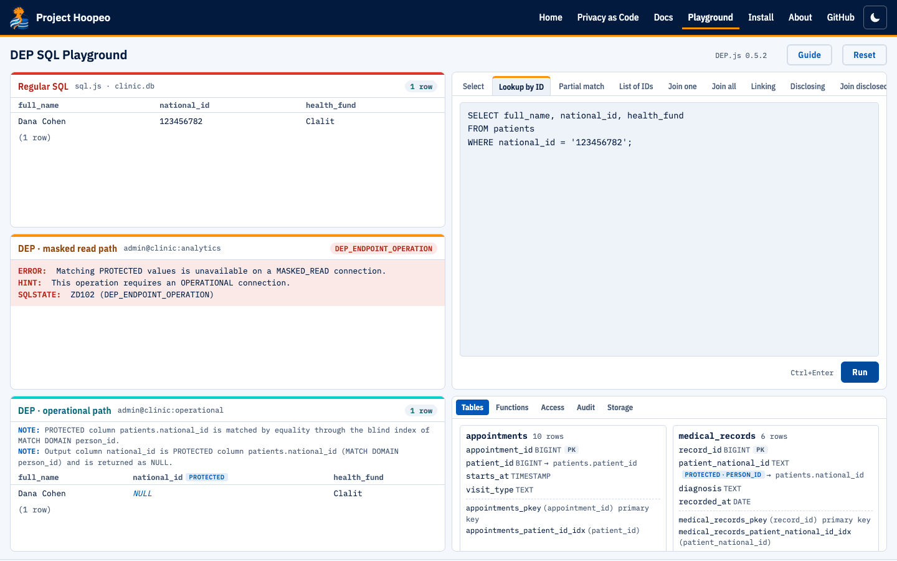

<p align="center"></p>

# Project Hoopeo

Project Hoopeo implements **Database-Enforced Privacy (DEP)**: privacy rules that the database engine itself enforces, in every query, for every client. A protected column is stored as a blind index and a ciphertext, can be matched only by full-value equality, comes back as NULL, and is released in plaintext only by a function declared for that purpose. Joining whole datasets on protected values (linking) is allowed only in functions declared for it, and every connection's access path is fixed by its endpoint.

This repository holds the open layers of the project: the specification, the documentation, DEP.js and the playground, the examples, the website, and the installers, which are published as [GitHub Releases](https://github.com/mandelreouven2002/project-hoopeo.github.io/releases).

<p align="center"><a href="https://mandelreouven2002.github.io/project-hoopeo.github.io/playground/"></a></p>

- **Website:** <https://mandelreouven2002.github.io/project-hoopeo.github.io/>
- **Playground:** [try DEP in your browser](https://mandelreouven2002.github.io/project-hoopeo.github.io/playground/), with nothing to install
- **Install:** the [latest release](https://github.com/mandelreouven2002/project-hoopeo.github.io/releases/latest), and the [Install page](https://mandelreouven2002.github.io/project-hoopeo.github.io/install/)
- **Docs:** the [guides and reference](https://mandelreouven2002.github.io/project-hoopeo.github.io/docs/), also in [`docs/`](docs/)
- **Privacy as Code:** [DEP and privacy as code](https://mandelreouven2002.github.io/project-hoopeo.github.io/privacy-as-code/)

## Products

| Product | What it is | Licence |
|---|---|---|
|  **DEP Engine** | The database server: Rust, Apache DataFusion, disk-based storage with indexes (redb), constraints, transactions with savepoints and transactional schema changes, roles and privileges, an audit log and match limits, the PostgreSQL wire protocol (simple and extended), an HTTP API, TLS | Binaries under the Evaluation License; source private |
|  **DEP CLI** | `dep-cli`, the command-line tool, with DEP Engine built in | Binaries under the Evaluation License; source private |
|  **Hoopeo Studio** | The developer application, in the spirit of PL/SQL Developer, with DEP Engine built in | Binaries under the Evaluation License; source private |
|  **DEP.js** | The DEP SQL Playground: a browser simulator of DEP Engine 0.5, on sql.js | Apache 2.0 |
| **Specification** | The design proposal and the roadmap | CC BY 4.0 |

The binaries are free for evaluation, research, teaching and non-production testing, with invented data. Production and commercial use needs a commercial licence. See [Licensing](#licensing).

## A short example

Reception finds a patient by the ID number she presents. The ID number is matched through the blind index, and it comes back as NULL:

```
reception_app@operational=> SELECT full_name, national_id FROM patients WHERE national_id = '123456782';
DEP:  PROTECTED column patients.national_id is matched by equality through the blind index of MATCH DOMAIN person_id.
DEP:  Output column national_id is PROTECTED column patients.national_id (MATCH DOMAIN person_id) and is returned as NULL.
 full_name  | national_id
------------+-------------
 Dana Cohen | NULL
(1 row)
```

Plain SQL gets no notes. A DEP rule gets a note, and a violation gets an error with a `ZDnnn` SQLSTATE and a hint. Over the PostgreSQL protocol the notes are `NOTICE` messages, so `psql` shows them as `NOTICE:  DEP: ...`. The [getting started guide](docs/guides/getting-started.md) runs this against a server.

## Contents of this repository

```
docs/
  design/       the design proposal, the roadmap and the diagrams
  guides/       getting started, concepts, DEP SQL, transactions, administration, applications
  reference/    errors, notes, SHOW commands, server options, HTTP API, DEP CLI
examples/       the demo clinic (clinic.sql) and the guided tour
playground/     DEP.js: the DEP SQL Playground, its tests and the compatibility test
site/           the source of the website
branding/       logos and icons (see BRAND.md)
LICENSES/       the licence texts
```

The source of DEP Engine, DEP CLI and Hoopeo Studio is in a private repository. Their installers are in the [Releases](https://github.com/mandelreouven2002/project-hoopeo.github.io/releases).

## Licensing

Each layer has its own licence; see [LICENSING.md](LICENSING.md) and [NOTICE](NOTICE).

| Layer | Licence |
|---|---|
| Specification, documentation | CC BY 4.0 |
| DEP.js and the playground, the examples | Apache License 2.0 |
| DEP Engine, DEP CLI, Hoopeo Studio (binaries) | Project Hoopeo Evaluation License: evaluation, research, teaching and non-production testing |
| Production and commercial use | A commercial licence, on request |

The names and logos are covered by [BRAND.md](BRAND.md). Third-party libraries keep their own licences: see [THIRD-PARTY.md](THIRD-PARTY.md).

---

Project Hoopeo is experimental software. It is an experimental concept, not a production database, and it should not be used with real personal data. By Reuven Mandelovich, [lp.reuven.click](https://lp.reuven.click).
