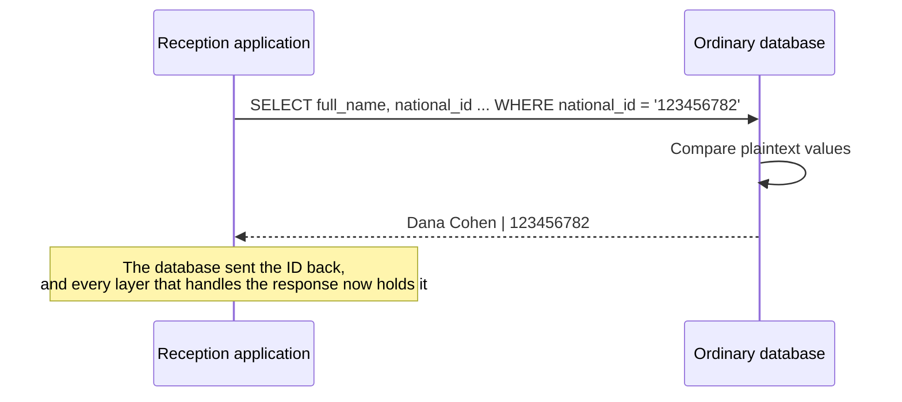
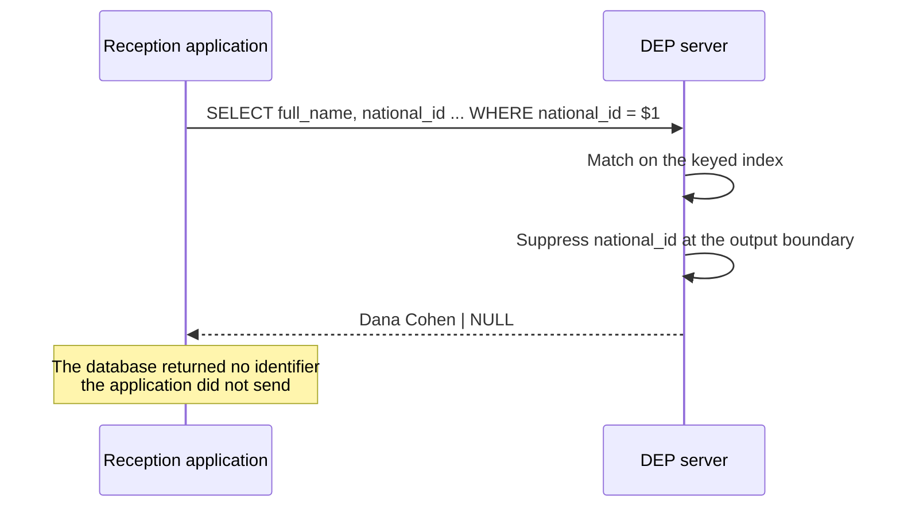
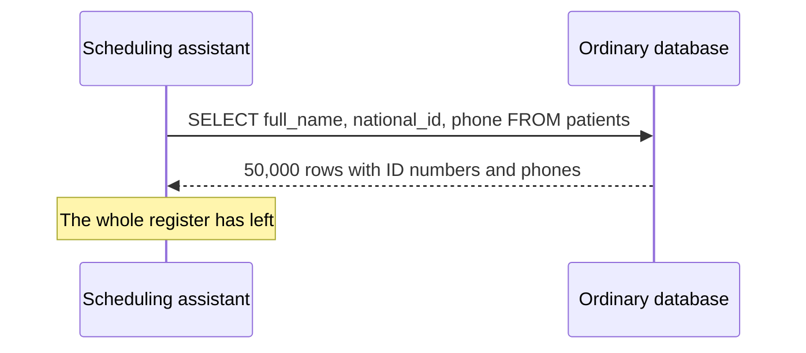
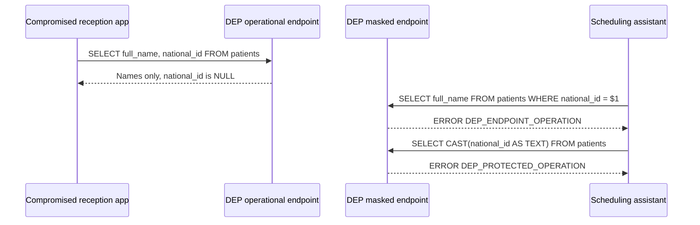
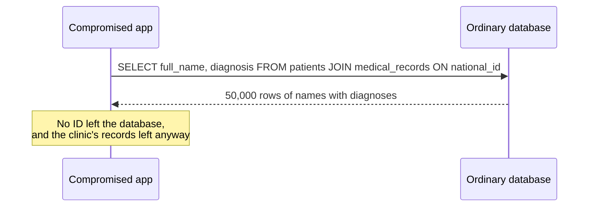
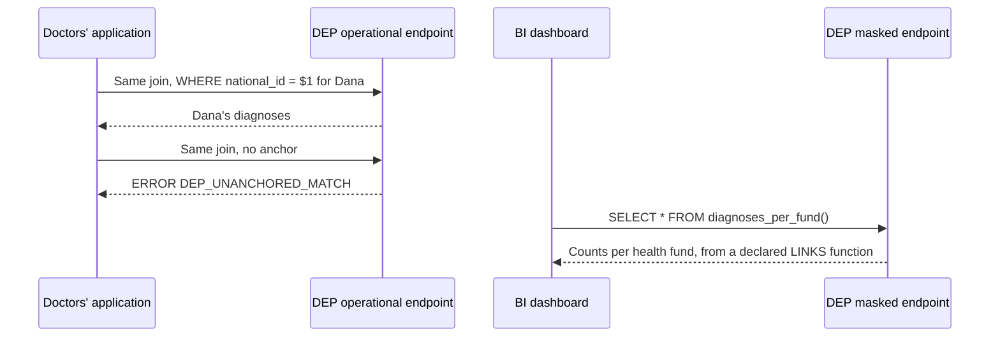
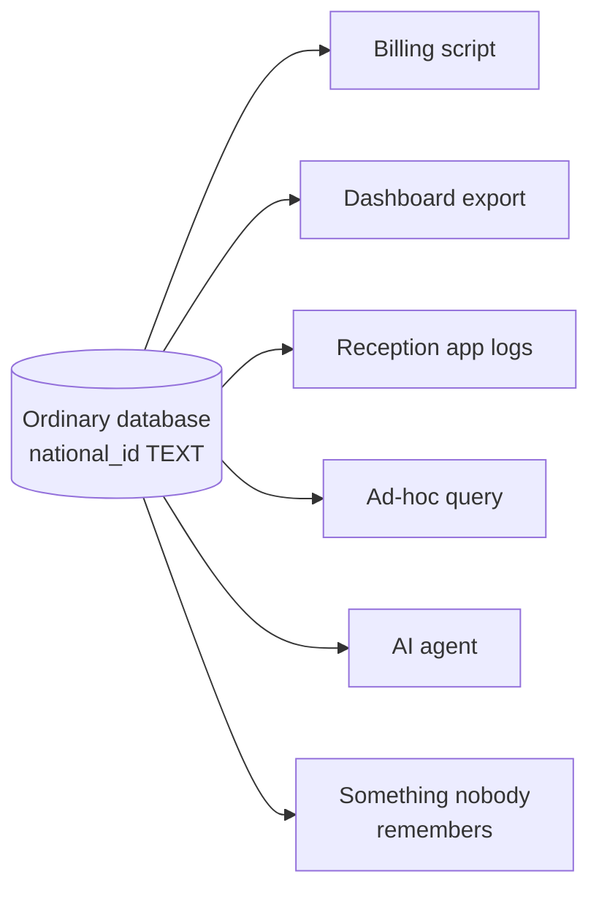
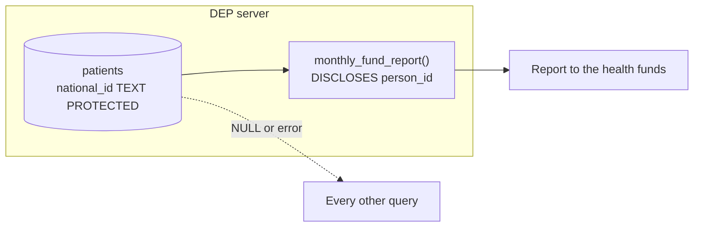

# Understand DEP

DEP separates the ability to use an identifier from the ability to read it. Start with the clinic below, then follow the chapters from SQL to a working application. Basic SELECT, INSERT and JOIN knowledge is enough.

## Summary

**What is DEP?** DEP (Database-Enforced Privacy) is a database-enforced privacy model, implemented by the experimental DEP Engine in which privacy protection is part of the type system, the query semantics, and the execution engine, rather than a layer added on top of the data.

**What is the core idea?** A column declared `PROTECTED` can be used by the database to find a record, update it, and connect it to related records, but its value is never returned by an ordinary query.

**The principle.**

> **The ability to use a value for an operation does not require the ability to read it.**

**The promise.**

> **Protected values remain inside the database unless released through an explicitly declared disclosure.**

**The four decisions.** DEP separates four decisions that most databases fold into a single privilege:

| Decision | What it means | In DEP |
| --- | --- | --- |
| **Matching** | Using a protected value to find, update, or connect the records of one value | Authorized equality lookups on the operational path; protected joins need a single-value anchor |
| **Linking** | Connecting whole datasets through a protected value | Allowed only inside a function declared `LINKS` |
| **Returning** | Sending a protected value back to a client | Never done by an ordinary query; the value comes back as `NULL` |
| **Disclosing** | Releasing a protected value deliberately | Allowed only inside a function declared `DISCLOSES`, the only place where `REVEAL` is legal |

**In the clinic.** A patient's ID number lets reception find her and lets her doctor see her diagnoses, yet neither application ever receives an ID number back from the database. The clinic's dashboard and its AI scheduling assistant connect through the masked read path, where an ID number cannot even be used to search.

**Why it matters for privacy.** Every route by which a protected value can leave the database, and every place where whole datasets are linked through one, is an object in the schema: visible to code review and queryable from the catalog. That turns privacy by design from a policy into something the database enforces on every query ([Privacy as Code, privacy by design, and the GDPR](07-privacy.md#3-privacy-as-code-privacy-by-design-and-the-gdpr)).

**The limits.** Permitted matching can still reveal that a record exists and associate it with the data that is returned. Names and other ordinary fields can identify people, aggregates are not automatically anonymous, and the server itself is trusted. [Chapter 8](08-internals.md#18-guarantees-and-limits) states the guarantees and limits precisely.

---


## Working with the examples {#reading-order}

The [playground](../../playground/) and [clinic.sql](../../examples/clinic.sql) contain six sample patients. The larger clinic described below illustrates the scale of the problem. Example tables show selected rows; the playground shifts dates to today. For a local setup, use [Run the full clinic](05-application.md#run-the-full-clinic). The [server chapter](06-server.md#compatibility) records implementation limits and version differences.

## Project components {#project-components}

| Name | Role |
|---|---|
| DEP | The Database-Enforced Privacy model |
| DEP SQL | SQL constructs that express protection, permitted use and declared exceptions |
| DEP Engine | The separate database server that enforces the implemented rules |
| DEP CLI and Hoopeo Studio | The SQL shell and graphical client; both can also run an embedded Engine |
| DEP.js | The browser simulator behind the playground |
| Project Hoopeo | The project containing these components |

## The problem {#1-the-problem}

**In one sentence:** in most databases, the permission to *use* a value in a query and the permission to *read* that value are the same permission.

### The clinic {#11-the-clinic}

**What is the clinic?** It is the single example this whole document follows: a small clinic with about 50,000 patients. Its database holds three kinds of information: who the patients are, when they have appointments, and what they have been diagnosed with.

Before DEP, the schema is ordinary SQL:

```sql
CREATE TABLE patients (
    patient_id  BIGINT PRIMARY KEY,
    national_id TEXT UNIQUE,
    phone       TEXT,
    full_name   TEXT,
    health_fund TEXT
);

CREATE TABLE appointments (
    appointment_id BIGINT PRIMARY KEY,
    patient_id     BIGINT REFERENCES patients (patient_id),
    starts_at      TIMESTAMPTZ,
    visit_type     TEXT
);

CREATE TABLE medical_records (
    record_id           BIGINT PRIMARY KEY,
    patient_national_id TEXT REFERENCES patients (national_id),
    diagnosis           TEXT,
    recorded_at         DATE
);
```

A few of its rows:

| patient_id | national_id | phone | full_name | health_fund |
| --- | --- | --- | --- | --- |
| 1 | 123456782 | +972-50-0000001 | Dana Cohen | Clalit |
| 2 | 234567893 | +972-50-0000002 | Yossi Levi | Maccabi |

**Who uses it?** Six programs connect to this database. Each has its own database role, and each needs something different:

| Consumer | Role | What it needs to do |
| --- | --- | --- |
| Reception application | `reception_app` | Find a patient by the ID number they present, and show today's appointments |
| Doctors' application | `doctors_app` | Find the patient in the room, and show their diagnoses |
| Nightly reminder job | `reminder_job` | Send an SMS to every patient with an appointment tomorrow |
| Billing job | `billing_job` | Report visits and diagnosis claims to the patients' health funds |
| BI dashboard | `bi_dashboard` | Show visits per day and type, and diagnoses per health fund |
| Scheduling assistant | `scheduling_agent` | An AI agent that suggests scheduling improvements from appointment patterns |

Dana Cohen, the first patient, appears throughout: she arrives at reception, sees a doctor, receives a reminder, and appears in the report to her health fund.

### Using a value and reading it {#12-using-a-value-and-reading-it}

**What is the difference?** Two words carry the whole argument of this document:

- **Using a value** means letting the database apply it in an operation: comparing it in a `WHERE` clause, joining two tables through it, or checking it against a constraint. The value decides *which rows* the database works with.
- **Reading a value** means receiving the value itself: seeing it in a query result, an error message, a log, or an export.

**Example.** Dana presents her ID card at reception.

- Reception needs to **use** her ID number, because that is how it finds her record.
- Reception never needs to **read** it back from the database: Dana just handed it over.

**Key point:** most of what applications do with sensitive identifiers is *using* them. Very little of it requires *reading* them.

### What goes wrong in an ordinary database {#13-what-goes-wrong-in-an-ordinary-database}

**Why is this a problem?** In PostgreSQL, referencing a column in a `WHERE` clause requires `SELECT` privilege on that column, and the same privilege lets the column be returned in a result. Column privilege works as a single switch: a role may touch the value for any purpose, or not at all. Three failures follow from that.

**Failure 1: wholesale extraction.** The clinic has just connected an AI agent directly to the database. The agent writes its own SQL, and it knows nothing about the privacy policy encoded in other applications. Asked for help, it runs:

```sql
SELECT full_name, national_id, phone FROM patients;
```

**Output**

```text
 full_name   | national_id | phone
-------------+-------------+-----------------
 Dana Cohen  | 123456782   | +972-50-0000001
 Yossi Levi  | 234567893   | +972-50-0000002
 ... 49,998 more rows
```

**Explanation:** no one broke in, and every permission worked exactly as configured. Because the agent may search by ID number, it may also read every ID number. The entire register left the database in one query.

**Failure 2: invisible linking.** A query can produce the most sensitive dataset without returning any identifier:

```sql
SELECT p.full_name, m.diagnosis
FROM patients AS p
JOIN medical_records AS m ON m.patient_national_id = p.national_id;
```

**Output**

```text
 full_name  | diagnosis
------------+------------------
 Dana Cohen | Asthma
 Dana Cohen | Seasonal allergy
 Yossi Levi | Diabetes
 ...
```

**Explanation:** no ID number appears in the result, so hiding ID numbers would not help. Yet the query produced the name and diagnosis of every patient. Nothing in an ordinary database marks this join as different from looking up a single appointment.

**Failure 3: unknown exits.** Ask the clinic: "which code paths can export our patients' ID numbers?" Answering means interviewing teams and reading code, because any role with `SELECT` on the column is a possible exit. Regulators increasingly expect organizations to answer that question on demand.

### Why existing controls are not enough {#14-why-existing-controls-are-not-enough}

**What do databases offer today?** Several controls, each addressing part of the problem:

| Control | What it does | What it leaves open |
| --- | --- | --- |
| Views | Hide columns or rows | A view that lets callers search by a column generally has to expose it, or something derived from it |
| Row-level security | Restricts which rows a role sees | Does not distinguish using a value from reading it |
| Dynamic masking and projection policies | Change what a query returns | The column can still be used in predicates and joins to single out one person or link two datasets, as the vendors' documentation acknowledges |
| Application-side encryption | Protects stored data | The application holds the keys, so anything running with its credentials can decrypt |
| Privacy as Code tools | Check policy in code review and CI | Do not see the query an agent composes at run time |

**Explanation:** none of these separates *using* from *reading*. So in practice privacy lives in the applications: developers must remember not to write `SELECT *`, to strip columns before exports, and to scrub logs. Every new consumer, whether a report, an integration, or an AI agent, starts with none of those safeguards. [Chapter 7](07-privacy.md#3-privacy-as-code-privacy-by-design-and-the-gdpr) looks at Privacy as Code more closely, and [Roadmap and Release](../design/02-roadmap-and-release.md#appendix-b-how-dep-relates-to-existing-approaches) compares DEP with existing products and research in detail.

**Key points**

- One privilege decides both using and reading a column.
- That allows wholesale extraction, invisible linking, and exits nobody can list.
- Existing controls each solve part of the problem, outside the place every query passes through.

---

## The idea {#2-the-idea}

**In one sentence:** separate the four things a client may do with a sensitive value (match, link, return, disclose), allow the everyday one freely, and require the other three to be declared in the schema.

### The principle {#21-the-principle}

**What is the principle?**

> **The ability to use a value for an operation does not require the ability to read it.**

**Where does it come from?** From passwords. A well-built login system verifies that a password is correct without storing it in readable form, and without ever showing it back to anyone. Verification is an operation; the password itself is never output.

**What does DEP add?** Two things:

1. **Connecting records.** Protected values can connect records across tables, not only verify a single input.
2. **Enforcement by the server.** The rules are enforced inside the database server, across the whole execution of every query, not by a helper function a developer must remember to call.

### The change in the schema {#22-the-change-in-the-schema}

**What changes?** One qualifier on one column:

```sql
national_id TEXT PROTECTED MATCH DOMAIN person_id UNIQUE,
```

**Explanation:**

- `TEXT` stays: `PROTECTED` is a qualifier added to an existing type, not a new type. The column is still text.
- `PROTECTED` defines what the engine may do with the value: use it for matching, never return it in an ordinary query.
- `MATCH DOMAIN person_id` says what kind of value this is, so it can be compared only with values of the same kind.

The full syntax is in [Declaring a protected column](02-sql.md#71-declaring-a-protected-column).

<figure markdown="1">

<picture><source media="(prefers-color-scheme: dark)" srcset="../images/diagrams/dep-sql-adds-dark.png"></picture>

<figcaption>The schema, connection path and declared exceptions are three separate parts of DEP.</figcaption>
</figure>

### Four decisions instead of one {#23-four-decisions-instead-of-one}

**What are the four decisions?** With direct SELECT access to the underlying column, an application can use or return Dana's ID. DEP makes these value-use decisions explicit in the schema and query rules:

| Decision | What it means | In the clinic | Ordinary SQL: direct SELECT | In DEP |
| --- | --- | --- | --- | --- |
| **Match** | Use a protected value to find, update, or connect the records of one value | Reception finds Dana by the ID she presents | Allowed with `SELECT` | Authorized equality lookups on the operational path; protected joins need a single-value anchor |
| **Link** | Connect whole datasets through a protected value | Diagnosis statistics per health fund | Allowed with `SELECT` | Allowed only inside a function declared **`LINKS`** |
| **Return** | Send a protected value back to a client | Nothing in the clinic needs this | Allowed with `SELECT` | **Never** in an ordinary query; the value comes back as `NULL` |
| **Disclose** | Release a protected value deliberately | The monthly report to the health funds | Allowed with `SELECT` | Allowed only inside a function declared **`DISCLOSES`** |

**Why does the split fall there?** Matching is the everyday work of an operational system: a receptionist finds the patient in front of her. DEP allows it and records it. The other three are where privacy is actually lost, at scale or by releasing the value itself, so DEP requires each of them to be declared in the schema, where it can be reviewed.

### What this protects, and what it does not {#24-what-this-protects-and-what-it-does-not}

**What does DEP not prevent?** When reception looks Dana up, it already holds her ID number, and DEP does not hide it from reception. The lookup also tells reception something: that Dana is a patient, and whatever ordinary fields come back with her record. A receptionist who types a stranger's ID number learns whether that person is a patient.

**What does DEP prevent?** Wholesale extraction and unreviewed processing. The AI agent cannot run `SELECT national_id FROM patients` and walk away with the register, and a compromised reception application cannot join every patient to every diagnosis.

> **Ordinary queries never return protected plaintext. Permitted matching can still reveal record existence and associations with returned data.**

**Explanation:** releasing protected identifiers or linking protected datasets becomes an explicit, reviewable operation. Ordinary fields can still be returned according to their grants; they are not automatically anonymous.

### Ordinary SQL and DEP, side by side {#25-ordinary-sql-and-dep-side-by-side}

Four situations in the clinic, first in an ordinary database and then in DEP.

#### Situation 1: Dana arrives at reception

**Without DEP**, her ID number comes back with the answer:



**With DEP**, the ID number is used and stays inside:



**Explanation:** the query is the same. The difference is that DEP used the ID number to find Dana, and then sent `NULL` in place of the ID number.

#### Situation 2: The AI agent tries to take everything

**Without DEP**, one query is enough:



**With DEP**, nothing protected leaves, whether through the agent on the masked path or through a compromised application on the operational path:



**Explanation:** names still reach the compromised application, which is why ordinary permissions still matter. The identifiers, the values that link a person across systems, do not.

#### Situation 3: Linking patients to diagnoses

**Without DEP**, the query from [What goes wrong in an ordinary database](01-understand.md#13-what-goes-wrong-in-an-ordinary-database) is just another join:



**With DEP**, the same join is allowed for one patient at a time, and only declared code may link everyone:



**Explanation:** the doctor's join names one patient, so it is allowed. The same join for everyone is rejected. The dashboard still gets its statistics, from a function the clinic declared and reviewed.

#### Situation 4: Where ID numbers can leave the database

**Without DEP**, every role with `SELECT` on the column is a potential exit, and finding them all means reading code:



**With DEP**, the exits are declared functions, and the catalog lists them:



**Explanation:** the only way an ID number leaves is through `monthly_fund_report`, and anyone can find it in the catalog.

#### Summary of the four situations

| | Ordinary SQL | DEP |
| --- | --- | --- |
| Finding Dana by her ID number | The ID comes back with the answer | The ID is matched internally and never returned |
| Taking the whole register | One `SELECT` | ID numbers are `NULL`; matching on the masked path is rejected |
| Linking patients to diagnoses | One `JOIN` | One patient at a time; everyone only in declared `LINKS` functions |
| Where ID numbers can leave | Wherever someone has `SELECT` | Only through declared `DISCLOSES` functions, listed in the catalog |
| Who enforces the policy | Every client, separately | The server, for every client |

### Why it is a language feature {#26-why-it-is-a-language-feature}

**Why not just a permission?** Because a permission can be granted quietly, somewhere, by someone. DEP changes how developers write queries, in the way Rust changed how systems programmers write code. Rust is stricter than C, and the strictness is built into the language rather than left to discipline. Its exceptions are explicit: an `unsafe` block is allowed, but it is marked, local, and easy to find.

**How does DEP follow that pattern?** By default, protected values cannot be read, and datasets cannot be linked through them. When they must be, the exception is a language construct (a function declared `DISCLOSES` or `LINKS`), not a permission granted out of sight. The additional effort is intentional: it is what makes every exception reviewable.

### Why it is a server {#27-why-it-is-a-server}

**Why can't the rules run in the application?** Every guarantee depends on a trust boundary: the client sends SQL, and the enforcement, the keys, and the data live in a separate process the client does not control. A privacy rule checked inside the client's own process would be a simulation, not a protection, because whoever runs the process can bypass it. DEP is therefore always a **server**, and clients reach it only through the network protocol. [The trust boundary](08-internals.md#121-the-trust-boundary) explains the boundary in detail.

**Key points**

- The principle: using a value does not require reading it.
- Matching is allowed and recorded; linking, returning, and disclosing are declared or impossible.
- DEP does not hide what a client already knows; it stops wholesale extraction and unreviewed linkage.
- Exceptions are language constructs, enforced by a server the client cannot bypass.

---

## Core concepts {#4-core-concepts}

**In one sentence:** this chapter defines every DEP term once, in plain words, with an example from the clinic and a link to where it is explained in full.

### Values {#41-values}

**Protected field** (`PROTECTED`)
- *What is it?* A column whose value is never returned by an ordinary query, and on which only the operations DEP defines are allowed. In the first version, the only such operation is full-value equality.
- *In the clinic.* `patients.national_id`, `patients.phone`, and `medical_records.patient_national_id`.
- *Note.* A protected field is not necessarily a personal identifier: phone numbers, addresses, card numbers, or any other sensitive value can be protected.
- *See* [Declaring a protected column](02-sql.md#71-declaring-a-protected-column).

**Ordinary field**
- *What is it?* Any column that is not protected. It behaves exactly as in ordinary SQL, governed by ordinary permissions.
- *In the clinic.* `full_name`, `health_fund`, `diagnosis`, and the internal key `patient_id`.

**Match domain** (`MATCH DOMAIN`)
- *What is it?* A named group of protected fields that hold the same kind of value, and may therefore be compared with one another.
- *In the clinic.* `person_id` (national ID numbers) and `phone_number`.
- *See* [What a match domain decides](01-understand.md#46-what-a-match-domain-decides).

**Protected input**
- *What is it?* A value the client sends in a protected position: compared with a protected column, or inserted into one. It is either a **protected parameter** (sent separately, as `$1`) or a **protected literal** (written in the query, as `'123456782'`). The engine treats both the same way.
- *See* [Parameters and literals](02-sql.md#79-parameters-and-literals).

**Index entry**
- *What is it?* A keyed hash of a protected value, stored next to it and used for all matching. It lets the database compare values without looking at them. Ordinary SQL cannot reach it.
- *See* [Matching with a keyed index](08-internals.md#163-matching-with-a-keyed-index).

### Operations {#42-operations}

**Matching**
- *What is it?* Comparing protected values for equality, done by the engine on index entries, without making the values available to the rest of the query.

**Anchored matching**
- *What is it?* Matching tied to one value the client sent. A join between protected columns needs this anchor unless it runs inside a LINKS function. Simple equality lookups can also use IN lists; a list does not anchor a broader protected join.
- *Example.* Finding Dana by her ID number, or showing Dana's diagnoses.
- *See* [Joining on protected columns](02-sql.md#76-joining-on-protected-columns).

**Anchor**
- *What is it?* The condition that limits a query to one value: an equality between a protected column and one protected input, at the top level of the query.
- *Example.* `WHERE p.national_id = $1`.

**Linking**
- *What is it?* Matching that connects whole datasets through a protected value, rather than one value at a time. Allowed only inside a linking function.
- *Example.* Counting diagnoses per health fund, which connects every patient to every diagnosis.

**Returning** and **suppression**
- *What is it?* Returning is sending a value to the client. When an ordinary query selects a protected value, it is **suppressed**: replaced with a real SQL `NULL` before the result is sent.
- *See* [Selecting a protected column](02-sql.md#74-selecting-a-protected-column).

**Disclosing**
- *What is it?* Deliberately turning a protected value into an ordinary one, so it can leave the database. Possible only through `REVEAL` inside a disclosing function.

### Connections {#43-connections}

**Access path**
- *What is it?* A property of a connection, fixed when it logs in, that sets the most it may do with protected values. There are two paths.
- *See* [Two access paths](02-sql.md#6-two-access-paths).

**Operational path** (`OPERATIONAL`)
- *What is it?* The path for applications that find and update records. It allows reads, writes, anchored matching, and calls to declared functions the role may execute.
- *In the clinic.* Reception, the doctors' application, the reminder job, and billing.

**Masked read path** (`MASKED_READ`)
- *What is it?* A read-only path on which protected values cannot be used for matching at all. It may call linking functions that take no protected input, but never disclosing functions.
- *In the clinic.* The dashboard and the AI scheduling assistant.

**Endpoint**
- *What is it?* A server address that clients connect to, bound to one access path.
- *See* [CREATE ENDPOINT](02-sql.md#62-create-endpoint).

<figure markdown="1">

<picture><source media="(prefers-color-scheme: dark)" srcset="../images/diagrams/roles-dark.png"></picture>

<figcaption>Compare the operations needed by reception, doctors, analytics and billing.</figcaption>
</figure>

### Declared code {#44-declared-code}

**Declared function**
- *What is it?* A function whose signature says it does something an ordinary query may not: disclose protected values (`DISCLOSES`), link datasets through them (`LINKS`), or both.
- *See* [Declared functions](03-functions.md#8-declared-functions).

**Disclosing function** (`DISCLOSES d`)
- *What is it?* A declared function that may reveal values of match domain `d`. The only place where `REVEAL` is legal.
- *In the clinic.* `monthly_fund_report`, `appointment_reminders`.

**Linking function** (`LINKS d`)
- *What is it?* A declared function that may match values of domain `d` without an anchor.
- *In the clinic.* `diagnoses_per_fund`.

**`REVEAL`**
- *What is it?* The only operation that turns a protected value into an ordinary one.
- *See* [REVEAL](03-functions.md#82-reveal).

**Disclosed value**
- *What is it?* A value produced by `REVEAL`. It may be returned to the client, but not used to filter, join, group, store, or call a function.
- *See* [Disclosed values and the terminal rule](03-functions.md#89-disclosed-values-and-the-terminal-rule).

**Linking region**
- *What is it?* The part of a query plan that came from the body of a linking function. Unanchored matching is accepted only inside it.
- *See* [Tracking disclosed values and linking regions](08-internals.md#142-tracking-disclosed-values-and-linking-regions).

### Enforcement {#45-enforcement}

**Protected foreign key**
- *What is it?* A foreign key from a protected column to a protected column of the same match domain. Its integrity is checked inside the engine, and each check counts as a protected lookup.
- *See* [Protected foreign keys](02-sql.md#710-protected-foreign-keys).

**Output boundary**
- *What is it?* The last stage before anything is sent to a client. It suppresses protected values, lets disclosed values through, and cleans every message.
- *See* [Components](08-internals.md#123-components).

**Audit log**
- *What is it?* A record, kept by the server, of every protected match on the operational path and every call to a declared function, with the identity that made it. It never contains protected or disclosed values.
- *See* [Recording and auditing](08-internals.md#144-recording-and-auditing).

**Rate limit**
- *What is it?* A limit, per identity, on protected lookups. It stops one-value-at-a-time matching from becoming guessing every value.

**Policy rejection** and **execution failure**
- *What is it?* A policy rejection is an error because a statement is not allowed. It depends only on the statement, the path, the role, and the schema, and happens before any row is read. An execution failure happens while an allowed statement runs, and may depend on the data.
- *See* [19.1](../reference/errors.md#dep-errors).

**Fail closed**
- *What is it?* Any case the rules do not explicitly support is rejected, never silently allowed.

### What a match domain decides {#46-what-a-match-domain-decides}

**What is it?** A match domain is more than a label. It decides four things:

| What it decides | Meaning | In the clinic |
| --- | --- | --- |
| **Meaning** | Two equal values in the same domain refer to the same entity. | "123456782" as a national ID and "123456782" as an internal record number are not the same thing, even though the digits match. |
| **Input representation** | Choose and enforce a consistent representation before writing and matching. The current Engine does not expose a configurable domain-normalization policy. | Decide how the application handles leading zeros or spaces; do not assume DEP cleans them up. |
| **The matching key** | Each domain has its own secret key for its index entries. The same string in two domains produces unrelated entries, so values from different domains cannot be compared, even in storage. | `person_id` and `phone_number` have separate keys. |
| **The scope of declarations** | `DISCLOSES d` and `LINKS d` apply only to values of domain `d`, and the privilege to declare them is granted per domain. | A function declared `DISCLOSES phone_number` cannot reveal ID numbers. |

**What a shared domain is not.** A shared domain makes matching and linking *technically possible*. It is not consent, not legal approval to combine datasets, and not proof that a linked result is safe to disclose.

**Key points**

- Protected values are used through index entries and never returned by ordinary queries.
- Equality lookups may use one value or a list; joins between protected columns need a single-value anchor or a LINKS function. Disclosing requires DISCLOSES.
- The path sets the ceiling; column privileges decide who may match on what.

---

## Read the comparison correctly

The ordinary SQL examples assume direct SELECT access to the base columns. Conventional databases can also constrain access with views, permissions and stored procedures. DEP makes its value-use rules explicit in the schema and analyzer. A MATCH DOMAIN is a matching and key boundary, not a GDPR legal purpose.
