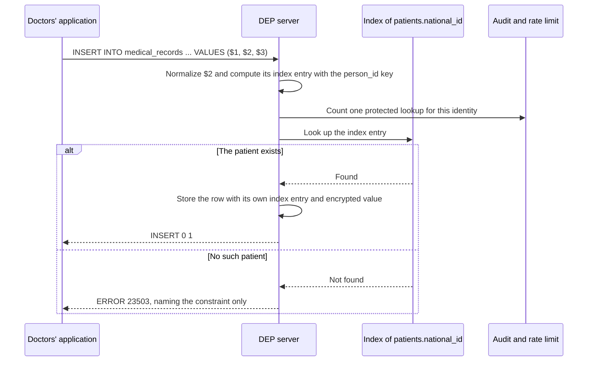
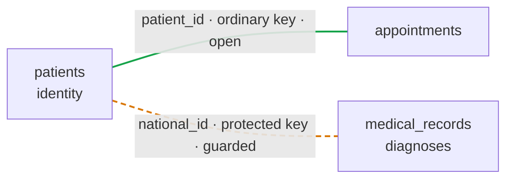

# Write DEP SQL

## Two access paths {#6-two-access-paths}

**In one sentence:** every connection is fixed, when it logs in, to one of two paths, and the path sets the most the connection can ever do with protected values.

### What an access path is {#61-what-an-access-path-is}

**What is it?** An access path is a property of a connection that decides which operations on protected values are available to it. DEP has two paths: `OPERATIONAL` and `MASKED_READ`.

**Why is it needed?** Permissions decide what a *role* may do, and roles can be granted by mistake, inherited, and switched. The path adds a ceiling that does not depend on any of that: whatever privileges a masked connection holds, it cannot match on protected values.

**Example.** The same query, sent by two consumers:

```sql
SELECT full_name FROM patients WHERE national_id = $1;   -- $1 = '123456782'
```

**Output on the operational path (reception)**

| full_name |
| --- |
| Dana Cohen |

**Output on the masked path (the AI assistant)**

```text
ERROR:  DEP_ENDPOINT_OPERATION
DETAIL: Matching PROTECTED values is unavailable on a MASKED_READ connection.
```

**Explanation:** reception's connection was fixed to the operational path when it logged in, so the lookup runs. The assistant's connection was fixed to the masked path, so matching on `national_id` is not available to it at all, whatever privileges its role holds.

**Rules in detail**

1. The server decides the path when the connection authenticates, from the endpoint the client connected to and its identity.
2. The path cannot be changed for the rest of the session, by any statement, setting, or role switch ([The path cannot change](02-sql.md#67-the-path-cannot-change)).
3. The path is an upper bound. Ordinary column privileges decide what a role may do beneath it ([Who may match on what](02-sql.md#66-who-may-match-on-what)).
4. On both paths, an ordinary query never returns a protected value.

### CREATE ENDPOINT {#62-create-endpoint}

**What is it?** `CREATE ENDPOINT` defines a server address that clients connect to, and binds it to one access path.

**Syntax**

```sql
CREATE ENDPOINT endpoint_name MODE { OPERATIONAL | MASKED_READ };
```

**Parameters**

| Parameter | Meaning |
| --- | --- |
| `endpoint_name` | A name for the endpoint, unique in the server. |
| `MODE OPERATIONAL` | Connections through this endpoint receive the operational path. |
| `MODE MASKED_READ` | Connections through this endpoint receive the masked read path. |

**Example.** The clinic defines one endpoint per path:

```sql
CREATE ENDPOINT operational MODE OPERATIONAL;
CREATE ENDPOINT analytics   MODE MASKED_READ;
```

**Explanation:** reception, the doctors' application, the reminder job, and billing connect to `operational`. The dashboard and the scheduling assistant connect to `analytics`. Choosing an endpoint is the only way a client "chooses" a path, and only if its identity is allowed to connect there.

**Rules in detail**

1. `CREATE ENDPOINT` is a server-level administrative command, not something an application runs.
2. DEP Engine 0.5.2 controls endpoint access with `GRANT CONNECT ON ENDPOINT operational TO role_name`. The endpoint is selected as the database name at login; two endpoints do not require two TCP ports.

<figure markdown="1">

<picture><source media="(prefers-color-scheme: dark)" srcset="../images/diagrams/access-paths-dark.png"></picture>

<figcaption>The connection path sets which operations are available; privileges still decide which objects a role may use.</figcaption>
</figure>

### The operational path {#63-the-operational-path}

**What is it?** The path for applications that must find, create, and update records.

| | |
| --- | --- |
| **Allows** | Reads and writes within ordinary permissions; inserting protected values; finding, updating, and connecting records by one protected value; calling declared functions the role may execute |
| **Does not allow** | Returning protected values from an ordinary query; unanchored matching outside a `LINKS` function; processing protected values (casts, substrings, ordering) |
| **Typical consumers** | Reception, the doctors' application, the reminder job, the billing job |

### The masked read path {#64-the-masked-read-path}

**What is it?** A read-only path on which protected values cannot be used for matching at all.

| | |
| --- | --- |
| **Allows** | Reading ordinary fields; joining on ordinary keys; aggregates; calling linking functions that take no protected input |
| **Does not allow** | Any matching on protected values, even for one value; any write; calling disclosing functions; calling linking functions that take a protected input |
| **Typical consumers** | Analysts, BI tools, and AI agents. The masked path is the default for any new consumer. |

**Example.** The assistant studies appointment patterns:

```sql
SELECT visit_type, extract(hour FROM starts_at) AS hour, COUNT(*)
FROM appointments
GROUP BY visit_type, hour
ORDER BY COUNT(*) DESC;
```

**Output**

| visit_type | hour | count |
| --- | --- | --- |
| Follow-up | 10 | 214 |
| First visit | 9 | 187 |

**Explanation:** the query uses only ordinary fields, so it runs exactly as in ordinary SQL. The masked path does not get in the way of the assistant's real work; it only removes access to identifiers.

### Capabilities of each path {#65-capabilities-of-each-path}

| Capability | `OPERATIONAL` | `MASKED_READ` |
| --- | --- | --- |
| Read ordinary fields | Allowed within ordinary permissions | Allowed within ordinary permissions |
| Join on ordinary fields | Allowed | Allowed |
| Insert or update data | Allowed within ordinary permissions | Rejected |
| Supply a value for a protected field on insert | Allowed | Rejected |
| Find or update a record by one protected value | Allowed, for columns the role may use; recorded | Rejected |
| Join on protected fields, anchored to one protected value | Allowed, for columns the role may use; recorded | Rejected |
| Join on protected fields across whole datasets | Rejected outside a `LINKS` function | Rejected |
| Return a protected field directly | Suppressed (`NULL`) | Suppressed (`NULL`) |
| Call a `LINKS` function that takes no protected input | Allowed with `EXECUTE` | Allowed with `EXECUTE` |
| Call a `LINKS` function that takes a protected input | Allowed with `EXECUTE` | Rejected |
| Call a `DISCLOSES` function | Allowed with `EXECUTE` | Rejected |
| Use `REVEAL` in an ordinary query | Rejected | Rejected |
| Extract parts of, cast, or pass a protected field to a general function | Rejected | Rejected |

### Who may match on what {#66-who-may-match-on-what}

**What is it?** On the operational path, a role may match on a protected column if, and only if, it holds ordinary SQL privilege on that column.

**Why is it needed?** It lets DEP reuse the privileges SQL already has, instead of inventing a new permission system. DEP only changes what a privilege can reveal: because a protected value is never returned by an ordinary query, privilege on a protected column means only **"may use this column for matching."**

**Example 1: Reception may search by ID number**

```sql
GRANT SELECT (patient_id, national_id, full_name, health_fund) ON patients TO reception_app;

-- as reception_app
SELECT full_name FROM patients WHERE national_id = $1;
```

**Output**

| full_name |
| --- |
| Dana Cohen |

**Explanation:** reception holds privilege on `national_id`, so it may use it to find Dana. It still never receives the ID number itself.

**Example 2: Reception may not search by phone number**

```sql
-- as reception_app
SELECT full_name FROM patients WHERE phone = $1;
```

**Output**

```text
ERROR:  permission denied for column phone
```

**Explanation:** reception holds no privilege on `phone`, so it cannot perform a reverse lookup by phone number, which would let a receptionist identify an unknown caller. This is an ordinary SQL permission error, not a DEP error.

**Three layers.** Every decision about a protected column is made by exactly one of three layers:

| Layer | Decides | In the clinic |
| --- | --- | --- |
| The path | Whether matching is possible at all | The assistant, on the masked path, cannot match on anything |
| Column privileges | Who may match on which column | Reception may match on `national_id`, but not on `phone` |
| `PROTECTED` | What a match can ever reveal | No ordinary query returns either column |

**Key point:** every protected match on the operational path is written to the audit log with the identity that made it, and protected lookups are rate-limited per identity ([Recording and auditing](08-internals.md#144-recording-and-auditing)).

### The path cannot change {#67-the-path-cannot-change}

**What is it?** A rule: once a connection has logged in, its path stays the same until it disconnects.

**Example.** The assistant, connected to `analytics`, tries to promote itself:

```sql
SET dep.path = 'OPERATIONAL';
```

**Output**

```text
ERROR:  DEP_PATH_IMMUTABLE
DETAIL: The access path of this connection is MASKED_READ and cannot be changed.
HINT:   The path is fixed at authentication. Connect through the operational endpoint instead.
```

**Explanation:** the path belongs to the connection as it logged in, not to anything the client can set afterwards. The same applies to `SET ROLE`, `SET SESSION AUTHORIZATION`, and pooled connections.

**Errors.** [`DEP_PATH_IMMUTABLE`](../reference/errors.md#dep-errors).

### Choosing a path for a consumer {#68-choosing-a-path-for-a-consumer}

**How is a path chosen?** From what the consumer must do with protected values:

1. A consumer that must match on a protected value connects on the **operational** path.
2. A consumer that must disclose values does so through a disclosing function, on the **operational** path.
3. A consumer whose only protected access is through linking functions that take no protected input connects on the **masked** path.
4. A consumer with no use for protected values connects on the **masked** path.
5. Any new consumer starts on the **masked** path, and moves only when someone decides, with a written reason, that it needs to match.

**In the clinic**

| Consumer | Path | Why |
| --- | --- | --- |
| `reception_app` | `OPERATIONAL` | Matches on `national_id` |
| `doctors_app` | `OPERATIONAL` | Matches on `national_id` and `medical_records.patient_national_id` |
| `reminder_job` | `OPERATIONAL` | Calls a disclosing function |
| `billing_job` | `OPERATIONAL` | Calls disclosing functions |
| `bi_dashboard` | `MASKED_READ` | Only calls a linking function without protected input |
| `scheduling_agent` | `MASKED_READ` | Has no use for protected values |

[Chapter 4](04-design.md#10-designing-with-dep) derives these assignments from the clinic's privacy matrix.

**Key points**

- Two paths: operational for applications that find and update records; masked for analysts, dashboards, and agents.
- The path is fixed at login and cannot be changed by any statement.
- Column privileges decide who may match on which column, beneath the path.
- New consumers start on the masked path.

---

## Writing DEP SQL {#7-writing-dep-sql}

**In one sentence:** this chapter shows every DEP construct used in ordinary statements, one at a time, turning the clinic's database into a DEP database.

**Before you start.** Parameters written as `$1`, `$2` are values sent separately from the query text, through the PostgreSQL protocol. Writing a value directly in the query works the same way ([Parameters and literals](02-sql.md#79-parameters-and-literals)). All examples run on the operational path unless stated otherwise.

### Declaring a protected column {#71-declaring-a-protected-column}

```sql
CREATE [TEMPORARY] TABLE name (
    column type [PROTECTED MATCH DOMAIN domain] [constraints],
    column type PROTECTED REFERENCES other (column),
    ...
);
```

`PROTECTED MATCH DOMAIN d` declares a protected column and names its match domain. A domain is created by its first use. A column that references a protected column is itself protected and takes the same domain: write `PROTECTED REFERENCES t (c)`, without repeating the domain. Constraints (`PRIMARY KEY`, `UNIQUE`, `NOT NULL`, `REFERENCES`) work on protected columns too; the engine checks them through the blind index, and the error never shows the value.

```text
admin@operational=> CREATE TABLE patients (
    patient_id  BIGINT PRIMARY KEY,
    national_id TEXT PROTECTED MATCH DOMAIN person_id UNIQUE,
    full_name   TEXT
);
CREATE TABLE

admin@operational=> CREATE TABLE records (
    record_id           BIGINT PRIMARY KEY,
    patient_national_id TEXT PROTECTED REFERENCES patients (national_id),
    diagnosis           TEXT
);
CREATE TABLE

admin@operational=> SHOW COLUMNS FROM records;
       column        |  type  | match_domain | primary_key |       references       | not_null | unique
---------------------+--------+--------------+-------------+------------------------+----------+--------
 record_id           | BIGINT | NULL         | yes         | NULL                   | yes      | yes
 patient_national_id | TEXT   | person_id    |             | patients (national_id) |          |
 diagnosis           | TEXT   | NULL         |             | NULL                   |          |
(3 rows)
```

The reference and the column it references must agree, and the engine checks it:

```text
admin@operational=> CREATE TABLE bad1 (id BIGINT PRIMARY KEY, nid TEXT PROTECTED);
ERROR:  PROTECTED column nid needs a match domain
HINT:  Write TEXT PROTECTED MATCH DOMAIN name, or PROTECTED REFERENCES a protected column.
SQLSTATE:  42601

admin@operational=> CREATE TABLE bad2 (id BIGINT PRIMARY KEY, nid TEXT PROTECTED MATCH DOMAIN phone_number REFERENCES patients (national_id));
ERROR:  Column bad2.nid (match domain phone_number) references patients.national_id (match domain person_id).
HINT:  A reference and the column it references must have the same match domain.
SQLSTATE:  ZD103 (DEP_MATCH_DOMAIN_MISMATCH)

admin@operational=> CREATE TABLE bad3 (id BIGINT PRIMARY KEY, nid TEXT REFERENCES patients (national_id));
ERROR:  Column bad3.nid references PROTECTED column patients.national_id (match domain person_id) but is not PROTECTED.
HINT:  Declare it TEXT PROTECTED REFERENCES patients (national_id), so the reference is kept as an index entry.
SQLSTATE:  ZD006 (DEP_REFERENCE_MISMATCH)
```

| Mistake | Error |
|---|---|
| `PROTECTED` with no domain and no reference | `42601` syntax error |
| A reference in a different domain from its target | `ZD103` `DEP_MATCH_DOMAIN_MISMATCH` |
| A protected column that references an ordinary one, or the reverse | `ZD006` `DEP_REFERENCE_MISMATCH` |

Only a superuser creates tables. A protected value is never stored in an ordinary column; the next section shows the error.

### Inserting and updating protected values {#72-inserting-and-updating-protected-values}

**What is it?** Protected values are written with ordinary `INSERT` and `UPDATE` statements. The server converts them to their protected form immediately.

**Example 1: Registering a patient**

```sql
INSERT INTO patients (patient_id, national_id, full_name, health_fund)
VALUES ($1, $2, $3, $4);
```

**Output**

```text
INSERT 0 1
```

**Explanation:** the ID number in `$2` is normalized, turned into an index entry and a ciphertext, and stored. It never appears in the server's logs.

**Example 2: Updating a record found by its ID number**

Dana has changed her family name. Reception updates it, and uses the ID number only to locate the record:

```sql
UPDATE patients
SET full_name = $2
WHERE national_id = $1;
```

**Output**

```text
UPDATE 1
```

**Explanation:** `WHERE national_id = $1` is an anchored lookup ([Finding a record by a protected value](02-sql.md#73-finding-a-record-by-a-protected-value)): it finds one patient by one value.

**Example 3: The same update from the masked path**

**Output**

```text
ERROR:  DEP_ENDPOINT_OPERATION
DETAIL: Writes are unavailable on a MASKED_READ connection.
```

**Explanation:** the masked path is read-only.

**Rules in detail**

1. Writing protected values is allowed only on the operational path.
2. A value written into a protected column is a protected input: normalized, converted, and redacted from any recorded statement text.
3. A protected column can be used in the `WHERE` clause of an `UPDATE` or `DELETE` only as an anchor.

### Finding a record by a protected value {#73-finding-a-record-by-a-protected-value}

A protected column can be compared with a value for equality. The value is a literal (`'123456782'`) or a parameter (`$1`); the engine treats both the same way and, for a parameter, never puts the value in an error message.

| Form | Works | Note |
|---|---|---|
| `col = value` | yes | A lookup through the blind index |
| `col IN (v1, v2, ...)` | yes | A list of lookups |
| `col = v1 OR col = v2` | yes | Each side is a lookup |
| `CASE WHEN col = v THEN ... END` | yes | The comparison is a lookup |
| `col NOT IN (...)`, `NOT (col = v)` | yes | The same lookups, negated |
| `col IS NULL`, `col IS NOT NULL` | filtering on the operational path | These test whether a stored value is missing or present. Filtering, returning the test and counting values have different rules; see [Checking whether a protected value is present](#protected-value-presence). |
| `col = other_protected_col` | in a join | The two columns must be in the same domain |
| `col <> v`, `<`, `>`, `BETWEEN` | no | `ZD101` |

```text
reception_app@operational=> SELECT full_name FROM patients WHERE national_id IN ('123456782', '234567893');
DEP:  PROTECTED column patients.national_id is matched against a list of values through the blind index of MATCH DOMAIN person_id.
 full_name
------------
 Dana Cohen
 Yossi Levi
(2 rows)

reception_app@operational=> SELECT full_name FROM patients WHERE national_id = '123456782' OR national_id = '345678904';
DEP:  PROTECTED column patients.national_id is matched by equality through the blind index of MATCH DOMAIN person_id.
  full_name
-------------
 Dana Cohen
 Noa Mizrahi
(2 rows)
```

Each lookup on the operational path is counted for the role's [match limit](#match-limits) and written to the audit log, without the value. A lookup needs the privilege `SELECT (column)` on the protected column. On the masked read path it is refused altogether:

```text
bi_dashboard@analytics=> SELECT health_fund FROM patients WHERE national_id = '123456782';
ERROR:  Matching PROTECTED values is unavailable on a MASKED_READ connection.
HINT:  This operation requires an OPERATIONAL connection.
SQLSTATE:  ZD102 (DEP_ENDPOINT_OPERATION)
```

A comparison with a value of the wrong kind does not match and does not fail: `national_id = 123` compares an integer with text and finds no row. Compare with a string.

#### Checking whether a protected value is present {#protected-value-presence}

A missing value and a hidden value are different. A protected column comes back as `NULL` in ordinary query output even when the database stores a value. That output does not tell you whether the stored value is missing.

Three SQL forms answer different questions:

- **`IS NULL` / `IS NOT NULL`** checks whether the stored value in one row is missing or present.
- **`COUNT(national_id)`** counts the rows whose stored `national_id` is not `NULL`.
- **`COUNT(*)`** counts rows, without checking whether `national_id` has a value.

Assume `patients.national_id` is protected and the role has the required ordinary `SELECT` privileges. The DEP rules distinguish these operations:

| Operation | Operational | Masked read |
|---|---|---|
| Filter rows with `WHERE national_id IS NOT NULL` (or `IS NULL`) | Allowed | Refused: `ZD102` |
| Return the test with `SELECT national_id IS NULL` (or `IS NOT NULL`) | Refused: `ZD101` | Refused: `ZD102` |
| Count stored values with `COUNT(national_id)` | Refused: `ZD101` | Refused: `ZD102` |
| Count rows with `COUNT(*)` | Allowed | Allowed |

**Filter rows: allowed on the operational path.** The application can select rows that have an identifier without returning the identifier or a separate presence flag.

```sql
SELECT patient_id
FROM patients
WHERE national_id IS NOT NULL;
```

**Count rows: allowed on either path.** This counts the rows the query selects, including rows whose identifier is missing. Adding a protected-value filter is a separate operation, and follows the rule in the first row of the table.

```sql
SELECT COUNT(*) AS patient_count
FROM patients;
```

**Return a presence flag or count stored identifiers: refused on either path.** These reveal information about the protected column rather than simply counting rows.

```sql
-- Refused: return whether an identifier is missing.
SELECT national_id IS NULL AS identifier_missing
FROM patients;

-- Refused: count non-NULL identifiers.
SELECT COUNT(national_id) AS identifiers_present
FROM patients;
```

Allowing a presence test in a filter does **not** allow `COUNT(national_id)` inside a condition such as `HAVING`. Use the distinct rules above rather than treating every presence-related expression as interchangeable.

**Implementation status:** this table describes the DEP rules, not a guarantee that every released Engine enforces them. DEP Engine 0.5.2 has a [documented presence-test difference](06-server.md#other-known-differences-in-dep-engine-052).

### Selecting a protected column {#74-selecting-a-protected-column}

**What is it?** When an ordinary query selects a protected column, the value is replaced with a real SQL `NULL` before the result is sent. This is called **suppression**.

**Why is it needed?** Existing applications, ORMs, and reports that select every column should keep working, without receiving identifiers.

**Example 1: Asking for the ID number with the name**

```sql
SELECT full_name, national_id
FROM patients
WHERE national_id = $1;
```

**Output**

| full_name | national_id |
| --- | --- |
| Dana Cohen | `NULL` |

**Explanation:** the match still works: Dana was found. But a protected value never leaves the database in an ordinary query, so `national_id` comes back as `NULL`.

**Example 2: `SELECT *`**

```sql
SELECT * FROM patients WHERE national_id = $1;
```

**Output**

| patient_id | national_id | phone | full_name | health_fund |
| --- | --- | --- | --- | --- |
| 1 | `NULL` | `NULL` | Dana Cohen | Clalit |

**Explanation:** both protected columns are suppressed. An application that always selects every column keeps working; it simply never receives the identifiers.

**Rules in detail**

1. Suppression happens at the output boundary, on both paths, in every result format.
2. The value is a real SQL `NULL`: not the string `"NULL"`, not the stored ciphertext, and not a reusable token.
3. The column keeps its declared type in the result description.

**Notes**

- **Why not a token?** Returning stable "gibberish" in place of the ID would let clients track Dana across results.
- **Why not an error?** Because selecting is harmless once the value is suppressed. *Processing* a protected value, as opposed to selecting it, is an error ([Operations that are not allowed](02-sql.md#78-operations-that-are-not-allowed)).
- **Telling suppression from absence.** Whether a client can tell a suppressed value from a missing one is an open question ([Roadmap and Release](../design/02-roadmap-and-release.md#7-open-questions)). Protected status is always visible in the schema.

### Queries on the masked path {#75-queries-on-the-masked-path}

**What is it?** On the masked path, queries over ordinary fields run exactly as in ordinary SQL, and any matching on protected values is rejected.

**Example 1: Statistics the dashboard needs**

```sql
SELECT p.health_fund, COUNT(*)
FROM appointments AS a
JOIN patients AS p USING (patient_id)
GROUP BY p.health_fund;
```

**Output**

| health_fund | count |
| --- | --- |
| Clalit | 1,284 |
| Maccabi | 903 |

**Explanation:** the query joins through the ordinary key `patient_id` and touches no protected column, so it runs as usual.

**Example 2: The assistant tries to look Dana up**

```sql
SELECT full_name FROM patients WHERE national_id = $1;
```

**Output**

```text
ERROR:  DEP_ENDPOINT_OPERATION
DETAIL: Matching PROTECTED values is unavailable on a MASKED_READ connection.
HINT:   This operation requires an OPERATIONAL connection.
```

**Explanation:** the response is an error, not zero rows. An unsupported operation is a different outcome from an unsuccessful lookup, so the assistant cannot even learn whether Dana is a patient.

**Errors.** [`DEP_ENDPOINT_OPERATION`](../reference/errors.md#dep-errors).

### Joining on protected columns {#76-joining-on-protected-columns}

Two protected columns in the same domain can be joined, if the join is **anchored**: the query also contains an equality between one of the columns and a single value, at the top level of the `WHERE` clause.

<picture><source media="(prefers-color-scheme: dark)" srcset="../images/diagrams/anchoring-dark.png"></picture>

```text
doctors_app@operational=> SELECT p.full_name, m.diagnosis
FROM patients AS p JOIN medical_records AS m ON m.patient_national_id = p.national_id
WHERE p.national_id = '123456782';
DEP:  PROTECTED column patients.national_id is matched by equality through the blind index of MATCH DOMAIN person_id.
DEP:  Join of PROTECTED columns medical_records.patient_national_id and patients.national_id (MATCH DOMAIN person_id) is anchored to a single protected value.
 full_name  |    diagnosis
------------+------------------
 Dana Cohen | Asthma
 Dana Cohen | Seasonal allergy
(2 rows)
```

Without the anchor, the join would connect every patient to every record, and it is refused with `ZD107` `DEP_UNANCHORED_MATCH`. These are also unanchored matches, and refused in the same way:

```text
doctors_app@operational=> SELECT m.diagnosis FROM patients AS p JOIN medical_records AS m ON m.patient_national_id = p.national_id
WHERE p.national_id = '123456782' OR p.full_name = 'Yossi Levi';
ERROR:  Join on PROTECTED columns patients.national_id and medical_records.patient_national_id is not anchored to a single protected value.
HINT:  Anchor the join with a lookup such as WHERE patients.national_id = $1, or perform it inside a function declared LINKS person_id.
SQLSTATE:  ZD107 (DEP_UNANCHORED_MATCH)

doctors_app@operational=> SELECT full_name FROM patients WHERE national_id IN (SELECT patient_national_id FROM medical_records);
ERROR:  Match of PROTECTED column patients.national_id against a subquery is not anchored to a single protected value.
HINT:  Anchor the join with a lookup such as WHERE patients.national_id = $1, or perform it inside a function declared LINKS person_id.
SQLSTATE:  ZD107 (DEP_UNANCHORED_MATCH)

doctors_app@operational=> SELECT patient_national_id, count(*) FROM medical_records GROUP BY patient_national_id;
ERROR:  GROUP BY on PROTECTED column medical_records.patient_national_id links every row that shares a value.
HINT:  Group by ordinary columns, or perform the grouping inside a function declared LINKS person_id.
SQLSTATE:  ZD107 (DEP_UNANCHORED_MATCH)

doctors_app@operational=> SELECT DISTINCT patient_national_id FROM medical_records;
ERROR:  DISTINCT on PROTECTED column medical_records.patient_national_id links every row that shares a value.
HINT:  Perform it inside a function declared LINKS person_id.
SQLSTATE:  ZD107 (DEP_UNANCHORED_MATCH)

doctors_app@operational=> SELECT p.full_name FROM patients p, medical_records m WHERE p.national_id = m.patient_national_id;
ERROR:  Join on PROTECTED columns medical_records.patient_national_id and patients.national_id is not anchored to a single protected value.
HINT:  Anchor the join with a lookup such as WHERE medical_records.patient_national_id = $1, or perform it inside a function declared LINKS person_id.
SQLSTATE:  ZD107 (DEP_UNANCHORED_MATCH)
```

An anchor under `OR` is not an anchor, a subquery is a join written differently, and grouping or `DISTINCT` on a protected column links every row that shares a value. Joins on ordinary keys, such as `appointments.patient_id`, are ordinary SQL.

The only way to run an unanchored match is inside a function declared `LINKS` for the domain; see [Declared functions](03-functions.md).

### Comparing protected columns: match domains {#77-comparing-protected-columns-match-domains}

**What is it?** A rule: two protected columns can be compared only if they belong to the same match domain.

**Example 1: Comparing ID numbers with ID numbers**

```sql
SELECT m.diagnosis
FROM patients AS p
JOIN medical_records AS m ON m.patient_national_id = p.national_id
WHERE p.national_id = $1;
```

**Explanation:** both columns are in `person_id`, so the comparison is allowed (and anchored).

**Example 2: Comparing an ID number with a phone number**

```sql
SELECT full_name FROM patients WHERE national_id = phone;
```

**Output**

```text
ERROR:  DEP_MATCH_DOMAIN_MISMATCH
DETAIL: patients.national_id (person_id) cannot be compared with patients.phone (phone_number).
HINT:   Only PROTECTED fields in the same match domain can be compared.
```

**Explanation:** ID numbers and phone numbers are different kinds of value, even if some digits happen to coincide. Each domain has its own key, so their index entries are unrelated.

**Example 3: Comparing a protected column with an ordinary one**

```sql
SELECT p.full_name
FROM patients AS p
JOIN my_id_list AS l ON l.id = p.national_id;     -- l.id is ordinary TEXT
```

**Output**

```text
ERROR:  DEP_PROTECTED_OPERATION
```

**Explanation:** a protected column can be compared only with a protected input or with another protected column of the same domain. A client therefore cannot load a list of identifiers into a table of its own and join it against protected data.

**Errors.** [`DEP_MATCH_DOMAIN_MISMATCH`](../reference/errors.md#dep-errors), [`DEP_PROTECTED_OPERATION`](../reference/errors.md#dep-errors).

### Operations that are not allowed {#78-operations-that-are-not-allowed}

Everything other than full-value equality is refused on a protected value, on every path, in any position of a query, with `ZD101` `DEP_PROTECTED_OPERATION`:


```text
admin@operational=> SELECT full_name FROM patients WHERE national_id LIKE '1234%';
ERROR:  LIKE is not supported for PROTECTED values (patients.national_id).
HINT:  PROTECTED values support only full-value equality matching. To release a value, use a disclosing function.
SQLSTATE:  ZD101 (DEP_PROTECTED_OPERATION)

admin@operational=> SELECT full_name FROM patients WHERE national_id <> '123456782';
ERROR:  Operator != is not supported for PROTECTED values (patients.national_id).
HINT:  PROTECTED values support only full-value equality matching. To release a value, use a disclosing function.
SQLSTATE:  ZD101 (DEP_PROTECTED_OPERATION)

admin@operational=> SELECT full_name FROM patients ORDER BY national_id;
ERROR:  ORDER BY is not supported for PROTECTED values (patients.national_id).
HINT:  PROTECTED values support only full-value equality matching. To release a value, use a disclosing function.
SQLSTATE:  ZD101 (DEP_PROTECTED_OPERATION)

admin@operational=> SELECT CAST(national_id AS TEXT) FROM patients;
ERROR:  Conversion from PROTECTED to plain TEXT is forbidden (patients.national_id).
HINT:  To release a value, use a disclosing function.
SQLSTATE:  ZD101 (DEP_PROTECTED_OPERATION)

admin@operational=> SELECT length(national_id) FROM patients;
ERROR:  Function character_length() is not supported for PROTECTED values (patients.national_id).
HINT:  PROTECTED values support only full-value equality matching. To release a value, use a disclosing function.
SQLSTATE:  ZD101 (DEP_PROTECTED_OPERATION)

admin@operational=> SELECT coalesce(national_id, 'none') FROM patients;
ERROR:  Function coalesce() is not supported for PROTECTED values (patients.national_id).
HINT:  PROTECTED values support only full-value equality matching. To release a value, use a disclosing function.
SQLSTATE:  ZD101 (DEP_PROTECTED_OPERATION)

admin@operational=> SELECT min(national_id) FROM patients;
ERROR:  Aggregate min() is not supported for PROTECTED values (patients.national_id).
HINT:  PROTECTED values support only full-value equality matching. To release a value, use a disclosing function.
SQLSTATE:  ZD101 (DEP_PROTECTED_OPERATION)

admin@operational=> SELECT full_name FROM patients WHERE national_id = full_name;
ERROR:  Comparison with a non-PROTECTED column is not supported for PROTECTED values (patients.national_id).
HINT:  PROTECTED values support only full-value equality matching. To release a value, use a disclosing function.
SQLSTATE:  ZD101 (DEP_PROTECTED_OPERATION)
```

| Operation | Why |
|---|---|
| `LIKE`, `ILIKE`, `~`, `SIMILAR TO` | Reveals the structure of the value |
| `<>`, `<`, `>`, `BETWEEN`, `ORDER BY` | Reveals order |
| `CAST`, `::`, `COALESCE`, any function or aggregate (`min`, `max`, `length`, ...) | Produces or releases a derived value |
| Comparing with an ordinary column | The ordinary column is plaintext |

`COUNT(*)` counts rows and is allowed on either path. `COUNT(column)` is allowed for ordinary columns; counting a protected column is refused because it reveals how many stored values are present. See the [presence-test table](#protected-value-presence).

DEP fails closed. A form the engine cannot analyze is rejected with `ZD108` `DEP_UNSUPPORTED_FORM` rather than run with uncertain protection.

A protected column read by `SELECT` comes back as `NULL`:

```text
admin@operational=> SELECT patient_id, national_id, phone FROM patients WHERE patient_id = 1;
DEP:  Output column national_id is PROTECTED column patients.national_id (MATCH DOMAIN person_id) and is returned as NULL.
DEP:  Output column phone is PROTECTED column patients.phone (MATCH DOMAIN phone_number) and is returned as NULL.
 patient_id | national_id | phone
------------+-------------+-------
 1          | NULL        | NULL
(1 row)
```

### Parameters and literals {#79-parameters-and-literals}

**What is it?** A **protected input** is a value the client sends in a protected position. It can arrive in two forms, and both are allowed:

- a **protected parameter**, sent separately from the query text, as `$1`;
- a **protected literal**, written in the query text, as `'123456782'`.

**Why is it needed?** DEP is SQL, and a query that searches for Dana has to send her ID number to the server.

**What counts as a protected position?** A value compared with a protected column, joined against one, or inserted into one.

**Example 1: The same lookup, both ways**

```sql
-- As a parameter: the value travels separately from the query text
SELECT full_name FROM patients WHERE national_id = $1;

-- As a literal: the value is written in the query text
SELECT full_name FROM patients WHERE national_id = '123456782';
```

**Output (both)**

| full_name |
| --- |
| Dana Cohen |

**Explanation:** both are anchored lookups, follow the same rules, and are recorded the same way.

**Example 2: Literals in an insert and an update**

```sql
INSERT INTO patients (patient_id, national_id, full_name, phone)
VALUES (3, '345678904', 'Noa Mizrahi', '+972-50-0000003');   -- both stored protected

UPDATE patients SET full_name = 'Dana Cohen-Levi'
WHERE national_id = '123456782';                              -- used for matching
```

**Explanation:** `'345678904'` and `'+972-50-0000003'` go into protected columns, so they are protected literals. `'Noa Mizrahi'` goes into an ordinary column, so it is ordinary.

**Example 3: What the server's log records**

```text
LOG:  statement: UPDATE patients SET full_name = 'Dana Cohen-Levi' WHERE national_id = <protected>
```

**Explanation:** the protected literal is redacted wherever the server records the statement. The ordinary literal is not.

**Rules in detail.** From the moment the statement is parsed, a protected input is:

1. normalized and converted to an index entry with the match domain's key, and used only for matching or storage;
2. unavailable to the rest of the query, which cannot read, transform, or return it;
3. redacted from the statement text wherever the server records or echoes it: logs, query statistics, audit records, and error messages.

**Notes**

- **Protection is positional.** DEP recognizes a value as protected because of *where it is used*, not because of what it looks like. A value written elsewhere (`SELECT '123456782'`, for instance) is ordinary text, and the server has no way to know it is an ID number.
- **Parameters are still recommended.** They keep the value out of the query text entirely, and they are the standard defense against SQL injection.
- **Client-side substitution.** Some drivers substitute values into the query text before sending it. To the server, that is a literal, and it is handled as one.

### Protected foreign keys {#710-protected-foreign-keys}

**What is it?** A protected foreign key is a foreign key from a protected column to a protected column of the same match domain.

**Why is it needed?** A foreign key promises that every value in one column also appears in another. When the referenced column is protected, the protected value now lives in two places; these rules keep the second place as protected as the first.

**Syntax**

```sql
column_name base_type PROTECTED REFERENCES table_name ( protected_column )
```

**Example 1: Linking diagnoses through the protected ID number**

```sql
CREATE TABLE medical_records (
    record_id           BIGINT PRIMARY KEY,
    patient_national_id TEXT PROTECTED REFERENCES patients (national_id),  -- inherits person_id
    diagnosis           TEXT,
    recorded_at         DATE
);
```

**Output**

```text
CREATE TABLE
```

**Explanation:** the clinic links diagnoses to patients through the protected ID number, not through `patient_id`, because a list of patients next to their diagnoses is exactly the kind of link that must be guarded. The match domain `person_id` is inherited from `patients.national_id`.

**Example 2: Forgetting `PROTECTED`**

```sql
CREATE TABLE medical_records (
    record_id           BIGINT PRIMARY KEY,
    patient_national_id TEXT REFERENCES patients (national_id),
    diagnosis           TEXT
);
```

**Output**

```text
ERROR:  DEP_REFERENCE_MISMATCH
DETAIL: medical_records.patient_national_id references patients.national_id, which is PROTECTED.
HINT:   Declare the column TEXT PROTECTED REFERENCES patients (national_id).
```

**Explanation:** without `PROTECTED`, the second table would hold an ordinary copy of every ID number, and a plain `SELECT` on it would return them all.

**Example 3: Recording a diagnosis for a patient who does not exist**

```sql
INSERT INTO medical_records (record_id, patient_national_id, diagnosis)
VALUES (104, $1, 'Migraine');        -- $1 is not any patient's ID number
```

**Output**

```text
ERROR:  insert or update on table "medical_records" violates foreign key constraint "medical_records_patient_national_id_fkey"
```

**Explanation:** the check happened inside the engine, on index entries. The error names only the constraint, never the value. But the failure itself reveals that no patient has that ID number, so the check is counted as a protected lookup, audited and rate-limited.

**How a write is checked**



**Rules in detail**

1. **The referencing column must be declared `PROTECTED`, and inherits the match domain.** `PROTECTED` must be written, so that anyone reading the schema sees it wherever the value lives. If the domain is written, it must match. The same applies in the other direction (a protected column referencing an ordinary one) and across domains.
2. **The integrity check happens inside the engine**, by comparing index entries, without decrypting anything.
3. **The check counts as a protected lookup**, because its outcome carries information. A delete blocked by `RESTRICT` likewise reveals that a patient has records.
4. **Joins through the key follow the matching rules** ([Joining on protected columns](02-sql.md#76-joining-on-protected-columns)).
5. **Privileges are not inherited.** The referencing column has its own privileges. Only the doctors receive privilege on both protected columns, which is how the clinic keeps reception away from diagnoses:

   ```sql
   GRANT SELECT (patient_id, national_id, full_name, health_fund) ON patients TO doctors_app;
   GRANT SELECT ON appointments, medical_records TO doctors_app;
   ```

6. **Creating the key requires `REFERENCES` privilege** on the referenced column, so adding a second home for a protected value is itself a decision someone must approve.

**What is inherited**

| Property | Taken from the referenced column? |
| --- | --- |
| `PROTECTED` | Required, and must be written |
| Match domain | Yes, inherited |
| Storage | The same as any protected column |
| Privilege to match on the column | No; each column has its own |

**Notes.** `ON UPDATE CASCADE` recomputes the index entries of the referencing rows, and `ON DELETE CASCADE` or `RESTRICT` locates them through the index. Deferred constraints, and foreign keys spanning several columns of which some are protected, are outside the first version.

**Errors.** [`DEP_REFERENCE_MISMATCH`](../reference/errors.md#dep-errors); standard SQLSTATE `23503` for violations, naming only the constraint.

**Key points**

- A copy of a protected value must itself be protected.
- Checks run on index entries and count as lookups.
- Use a protected foreign key only when the link itself is sensitive.

### Requiring qualified access {#711-requiring-qualified-access}

> **Future design, not supported in DEP Engine 0.5.2.** This section records an idea from the proposal. The ALTER TABLE option below is not runnable on the current Engine; ZD105 is reserved. Current protected-join anchoring does not prohibit every unfiltered ordinary read or write.

**What is it?** A table can require **qualified access**: every operational read or write on it must be anchored to one protected value or to its primary key.

**Why is it needed?** For tables where every legitimate access is targeted, it turns an accidental `UPDATE` without a `WHERE`, or a full scan, into an explicit error.

**Syntax.** The exact form is not yet fixed. One possibility is a table option:

```sql
ALTER TABLE patients SET (qualified_access = true);
```

**Example 1: An update that names one patient**

```sql
UPDATE patients SET full_name = $2 WHERE national_id = $1;
```

**Output**

```text
UPDATE 1
```

**Example 2: An update that names nobody**

```sql
UPDATE patients SET full_name = $1;
```

**Output**

```text
ERROR:  DEP_UNQUALIFIED_ACCESS
DETAIL: UPDATE on patients requires a qualifying lookup predicate.
HINT:   Locate the record by a single PROTECTED value or by its primary key.
```

**Explanation:** without qualified access, the second statement would have renamed all 50,000 patients.

**Notes.** Which tables should require qualified access, and whether it should be the default for tables with protected columns, is an open question ([Roadmap and Release](../design/02-roadmap-and-release.md#7-open-questions)).

**Errors.** [`DEP_UNQUALIFIED_ACCESS`](../reference/errors.md#dep-errors).

---

## Roles, grants and endpoints

```sql
CREATE ROLE name [LOGIN | NOLOGIN] [SUPERUSER | NOSUPERUSER] [PASSWORD 'secret' | PASSWORD NULL];
ALTER ROLE name [same options] [MATCH LIMIT n PER unit | NONE | DEFAULT];
CREATE ENDPOINT name MODE OPERATIONAL | MASKED_READ;

GRANT privilege [, ...] ON object TO role [, ...];
REVOKE privilege [, ...] ON object FROM role [, ...];
```


| Privilege | On | Meaning |
|---|---|---|
| `SELECT [(columns)]`, `INSERT`, `UPDATE [(columns)]`, `DELETE`, `ALL` | A table | Ordinary privileges. On a protected column, `SELECT` is the privilege to *match* on it. |
| `EXECUTE` | `FUNCTION name(types)` | Call a declared function. Never to `PUBLIC` for a declared function. |
| `DISCLOSE`, `LINK` | `MATCH DOMAIN d` | Declare functions with `DISCLOSES d` or `LINKS d`. Never to `PUBLIC`. |
| `CONNECT` | `ENDPOINT e` | Log in through an endpoint, and so on its access path |

A role can connect only through endpoints it was granted, and an endpoint is bound to one path, so the grant decides the path. Only superusers create roles, endpoints and tables. The `GRANT SELECT (columns)` form is what makes the privacy matrix. Here `support` may match on `email` and `marketing` may not, because it connects through the masked read path:

```text
admin@operational=> CREATE TABLE accounts (id BIGINT PRIMARY KEY, email TEXT PROTECTED MATCH DOMAIN email, name TEXT);
CREATE TABLE

admin@operational=> CREATE ROLE support LOGIN PASSWORD 'x';
CREATE ROLE

admin@operational=> CREATE ROLE marketing LOGIN PASSWORD 'x';
CREATE ROLE

admin@operational=> GRANT CONNECT ON ENDPOINT operational TO support;
GRANT

admin@operational=> GRANT CONNECT ON ENDPOINT analytics TO marketing;
GRANT

admin@operational=> GRANT SELECT (id, email, name) ON accounts TO support;
GRANT

admin@operational=> GRANT SELECT (id, name) ON accounts TO marketing;
GRANT

admin@operational=> SHOW PRIVACY MATRIX;
 match_domain |     column     |   role    |                       paths                        | may_match | discloses_via | links_via
--------------+----------------+-----------+----------------------------------------------------+-----------+---------------+-----------
 email        | accounts.email | admin     | analytics (MASKED_READ), operational (OPERATIONAL) | yes       |               |
 email        | accounts.email | marketing | analytics (MASKED_READ)                            | no        |               |
 email        | accounts.email | support   | operational (OPERATIONAL)                          | yes       |               |
(3 rows)
```

`SHOW PRIVACY MATRIX` lists, for every protected column and every role, whether the role may match on it, through which paths, and which declared functions it may use to disclose or link it. It is computed from the grants, so it cannot drift.

### SET ROLE

A superuser can act as another role without reconnecting. It is the way to test what a role sees.

```text
admin@operational=> SET ROLE reception_app;
SET

reception_app@operational=> SHOW ROLE;
     role
---------------
 reception_app
(1 row)

reception_app@operational=> SELECT phone FROM patients;
ERROR:  permission denied for column phone of table patients
HINT:  In DEP, the privilege on a PROTECTED column is the privilege to match on it. GRANT SELECT (phone) ON patients TO reception_app would allow it.
SQLSTATE:  42501

reception_app@operational=> RESET ROLE;
SET

admin@operational=> SHOW ROLE;
 role
-------
 admin
(1 row)
```

`SET ROLE` changes the privileges that apply. It does not change the access path of the connection, which is fixed at login.

## Match limits

A lookup on a protected column is a question, "is this value in the table?", and a program that can ask it without limit can guess every value. A **match limit** caps how many protected matches a role can make in a period. It is set per role, with a server default for roles that are not superusers (`--match-limit`).

```sql
ALTER ROLE reception_app MATCH LIMIT 600 PER HOUR;   -- units: SECOND, MINUTE, HOUR, DAY
ALTER ROLE reception_app MATCH LIMIT NONE;           -- no limit for this role
ALTER ROLE reception_app MATCH LIMIT DEFAULT;        -- the server default
```

```text
admin@operational=> ALTER ROLE reception_app MATCH LIMIT 2 PER MINUTE;
ALTER ROLE

admin@operational=> \c operational reception_app
You are now connected as "reception_app" through endpoint "operational" (OPERATIONAL).

reception_app@operational=> SELECT full_name FROM patients WHERE national_id IN ('123456782', '234567893');
DEP:  PROTECTED column patients.national_id is matched against a list of values through the blind index of MATCH DOMAIN person_id.
 full_name
------------
 Dana Cohen
 Yossi Levi
(2 rows)

reception_app@operational=> SELECT full_name FROM patients WHERE national_id = '345678904';
ERROR:  Role reception_app has made 2 protected matches of the 2 PER MINUTE it is allowed; this statement would make 1 more.
HINT:  Wait for the period to pass, or ask a superuser to change the limit (ALTER ROLE ... MATCH LIMIT n PER MINUTE).
SQLSTATE:  ZD109 (DEP_MATCH_RATE_LIMITED)
```

A statement over the limit fails with `ZD109` `DEP_MATCH_RATE_LIMITED` before it reads anything, and the refusal is audited. Every value in an `IN` list counts.

## Clinic schema {#clinic-schema}



The complete executable setup, including roles, grants, data and functions, is [clinic.sql](../../examples/clinic.sql). Load it once using [the clinic setup instructions](05-application.md#run-the-full-clinic). The clinic uses ordinary keys for appointments and protected keys for diagnoses; this is a modeling decision for this example, not a claim that appointment data is always non-sensitive.
