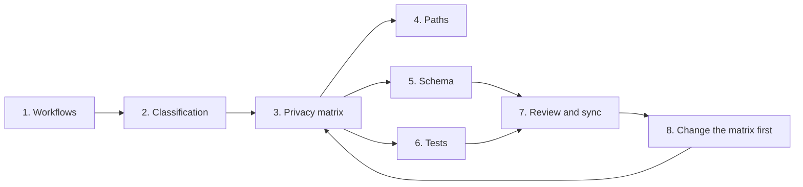
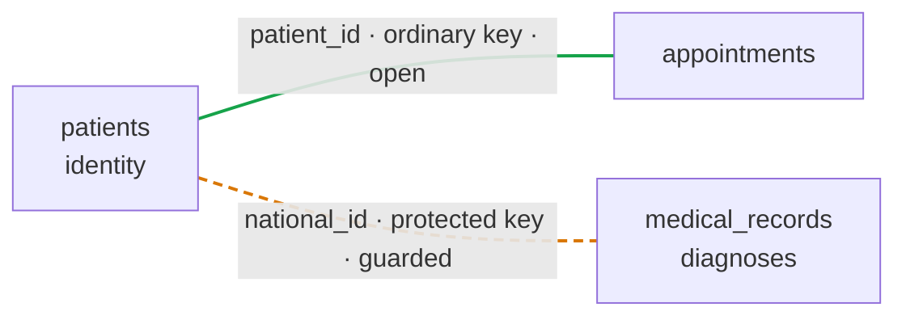
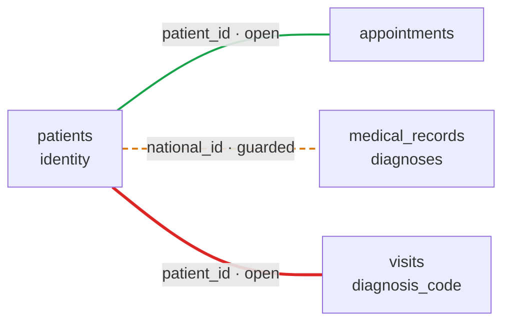
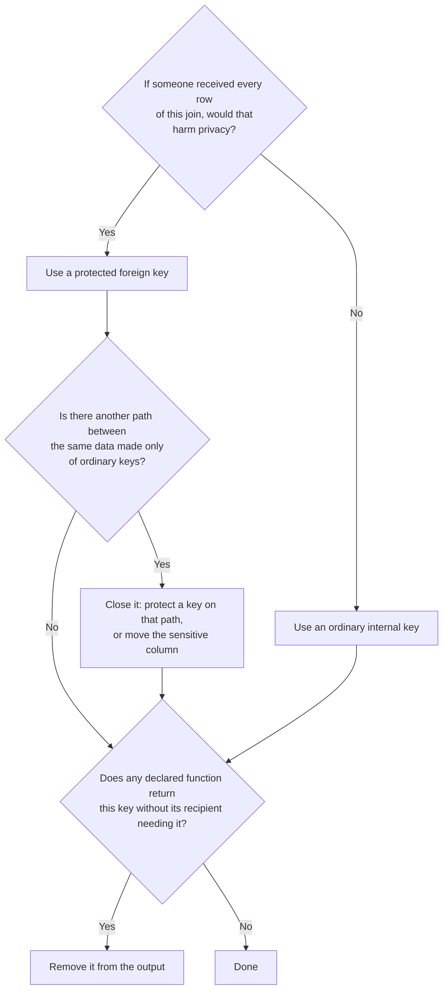

# Design with DEP

## Design principles {#5-design-principles}

**In one sentence:** ten rules that every other part of DEP follows. Each is stated, illustrated with the clinic, and followed by what it means in practice.

**1. Protection is declared in the schema.**
Marking a field as protected changes its behavior everywhere in the engine. There is no separate policy file that can drift out of sync with the table, and no application code that must agree to honor it.
- *Example.* Declaring `national_id TEXT PROTECTED` protects it for all six consumers, including the AI agent connected last week.
- *In practice:* reading the schema is enough to know what is protected.

**2. Defined capabilities instead of general access.**
The rules are an allow-list. Anchored equality matching on the operational path is permitted; everything else (substrings, casts, ordering, ranges, arbitrary functions) is rejected until it is explicitly designed and added.
- *Example.* `WHERE RIGHT(national_id, 4) = '6782'` is rejected, because "last four digits" was never designed as an operation.
- *In practice:* a new SQL feature never weakens protection by accident.

**3. Single values are operational work; bulk processing is declared.**
Finding, updating, or connecting the records of one protected value is everyday work, and DEP allows it to anyone who may use the column. Linking whole datasets, or releasing the values themselves, is an organizational decision, and DEP allows it only in declared code.
- *Example.* The doctor sees Dana's diagnoses; listing every patient's diagnoses requires a declared function.
- *In practice:* applications keep working; exports and linkages become reviewable objects.

**4. Permit and attribute.**
DEP does not decide whether a particular person may look up a particular record; ordinary permissions and the organization's own rules do that. DEP guarantees that every protected match is recorded, attributed to an identity, and rate-limited.
- *Example.* Reception may look anyone up, and every lookup is in the audit log under `reception_app`.
- *In practice:* a single action is allowed and visible; misuse can be detected and traced.

**5. Protection travels with the value.**
Aliases, subqueries, common table expressions, views, temporary tables, and planner transformations must not turn a protected value into an ordinary one.
- *Example.* Wrapping `national_id` in a common table expression and calling `length()` on it is still rejected.
- *In practice:* there is no way to launder a value through query structure.

**6. Exceptions are explicit and local.**
The only way to reveal a protected value is `REVEAL` inside a function declared `DISCLOSES`, and the only way to link whole datasets through protected values is a function declared `LINKS`.
- *Example.* `monthly_fund_report` is visible in the schema as the place ID numbers leave.
- *In practice:* every exception is visible in the code, not hidden in a grant.

**7. Reject rather than silently weaken.**
When a query asks for something forbidden, DEP returns an explicit error. It never "fixes" the query by removing a condition, because that would change its meaning and could return far more data than intended.
- *Example.* The assistant's lookup returns `DEP_ENDPOINT_OPERATION`, not zero rows.
- *In practice:* an error never looks like an empty result, and an empty result never hides an error.

**8. The path belongs to the connection, not to the query.**
Whether a client is operational or masked is decided by the server at login. No statement, session variable, role switch, or pooled connection can change it.
- *Example.* `SET dep.path = 'OPERATIONAL'` on the assistant's connection is rejected.
- *In practice:* a misbehaving client cannot promote itself.

**9. Familiar SQL wherever possible.**
DEP adds a few constructs to PostgreSQL-style syntax and reuses everything else: `CREATE FUNCTION`, `LANGUAGE sql`, `$$` bodies, `GRANT`, `COMMENT ON`. It adds no permission system of its own beyond two privileges for declaring functions.
- *Example.* The monthly report is an ordinary `CREATE FUNCTION` with one extra word, `DISCLOSES`.
- *In practice:* a PostgreSQL developer can read DEP code without learning a new language.

**10. A precise promise rather than a grand one.**
DEP prevents direct disclosure, unreviewed linkage, and arbitrary processing of protected fields. It does not promise anonymity, and it says so.
- *Example.* DEP states plainly that a successful lookup reveals that a patient exists.
- *In practice:* every claim in this document can be tested.

---

## DEP and Privacy as Code {#9-dep-and-privacy-as-code}

**In one sentence:** with DEP, the privacy policy is enforced by the engine that runs every query, and the evidence of that enforcement is produced in the same place.

[Chapter 7](07-privacy.md#3-privacy-as-code-privacy-by-design-and-the-gdpr) compares DEP with Privacy as Code tools and with privacy frameworks. This chapter shows what Privacy as Code looks like in day-to-day work with DEP.

### What changes in practice {#91-what-changes-in-practice}

**What is different?** Four things, each explained below with an example:

| | Without DEP | With DEP |
| --- | --- | --- |
| Where values may leave | Wherever a role has `SELECT` | Only in declared functions, listed in the catalog ([A complete inventory by construction](04-design.md#92-a-complete-inventory-by-construction)) |
| Who looked up what | Unknown, unless every application logs it | Every protected match is recorded by the server ([Everyday work is attributed](04-design.md#93-everyday-work-is-attributed)) |
| Review of privacy-relevant changes | Depends on reviewers noticing | Declared functions are syntax that CI can find ([Review happens in code](04-design.md#94-review-happens-in-code)) |
| Who decides | Whoever holds a permission | People decide; the engine enforces exactly what they approved ([The engine enforces, people decide](04-design.md#95-the-engine-enforces-people-decide)) |

### A complete inventory by construction {#92-a-complete-inventory-by-construction}

**What is it?** Because `REVEAL` is legal only inside disclosing functions, and unanchored matching only inside linking functions, the set of places where protected values can leave the database, or link whole datasets, is exactly the set of declared functions.

**Example**

```sql
SHOW FUNCTIONS;
```

**Selected output fields** (SHOW FUNCTIONS also returns owner, callers, masked-path availability and the body):

| function | discloses | links | comment |
| --- | --- | --- | --- |
| `diagnoses_per_fund()` | | person_id | Diagnosis statistics per health fund |
| `fund_claims_report(DATE)` | person_id | person_id | Monthly diagnosis claims to health funds |
| `monthly_fund_report(DATE)` | person_id | | Monthly visit report to health funds |
| `appointment_reminders(DATE)` | phone_number | | SMS appointment reminders |

**Explanation:** these four rows are the clinic's complete answer to "where can identifiers leave, and where are datasets linked through them?" The answer is complete because of how the system is built, not because someone remembered to document every export.

### Everyday work is attributed {#93-everyday-work-is-attributed}

**What is it?** Anchored matching is allowed without any declaration, but every protected match on the operational path is recorded in the audit log with the identity that made it, and without the value itself.

**Example.** An administrator reviewing yesterday's activity might see entries like these:

| time | identity | operation | protected columns | rows |
| --- | --- | --- | --- | --- |
| 2026-10-19 09:12 | `reception_app` | lookup | `patients.national_id` | 1 |
| 2026-10-19 09:31 | `doctors_app` | anchored join | `patients.national_id`, `medical_records.patient_national_id` | 2 |
| 2026-10-19 23:00 | `reminder_job` | call `appointment_reminders()` | `patients.phone` | 64 |

**Explanation:** the clinic can show who looked up what, and when, without the log itself containing a single ID number. An audit log that held every identifier ever searched for would become the most sensitive table in the system. This table summarizes operations rather than reproducing the native audit format; use [SHOW AUDIT](../reference/show.md#show-audit-n) for the implemented columns.

### Review happens in code {#94-review-happens-in-code}

**What is it?** Declared functions live in migration files like any other schema change. Because `DISCLOSES` and `LINKS` are syntax, a CI pipeline can find every addition or change and require approval from the organization's privacy officer before it merges.

**Example.** A developer adds a new disclosing function in a migration. The pipeline reports:

```text
privacy check: 1 change requires approval
  + CREATE FUNCTION marketing_contacts() ... DISCLOSES phone_number
    no matching cell in privacy/matrix.md (phone x Marketing)
    approval required: privacy-officer
```

**Explanation:** the engine adds the guarantee that makes this review meaningful. Code that is not declared cannot reveal values or link datasets, so the review cannot be bypassed by writing the same logic somewhere else. The checks themselves are described in [Step 7: Keep the matrix and the database in sync](04-design.md#107-step-7-keep-the-matrix-and-the-database-in-sync).

### The engine enforces, people decide {#95-the-engine-enforces-people-decide}

**What is the division of work?** DEP does not run approval workflows, judge lawful bases, or decide what is legitimate. Those decisions belong to the privacy officer, legal counsel, and management. DEP ensures that their decisions are implemented exactly as approved, and that the organization can demonstrate it.

**Key points**

- The catalog is a complete list of exits and linkages.
- The audit log attributes every lookup, without holding values.
- Privacy-relevant changes are syntax, so CI can require their review.
- People decide; DEP enforces and produces the evidence.

---

## Designing with DEP {#10-designing-with-dep}

**In one sentence:** with DEP, privacy decisions are schema decisions, so they are made first, recorded as reviewed artifacts, and turned into grants, declared functions, and tests.

### Why the order of design changes {#100-why-the-order-of-design-changes}

**What changes?** In a conventional project the schema comes first, the application is built on it, and privacy is reviewed afterwards, usually by asking which columns should be hidden from whom. With DEP that order no longer works, because privacy decisions *are* schema decisions: whether a field is `PROTECTED`, which match domain it belongs to, which consumer connects on which path, which roles may use which protected column, and which declared functions exist at all.

**How does the method work?** It has eight steps. Each produces an **artifact** that lives in the repository next to the code, is reviewed like code, and is checked automatically. That is what makes it Privacy as Code rather than a checklist.



### Step 1: Start from the workflows {#101-step-1-start-from-the-workflows}

**Question.** What must the system do, and who or what does it?

**Why first?** A value is sensitive only in relation to what is done with it, so workflows, not data, are the starting point.

**In the clinic**

| Workflow | Consumer | What it needs to do |
| --- | --- | --- |
| Check-in | `reception_app` | Find a patient by the ID number they present and show today's appointments |
| Consultation | `doctors_app` | Find the patient in the room by ID number and show their diagnoses |
| Reminders | `reminder_job` | Send an SMS to each patient with an appointment tomorrow |
| Visit report | `billing_job` | Report each visit to the patient's health fund, identified by ID number |
| Claims | `billing_job` | Submit each month's diagnoses to the health funds, identified by ID number |
| Statistics | `bi_dashboard` | Show how many patients of each health fund have each diagnosis |
| Scheduling | `scheduling_agent` | Suggest scheduling improvements from appointment patterns |

**Artifact:** `privacy/workflows.md`.

### Step 2: Classify the fields {#102-step-2-classify-the-fields}

**Question.** Which fields are protected, in which match domain, and which keys link sensitive data?

**How?** Ask two questions about every field the workflows touch:

1. **Is the value sensitive, and is it mostly *used* rather than *read*?** Protect it when the system needs to use it (to find, deduplicate, or connect records) but most consumers have no need to see it. Fields that people must see to do their work, such as a name at reception or a diagnosis in the consultation room, stay ordinary in the first version, governed by ordinary permissions.
2. **Does the field link datasets whose linkage is sensitive?** DEP enforces anchoring and `LINKS` only on protected columns, so a key that connects two tables is a privacy decision in its own right.

**In the clinic**

| Field | Protected | Match domain | Reason |
| --- | --- | --- | --- |
| `patients.national_id` | Yes | `person_id` | Used to find patients and in the health-fund reports; nobody needs to browse it |
| `patients.phone` | Yes | `phone_number` | Needed only to send reminders |
| `medical_records.patient_national_id` | Yes | `person_id` | Links patients to diagnoses, and that linkage is sensitive |
| `patients.patient_id` | No | None | Internal key linking patients to appointments; that linkage is not sensitive |
| `patients.full_name` | No | None | Reception and doctors must see it |
| `medical_records.diagnosis` | No | None | Sensitive, but doctors must read it; governed by ordinary permissions |

**Explanation:** note what the design avoids: `medical_records` has no `patient_id`. Its only connection to `patients` is the protected ID number, so there is no ordinary path around the linkage rules.

#### Choosing how tables are connected

**What are the options?**

- An **ordinary key** is an open road: anyone with privilege on both tables can join them, on both paths, without anchoring or declaration.
- A **protected key** is a road with a barrier: joins through it are anchored on the operational path, declared in `LINKS` everywhere else, and impossible on the masked path.

The clinic's map:



**Rule 1: the default is an ordinary internal key.** Most links are not sensitive. If `appointments` referenced patients through the protected ID number, the simplest dashboard figure, visits per health fund, would fail on the masked path, and every such report would need a reviewed `LINKS` function.

**Rule 2: a protected foreign key is for links that are themselves sensitive.** A list of names next to diagnoses is the clinic's most sensitive dataset even without a single ID number.

**Rule 3: a sensitive pair must not also be connected by an open road.**

**Example: an open road around the barrier.** A designer adds a `visits` table with a diagnosis code, connected to patients through `patient_id`:



```sql
SELECT p.full_name, v.diagnosis_code
FROM patients AS p JOIN visits AS v USING (patient_id);
```

**Output**

```text
 full_name  | diagnosis_code
------------+----------------
 Dana Cohen | J45
 ...
```

**Explanation:** the query returns every patient's diagnoses, on both paths, without anchoring, without `LINKS`, and without touching a protected column. DEP cannot detect this by itself: to the engine, `patient_id` is an ordinary column like any other. Hence the rule:

> **Between a table that holds identities and a table that holds sensitive data, there must be no path made only of ordinary keys, of any length.**

**Three questions decide each connection**



The first question is a business decision. The other two can be checked from the schema itself, which makes them a natural CI check ([Step 7: Keep the matrix and the database in sync](04-design.md#107-step-7-keep-the-matrix-and-the-database-in-sync)).

**Artifact:** `privacy/classification.md`.

### Step 3: Build the privacy matrix {#103-step-3-build-the-privacy-matrix}

**What is it?** The **privacy matrix** has one row per protected field and one column per workflow. Every cell holds one of four decisions:

| Decision | Meaning |
| --- | --- |
| **MATCH** | The workflow uses the value to find, update, or connect the records of one value at a time, and never sees it. |
| **LINK** | The workflow connects whole datasets through the value. |
| **DISCLOSE** | The workflow needs the value itself to leave the database. |
| **NONE** | The workflow has no use for the value. |

**Rules.** The default is **NONE**. Every MATCH, LINK, and DISCLOSE carries a written reason. A cell may hold two decisions when a workflow both links and discloses.

**In the clinic**

| | Check-in | Consultation | Reminders | Visit report | Claims | Statistics | Scheduling |
| --- | --- | --- | --- | --- | --- | --- | --- |
| `patients.national_id` | MATCH | MATCH | NONE | DISCLOSE | DISCLOSE + LINK | LINK | NONE |
| `patients.phone` | NONE | NONE | DISCLOSE | NONE | NONE | NONE | NONE |
| `medical_records.patient_national_id` | NONE | MATCH | NONE | NONE | LINK | LINK | NONE |

**Explanation: reading by column** tells you what each consumer may do. Reception finds patients by ID number, but cannot look anyone up by phone and never reaches diagnoses. Doctors reach diagnoses one patient at a time: MATCH, not LINK. The reminder job releases phone numbers and touches no ID number. The dashboard links without matching anything itself, by calling a declared function. The scheduling assistant touches no protected value at all.

**Explanation: reading by row** tells you where each value goes. The ID number is used in two workflows, leaves the database in two, and links datasets in two. The phone number is never used for search and leaves only for reminders. The copy of the ID number in `medical_records` is used only by doctors, one patient at a time, and otherwise only in declared linkage; it never leaves.

The matrix covers only protected columns. Ordinary fields are governed by ordinary permissions.

**Artifact:** `privacy/matrix.md`, or an equivalent machine-readable file, with a reason next to every MATCH, LINK, and DISCLOSE.

### Step 4: Assign consumers to paths {#104-step-4-assign-consumers-to-paths}

**Question.** Which consumer connects on which path?

**How?** Apply the rules of [Choosing a path for a consumer](02-sql.md#68-choosing-a-path-for-a-consumer) to the matrix:

| Consumer | Path | Declared functions it may call |
| --- | --- | --- |
| `reception_app` | `OPERATIONAL` | None |
| `doctors_app` | `OPERATIONAL` | None |
| `reminder_job` | `OPERATIONAL` | `appointment_reminders` |
| `billing_job` | `OPERATIONAL` | `monthly_fund_report`, `fund_claims_report` |
| `bi_dashboard` | `MASKED_READ` | `diagnoses_per_fund` |
| `scheduling_agent` | `MASKED_READ` | None |

**Artifact:** endpoint and role configuration.

### Step 5: Translate the decisions into schema {#105-step-5-translate-the-decisions-into-schema}

**Question.** How does each decision become code?

| Matrix decision | Schema construct | In the clinic |
| --- | --- | --- |
| MATCH | Privilege on that protected column for the consumer's role, and the operational endpoint | `GRANT SELECT (patient_id, national_id, full_name, health_fund) ON patients TO reception_app` |
| LINK | A function declared `LINKS`, with `GRANT EXECUTE` | `diagnoses_per_fund` for `bi_dashboard` |
| DISCLOSE | A function declared `DISCLOSES`, with `GRANT EXECUTE` | `appointment_reminders` for `reminder_job` |
| NONE | No privilege on that column for that role | Reception has no privilege on `phone` |

**Explanation:** declared functions are created with no public `EXECUTE`, so every consumer appears in the grants by name. The complete schema, functions, and grants are in [Appendix A](02-sql.md#clinic-schema). Three details in them come straight from the method:

- **The reminder function returns the phone number and the appointment time, but not the visit type.** A reminder SMS does not need to say what the visit is for.
- **No declared function returns `patient_id`.** Each returns only what its recipient needs, so its output cannot be joined back to other tables through an ordinary key.
- **Nobody has privilege on `patients.phone`.** The only route to phone numbers is `appointment_reminders`, and the NONE cells in the phone row are enforced by the absence of a grant.

**Artifact:** migration files.

### Step 6: Write the tests before the implementation {#106-step-6-write-the-tests-before-the-implementation}

**Question.** How do we prove each decision holds?

**How?** Every cell of the matrix becomes a test. Each test states a statement, a role, a path, and the expected result or error. The **NONE** cells produce negative tests, and they are the most important ones: they prove what must *not* happen.

**In the clinic**

```sql
-- national_id x Check-in = MATCH
-- role: reception_app    path: OPERATIONAL   expect: Dana's appointments; no national_id in output
SELECT p.full_name, a.starts_at
FROM patients AS p JOIN appointments AS a USING (patient_id)
WHERE p.national_id = '123456782';

-- phone x Check-in = NONE
-- role: reception_app    path: OPERATIONAL   expect: permission denied for column phone
SELECT full_name FROM patients WHERE phone = '+972-50-0000001';

-- medical_records x Consultation = MATCH (anchored)
-- role: doctors_app      path: OPERATIONAL   expect: Dana's diagnoses
SELECT m.diagnosis
FROM patients AS p JOIN medical_records AS m ON m.patient_national_id = p.national_id
WHERE p.national_id = '123456782';

-- medical_records x Consultation: linking everyone is not MATCH
-- role: doctors_app      path: OPERATIONAL   expect: DEP_UNANCHORED_MATCH
SELECT p.full_name, m.diagnosis
FROM patients AS p JOIN medical_records AS m ON m.patient_national_id = p.national_id;

-- national_id x Statistics = LINK
-- role: bi_dashboard     path: MASKED_READ   expect: rows of counts
SELECT * FROM diagnoses_per_fund();

-- national_id x Scheduling = NONE
-- role: scheduling_agent path: MASKED_READ   expect: DEP_ENDPOINT_OPERATION
SELECT a.starts_at
FROM patients AS p JOIN appointments AS a USING (patient_id)
WHERE p.national_id = '123456782';

-- phone x Visit report = NONE
-- role: billing_job      path: OPERATIONAL   expect: permission denied for function
SELECT * FROM appointment_reminders(DATE '2026-10-21');

-- Disclosed values are terminal
-- role: billing_job      path: OPERATIONAL   expect: DEP_DISCLOSED_VALUE_USE
SELECT r.national_id, m.diagnosis
FROM monthly_fund_report('2026-10-01') AS r
JOIN medical_records AS m ON m.patient_national_id = r.national_id;
```

**Explanation:** these tests use the same format a DEP conformance suite would. If any of them stops behaving as expected, a privacy decision has been broken, and the build fails.

**Artifact:** the matrix-derived test suite.

### Step 7: Keep the matrix and the database in sync {#107-step-7-keep-the-matrix-and-the-database-in-sync}

**Question.** Does what runs match what was decided?

**How?** The matrix and the schema live in the same repository and are reviewed together. A CI pipeline can enforce that:

1. every declared function in the migrations corresponds to a DISCLOSE or LINK cell, and every such cell has a function;
2. every privilege on a protected column corresponds to a MATCH cell for that role;
3. every new declared function, every `GRANT EXECUTE` on one, and every new privilege on a protected column is approved by the clinic's privacy officer;
4. every MATCH, LINK, and DISCLOSE cell carries a written reason;
5. the map of foreign keys contains no path made only of ordinary keys between a table that holds identities and a table that holds sensitive data;
6. the matrix-derived tests pass.

**After deployment.** The same comparison runs against the live database: `SHOW FUNCTIONS` and the privileges on protected columns are checked against the matrix.

**Example: a drift report**

```text
drift: 1 object in the database is not in the matrix
  GRANT EXECUTE ON FUNCTION monthly_fund_report(DATE) TO bi_dashboard
  matrix: national_id x Statistics = LINK (not DISCLOSE)
```

**Explanation:** someone granted the dashboard access to a disclosing function by hand. The grant would be useless on the masked path, but it contradicts what was decided, so it is reported.

**Artifact:** CI checks and a drift report.

### Step 8: Change the matrix first {#108-step-8-change-the-matrix-first}

**What is the rule?** When a new need arrives, the first change is to the matrix, not to the code.

**Example.** The marketing team asks to send patients a promotional SMS. That is a new column in the matrix, and a new question in one cell: `phone x Marketing = DISCLOSE?`

**Explanation:** the question "may we?" is now asked explicitly, with the reason written down and reviewed, and perhaps answered no. Without the matrix, it would have been answered by whoever happened to have permission to run a query.

### Summary of the method {#109-summary-of-the-method}

| Step | Question it answers | Artifact |
| --- | --- | --- |
| 1. Workflows | What must the system do, and who does it? | `privacy/workflows.md` |
| 2. Classification | Which fields are protected, in which match domain, and which keys link sensitive data? | `privacy/classification.md` |
| 3. Privacy matrix | For each field and workflow: match, link, disclose, or nothing? | `privacy/matrix.md` |
| 4. Paths | Which consumer connects on which path? | Endpoint and role configuration |
| 5. Schema | How do the decisions become code? | Migrations: tables, declared functions, grants |
| 6. Tests | How do we prove each decision holds? | Matrix-derived test suite |
| 7. Review and sync | Does what runs match what was decided? | CI checks and drift report |
| 8. Change | How does the system evolve? | Matrix first, code second |

**Notes.** The method does not replace legal review or a data protection impact assessment. It gives them precise inputs (the matrix and its reasons) and verifiable outputs: the schema, the tests, and the catalog.

**Key points**

- Decide privacy first: workflows, then fields, then the matrix.
- Every matrix cell becomes a grant or a declared function, and a test.
- CI and the drift report keep the database equal to what was decided.

---

## Use cases {#11-use-cases}

**In one sentence:** the same three patterns (match one value, link through declared code, disclose through declared code) appear wherever an organization holds identifiers it uses more than it reads.

### In the clinic {#111-in-the-clinic}

| Workflow | What DEP allows | What DEP prevents |
| --- | --- | --- |
| **Reception** | Finding a patient by the ID number she presents, and showing her appointments | Downloading the register; reaching diagnoses; reverse lookup by phone |
| **Consultation room** | Seeing the diagnoses of the patient in the room, through an anchored join | Listing the diagnoses of every patient |
| **Statistics** | Diagnoses per health fund, through the declared `diagnoses_per_fund` | Any linkage the dashboard writes itself |
| **Reports to the health funds** | The visit report and the claims, through declared disclosing functions | Any other route by which ID numbers leave |
| **The AI agent** | Exploring, aggregating, and joining appointments and patients through ordinary keys | Looking a patient up by ID number, or extracting identifiers, whatever SQL it generates |

**Explanation:** in every case, the legitimate work keeps running. What changes is that a compromised application, or an agent following the wrong instructions, cannot turn its access into a full export or a full linkage. Privacy is enforced by the server, not by the agent's prompt.

### Beyond the clinic {#112-beyond-the-clinic}

| Setting | Matching | Linking | Disclosing |
| --- | --- | --- | --- |
| **Customer service** in a bank or a telecom company | Agents find a caller by the identifier they give | Complaint statistics per product | A regulatory report identified by customer number |
| **Human resources and payroll** | HR finds an employee by ID number | Salary statistics per department | The annual salary report to the tax authority |
| **Development and support access** | None | None | None: engineers query realistic data through the masked path without ever seeing identifiers |

---

## Automating the review

The matrix-to-schema checks and drift report above describe a review workflow to implement in your own project. DEP Engine exposes SHOW FUNCTIONS, SHOW GRANTS and SHOW PRIVACY MATRIX; it does not ship the illustrated CI policy or an automatic privacy-officer approval service.


<figure markdown="1">

<picture><source media="(prefers-color-scheme: dark)" srcset="../images/studio/studio-matrix-dark.png"></picture>

<figcaption>Compare the computed privacy matrix with the workflows and permissions you approved.</figcaption>
</figure>
