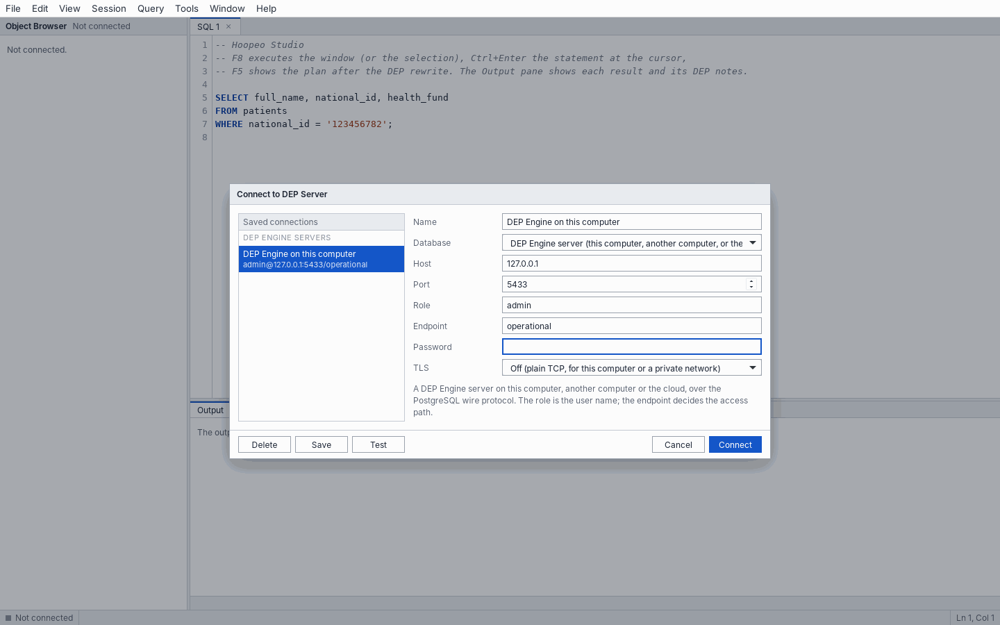
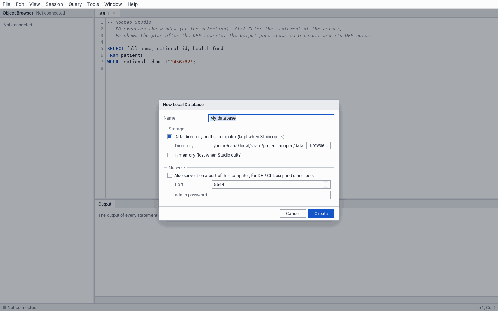

# Build an application

This chapter builds the downloadable starter, a smaller clinic with a `records` table. Earlier book examples use the full clinic with `medical_records`. These are separate databases; the section [Run the full clinic](#run-the-full-clinic) below prepares the earlier examples.


Create a small patient lookup application with a protected identifier. You will set up an isolated local server, create a schema and roles, connect from Python or Node.js, and verify both permitted and refused operations.

**Target:** DEP Engine 0.5.2. **Time:** about 15 minutes after installing the tools. This walkthrough builds an application for the example clinic.

[Download the complete starter](../../downloads/dep-starter.zip): schema, Python and Node.js examples, environment files and a verification script. The website's SQL examples are checked against DEP.js; verify them against your installed Engine before relying on an integration.

## 1. Prepare the tools

Install **DEP Engine** and **DEP CLI** from the [Install page](../../site/content/install.md), then extract the starter and open a terminal in its `dep-starter` folder.

The walkthrough uses **127.0.0.1:5543** to avoid the service port 5433 that an installer may already use. It creates a separate database in `./data`. You do not need to stop an existing service.

You also need either Python 3.10+ with a virtual environment, or Node.js 22+. For a browser-only introduction, use the [playground](../../playground).

## 2. Start an isolated server

**Terminal A: keep this running:**

```sh
dep-engine --listen 127.0.0.1:5543 --data-dir ./data \
  --admin-password local-dev-only --init ./schema.sql
```

The initialization script runs only when this database is new. It creates `patients`, a related `records` table, a lookup role `demo_app`, and a separate disclosure role `export_job`.

The passwords in the starter are deliberately local demonstration values. The server binds to loopback. For a shared server, use your own credentials and TLS; follow [Administration](../guides/administration.md).

<figure markdown="1">


<figcaption>The server reports its listeners and storage configuration at startup.</figcaption>
</figure>

## 3. Inspect the schema and grants

The starter's `schema.sql` runs as admin. These are the core declarations already executed by schema.sql. Read them here; do not execute them a second time in the initialized database:

```sql
CREATE TABLE patients (
    patient_id BIGINT PRIMARY KEY,
    national_id TEXT PROTECTED MATCH DOMAIN person_id UNIQUE,
    full_name TEXT
);

CREATE TABLE records (
    record_id BIGINT PRIMARY KEY,
    patient_national_id TEXT PROTECTED REFERENCES patients (national_id),
    diagnosis TEXT
);

INSERT INTO patients VALUES (1, '123456782', 'Dana Cohen');
INSERT INTO records VALUES (1, '123456782', 'Synthetic example');

CREATE ROLE demo_app LOGIN PASSWORD 'demo-local';
GRANT CONNECT ON ENDPOINT operational TO demo_app;
GRANT SELECT (patient_id, full_name, national_id) ON patients TO demo_app;
GRANT SELECT ON records TO demo_app;
ALTER ROLE demo_app MATCH LIMIT 600 PER HOUR;
```

Both protected columns belong to `person_id`; the protected reference inherits its domain. A SELECT grant on the protected column allows matching, not plaintext output.

**Terminal B: connect as the application:**

```sh
DEP_PASSWORD=demo-local dep-cli -h 127.0.0.1 -p 5543 -U demo_app -d operational
```

Here the database name `operational` chooses the endpoint and fixes the access path for the session. Use a separate connection or pool for another role or endpoint.

## 4. Find a patient without receiving their ID

```sql
SELECT full_name, national_id
FROM patients
WHERE national_id = '123456782';
```

Expected result:

```text
 full_name  | national_id
------------+------------
 Dana Cohen | NULL
```

The identifier matched by equality. The NULL is protected output, not proof that the stored identifier is missing. DEP notes explain the operation.

This query must be refused with **ZD101**:

```sql
SELECT full_name FROM patients WHERE national_id LIKE '123%';
```

## 5. Connect from your application

Exit the shell with `\q` before running these terminal commands. Choose one language; you do not need both.

<div class="tabs" markdown="1">
<div class="tablist" role="tablist" aria-label="Application language" markdown="1">
<a role="tab" href="#app-python" aria-selected="true">Python</a>
<a role="tab" href="#app-node" aria-selected="false">Node.js</a>
</div>
<section class="tabpanel" id="app-python" markdown="1">

### Python / psycopg

The starter includes requirements for psycopg 3.3 and loads connection settings from the environment.

```sh
python3 -m venv .venv
. .venv/bin/activate
pip install -r python/requirements.txt
export DEP_DSN='host=127.0.0.1 port=5543 user=demo_app password=demo-local dbname=operational sslmode=disable'
python python/app.py
```

The essential query uses a bound parameter:

```python
import os
import psycopg

with psycopg.connect(os.environ['DEP_DSN'], autocommit=True) as conn:
    row = conn.execute(
        'SELECT full_name, national_id FROM patients WHERE national_id = %s',
        ('123456782',)
    ).fetchone()
    print(row)  # ('Dana Cohen', None)
```

</section>
<section class="tabpanel" id="app-node" markdown="1">

### Node.js / node-postgres

```sh
cd node
npm install
cp .env.example .env
node --env-file=.env app.js
```

The essential query uses the same PostgreSQL parameter convention:

```javascript
const { Client } = require('pg');

async function main() {
  const client = new Client({ connectionString: process.env.DEP_DSN });
  await client.connect();
  try {
    const result = await client.query(
      'SELECT full_name, national_id FROM patients WHERE national_id = $1',
      ['123456782']
    );
    console.log(result.rows); // national_id: null
  } finally {
    await client.end();
  }
}
main().catch(error => { console.error(error.code || error.message); process.exitCode = 1; });
```

Run this as the application role demo_app, using the connection string in .env. The full starter also demonstrates handling a refused partial match.

</section>
</div>

`sslmode=disable` is appropriate only for this loopback demonstration. Use verified TLS when connecting over a network. Handle DEP errors by SQLSTATE and avoid logging parameter values.

## 6. Connect related records

This join is tied to one supplied protected value:

```sql
SELECT p.full_name, r.diagnosis
FROM patients AS p
JOIN records AS r ON r.patient_national_id = p.national_id
WHERE p.national_id = '123456782';
```

Removing the WHERE anchor must produce **ZD107**, because the join would match whole datasets. A justified dataset-wide match belongs inside a function declared `LINKS person_id`.

## 7. Declare a narrow disclosure

The complete starter also creates `privacy_owner` (a NOLOGIN role) and `export_job`. As admin, it grants the owner the operational endpoint, SELECT and DISCLOSE, switches to that owner to declare the function, then resets the role. The following explains the existing schema.sql setup; it is not an additional initialization step:

```sql
GRANT CONNECT ON ENDPOINT operational TO privacy_owner;
GRANT SELECT ON patients TO privacy_owner;
GRANT DISCLOSE ON MATCH DOMAIN person_id TO privacy_owner;

SET ROLE privacy_owner;
CREATE FUNCTION patient_identifier(id BIGINT)
RETURNS TABLE (national_id TEXT)
LANGUAGE sql
DISCLOSES person_id
AS $$
    SELECT REVEAL(p.national_id)
    FROM patients AS p
    WHERE p.patient_id = id
$$;
COMMENT ON FUNCTION patient_identifier(BIGINT)
IS 'Purpose: approved single-patient identifier export for this local demo.';
GRANT EXECUTE ON FUNCTION patient_identifier(BIGINT) TO export_job;
RESET ROLE;
```

To call it yourself, open a **new connection as export_job**. This role was created by schema.sql and has EXECUTE on this function, but no direct table-read grant.

**Terminal command:**

```sh
DEP_PASSWORD=export-local dep-cli -h 127.0.0.1 -p 5543 -U export_job -d operational
```

**SQL in that connection:**

```sql
SELECT * FROM patient_identifier(1);
```

Expected output:

```text
national_id
-----------
123456782
```

The synthetic ID is returned. `demo_app` has no EXECUTE grant and cannot call this function. Under the specification, the disclosed ID may only be returned: do not sort, filter or join on it. Match inside the function before REVEAL. See the [known native sorting difference](../guides/compatibility.md#known-difference-sorting-disclosed-values) for implementation status.

## 8. Verify the boundaries and inspect the audit

The starter's checks connect with separate application identities. Use the version for the language you installed:

**Python: from the starter root, with the virtual environment activated:**

```sh
python python/verify.py
```

**Node.js: from the starter's node folder:**

```sh
npm run verify
```

Both print PASS when the required boundaries hold. They fail if the connected Engine behaves differently from the documented rules.

Both also require disclosed sorting to fail with ZD104. A review reports that native 0.5.1 accepts it, so an affected Engine will fail this check. Keep that failure visible until native enforcement is fixed; it does not indicate an application setup error. Native 0.5.2 has not been retested here for this issue.

They verify that lookup output is NULL, a partial match fails with ZD101, an unanchored join fails with ZD107, disclosure fails for demo_app, and export_job can call its approved function. This requires the running DEP Engine and the dependency for your chosen language from step 5.

Connect **as admin** to inspect governance:

```sh
DEP_PASSWORD=local-dev-only dep-cli -h 127.0.0.1 -p 5543 -U admin -d operational
```

```sql
SHOW PRIVACY MATRIX;
SHOW AUDIT 20;
```

Audit records attribute protected operations to roles without recording the protected values. Inspect [notes and errors](../guides/applications.md#notes-and-errors), [match limits](../guides/dep-sql.md#match-limits), and the [server guide](../guides/administration.md) before expanding the application.

## Restarting and changing your schema

Stop Terminal A with Ctrl+C, then run the same server command to reopen `./data`. The initialization script will not run again. DEP Engine 0.5.2 has no ALTER TABLE support: for a different tutorial schema, choose a new directory such as `./data-v2`, or plan an explicit migration. Do not assume an ORM's migration commands will work.


## If something does not work

| Symptom | What to check | Next step |
|---|---|---|
| dep-engine or dep-cli: command not found | The binary was not installed, or your shell PATH has not refreshed | Follow the Install page for your OS; open a new terminal after installation |
| Address already in use | Another server is listening on the selected port | This tutorial uses 5543; choose another local port and update every client connection consistently |
| patients already exists | The schema was imported into a database that already contains it | Connect without importing again, or start a new isolated data directory |
| The changed schema.sql seems ignored | --init runs only for a new database | Use a new directory such as ./data-v2 when testing a new tutorial schema |
| SQLSTATE ZD102 on a lookup | The connection is on the MASKED_READ path | Open a new authorized operational connection; SET cannot change the path |
| SQLSTATE 42501 on the disclosure | The connection is demo_app, or an EXECUTE/owner privilege is missing | Use export_job for the approved export; inspect grants as admin |
| national_id is NULL | The selected output is protected | This is expected. Match on the input value or call an explicitly approved disclosure function |
| An integration check fails | Installed Engine behavior or the loaded schema differs from this guide | Keep the SQLSTATE and compare the exact version and schema; the website build verifies DEP.js, not a native Engine process |

For a slower explanation of each operation and result, read [Understand the examples](../guides/read-examples.md).


## Connection settings

| Setting | Value |
|---|---|
| Host, port | The server's `--listen` address (default `127.0.0.1:5433`) |
| User | The **role**, for example `reception_app` |
| Database | The **endpoint**, for example `operational` or `analytics`. It fixes the access path. |
| Password | The role's password |
| SSL mode | `require` or `verify-full` for any server that is not on the same machine; see the [administration guide](../guides/administration.md#tls) |

The role is a database role, not a person, in most deployments: one role per application or job, each granted the endpoint, columns and functions it needs and nothing more. Connect an analytics tool through `analytics` and it cannot match, write, or disclose, whatever its role is granted.

A connection keeps its role and path for its whole life. The path is fixed when it logs in, and cannot be changed by `SET`. If an application needs two access paths, it opens two connections, ideally with two roles.

## Parameters

Use parameters, as with any database. DEP treats a protected parameter (`$1` compared with a protected column, or inserted into one) exactly as it treats a protected literal. In the extended protocol the engine infers the types of parameters for queries and for `INSERT`, `UPDATE` and `DELETE`. An error message never carries the value of a bound parameter.

## Notes and errors

- **Notes.** Each rule that applies produces a DEP note, sent as a PostgreSQL `NOTICE` whose text starts with `DEP: `. Drivers deliver notices through a handler (`add_notice_handler` in psycopg, the `notice` event in node-postgres). They need no handling: ignore them in production and read them while developing.
- **Errors.** A DEP error has a `ZDnnn` SQLSTATE and a message and a hint. Branch on the SQLSTATE. The `DEP_...` name is not sent over the PostgreSQL protocol; the [error reference](../reference/errors.md) maps one to the other. Constraint violations use PostgreSQL's SQLSTATEs (`23505`, `23502`, `23503`), and `40001` means the transaction should be retried.
- **Protected columns come back as NULL.** `SELECT national_id` returns a row with NULL, never an error. An application that needs the value must call a declared function, and the role must have `EXECUTE` on it.

## Pools, roles and sessions

- **One pool per role and endpoint.** A connection's identity is its role and path, so do not share a pool between applications. The audit log attributes every protected match to the role that made it.
- **Do not rely on `SET ROLE`.** Only a superuser may use it, and it changes the privileges that apply without changing the path. Use separate connections.
- **Keep transactions short.** One transaction writes at a time, and a transaction left idle for `--idle-in-transaction-timeout` is rolled back. See [Transactions](../guides/transactions-and-constraints.md#concurrent-transactions).
- **Retry on `40001`.** It means another transaction changed a table this one wanted to write.
- **Mind the match limit.** An application that looks up many protected values in a short time can reach its role's limit (`ZD109`). The limit counts every value of an `IN` list.

## HTTP clients

Clients without a PostgreSQL driver can use [POST /v1/query](../reference/http-api.md). It uses role authentication and the same endpoint and grants. Open transactions must finish in one HTTP request; see the API reference for request and result formats.


## Run the full clinic {#run-the-full-clinic}

## 1. Choose a local environment

This setup loads the full clinic used in chapters 1 to 4, instead of the smaller starter database above.

Install **DEP Engine** and **DEP CLI** from [Install](../../site/content/install.md). Studio can also run an embedded database: choose New Local Database and load the clinic there, without starting another server.

Download [clinic.sql](../../examples/clinic.sql) into your current folder. The commands below use `./clinic.sql`, not a repository-relative examples path.

## 2. Start the clinic, or use your running service

Choose one option. An installer may already have started a persistent service on port 5433.

### Option A: isolated manual server (recommended for this tour)

Use port **5543** so the tour can run beside an installed service. Keep Terminal A running:

```sh
dep-engine --listen 127.0.0.1:5543 --init ./clinic.sql --admin-password local-dev-only --http-listen 127.0.0.1:8543
```

This instance is in memory: its data disappears when it stops. Every connection below uses port 5543 and the HTTP examples use 8543. The clinic's application-role passwords are `demo`.

### Option B: the installed background service

Use the service on **5433** instead of starting another process. Import `./clinic.sql` only into a fresh evaluation database. `--init` only runs when a database is new.

On Linux, read the package-generated admin password and import the clinic:

```sh
export DEP_PASSWORD=$(sudo cat /etc/dep-engine/admin-password)
dep-cli -h 127.0.0.1 -p 5433 -U admin -d operational -f ./clinic.sql
```

On macOS:

```sh
export DEP_PASSWORD=$(cat "$HOME/Library/Application Support/Project Hoopeo/admin-password")
dep-cli -h 127.0.0.1 -p 5433 -U admin -d operational -f ./clinic.sql
```

If you choose this option, replace **5543 with 5433** in the connection examples below. The service's HTTP API is optional: do not assume port 8543 exists. Use CLI or psql, or configure the HTTP listener explicitly through [Administration](../guides/administration.md).

**Already loaded the clinic?** Connect to it without importing again. Existing table errors mean that this is not an empty database. For an isolated first try, use Option A.

The clinic has three tables, eight roles and two endpoints. The database name is the endpoint: `operational` permits authorized matching and writes; `analytics` is MASKED_READ. The access path is fixed at login.

## 3. Connect

The user name is the **role**, and the database name is the **endpoint**. There are three ways in.

### DEP CLI

```sh
dep-cli -h 127.0.0.1 -p 5543 -U reception_app -d operational
```

The password comes from `DEP_PASSWORD`, `PGPASSWORD` or a prompt. For a first try without a server, DEP CLI can hold the clinic itself, in memory:

```sh
dep-cli --memory --init ./clinic.sql -U reception_app
```

Type `\dt` to list the tables, and any statement to run it. DEP notes are printed before each result:


### psql, or any PostgreSQL driver

DEP Engine speaks the PostgreSQL wire protocol, so `psql` works as it is. The DEP notes of each statement arrive as ordinary `NOTICE` messages.

```sh
export PGPASSWORD=demo
psql "host=127.0.0.1 port=5543 user=reception_app dbname=operational sslmode=disable" \
     -c "SELECT full_name, national_id FROM patients WHERE national_id = '123456782'"
```


`sslmode=disable` is for this local try. See the [administration guide](../guides/administration.md) for TLS.

### The HTTP API

```sh
curl -s -u reception_app:demo "http://127.0.0.1:8543/v1/query?endpoint=operational" \
     -H 'Content-Type: application/json' \
     -d '{"sql": "SELECT full_name, national_id FROM patients WHERE national_id = $1", "params": ["123456782"]}'
```

```text
{"endpoint":"operational","open_transaction_rolled_back":false,"path":"OPERATIONAL","results":[{"columns":["full_name","national_id"],"elapsed_ms":3.13,"notes":["PROTECTED column patients.national_id is matched by equality through the blind index of MATCH DOMAIN person_id.","Output column national_id is PROTECTED column patients.national_id (MATCH DOMAIN person_id) and is returned as NULL."],"row_count":1,"rows":[["Dana Cohen",null]],"statement":"SELECT full_name, national_id FROM patients WHERE national_id = $1"}],"role":"reception_app"}
```

The [HTTP API reference](../reference/http-api.md) describes the request and the response.


<figure markdown="1">


<figcaption>In Studio, a connection identifies the server, role and endpoint.</figcaption>
</figure>


<figure markdown="1">



<figcaption>Studio can open a connection to a running server.</figcaption>
</figure>


<figure markdown="1">

<picture><source media="(prefers-color-scheme: dark)" srcset="../images/studio/studio-lookup-dark.png"></picture>

<figcaption>A successful lookup returns ordinary fields while the protected identifier is NULL.</figcaption>
</figure>


<figure markdown="1">



<figcaption>Studio also supports a local embedded database for exploration.</figcaption>
</figure>


<figure markdown="1">


<figcaption>The local-database dialog chooses the database location and initial setup.</figcaption>
</figure>
