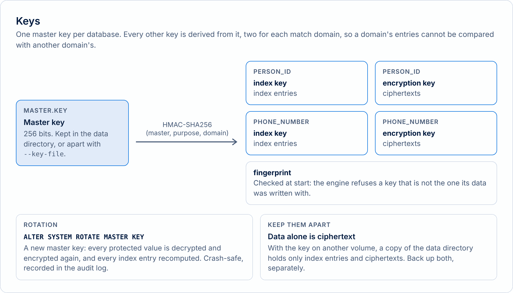
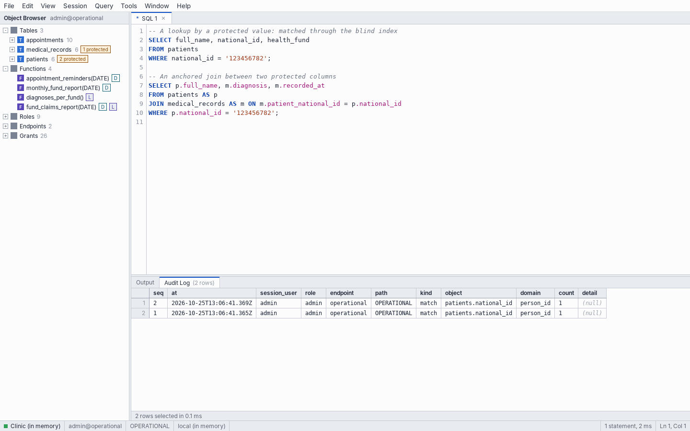
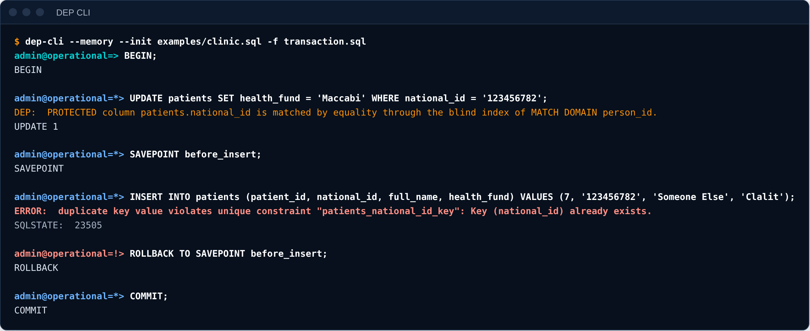
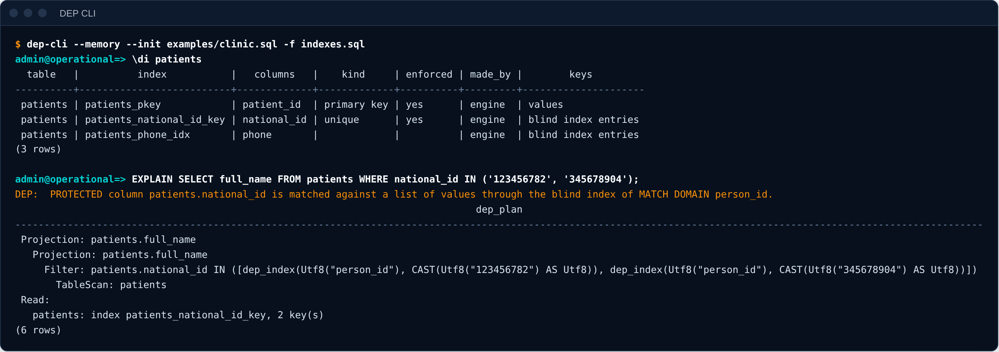
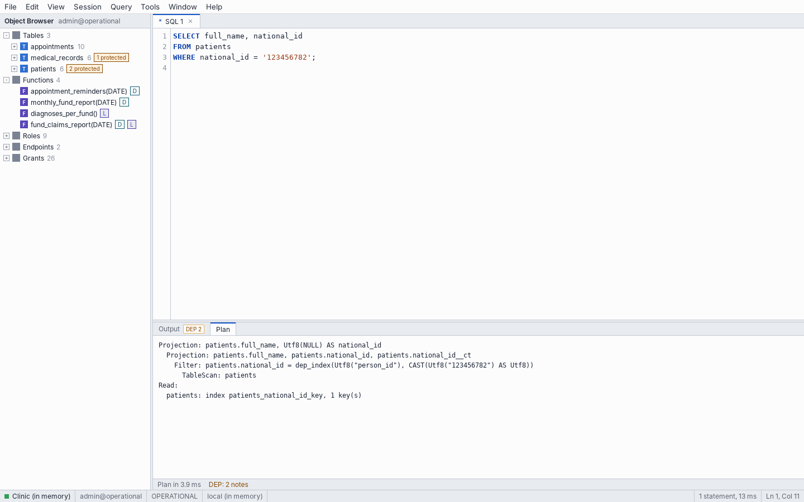

# Run the server

Know the supported forms and version differences before deploying a server or choosing an integration.

## Compatibility {#compatibility}


Know what DEP Engine 0.5.2 supports before choosing it for an application. This is an experimental reference server for evaluation and non-production testing.

## What you are running

DEP Engine is built on **Apache DataFusion**. It accepts DEP SQL and speaks the **PostgreSQL wire protocol**. It is a separate database server: these additions cannot be installed by running `CREATE EXTENSION` in an existing PostgreSQL database.

PostgreSQL drivers can connect, but PostgreSQL wire compatibility does not mean that PostgreSQL SQL, extensions, catalogs or ORM migrations are all supported.

## Support at a glance

| Capability | Current behavior |
|---|---|
| Ordinary queries | SELECT, joins, CTEs, subqueries, aggregates and window functions, within the analyzer's supported forms |
| Writing | INSERT, UPDATE and DELETE |
| Protected matching | Whole-value equality and lists of values; appropriate privileges and OPERATIONAL path required |
| Protected output | NULL in ordinary query output; explicit DISCLOSES functions may release values |
| Protected joins | A single-value anchor, or a declared LINKS function, is required |
| Transactions | Transactions and savepoints; one writer at a time |
| Constraints | PRIMARY KEY, UNIQUE, NOT NULL and REFERENCES, including protected columns |
| Schema migration | ALTER TABLE is not supported |
| Defaults and validation | DEFAULT and CHECK are not supported |
| Bulk statements | COPY and MERGE are not supported |
| Referential actions | NO ACTION only; no ON DELETE CASCADE |
| Declared functions | LANGUAGE sql and RETURNS TABLE; no PL/pgSQL |
| Protected transformations | No LIKE, range, sort, cast, substring or arbitrary function calls on protected values. The design allows presence tests in operational filters, but refuses returning the test or `COUNT(col)` on either path. See the [presence-test table](02-sql.md#protected-value-presence) and the native differences below. |
| Disclosed values | The specification permits output only (renamed or cast); filtering, joining, grouping, `DISTINCT`, sorting, storing and function arguments are forbidden. DEP Engine 0.5.2 does not apply all of it: see the known differences below. |

The [language guide](../guides/dep-sql.md) defines the rules and their error codes. [Transactions and constraints](../guides/transactions-and-constraints.md) covers concurrency, indexes and EXPLAIN.

## Clients tested by the project

The examples of [chapter 5](05-application.md) are documented as tested against DEP Engine 0.5.2 with:

| Client | Documented version | Status |
|---|---|---|
| psql | 16 | Connection and query examples |
| Python psycopg | 3.3 | Application examples |
| node-postgres | 8.23 | Application examples |
| Other PostgreSQL drivers | Not verified | Expected to connect; not individually verified by that guide |
| ORMs and migration frameworks | Not verified | No general compatibility claim; test generated SQL and catalog access |

Use explicit SQL for the first application. Before introducing an ORM, check its connection probes, schema introspection, transaction behavior and migrations against the supported forms.

## The simulator and the server

**DEP.js** runs in your browser on sql.js / SQLite, using the synthetic clinic. It demonstrates DEP SQL rules; enforcement for connected applications is provided by DEP Engine on the server.

**DEP Engine** enforces the rules on the server for connected clients. The server, operating system and administrator are trusted. Identifiers are stored as a blind index and ciphertext; authorized matches still reveal that a record exists.

Ordinary names, dates and ordinary join keys remain governed by ordinary permissions. Aggregates can identify people in small groups. Values released to a client are outside DEP's control. Read [DEP and GDPR](../../site/content/gdpr.md) for the implications.

### Known difference: sorting disclosed values

The [terminal rule](03-functions.md#89-disclosed-values-and-the-terminal-rule) in chapter 3 forbids using a disclosed value as a sort key. DEP.js follows this rule and returns **ZD104 (DEP_DISCLOSED_VALUE_USE)** for each query below:

```sql
-- Sort by the disclosed column's name.
SELECT national_id FROM monthly_fund_report(DATE '2026-10-01')
ORDER BY national_id;

-- Sort by an alias of the disclosed column.
SELECT national_id AS exposed_id FROM monthly_fund_report(DATE '2026-10-01')
ORDER BY exposed_id;

-- Sort by the disclosed column's position in the result.
SELECT national_id FROM monthly_fund_report(DATE '2026-10-01')
ORDER BY 1;
```

Native testing of DEP Engine 0.5.1 confirmed that **it accepts all three forms**, contrary to the specification. Version 0.5.2 changed licensing and distribution only, and its query behavior is the same, so assume that 0.5.2 accepts them too.

Sort reports by an ordinary output column, such as `visit_date` or `visit_type`. This keeps examples within the specified rules; it does not repair enforcement in an affected Engine. The compatibility suite includes name, alias and ordinal cases without suppressing differences.

### Other known differences in DEP Engine 0.5.2

The same testing found three more places where the native analyzer checks less than the specification. DEP.js follows the specification in all three.

| Rule | DEP.js and the specification | DEP Engine 0.5.2 |
|---|---|---|
| Presence of a protected value | A filter such as `WHERE national_id IS NOT NULL` is allowed only on the operational path. Returning the test or using `COUNT(national_id)` is refused on either path (`ZD101` operational; `ZD102` masked). `COUNT(*)` counts rows and is allowed on either. [Examples and permission table](02-sql.md#protected-value-presence). | Accepts `IS NULL`, `IS NOT NULL` and `COUNT(col)` on both paths, so a masked connection can learn whether a person has a value on record |
| Computing on a disclosed value | `upper(national_id)`, `concat(national_id, '')`, `CASE` over a disclosed value and `SELECT DISTINCT national_id` are refused (`ZD104`); renaming and casting are allowed | Accepts functions, operators and `DISTINCT` over a disclosed value in the output |
| Rows of a `VALUES` list | Checked like any projection, including scalar subqueries | Not checked. A DataFusion limitation currently stops a scalar subquery inside `VALUES` from running, so no value leaks today, but the analyzer does not enforce the rules there |

Fixes for all four differences, with regression tests, exist in the development source of DEP Engine and are not yet in a release. Until a release includes them, test these cases against the Engine you run, and do not rely on the specification's guarantees for them.

## Version, licensing and readiness

- **Current documented engine:** 0.5.2. The release is available as binary packages.
- **Readiness:** experimental evaluation software, not a production-readiness assurance.
- **Open material:** specification and documentation under CC BY 4.0; DEP.js, the playground and examples under Apache 2.0.
- **Binary licensing:** evaluation terms apply to Engine, CLI and Studio. A commercial license is a licensing arrangement, not evidence of production readiness.
- **Future plans:** the [design roadmap](../design/02-roadmap-and-release.md) discusses possible future work, including PostgreSQL. It is not the current feature list.

See [licensing](../../LICENSING.md) and [the current releases](https://github.com/mandelreouven2002/project-hoopeo.github.io/releases).


## Server administration


This guide is for the person who runs DEP Engine as a server for other people or programs: configuration, TLS, the data directory and its key, resources, the audit log, key rotation, upgrades and metrics.

<p class="muted"><span class="badge">Experimental</span> Project Hoopeo is an experimental, conceptual project. See the <a href="../../site/content/legal/terms.md">terms of use</a>.</p>

## Running the server

```sh
dep-engine --listen 127.0.0.1:5433 --data-dir /var/lib/dep-engine/data --http-listen 127.0.0.1:8433
```

Every option has an environment variable too, which is how the packages configure the server. The [server options reference](../reference/server-options.md) lists them all.

| Installed as | Configuration | Data | Notes |
|---|---|---|---|
| Linux `.deb` | `/etc/dep-engine/dep-engine.env`, then `sudo systemctl restart dep-engine` | `/var/lib/dep-engine/data` | A systemd service as the `dep-engine` user. The admin password of a new database is in `/etc/dep-engine/admin-password` |
| Linux tarball | `sudo ./install.sh` installs the same service | the same | `sudo ./install.sh --uninstall` removes it and keeps the data |
| macOS service | A launch agent, started at login | `~/Library/Application Support/Project Hoopeo/data` | Listens on 127.0.0.1:5433 |
| Docker | Environment variables (`DEP_ADMIN_PASSWORD`, ...) | the volume at `/var/lib/dep-engine` | Self-signed TLS by default |

Logs: `journalctl -u dep-engine` on Linux, `/tmp/dep-engine.log` for the macOS service, and `docker logs` in a container.

### The admin password

`admin` is the superuser of a new database. Set its password with `--admin-password` (at every start) or `--init-admin-password-file` (for a new database only, read from a file). With neither, a random password is printed once, when the database is created:

```sh
dep-engine --listen 127.0.0.1:5433 --data-dir /var/lib/dep-engine/data
```

```text
DEP Engine 0.5.2 listening on 127.0.0.1:5433
  data directory: /var/lib/dep-engine/data (new)
  TLS: off (use --tls-cert and --tls-key, or --tls-self-signed)
  query memory: 6144 MB (beyond it, encrypted spill files); data file cache: 3072 MB; idle transactions end after 300 s; at most 200 connections
  password for admin: d251f045a4d6029dddcc681f
  dep-cli -h 127.0.0.1 -p 5433 -U admin -d operational   (OPERATIONAL)
  dep-cli -h 127.0.0.1 -p 5433 -U admin -d analytics     (MASKED_READ)
```

Create a role for each application, grant it only the endpoint and the columns it needs, and keep `admin` for administration. See [chapter 2](../guides/dep-sql.md#roles-grants-and-endpoints).

## TLS

Without TLS, passwords and results cross the network in clear text. A server that accepts connections from other machines should use it.

- `--tls-cert FILE --tls-key FILE` use your own PEM certificate chain and private key.
- `--tls-self-signed` creates a self-signed certificate in `DATA_DIR/tls`, valid for `localhost` and each `--tls-host NAME`.
- `--tls-required` refuses connections without TLS.

The same certificate serves the HTTP API, which then runs over HTTPS. Clients choose the mode: `--sslmode require` encrypts, and `verify-full` also checks the certificate against a CA file (`--sslrootcert`; for a self-signed certificate, the certificate itself).

```sh
dep-engine --listen 127.0.0.1:5433 --data-dir /var/lib/dep-engine/data --tls-self-signed --tls-required --admin-password admin
export DEP_PASSWORD=admin
# Without TLS
dep-cli -h 127.0.0.1 -p 5433 -U admin -d operational --sslmode disable -c "SELECT 1;" 2>&1
# Verified TLS, with the server's own certificate as the CA
dep-cli -h localhost -p 5433 -U admin -d operational --sslmode verify-full \
        --sslrootcert /var/lib/dep-engine/data/tls/server.crt -c '\conninfo'
```

```text
ERROR:  this DEP Engine server accepts only TLS connections
HINT:  Connect with sslmode=require (dep-cli --sslmode require).
SQLSTATE:  28000
Role "admin", endpoint "operational", access path OPERATIONAL, server localhost:5433.
```

Keep the private key readable only by the server's user. The packages do this for the files they create.

## The data directory and the master key

The data directory holds the database (`data.redb`), the audit log (`audit.redb`), a lock file and, with `--tls-self-signed`, the certificate. The **master key** (`master.key`) is the secret from which every protected value's index key and encryption key derive. Without it the protected values cannot be read or matched, and with it anyone with the data can read them.

<picture><source media="(prefers-color-scheme: dark)" srcset="../images/diagrams/keys-dark.png"></picture>

- By default the key is in the data directory. **Keep it apart:** `--key-file /etc/dep-engine/master.key` on another volume, with its own permissions and its own backup. A stolen backup of the data alone then holds only ciphertext and index entries.
- Neither file is useful without the other, so back up both, and test the restore.
- Back up while the server is stopped, or from a filesystem snapshot. Copying `data.redb` while the server writes can produce a file that does not open.
- The key file and the data directory should be readable only by the server's user.

```sh
dep-engine --data-dir /var/lib/dep-engine/data --key-file /etc/dep-engine/master.key --admin-password admin
find /var/lib/dep-engine /etc/dep-engine -type f | sort
```

```text
/etc/dep-engine/master.key
/var/lib/dep-engine/data/.lock
/var/lib/dep-engine/data/audit.redb
/var/lib/dep-engine/data/data.redb
```

Data persists across restarts when `--data-dir` is set. Without it the database lives in memory and is lost when the server stops.

## Resources and limits

| Option | Default | Effect |
|---|---|---|
| `--memory-limit` | a quarter of RAM | Memory for running queries. Beyond it, sorts and aggregations spill to **encrypted** temporary files, since they can hold values a disclosing function released. A hash join whose smaller side exceeds it fails with `53200`. |
| `--cache-size` | an eighth of RAM, at most 4 GB | Page cache of the data file |
| `--max-connections` | 200 | Client connections served at once (`0`: no limit) |
| `--idle-in-transaction-timeout` | 300 s | A transaction left idle is rolled back (`0`: never) |
| `--lock-timeout` | 30 s | How long a writer waits for the write lock before `55P03` |
| `--match-limit` | none | Default limit on protected matches for roles that are not superusers, for example `1000/minute` |

In a container the defaults follow the container's memory limit, not the host's. One transaction writes at a time; readers never wait.

### Match limits

A lookup on a protected column answers the question "is this value here?", and a client that can ask without limit can guess every value. Set a default for all roles that are not superusers with `--match-limit`, and a specific limit per role with `ALTER ROLE r MATCH LIMIT 600 PER HOUR`. A statement over the limit is refused with `ZD109` and recorded. See [chapter 2](../guides/dep-sql.md#match-limits).

## The audit log

The audit log is `audit.redb`, written with group commit: a statement returns only after its records are on disk. It records:



| `kind` | When |
|---|---|
| `match` | A protected match, with the number of values matched |
| `disclose`, `link` | A call of a function declared `DISCLOSES` or `LINKS` |
| `denied` | A refused statement, with the error code |
| `rate_limited` | A statement over a match limit |
| `key_rotated` | A master key rotation |

Each record has a sequence number, a time, the session user and the current role, the endpoint and path, the object and match domain, and the count. It never holds a protected value, a disclosed value, or the text of a statement. Superusers read it with `SHOW AUDIT [n]` (the latest `n` records, default 100; DEP CLI's `\audit` shows 50). The log is not rotated or truncated by the server.

```text
reception_app@operational=> SELECT full_name FROM patients WHERE national_id IN ('123456782', '234567893');
DEP:  PROTECTED column patients.national_id is matched against a list of values through the blind index of MATCH DOMAIN person_id.
 full_name
------------
 Dana Cohen
 Yossi Levi
(2 rows)

reception_app@operational=> SELECT full_name FROM patients WHERE national_id LIKE '1%';
ERROR:  LIKE is not supported for PROTECTED values (patients.national_id).
HINT:  PROTECTED values support only full-value equality matching. To release a value, use a disclosing function.
SQLSTATE:  ZD101 (DEP_PROTECTED_OPERATION)

reception_app@operational=> \c operational billing_job
You are now connected as "billing_job" through endpoint "operational" (OPERATIONAL).

billing_job@operational=> SELECT count(*) FROM monthly_fund_report(DATE '2026-10-01');
DEP:  monthly_fund_report() is declared DISCLOSES person_id: the columns it declares are returned in plaintext.
 count(*)
----------
 10
(1 row)

billing_job@operational=> \c operational admin
You are now connected as "admin" through endpoint "operational" (OPERATIONAL).

admin@operational=> SHOW AUDIT 10;
 seq |            at            | session_user  |     role      |  endpoint   |    path     |   kind   |        object         |  domain   | count |         detail
-----+--------------------------+---------------+---------------+-------------+-------------+----------+-----------------------+-----------+-------+-------------------------
 3   | 2026-10-23T12:27:12.903Z | billing_job   | billing_job   | operational | OPERATIONAL | disclose | monthly_fund_report() | person_id | NULL  | NULL
 2   | 2026-10-23T12:27:12.900Z | reception_app | reception_app | operational | OPERATIONAL | denied   | SELECT                | NULL      | NULL  | DEP_PROTECTED_OPERATION
 1   | 2026-10-23T12:27:12.899Z | reception_app | reception_app | operational | OPERATIONAL | match    | patients.national_id  | person_id | 2     | NULL
(3 rows)
```

## Key rotation

`ALTER SYSTEM ROTATE MASTER KEY` replaces the master key. Every protected value is decrypted with the old key and re-indexed and re-encrypted with a new one, and every index is rebuilt, in a single commit. A crash at any point leaves either the old key and data or the new ones. It needs a superuser, and it cannot run in a transaction block. Take a backup of the key file and the data first; the old key stops working.

```text
admin@operational=> ALTER SYSTEM ROTATE MASTER KEY;
DEP:  The master key was replaced: 18 protected values were indexed and encrypted again with the new key, and the indexes were rebuilt. The old key no longer opens this data.
ALTER SYSTEM

admin@operational=> SELECT full_name FROM patients WHERE national_id = '123456782';
DEP:  PROTECTED column patients.national_id is matched by equality through the blind index of MATCH DOMAIN person_id.
 full_name
------------
 Dana Cohen
(1 row)
```

With `--key-file`, the new key is written to the key file. The rotation is recorded in the audit log.

## Upgrading and migrating

Replace the binary or the package and restart. Older data directories are converted the first time they are opened:

- a **0.4** directory is converted in place (rows are re-encoded, indexes are built, the audit log moves to `audit.redb`);
- a **0.3** directory is converted into a new `data.redb`, and its old files are kept in `legacy-0.3/`;
- a primary or unique key whose existing rows have duplicates (0.4 did not enforce keys) is kept, but not enforced. The server says so when it starts, and `SHOW INDEXES` shows `enforced` empty. Remove the duplicates, then run `REINDEX TABLE t`.

Back up the data directory and the key before upgrading. A directory converted by a newer version is not guaranteed to open in an older one, so do not move back.

## Metrics

`GET /metrics` on the HTTP port (no authentication, no data) returns counters in the Prometheus text format, and `GET /v1/health` returns `{"status":"ok", ...}`. Both are meant for a local monitor or a firewall-protected port.

| Metric | Meaning |
|---|---|
| `dep_statements_total`, `dep_commits_total`, `dep_rollbacks_total` | Statements and transactions |
| `dep_protected_matches_total`, `dep_disclosures_total`, `dep_links_total` | Protected matches, and calls of `DISCLOSES` and `LINKS` functions |
| `dep_rate_limited_total` | Statements refused by a match limit |
| `dep_index_lookups_total`, `dep_full_scans_total`, `dep_rows_read_total` | How tables were read |
| `dep_idle_transactions_ended_total` | Transactions ended by the idle timeout |
| `dep_wire_connections_total`, `dep_wire_connections_active`, `dep_http_requests_total` | Connections and requests |
| `dep_tables`, `dep_rows`, `dep_persistent` | Size of the database, and whether it is kept on disk |
| `dep_query_memory_limit_bytes`, `dep_spilled_bytes_total` | Query memory and the bytes spilled to encrypted files |
| `dep_errors_total{code="..."}` | Failed statements, by SQLSTATE or DEP code |

```sh
curl -s http://127.0.0.1:8433/metrics | grep -v '^#' | head -12
```

```text
dep_statements_total 40
dep_protected_matches_total 0
dep_disclosures_total 0
dep_links_total 0
dep_rate_limited_total 0
dep_commits_total 38
dep_rollbacks_total 0
dep_wire_connections_total 1
dep_wire_connections_active 0
dep_http_requests_total 0
dep_index_lookups_total 0
dep_full_scans_total 0
```

## A checklist for an evaluation server

Experimental software calls for caution, so treat this as the minimum for a shared evaluation server, and not as a statement that anything is production-ready.

1. Remember that the project is experimental: read the [terms of use](../../site/content/legal/terms.md).
2. TLS on, and `--tls-required` if clients are remote.
3. A strong admin password, and one role per application.
4. The master key on a separate volume, with its own permissions.
5. A match limit as the default.
6. Memory and connection limits sized for the machine.
7. The HTTP port bound to `127.0.0.1` or behind a firewall.
8. Backups of the data and the key, tested by a restore.
9. Someone reads `SHOW AUDIT` and `/metrics`.


This guide covers the parts of DEP Engine that behave like an ordinary SQL database: transactions and savepoints, transactional schema changes, constraints, indexes and `EXPLAIN`. DEP's privacy rules apply inside all of them. Examples run against the demo clinic, and the output is real.

## Transactions

Every statement runs in a transaction: its own, or one you open.

```sql
BEGIN;                 -- or START TRANSACTION
...
COMMIT;                -- or END
ROLLBACK;              -- or ABORT
```

A transaction sees a consistent snapshot of the data and its own writes. Nobody else sees them until `COMMIT`, which is one durable write. `SHOW TRANSACTION ISOLATION LEVEL` reports `repeatable read`.

DEP CLI marks the prompt: `=*>` inside a transaction, `=!>` after an error.

```text
admin@operational=> BEGIN;
BEGIN

admin@operational=*> INSERT INTO patients (patient_id, national_id, phone, full_name, health_fund)
VALUES (7, '789012348', '+972-50-0000007', 'Lior Katz', 'Clalit');
DEP:  PROTECTED column patients.national_id (MATCH DOMAIN person_id) is stored as a blind index and ciphertext.
DEP:  PROTECTED column patients.phone (MATCH DOMAIN phone_number) is stored as a blind index and ciphertext.
INSERT 0 1

admin@operational=*> SELECT full_name FROM patients WHERE national_id = '789012348';
DEP:  PROTECTED column patients.national_id is matched by equality through the blind index of MATCH DOMAIN person_id.
 full_name
-----------
 Lior Katz
(1 row)

admin@operational=*> ROLLBACK;
ROLLBACK

admin@operational=> SELECT count(*) FROM patients;
 count(*)
----------
 6
(1 row)
```

### After an error

An error inside a transaction aborts it. Every later statement fails with `25P02` until you run `ROLLBACK`, or `ROLLBACK TO` a savepoint.

```text
admin@operational=> BEGIN;
BEGIN

admin@operational=*> INSERT INTO patients (patient_id, national_id, phone, full_name, health_fund)
VALUES (7, '789012348', '+972-50-0000007', 'Lior Katz', 'Clalit');
DEP:  PROTECTED column patients.national_id (MATCH DOMAIN person_id) is stored as a blind index and ciphertext.
DEP:  PROTECTED column patients.phone (MATCH DOMAIN phone_number) is stored as a blind index and ciphertext.
INSERT 0 1

admin@operational=*> INSERT INTO patients (patient_id, national_id, phone, full_name, health_fund)
VALUES (8, '789012348', '+972-50-0000008', 'Second', 'Clalit');
ERROR:  duplicate key value violates unique constraint "patients_national_id_key": Key (national_id) already exists.
SQLSTATE:  23505

admin@operational=!> SELECT 1;
ERROR:  current transaction is aborted, commands ignored until end of transaction block
HINT:  ROLLBACK (or ROLLBACK TO a savepoint), then run the statements again.
SQLSTATE:  25P02

admin@operational=!> ROLLBACK;
ROLLBACK
```

The second insert reuses an ID number, and the unique constraint refuses it without showing the value. A DEP rule violation, such as an unanchored join, aborts a transaction in the same way.

### Savepoints

`SAVEPOINT name`, `ROLLBACK TO SAVEPOINT name` and `RELEASE SAVEPOINT name` work as in PostgreSQL. Rolling back to a savepoint also ends the aborted state.



```text
admin@operational=> BEGIN;
BEGIN

admin@operational=*> SAVEPOINT before_change;
SAVEPOINT

admin@operational=*> UPDATE patients SET health_fund = 'Leumit' WHERE patient_id = 1;
UPDATE 1

admin@operational=*> SELECT health_fund FROM patients WHERE patient_id = 1;
 health_fund
-------------
 Leumit
(1 row)

admin@operational=*> ROLLBACK TO SAVEPOINT before_change;
ROLLBACK

admin@operational=*> SELECT health_fund FROM patients WHERE patient_id = 1;
 health_fund
-------------
 Clalit
(1 row)

admin@operational=*> COMMIT;
COMMIT
```

### Schema changes are transactional

`CREATE` and `DROP` of tables, indexes, functions, roles, grants and endpoints happen on the transaction's own copy of the catalog. Other connections see them after `COMMIT`, and `ROLLBACK` undoes them.

```text
admin@operational=> BEGIN;
BEGIN

admin@operational=*> CREATE TABLE visitors (visitor_id BIGINT PRIMARY KEY, name TEXT);
CREATE TABLE

admin@operational=*> INSERT INTO visitors VALUES (1, 'Guest');
INSERT 0 1

admin@operational=*> SHOW TABLES;
      table      |  protected_columns  | rows | temporary
-----------------+---------------------+------+-----------
 appointments    |                     | 10   |
 medical_records | patient_national_id | 6    |
 patients        | national_id, phone  | 6    |
 visitors        |                     | 1    |
(4 rows)

admin@operational=*> ROLLBACK;
ROLLBACK

admin@operational=> SHOW TABLES;
      table      |  protected_columns  | rows | temporary
-----------------+---------------------+------+-----------
 appointments    |                     | 10   |
 medical_records | patient_national_id | 6    |
 patients        | national_id, phone  | 6    |
(3 rows)
```

`ALTER SYSTEM ROTATE MASTER KEY` is the exception: it cannot run inside a transaction block (`25001`).

### Concurrent transactions

Readers never wait for writers, and never see uncommitted data. **One transaction writes at a time.** A second writer waits up to `--lock-timeout` (30 seconds by default) and then fails with `55P03`. A transaction that writes a table which another transaction changed after it began fails with `40001`; roll back and run it again. This script starts the server with `--lock-timeout 2` and shows both:

```python
import psycopg
dsn = "host=127.0.0.1 port=5433 user=admin password=admin dbname=operational sslmode=disable"
a = psycopg.connect(dsn, autocommit=True)
b = psycopg.connect(dsn, autocommit=True)

a.execute("BEGIN")
a.execute("UPDATE patients SET health_fund = 'Maccabi' WHERE patient_id = 1")
print("a sees:", a.execute("SELECT health_fund FROM patients WHERE patient_id = 1").fetchall())
print("b sees:", b.execute("SELECT health_fund FROM patients WHERE patient_id = 1").fetchall())
try:
    b.execute("UPDATE patients SET health_fund = 'Leumit' WHERE patient_id = 2")
except psycopg.Error as e:
    print("b write:", e.sqlstate, str(e).strip())
a.execute("COMMIT")
print("b now sees:", b.execute("SELECT health_fund FROM patients WHERE patient_id = 1").fetchall())

# b takes a snapshot, then a commits a change to patients; b may no longer write that table
b.execute("BEGIN")
b.execute("SELECT count(*) FROM patients")
a.execute("UPDATE patients SET health_fund = 'Clalit' WHERE patient_id = 1")
try:
    b.execute("UPDATE patients SET health_fund = 'Leumit' WHERE patient_id = 2")
except psycopg.Error as e:
    print("b write after a committed:", e.sqlstate, str(e).strip())
b.execute("ROLLBACK")
```

```text
a sees: [('Maccabi',)]
b sees: [('Clalit',)]
b write: 55P03 could not obtain the write lock within 2 s: another transaction is writing
HINT:  Commit or roll back the other transaction, or retry.
b now sees: [('Maccabi',)]
b write after a committed: 40001 could not serialize access due to a concurrent update of patients
HINT:  Another transaction committed a change to this table after this transaction began. Roll back and run it again.
```

A transaction left idle holds the write lock, so the server ends it. After `--idle-in-transaction-timeout` (300 seconds by default; `0` never) the transaction is rolled back and the next statement on the connection fails with `25P03`.

| SQLSTATE | Meaning | What to do |
|---|---|---|
| `25P02` | The transaction is aborted | `ROLLBACK`, or `ROLLBACK TO` a savepoint |
| `40001` | Another transaction changed a table you want to write | Roll back and retry |
| `55P03` | The write lock was not free within `--lock-timeout` | Retry, or find the long transaction |
| `25P03` | The transaction was idle too long and was rolled back | Start again, and keep transactions short |
| `25001` | `ALTER SYSTEM ROTATE MASTER KEY` inside a transaction | Run it on its own |

## Constraints

`PRIMARY KEY` (single or composite), `UNIQUE`, `NOT NULL` and `REFERENCES` (`NO ACTION`) are enforced, with PostgreSQL's SQLSTATEs. `DEFAULT`, `CHECK` and `ON DELETE CASCADE` are not supported.

```text
admin@operational=> INSERT INTO patients (patient_id, national_id) VALUES (1, '999999990');
ERROR:  duplicate key value violates unique constraint "patients_pkey": Key (patient_id)=(1) already exists.
SQLSTATE:  23505

admin@operational=> INSERT INTO patients (patient_id, national_id) VALUES (NULL, '999999990');
ERROR:  null value in column "patient_id" of relation "patients" violates not-null constraint
SQLSTATE:  23502

admin@operational=> INSERT INTO appointments VALUES (999, 77, '2026-10-30 10:00:00', 'Follow-up');
ERROR:  insert or update on table "appointments" violates foreign key constraint "appointments_patient_id_fkey": Key (patient_id)=(77) is not present in table "patients".
SQLSTATE:  23503

admin@operational=> DELETE FROM patients WHERE patient_id = 1;
ERROR:  update or delete on table "patients" violates foreign key constraint "appointments_patient_id_fkey" on table "appointments": Key (patient_id)=(1) is still referenced from table "appointments".
SQLSTATE:  23503
```

| SQLSTATE | Constraint |
|---|---|
| `23505` | A primary or unique key already exists |
| `23502` | A `NOT NULL` column received NULL |
| `23503` | A reference points at nothing, or a referenced row is changed or deleted |

A constraint on an ordinary column shows its key in the message. A constraint on a **protected** column never does: the unique key on `national_id` is checked through blind index entries, and the error names the column only.

```text
admin@operational=> INSERT INTO patients (patient_id, national_id, phone, full_name, health_fund)
VALUES (9, '123456782', '+972-50-0000009', 'Copy', 'Clalit');
ERROR:  duplicate key value violates unique constraint "patients_national_id_key": Key (national_id) already exists.
SQLSTATE:  23505

admin@operational=> INSERT INTO medical_records VALUES (300, '000000000', 'Asthma', DATE '2026-10-01');
ERROR:  insert or update on table "medical_records" violates foreign key constraint "medical_records_patient_national_id_fkey": Key (patient_national_id) is not present in table "patients".
SQLSTATE:  23503
```

## Indexes

The engine keeps an index for every primary key, unique key, reference and protected column. On a protected column the key is the blind index entry, so a lookup never needs a plaintext value. `CREATE [UNIQUE] INDEX` adds more, and `DROP INDEX` removes only those you made.



```text
admin@operational=> CREATE INDEX appointments_by_type ON appointments (visit_type);
CREATE INDEX

admin@operational=> CREATE UNIQUE INDEX appointments_by_time ON appointments (starts_at);
CREATE INDEX

admin@operational=> CREATE UNIQUE INDEX appointments_by_type_u ON appointments (visit_type);
ERROR:  duplicate key value violates unique constraint "appointments_by_type_u": Key (visit_type)=(Follow-up) already exists.
HINT:  The table has rows with equal keys; remove the duplicates first.
SQLSTATE:  23505

admin@operational=> SHOW INDEXES FROM appointments;
    table     |            index            |    columns     |    kind     | enforced |   made_by    |  keys
--------------+-----------------------------+----------------+-------------+----------+--------------+--------
 appointments | appointments_pkey           | appointment_id | primary key | yes      | engine       | values
 appointments | appointments_patient_id_idx | patient_id     |             |          | engine       | values
 appointments | appointments_by_type        | visit_type     |             |          | CREATE INDEX | values
 appointments | appointments_by_time        | starts_at      | unique      | yes      | CREATE INDEX | values
(4 rows)

admin@operational=> DROP INDEX appointments_by_type;
DROP INDEX

admin@operational=> DROP INDEX appointments_pkey;
ERROR:  cannot drop index appointments_pkey: the engine keeps it for a key, a reference or a PROTECTED column of appointments
SQLSTATE:  2BP01
```

An index on a protected column answers equality only:

```text
admin@operational=> CREATE INDEX phones ON patients (phone);
DEP:  Index phones keys PROTECTED column(s) phone by their blind index entries: it answers equality only, and holds no plaintext.
CREATE INDEX
```

`REINDEX TABLE t` rebuilds the indexes of a table. After a [data directory migration](../guides/administration.md#upgrading-and-migrating), it also makes a key enforced again once its duplicates are removed.

## EXPLAIN

`EXPLAIN` shows the plan after the DEP rewrite, and below it a `Read:` section that says how each table is read: an index lookup, or every row. Reading by an index touches only the matching rows; reading every row is a scan.



```text
admin@operational=> EXPLAIN SELECT * FROM appointments WHERE appointment_id = 101;
                                                      dep_plan
---------------------------------------------------------------------------------------------------------------------
 Projection: appointments.appointment_id, appointments.patient_id, appointments.starts_at, appointments.visit_type
   Projection: appointments.appointment_id, appointments.patient_id, appointments.starts_at, appointments.visit_type
     Filter: appointments.appointment_id = Int64(101)
       TableScan: appointments
 Read:
   appointments: index appointments_pkey, 1 key(s)
(6 rows)

admin@operational=> EXPLAIN SELECT * FROM appointments WHERE starts_at > '2026-10-01';
                                                      dep_plan
---------------------------------------------------------------------------------------------------------------------
 Projection: appointments.appointment_id, appointments.patient_id, appointments.starts_at, appointments.visit_type
   Projection: appointments.appointment_id, appointments.patient_id, appointments.starts_at, appointments.visit_type
     Filter: appointments.starts_at > Utf8("2026-10-01")
       TableScan: appointments
 Read:
   appointments: every row
(6 rows)

admin@operational=> EXPLAIN SELECT full_name FROM patients WHERE national_id = '123456782';
DEP:  PROTECTED column patients.national_id is matched by equality through the blind index of MATCH DOMAIN person_id.
                                             dep_plan
--------------------------------------------------------------------------------------------------
 Projection: patients.full_name
   Projection: patients.full_name
     Filter: patients.national_id = dep_index(Utf8("person_id"), CAST(Utf8("123456782") AS Utf8))
       TableScan: patients
 Read:
   patients: index patients_national_id_key, 1 key(s)
(6 rows)
```

In the last plan the protected value has become a call of the internal function `dep_index`, which computes the blind index entry. The statement and its plan are shown to the role that sent them, and never recorded in the audit log.

`/metrics` counts index lookups, full scans and rows read; see the [administration guide](../guides/administration.md#metrics).
