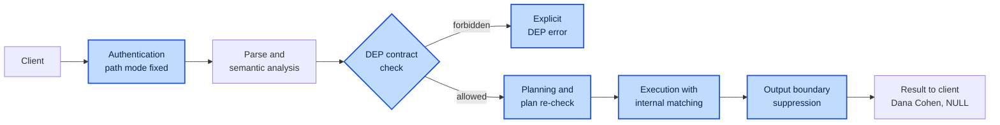

# Inside the engine

This chapter explains the architecture and design contract. It is not a line-by-line implementation audit. Features explicitly marked as future design are not available in the current Engine; see [current capabilities and native differences](06-server.md#compatibility).

## Architecture {#12-architecture}

**In one sentence:** a DEP server is an ordinary query pipeline with DEP's checks added at each stage, running in a process the client cannot reach.

### The trust boundary {#121-the-trust-boundary}

**Definition.** The trust boundary is the line between the client's process, which DEP does not trust, and the server's process, which it does. Every guarantee in DEP depends on one architectural fact: **the client and the enforcement run in different processes, and the client controls only its own.**

**What the client holds.** A connection and the ability to send SQL. It never holds the data files, the matching keys, the server's memory, or the code that enforces the rules. Everything it learns arrives through the protocol, after the output boundary.

**Why DEP is a server and not a library.** If the same rules ran inside the client's process (a query engine embedded in an application or a notebook), whoever runs that process could read the data directly, load the keys, or simply change the code. The rules would still *describe* correct behavior, but they would not *enforce* it. Such an embedded build can be useful as a playground for learning the syntax ([Roadmap and Release](../design/02-roadmap-and-release.md#4-distribution)), but it must be labeled clearly: **it offers no protection, because whoever runs it holds all the data.**

**Two consequences.**

1. **Keys never cross the boundary.** Matching keys and encryption keys are loaded by the server from a location the client cannot reach: a key-management service, or at minimum a server-side file or environment variable.
2. **The path is a property of the endpoint.** Each access path is bound to a listening endpoint and to authenticated identities at connection time. Nothing a client sends afterwards can change it.

### Overview {#122-overview}

The figure shows the whole server, using the clinic's six consumers. Numbers give the order in which a statement passes through it.


| Step | What happens |
| --- | --- |
| ① | The client sends SQL over the PostgreSQL protocol to the endpoint of its path. |
| ② | The endpoint authenticates the client and fixes the path for the session. |
| ③ | The parser reads the statement, including DEP syntax, and marks protected literals. DDL that declares functions also goes to the declaration checker, which records declarations in the DEP catalog. |
| ④ | The DEP analyzer resolves names and types through the catalog, and checks typing, anchoring, and path rules. A forbidden statement is rejected here with an explicit DEP error, before any row is read. |
| ⑤ | The planner optimizes the statement and re-checks the final plan. |
| ⑥ | The executor runs the plan. |
| ⑦ | Protected matching compares keyed index entries in protected storage, using the domain's key; every protected match is audited and counted against the rate limit. |
| ⑧ | Results pass to the output boundary. |
| ⑨ | The output boundary suppresses protected values, passes disclosed values, scrubs errors, and sends the response. |

### Components {#123-components}

The same logical architecture applies whichever query engine sits underneath.

| Component | Definition | Role |
| --- | --- | --- |
| **Endpoints** | Listening server addresses, one per access path | Authenticate the client and fix the access path for the session. |
| **DEP catalog** | The server's record of DEP objects | Holds protected columns, match domains, protected foreign keys, declared functions, disclosed output columns, linking regions, `DISCLOSE` and `LINK` privileges, and purposes. |
| **Parser** | The SQL parser, with DEP's additions to the grammar | Understands `PROTECTED`, `MATCH DOMAIN`, `DISCLOSES`, `LINKS`, `GRANT DISCLOSE`, `GRANT LINK`, and `CREATE ENDPOINT`; identifies protected literals. |
| **DEP analyzer** | A checker over the resolved statement | Checks every statement by its resolved meaning (which table, column, type, and operator), not by its spelling, including whether protected matching is anchored. |
| **Declaration checker** | A checker for declared functions | Validates `DISCLOSES` and `LINKS` bodies at creation, and records disclosed columns and linking regions. |
| **Plan re-check** | A second check after optimization | Ensures no transformation reintroduces a forbidden use. |
| **Matching component** | The part of execution that handles protected comparisons | Performs lookups and joins on protected values through the internal matching index. |
| **Protected storage** | Internal columns that ordinary SQL cannot address | Holds each protected value's index entry and ciphertext. |
| **Key management** | The server-side source of keys | Supplies one versioned matching key per match domain, and encryption keys. |
| **Output boundary** | The last stage before the protocol | Suppresses protected values, passes disclosed values, and scrubs every outgoing message. |
| **Audit and rate limiting** | A server-side recorder and limiter | Records every protected match on the operational path and every call to a declared function, with the identity that made it; enforces per-identity limits; records withheld errors. Never records protected values. |

### How the components fit together {#124-how-the-components-fit-together}

**The path selects the execution rules; DEP enforces them inside the server.** The path does not rewrite queries for the client. Some queries run with suppressed output, some are rejected because the requested operation is forbidden, and some return disclosed values or linked results because a declared function says they may.

---

## The life of a query {#13-the-life-of-a-query}

**In one sentence:** DEP keeps the ordinary pipeline of a query engine (authenticate, analyze, plan, execute, return) and adds enforcement at every stage.

### The query {#131-the-query}

Reception sends this query when Dana arrives, with `123456782` supplied as `$1`:

```sql
SELECT full_name, national_id
FROM patients
WHERE national_id = $1;
```

### In an ordinary engine {#132-in-an-ordinary-engine}

The query passes through four stages, and the protected column is treated like any other text:


### In DEP {#133-in-dep}

The same pipeline, with DEP's additions highlighted:



| Stage | Ordinary engine | DEP |
| --- | --- | --- |
| Authentication | Identifies the user | Also fixes the access path for the whole session |
| Analysis | Resolves names and types | Also checks every use of a protected or disclosed value against the rules, and rejects forbidden ones with an explicit error |
| Planning | Optimizes the query | Also re-checks the final plan, so no optimization reintroduces a forbidden use |
| Execution | Compares stored values directly | Compares keyed index entries; the value itself is never compared or exposed |
| Output | Sends whatever was selected | Suppresses protected values, passes only declared disclosed values, and scrubs every message |

<figure markdown="1">

<picture><source media="(prefers-color-scheme: dark)" srcset="../images/diagrams/statement-path-dark.png"></picture>

<figcaption>Follow a statement through parsing, privacy analysis, planning, execution and the output boundary.</figcaption>
</figure>

### Step by step {#134-step-by-step}

**Step 1: The connection already carries its path.** At authentication the server fixed the path, here `OPERATIONAL`, and the client cannot change it. The path accompanies the query through checking and execution. It is not a separate engine; it is the context in which the engine runs.

**Step 2: The engine resolves what the query means.** DEP works on the engine's resolved internal representation: which table `patients` refers to, which column `national_id` refers to, what its type is and whether it is protected, which operator implements `=`, and which fields are meant to reach the client. At this point DEP sees two different uses of the same column: in `WHERE national_id = $1` it is used for **matching**, and in `SELECT national_id` it is a request to **return** the value.

**Step 3: DEP checks the operations against the path.** On the operational path, the match is allowed: the role holds privilege on `national_id`, and the match is anchored to the single value `$1`. Returning the value is not allowed, so the projection will be suppressed. On the masked path, the matching itself is forbidden, and the query is rejected before any search runs. The engine never deletes the `WHERE` clause to "legalize" a query; that would change its meaning and could return the whole table.

**Step 4: The engine plans execution.** Conceptually, the plan is: find the matching record using the protected identifier; read the permitted `full_name` field; produce `NULL` for the protected output column; return the result. The predicate `national_id = $1` is rewritten into a comparison between the column's internal index entries and the keyed hash of the normalized parameter. This is fundamentally different from replacing `national_id` with `NULL` everywhere, which would destroy the search. Because the optimizer can transform queries, DEP re-checks the final plan rather than trusting only the check before planning.

**Step 5: The engine performs the internal match.** The matching component computes the index entry for the parameter with the match domain's key and locates the record ([Matching with a keyed index](08-internals.md#163-matching-with-a-keyed-index)). The same mechanism serves joins between protected fields of the same domain: a join on two `person_id` columns becomes an equi-join on their index entries.

**Step 6: The result crosses the output boundary.** Before anything is sent, DEP enforces the output rules, in text and binary result formats and on every output path:

| full_name | national_id |
| --- | --- |
| Dana Cohen | `NULL` |

Had the same value been produced by `REVEAL` inside a disclosing function, the output boundary would have let it through as a disclosed value, and Step 3 would have rejected any attempt to use it for anything but output.

---

## How declared functions and anchoring are enforced {#14-how-declared-functions-and-anchoring-are-enforced}

[Chapter 3](03-functions.md#8-declared-functions) defines the rules for `REVEAL`, `DISCLOSES`, `LINKS`, and anchored matching. Enforcing them takes five mechanisms.

### Validation at creation {#141-validation-at-creation}

**When.** `CREATE FUNCTION ... DISCLOSES d` or `CREATE FUNCTION ... LINKS d` runs.

**What the server does, in order:**

1. checks that the creating role holds `DISCLOSE ON MATCH DOMAIN d` or `LINK ON MATCH DOMAIN d`, respectively;
2. checks that the function is `LANGUAGE sql`, and parses and analyzes its body;
3. checks that every `REVEAL` in the body applies to a domain the function declares `DISCLOSES`, and that every unanchored match applies to a domain it declares `LINKS`;
4. checks that every user-defined function the body calls is itself declared for the same purpose and domain;
5. determines which output columns come from `REVEAL`, and records them in the DEP catalog as **disclosed columns**;
6. determines whether the function takes any parameter used for protected matching, and records whether it may be called on the masked path;
7. creates the function with no `EXECUTE` privilege for `PUBLIC`;
8. records the function, its kinds, its domains, its owner, and its comment in `SHOW FUNCTIONS`.

**On failure.** Any failure rejects the whole statement. Later attempts to `GRANT EXECUTE` on a declared function to `PUBLIC` are rejected.

**Notes.** The checks run unconditionally. If the underlying engine has a setting that skips function-body validation (as PostgreSQL does with `check_function_bodies`, which is turned off while restoring a dump), DEP's checks run regardless, and are repeated at execution time.

### Tracking disclosed values and linking regions {#142-tracking-disclosed-values-and-linking-regions}

**The problem.** A declared function is usually executed by expanding its body into the calling query, much as a view is. After expansion, the planner no longer sees a function boundary. Two things must survive this: the terminal rule, and the permission for unanchored matching.

**Implementation difference:** DEP Engine 0.5.2 does not yet track disclosed values through sorting, functions and `DISTINCT`; the gaps are documented in [chapter 6](06-server.md#known-difference-sorting-disclosed-values). The following describes the specified tracking rule.

**Marked expressions.** DEP represents `REVEAL(x)` internally as a **marked expression**: ordinary for the purpose of output, but carrying a *disclosed* marker. The analyzer propagates the marker through aliases, subqueries, common table expressions, and projections, and rejects any plan in which a marked expression reaches a filter, a join key, an aggregate, a sort key, a function argument, or a write. The only legal destination of a marked expression is the output boundary.

**Linking regions.** In the same way, the expanded body of a linking function is marked as a **linking region**. Unanchored matching is accepted inside that region and rejected anywhere else in the same plan, so a caller cannot extend the function's permission to its own joins.

**Symmetry.** This is the same mechanism that keeps protected values protected, with the opposite permission: protected values may be *matched* but not *output*; disclosed values may be *output* but not *matched*.

### Deciding whether matching is anchored {#143-deciding-whether-matching-is-anchored}

**Scope.** Outside a linking region, joins between protected columns require a single-value anchor. Plain equality lookups and IN lists are permitted on the operational path; they do not by themselves authorize a protected join. The analyzer decides this on each query block of the resolved query.

**Definitions.**

- A **protected input** is a parameter or a literal in a protected position ([Parameters and literals](02-sql.md#79-parameters-and-literals)).
- A **top-level conjunct** of a query block is a condition joined by `AND` at the top of its `WHERE` clause or of an inner join condition. It therefore holds in every row the block produces.
- The **match graph** of a query block has one vertex for each protected column, per table instance, that occurs in a matching comparison, and one edge for each equality between two protected columns.
- A vertex is **anchored** if the block contains, as a top-level conjunct, an equality between that column and a single protected input.

**The rule.** A query block is admissible if every connected component containing a protected-to-protected join edge contains an anchored vertex, or if the block lies inside a linking region for the component's domain.

**Anchored lookup**

```sql
WHERE p.national_id = $1                 -- anchored
WHERE p.national_id = '123456782'        -- anchored
```

**Anchored join.** One component, `{p.national_id, m.patient_national_id}`, anchored through `p`:

```sql
FROM patients AS p
JOIN medical_records AS m ON m.patient_national_id = p.national_id
WHERE p.national_id = $1
```

**Not anchored**

| Form | Why |
| --- | --- |
| A join between protected columns with no anchored lookup on either side | Links whole datasets |
| `IN` with more than one value, or several equalities combined with `OR` | Allowed for lookups, but not a single-value anchor for a protected join |
| Comparison with the result of a subquery, `IN (SELECT ...)`, `EXISTS` correlated on a protected column | Asks about a whole dataset of values |
| Comparison with a value computed inside the query | Not a client-supplied value |
| An anchor inside an `OR` or an outer join condition | Does not hold in every row the block produces |

**Design discussion.** The following cases are retained from the proposal; use the supported-form examples in chapter 2 and test the installed Engine rather than assuming these proposals are implemented. Discussed further in the roadmap ([Roadmap and Release](../design/02-roadmap-and-release.md#7-open-questions)), with a proposal for each:

- **Anchoring through a different protected column of the same table** (a join on `national_id` restricted by `WHERE p.phone = $1`) counts as anchored, because it is still a single protected value.
- **Anchoring through an ordinary key** (`WHERE p.patient_id = 42`) does not count, because it can be iterated over every key. At minimum, such queries count against the protected-lookup rate limit.

### Recording and auditing {#144-recording-and-auditing}

**What is recorded.** Every protected match on the operational path and every call to a declared function: which identity, when, which statement or function version, which protected columns were matched, and how many rows were returned.

**What is never recorded.** Protected values and disclosed values. An audit log holding every identifier that was ever looked up or released would itself become the most sensitive table in the system.

**Rate limiting.** The same component enforces the per-identity rate limit on protected lookups, and raises [`DEP_MATCH_RATE_LIMITED`](../reference/errors.md#dep-errors) when it is exceeded.

### Foreign keys {#145-foreign-keys}

The rules for protected foreign keys ([Protected foreign keys](02-sql.md#710-protected-foreign-keys)) are enforced in three places:

| When | What the server does |
| --- | --- |
| **At definition** | `CREATE TABLE` and `ALTER TABLE` check that a foreign key and the column it references have the same protection and match domain, fill in the inherited domain, and record the reference in the DEP catalog. A mismatch is rejected with `DEP_REFERENCE_MISMATCH`. |
| **At write time** | Referential checks compare index entries, never plaintext. Because both columns use the same domain key, an index entry computed for the referencing value can be looked up directly in the unique index of the referenced column. Cascading updates recompute index entries in the referencing rows; cascading deletes and `RESTRICT` locate them through the index. Each check passes through the audit and rate-limit component as one protected lookup. |
| **On failure** | Violation messages are reduced to the constraint's name before they reach the output boundary. The underlying engine's own message, which in most engines quotes the offending key, is never sent. |

---

## Layers of enforcement {#15-layers-of-enforcement}

**In one sentence:** no single check is trusted to catch everything, so each stage of execution enforces the rules that apply to it.

| Layer | What DEP does there |
| --- | --- |
| **Connection** | Fixes the access path from the endpoint and the authenticated identity; rejects any later attempt to change it. |
| **Function creation** | Validates every `DISCLOSES` and `LINKS` body, records disclosed columns and linking regions, and withholds public execution ([Validation at creation](08-internals.md#141-validation-at-creation)). |
| **Parsing and analysis** | Detects every use of a protected field or disclosed value and checks it against what the path allows, including whether protected matching is anchored ([Deciding whether matching is anchored](08-internals.md#143-deciding-whether-matching-is-anchored)). Identifies protected literals and records their positions so the statement text can be redacted wherever it is kept. |
| **Type checking** | Rejects casts, functions, and operators not defined for protected values. Because the protected type defines no conversion to plain types, many attacks fail here by construction. |
| **Planning** | Re-validates the final plan, so that view inlining, function inlining, subquery flattening, or other transformations cannot reintroduce a forbidden use. |
| **Execution** | Performs permitted matches through the matching component. Protected comparison operations themselves verify the path, so indirect calls cannot bypass the earlier checks. |
| **Intermediate results** | Copying into a temporary table or passing through a common table expression does not turn a protected value into an ordinary one. Forms that cannot yet guarantee this are rejected as unsupported. |
| **Output boundary** | Suppresses protected values, passes disclosed values, and scrubs errors and notices, in every result format. |

### Why rewriting the query is not enough {#151-why-rewriting-the-query-is-not-enough}

Editing the internal representation of a query is part of the implementation, but it is not sufficient on its own. If DEP only rewrote the outer query, a function, a view, or a subquery could route around it. Protection has to hold **during execution**, as the engine passes values between operations. That is why the protected type, the matching component, and the output boundary each enforce the rules independently, rather than relying on a single check at the start.

---

## Storage and matching {#16-storage-and-matching}

**In one sentence:** each protected value is stored twice inside the engine, once as a keyed hash used for matching and once encrypted, and SQL sees neither.

### Internal columns {#161-internal-columns}

**Definition.** A protected column is presented to SQL as one logical column, but stored as two internal columns that ordinary SQL cannot address.

| Internal column | Contents | Used for |
| --- | --- | --- |
| **Index entry** | Keyed hash of the normalized value, with a key version | Matching, joins, uniqueness, and foreign-key checks |
| **Ciphertext** | The value under authenticated encryption | `REVEAL`, key rotation, and re-indexing |

**Rules.**

1. Every protected column is stored the same way. There are no storage options for the user to choose in the first version.
2. `SELECT *`, the catalog's column listings, and every other introspection path show only the logical column.
3. The internal columns are reachable only by the matching component and by `REVEAL`.

### Encrypted storage {#162-encrypted-storage}

Protected values are stored with an established authenticated-encryption scheme, with keys held outside ordinary tables. Plaintext inputs are excluded from logs and error messages.

**Role of encryption.** Encryption is a complementary storage layer. DEP's query rules do not depend on a client being unable to decrypt a string it received, because clients never receive the stored representation in the first place.

<figure markdown="1">

<picture><source media="(prefers-color-scheme: dark)" srcset="../images/diagrams/blind-index-dark.png"></picture>

<figcaption>Matching uses the keyed index entry; authorized disclosure uses the ciphertext.</figcaption>
</figure>

### Matching with a keyed index {#163-matching-with-a-keyed-index}

**Definition.** A **keyed equality index** (sometimes called a *blind index*) stores, alongside each protected value, a keyed hash of its normalized form. Lookups and joins compare these entries instead of the values.

**What its design must define.**

| Aspect | Meaning |
| --- | --- |
| **Normalization** | How leading zeros, whitespace, or check digits are treated, so that equal values always produce equal index entries. |
| **Domain separation** | Each match domain, and each tenant, uses its own key, so that index entries from different domains cannot be compared. |
| **Key versions** | Each entry records which key produced it, so keys can be rotated. |
| **Collision handling** | A matching index entry is confirmed against the ciphertext before it is treated as a match. |

**What it reveals.** Such an index reveals equality patterns to anyone who can inspect storage directly: equal values have equal entries. This is acceptable under the threat model in [Guarantees and limits](08-internals.md#18-guarantees-and-limits), but it is not evidence of anonymity, and the technique itself is not new.

### Foreign-key columns {#164-foreign-key-columns}

A column that references a protected column stores its own index entry and ciphertext, like any protected column. Because both columns use the same domain key, their index entries are directly comparable, which is what makes internal referential checks and joins possible. The encrypted value now exists in two tables, which is one more reason to prefer ordinary internal keys unless the link itself is sensitive ([Step 2: Classify the fields](04-design.md#102-step-2-classify-the-fields)).

### Rotation is three different things {#165-rotation-is-three-different-things}

| Mechanism | What it changes |
| --- | --- |
| **Key rotation** | Which keys are in use |
| **Re-encryption** | The stored ciphertext |
| **Token rotation** | Identifiers visible to consumers (outside the first version) |

None of them can retract data that a client has already received.

### A possible later extension: match-only storage {#166-a-possible-later-extension-match-only-storage}

**Idea.** A protected column could, in principle, store only its index entry and discard the value itself. Matching, joins, uniqueness, and foreign-key checks would work unchanged; `REVEAL` would become impossible forever, and so would key rotation, re-normalization, migration, and correcting a mistyped value, unless the original values were re-supplied from elsewhere.

**Why it is not planned.** Its benefit is smaller than it appears. Against clients, DEP already prevents disclosure outside declared functions. Against theft of the database together with its keys, it protects little for low-entropy identifiers: there are only about 100 million valid Israeli ID numbers, and anyone holding both the index entries and the index key can hash every one of them. It protects well only high-entropy values that are verified and never read, which is password hashing, a technique that already exists.

---

## Leakage channels {#17-leakage-channels}

**In one sentence:** suppressing values in an ordinary `SELECT` is the easy part; a credible implementation must account for every other way a value can leave the server.

**Rule.** Each channel below must be either covered or rejected as unsupported.

| Channel | Risk | Treatment in the first version |
| --- | --- | --- |
| Text and binary result formats | A value encoded before suppression | Suppress before encoding, in both formats |
| `RETURNING` | `INSERT`, `UPDATE`, and `DELETE` returning rows | Suppress protected columns, or reject where unsupported |
| `COPY TO` and bulk export | Output that bypasses ordinary result handling | Reject for tables with protected columns |
| DEP's own errors | A message that quotes a value | Never include values ([19.1](../reference/errors.md#dep-errors)) |
| The underlying engine's errors | An internal error that quotes a literal or a row | Scrub; replace with `DEP_ERROR_WITHHELD` when in doubt |
| Constraint violations | A unique-key or foreign-key error that reports the conflicting value | Report the constraint name only; the violation itself still reveals whether the value exists, a documented limitation |
| Foreign-key checks | Inserts used to test identifiers one by one, without any `SELECT` | Each check counts as a protected lookup: audited and rate-limited ([Foreign keys](08-internals.md#145-foreign-keys)) |
| Server logs | Statement and parameter logging that records identifiers | Never log protected parameters; redact protected literals from statement text |
| Protected literals in statement text | An identifier written in the query, recorded or echoed with it | Redact at every place the text is kept: logs, query statistics, audit records, error messages ([Parameters and literals](02-sql.md#79-parameters-and-literals)) |
| `EXPLAIN` | Plans that show constants, parameters, or column statistics | Reject for statements involving protected values |
| Optimizer statistics | Minimum, maximum, and most-common values of a column | Never collect value statistics on internal protected columns; never expose them |
| User-defined functions, triggers, notices | User code that receives a value and emits it elsewhere | Protected values cannot be passed to user code at all, except declared functions |
| Views, temporary tables, `CREATE TABLE AS` | Derived objects that shed protection | Views inherit protection; materializing protected columns is rejected until designed |
| Disclosed values | Reuse of a revealed value after `REVEAL` | The terminal rule ([Tracking disclosed values and linking regions](08-internals.md#142-tracking-disclosed-values-and-linking-regions)) |
| Unanchored matching | A join or lookup that links whole datasets without returning any identifier | Rejected outside `LINKS` functions ([Deciding whether matching is anchored](08-internals.md#143-deciding-whether-matching-is-anchored)) |
| Linkage through ordinary keys | Datasets joined through an ordinary column, bypassing every linkage rule | Outside the engine's reach; a design responsibility ([Linkage through ordinary keys](08-internals.md#186-linkage-through-ordinary-keys)) |
| Timing | Execution time that depends on whether a match exists | Out of scope for the first version; documented as a known limitation |

Protection is incomplete if a value is hidden in the result but appears in a log.

---

## Guarantees and limits {#18-guarantees-and-limits}

**In one sentence:** DEP makes four precise guarantees under stated assumptions, and is explicit about everything they do not cover.

### Who is trusted {#181-who-is-trusted}

**Trusted.** The database server and its code, the operating system it runs on, the deployment administrator, the key-management service, and the roles granted `DISCLOSE` or `LINK` on a match domain.

**Not trusted.** Clients: applications, analysts, BI tools, and AI agents, even when they are authenticated. Clients cannot install native code, disable DEP, replace type functions, declare functions without the corresponding privilege, or obtain administrative credentials.

**Out of scope.** DEP does not protect against a compromised operating system or an administrator who can read the server's memory. If an administrator can modify the server itself, the rules of the query language cannot stop them. Encrypted backup and restore require a separate, controlled administrative design. DEP is therefore complementary to client-side encryption, which assumes the opposite trust model.

### What DEP guarantees {#182-what-dep-guarantees}

**Assumptions.** The guarantees hold if:

1. the server is trusted, as described in [Who is trusted](08-internals.md#181-who-is-trusted);
2. the rules are applied to the final plan of every statement, after views, common table expressions, and declared functions are expanded, and after optimization;
3. declared functions are created only by roles holding the declaration privilege, and invoked only by roles granted `EXECUTE`;
4. error text, logs, statistics, and plan output carry no protected values.

**Two kinds of information flow.** An *explicit* flow computes an output value from a protected value. An *implicit* flow lets a protected value decide which rows are produced, as a matching predicate does.

**The four guarantees**

| Guarantee | Statement |
| --- | --- |
| **No return** | In any statement, on either path, every output value computed from a protected value comes from `REVEAL` inside a declared disclosing function that the caller was explicitly allowed to execute. Every other protected value reaches the client as `NULL`. No statement can copy a protected value into an ordinary column, so a value cannot be laundered through storage. |
| **Anchored linkage** | On the operational path, an ordinary query combines records through a protected value only for the single value the client supplied. With a per-identity rate limit, this bounds how many people an operational client can link records for in a given period. |
| **Terminal disclosure** | A disclosed value never reaches a filter, join key, grouping, `DISTINCT`, sort key, aggregate, function argument, or write. A client can use disclosed values against protected data again only by sending them back one at a time, as anchored lookups. A disclosure therefore cannot be turned into bulk linkage inside the database. |
| **Masked-path confinement** | On the masked path, the result of a query does not depend on protected values at all, except through the outputs of approved linking functions. Two databases that differ only in their protected values give the same answer to any query on that path. |

**Notes.** These are properties of the design. An implementation has them only to the extent that it applies the rules faithfully. The accompanying paper states them formally, with proof sketches. The masked-path guarantee depends on the rule that a masked connection cannot test whether a protected value is present (`IS NULL`, or `COUNT` of the column); without it, whether a value is present would be an implicit flow. DEP.js applies that rule; DEP Engine 0.5.2 does not yet (see [chapter 6](06-server.md#other-known-differences-in-dep-engine-052)).

### Matching reveals information {#183-matching-reveals-information}

**The limit.** Every permitted match is a question the database answers. A successful lookup confirms that a record with that value exists; a join associates it with an appointment or a diagnosis; a returned name can identify the person behind it, however well the identifier is hidden.

**Enumeration.** Low-entropy identifiers make this concrete. An Israeli national ID has nine digits, the last of which is a check digit, so there are only about 100 million valid values. A client allowed 10,000 lookups per second could test every one of them in under three hours. Anchored matching without limits would be an enumeration oracle: one value at a time, but as many times as the client likes.

**DEP's answer: permit and attribute.** On the operational path, a role may match on any protected column it is permitted to use, and DEP does not judge each individual lookup. Instead:

- **every protected match is audited,** with the identity that made it, and without the value itself;
- **protected lookups are rate-limited per identity,** so that one value at a time cannot become every value in an afternoon;
- **qualified access is a future proposal, not a current control:** the proposed table option would require every operational read or write to be anchored ([Requiring qualified access](02-sql.md#711-requiring-qualified-access));
- **ordinary column privileges decide who may match on what** ([Who may match on what](02-sql.md#66-who-may-match-on-what)).

### Declared functions are trusted code {#184-declared-functions-are-trusted-code}

A declared function is, by design, an opening in the wall. DEP guarantees that the opening is declared, located, limited by the rules, and listed in the catalog. It does not guarantee that the declared purpose is legitimate, nor that the recipient will use the data properly. The quality of these decisions depends on the people who hold the `DISCLOSE` and `LINK` privileges and on the review process around them.

### Released values are beyond DEP's reach {#185-released-values-are-beyond-deps-reach}

> **Disclosure tracking applies within database execution. Once a value is returned to a client, DEP cannot control its subsequent use.**

A client that received identifiers from a disclosing function can keep them, combine them with other data, or send them back as parameters in later queries, within whatever matching its permissions allow.

### Linkage through ordinary keys {#186-linkage-through-ordinary-keys}

DEP enforces anchoring and `LINKS` only on protected columns. If two datasets are connected through an ordinary key, linkage through that key is governed by ordinary permissions alone, and every rule about linkage can be bypassed through it. The same is true of an ordinary key returned by a declared function. This is a design responsibility, not an engine guarantee: keys that link sensitive datasets must themselves be protected, there must be no path made only of ordinary keys between identities and sensitive data, and declared functions should not return keys their recipients do not need ([Step 2: Classify the fields](04-design.md#102-step-2-classify-the-fields)).

### Ordinary data is not anonymous data {#187-ordinary-data-is-not-anonymous-data}

The masked path can run aggregate queries over ordinary fields and call linking functions that return aggregates, but that does not make results anonymous. Small groups and combinations of released attributes can still identify people. DEP is one control among several, not a replacement for anonymization or data-minimization practices.

### Known limitations of the first version {#188-known-limitations-of-the-first-version}

- Timing differences between matching and non-matching lookups are not addressed.
- Constraint violations on protected columns reveal whether a value exists, even though the error never contains the value: a duplicate in a `UNIQUE` column means it exists, and a failed foreign-key check means it does not. Both count as protected lookups.
- Only full-value equality is supported on protected values.
- SQL forms outside the published supported-forms list are rejected rather than supported.
- Protection of ordinary fields is left to ordinary permissions.

### The precise promise {#189-the-precise-promise}

> **Ordinary queries never return protected plaintext, and never link whole datasets through protected values. Protected values leave the database only through explicitly declared disclosures, and datasets are linked through them only in explicitly declared linking functions. Permitted matching can still reveal record existence and associations with returned data, and DEP does not guarantee that nothing can be inferred from permitted information.**

---

## Reading and sources {#reading-and-sources}

The book develops the original DEP design by Reuven Mandelovich. Proposed extensions and comparisons are collected in [Roadmap and release](../design/02-roadmap-and-release.md).

## How to cite

This document is licensed under the [Creative Commons Attribution 4.0 International License](https://creativecommons.org/licenses/by/4.0/). You may share and adapt it for any purpose, including commercially, with appropriate credit.

> Reuven Mandelovich. *DEP: Database-Enforced Privacy. A Design Proposal.* Version 1.0, October 2026. https://doi.org/<DOI>

```bibtex
@techreport{mandelovich2026dep,
  author      = {Reuven Mandelovich},
  title       = {{DEP}: Database-Enforced Privacy. A Design Proposal},
  year        = {2026},
  month       = oct,
  institution = {Self-published},
  version     = {1.0},
  doi         = {<DOI>},
  url         = {https://github.com/<GITHUB-USER>/project-hoopeo}
}
```

If you implement DEP's ideas in your own system, a mention in your documentation, "based on DEP by Reuven Mandelovich", is appreciated.

---

## References

These sources describe existing capabilities, frameworks, and regulation that inform the design. They do not validate DEP, establish its novelty, or demonstrate its security. Sources on related products and research are listed in [Roadmap and Release](../design/02-roadmap-and-release.md#references).

1. PostgreSQL documentation. *Privileges*: column-level privileges. https://www.postgresql.org/docs/current/ddl-priv.html
2. PostgreSQL documentation. *CREATE FUNCTION*. https://www.postgresql.org/docs/current/sql-createfunction.html
3. PostgreSQL documentation. *Frontend/Backend Protocol*. https://www.postgresql.org/docs/current/protocol.html
4. PostgreSQL documentation. *The pg_hba.conf File*. https://www.postgresql.org/docs/current/auth-pg-hba-conf.html
5. PostgreSQL documentation. *Client Connection Defaults* (`check_function_bodies`). https://www.postgresql.org/docs/current/runtime-config-client.html
6. PostgreSQL documentation. *COMMENT*. https://www.postgresql.org/docs/current/sql-comment.html
7. Paragon Initiative. *CipherSweet: blind indexes*. https://ciphersweet.paragonie.com/internals/blind-index
8. Google Cloud. *Re-encrypting data*: key rotation versus re-encryption. https://docs.cloud.google.com/kms/docs/re-encrypt-data
9. Regulation (EU) 2016/679 (General Data Protection Regulation). https://eur-lex.europa.eu/eli/reg/2016/679/oj
10. Israel. Protection of Privacy Law, 5741-1981, as amended by Amendment No. 13 (in force August 2025).
11. European Data Protection Board. *Guidelines 4/2019 on Article 25: Data Protection by Design and by Default*, version 2.0, adopted 20 October 2020. https://edpb.europa.eu/our-work-tools/our-documents/guidelines/guidelines-42019-article-25-data-protection-design-and_en
12. A. Cavoukian. *Privacy by Design: The 7 Foundational Principles*. Information and Privacy Commissioner of Ontario. https://www.ietf.org/slides/slides-privacyws-privacy-by-design-the-seven-foundational-principles-00.pdf
13. International Conference of Data Protection and Privacy Commissioners. *Resolution on Privacy by Design*, 32nd International Conference, Jerusalem, October 2010.
14. S. Brooks, M. Garcia, N. Lefkovitz, S. Lightman, E. Nadeau. *An Introduction to Privacy Engineering and Risk Management in Federal Systems*, NISTIR 8062, NIST, January 2017. https://doi.org/10.6028/NIST.IR.8062
15. NIST. *NIST Privacy Framework: A Tool for Improving Privacy through Enterprise Risk Management*, version 1.0, January 2020. https://doi.org/10.6028/NIST.CSWP.01162020
16. Ethyca. *Creating privacy policies as code with Fides*. https://content.ethyca.com/?p=96024
17. Privado. *Open source*. https://privado.ai/open-source
18. Open Policy Agent. https://www.openpolicyagent.org/
19. Cedar policy language. https://www.cedarpolicy.com/


## Explore the architecture

<iframe class="architecture-frame" title="Interactive DEP architecture diagram" src="../design/diagrams/dep-architecture.html" loading="lazy" width="1000" height="620"></iframe>

[Open the interactive architecture](../design/diagrams/dep-architecture.html).
