# DEP: Database-Enforced Privacy

### A database that can use sensitive data without handing it over

**Reuven Mandelovich**

> **Status:** Design proposal, v1.0 · October 2026 · Licensed under [CC BY 4.0](https://creativecommons.org/licenses/by/4.0/) · [How to cite](#how-to-cite)
> **DEP is presented as an idea.** There is no implementation, and none is under way. All DEP syntax, error codes, and interfaces shown here are proposals, not SQL that exists in any engine today. Where this document describes engines and implementation, it describes how the idea *could* be realized.

**About this document.** This is the design proposal for DEP: what it is, how it is written, and how it works. The **normative contract** (the precise, testable specification from which a conformance suite would be derived) would be a separate, shorter document drawn from this one. One possible way to build and release DEP, a detailed comparison with existing products and research, and a mapping of the design onto Apache DataFusion and PostgreSQL are in the companion document [Roadmap and Release](02-roadmap-and-release.md).

**How to read it.** Every example follows one small clinic, introduced in [chapter 1](#1-the-problem) and collected in full in [Appendix A](#appendix-a-the-clinic).

- **Part I** (chapters 1 to 11) explains what DEP is and how you use it. It is written as a tutorial, for anyone: developers, architects, privacy officers, and decision makers. [Chapter 3](#3-privacy-as-code-privacy-by-design-and-the-gdpr) places DEP against Privacy as Code, privacy by design, and the GDPR.
- **Part II** (chapters 12 to 18) explains how the server is supposed to enforce the rules, and where its limits are. It is written as a specification, for database engineers and security reviewers.
- [Chapter 19](#19-error-code-reference) is a reference of every error.

**How each topic in Part I is explained.** Every construct follows the same order, so that the idea always comes before the code:

| Part | What it contains |
| --- | --- |
| **What is it?** | A short, plain-language answer. |
| **Why is it needed?** | The problem it solves. |
| **Syntax** | The general form, with optional parts in `[ ]` and alternatives separated by `\|`. |
| **Parameters** | Every part of the syntax, explained. |
| **Example 1, 2, 3** | Statements from the clinic, from the simplest case upwards. Each is followed by its **Output** and an **Explanation** of what happened and why. |
| **Rules in detail** | The complete, precise rules. |
| **Errors** | The errors the construct can raise, linked to [chapter 19](#19-error-code-reference). |
| **Key points** | A short summary to remember. |

Parts that would be empty are left out.

---

## Contents

- [Summary](#summary)

**Part I: What DEP is and how you use it**

1. [The problem](#1-the-problem)
2. [The idea](#2-the-idea)
3. [Privacy as Code, privacy by design, and the GDPR](#3-privacy-as-code-privacy-by-design-and-the-gdpr)
4. [Core concepts](#4-core-concepts)
5. [Design principles](#5-design-principles)
6. [Two access paths](#6-two-access-paths)
7. [Writing DEP SQL](#7-writing-dep-sql)
8. [Declared functions](#8-declared-functions)
9. [DEP and Privacy as Code](#9-dep-and-privacy-as-code)
10. [Designing with DEP](#10-designing-with-dep)
11. [Use cases](#11-use-cases)

**Part II: How DEP is supposed to work**

12. [Architecture](#12-architecture)
13. [The life of a query](#13-the-life-of-a-query)
14. [How declared functions and anchoring are enforced](#14-how-declared-functions-and-anchoring-are-enforced)
15. [Layers of enforcement](#15-layers-of-enforcement)
16. [Storage and matching](#16-storage-and-matching)
17. [Leakage channels](#17-leakage-channels)
18. [Guarantees and limits](#18-guarantees-and-limits)

**Reference**

19. [Error code reference](#19-error-code-reference)

**Appendix**

- [Appendix A: The clinic](#appendix-a-the-clinic)
- [How to cite](#how-to-cite)
- [References](#references)

---

## Summary

**What is DEP?** DEP (Database-Enforced Privacy) is a proposed database server in which privacy protection is part of the type system, the query semantics, and the execution engine, rather than a layer added on top of the data.

**What is the core idea?** A column declared `PROTECTED` can be used by the database to find a record, update it, and connect it to related records, but its value is never returned by an ordinary query.

**The principle.**

> **The ability to use a value for an operation does not require the ability to read it.**

**The promise.**

> **Protected values remain inside the database unless released through an explicitly declared disclosure.**

**The four decisions.** DEP separates four decisions that most databases fold into a single privilege:

| Decision | What it means | In DEP |
| --- | --- | --- |
| **Matching** | Using a protected value to find, update, or connect the records of one value | Allowed on the operational path, one value at a time |
| **Linking** | Connecting whole datasets through a protected value | Allowed only inside a function declared `LINKS` |
| **Returning** | Sending a protected value back to a client | Never done by an ordinary query; the value comes back as `NULL` |
| **Disclosing** | Releasing a protected value deliberately | Allowed only inside a function declared `DISCLOSES`, the only place where `REVEAL` is legal |

**In the clinic.** A patient's ID number lets reception find her and lets her doctor see her diagnoses, yet neither application ever receives an ID number back from the database. The clinic's dashboard and its AI scheduling assistant connect through the masked read path, where an ID number cannot even be used to search.

**Why it matters for privacy.** Every route by which a protected value can leave the database, and every place where whole datasets are linked through one, is an object in the schema: visible to code review and queryable from the catalog. That turns privacy by design from a policy into something the database enforces on every query ([chapter 3](#3-privacy-as-code-privacy-by-design-and-the-gdpr)).

**The limits.** Permitted matching can still reveal that a record exists and associate it with the data that is returned. Names and other ordinary fields can identify people, aggregates are not automatically anonymous, and the server itself is trusted. [Chapter 18](#18-guarantees-and-limits) states the guarantees and limits precisely.

---

# Part I: What DEP is and how you use it

## 1. The problem

**In one sentence:** in most databases, the permission to *use* a value in a query and the permission to *read* that value are the same permission.

### 1.1 The clinic

**What is the clinic?** It is the single example this whole document follows: a small clinic with about 50,000 patients. Its database holds three kinds of information: who the patients are, when they have appointments, and what they have been diagnosed with.

Before DEP, the schema is ordinary SQL:

```sql
CREATE TABLE patients (
    patient_id  BIGINT PRIMARY KEY,
    national_id TEXT UNIQUE,
    phone       TEXT,
    full_name   TEXT,
    health_fund TEXT
);

CREATE TABLE appointments (
    appointment_id BIGINT PRIMARY KEY,
    patient_id     BIGINT REFERENCES patients (patient_id),
    starts_at      TIMESTAMPTZ,
    visit_type     TEXT
);

CREATE TABLE medical_records (
    record_id           BIGINT PRIMARY KEY,
    patient_national_id TEXT REFERENCES patients (national_id),
    diagnosis           TEXT,
    recorded_at         DATE
);
```

A few of its rows:

| patient_id | national_id | phone | full_name | health_fund |
| --- | --- | --- | --- | --- |
| 1 | 123456782 | +972-50-0000001 | Dana Cohen | Clalit |
| 2 | 234567893 | +972-50-0000002 | Yossi Levi | Maccabi |

**Who uses it?** Six programs connect to this database. Each has its own database role, and each needs something different:

| Consumer | Role | What it needs to do |
| --- | --- | --- |
| Reception application | `reception_app` | Find a patient by the ID number they present, and show today's appointments |
| Doctors' application | `doctors_app` | Find the patient in the room, and show their diagnoses |
| Nightly reminder job | `reminder_job` | Send an SMS to every patient with an appointment tomorrow |
| Billing job | `billing_job` | Report visits and diagnosis claims to the patients' health funds |
| BI dashboard | `bi_dashboard` | Show visits per day and type, and diagnoses per health fund |
| Scheduling assistant | `scheduling_agent` | An AI agent that suggests scheduling improvements from appointment patterns |

Dana Cohen, the first patient, appears throughout: she arrives at reception, sees a doctor, receives a reminder, and appears in the report to her health fund.

### 1.2 Using a value and reading it

**What is the difference?** Two words carry the whole argument of this document:

- **Using a value** means letting the database apply it in an operation: comparing it in a `WHERE` clause, joining two tables through it, or checking it against a constraint. The value decides *which rows* the database works with.
- **Reading a value** means receiving the value itself: seeing it in a query result, an error message, a log, or an export.

**Example.** Dana presents her ID card at reception.

- Reception needs to **use** her ID number, because that is how it finds her record.
- Reception never needs to **read** it back from the database: Dana just handed it over.

**Key point:** most of what applications do with sensitive identifiers is *using* them. Very little of it requires *reading* them.

### 1.3 What goes wrong in an ordinary database

**Why is this a problem?** In PostgreSQL, referencing a column in a `WHERE` clause requires `SELECT` privilege on that column, and the same privilege lets the column be returned in a result. Column privilege works as a single switch: a role may touch the value for any purpose, or not at all. Three failures follow from that.

**Failure 1: wholesale extraction.** The clinic has just connected an AI agent directly to the database. The agent writes its own SQL, and it knows nothing about the privacy policy encoded in other applications. Asked for help, it runs:

```sql
SELECT full_name, national_id, phone FROM patients;
```

**Output**

```text
 full_name   | national_id | phone
-------------+-------------+-----------------
 Dana Cohen  | 123456782   | +972-50-0000001
 Yossi Levi  | 234567893   | +972-50-0000002
 ... 49,998 more rows
```

**Explanation:** no one broke in, and every permission worked exactly as configured. Because the agent may search by ID number, it may also read every ID number. The entire register left the database in one query.

**Failure 2: invisible linking.** A query can produce the most sensitive dataset without returning any identifier:

```sql
SELECT p.full_name, m.diagnosis
FROM patients AS p
JOIN medical_records AS m ON m.patient_national_id = p.national_id;
```

**Output**

```text
 full_name  | diagnosis
------------+------------------
 Dana Cohen | Asthma
 Dana Cohen | Seasonal allergy
 Yossi Levi | Diabetes
 ...
```

**Explanation:** no ID number appears in the result, so hiding ID numbers would not help. Yet the query produced the name and diagnosis of every patient. Nothing in an ordinary database marks this join as different from looking up a single appointment.

**Failure 3: unknown exits.** Ask the clinic: "which code paths can export our patients' ID numbers?" Answering means interviewing teams and reading code, because any role with `SELECT` on the column is a possible exit. Regulators increasingly expect organizations to answer that question on demand.

### 1.4 Why existing controls are not enough

**What do databases offer today?** Several controls, each addressing part of the problem:

| Control | What it does | What it leaves open |
| --- | --- | --- |
| Views | Hide columns or rows | A view that lets callers search by a column generally has to expose it, or something derived from it |
| Row-level security | Restricts which rows a role sees | Does not distinguish using a value from reading it |
| Dynamic masking and projection policies | Change what a query returns | The column can still be used in predicates and joins to single out one person or link two datasets, as the vendors' documentation acknowledges |
| Application-side encryption | Protects stored data | The application holds the keys, so anything running with its credentials can decrypt |
| Privacy as Code tools | Check policy in code review and CI | Do not see the query an agent composes at run time |

**Explanation:** none of these separates *using* from *reading*. So in practice privacy lives in the applications: developers must remember not to write `SELECT *`, to strip columns before exports, and to scrub logs. Every new consumer, whether a report, an integration, or an AI agent, starts with none of those safeguards. [Chapter 3](#3-privacy-as-code-privacy-by-design-and-the-gdpr) looks at Privacy as Code more closely, and [Roadmap and Release](02-roadmap-and-release.md#appendix-b-how-dep-relates-to-existing-approaches) compares DEP with existing products and research in detail.

**Key points**

- One privilege decides both using and reading a column.
- That allows wholesale extraction, invisible linking, and exits nobody can list.
- Existing controls each solve part of the problem, outside the place every query passes through.

---

## 2. The idea

**In one sentence:** separate the four things a client may do with a sensitive value (match, link, return, disclose), allow the everyday one freely, and require the other three to be declared in the schema.

### 2.1 The principle

**What is the principle?**

> **The ability to use a value for an operation does not require the ability to read it.**

**Where does it come from?** From passwords. A well-built login system verifies that a password is correct without storing it in readable form, and without ever showing it back to anyone. Verification is an operation; the password itself is never output.

**What does DEP add?** Two things:

1. **Connecting records.** Protected values can connect records across tables, not only verify a single input.
2. **Enforcement by the server.** The rules are enforced inside the database server, across the whole execution of every query, not by a helper function a developer must remember to call.

### 2.2 The change in the schema

**What changes?** One qualifier on one column:

```sql
national_id TEXT PROTECTED MATCH DOMAIN person_id UNIQUE,
```

**Explanation:**

- `TEXT` stays: `PROTECTED` is a qualifier added to an existing type, not a new type. The column is still text.
- `PROTECTED` defines what the engine may do with the value: use it for matching, never return it in an ordinary query.
- `MATCH DOMAIN person_id` says what kind of value this is, so it can be compared only with values of the same kind.

The full syntax is in [7.1](#71-declaring-a-protected-column).

### 2.3 Four decisions instead of one

**What are the four decisions?** In an ordinary database, one privilege decides everything a client may do with Dana's ID number. DEP separates four decisions:

| Decision | What it means | In the clinic | In an ordinary database | In DEP |
| --- | --- | --- | --- | --- |
| **Match** | Use a protected value to find, update, or connect the records of one value | Reception finds Dana by the ID she presents | Allowed with `SELECT` | Allowed on the operational path, for columns the role may use, **anchored to a single protected value** |
| **Link** | Connect whole datasets through a protected value | Diagnosis statistics per health fund | Allowed with `SELECT` | Allowed only inside a function declared **`LINKS`** |
| **Return** | Send a protected value back to a client | Nothing in the clinic needs this | Allowed with `SELECT` | **Never** in an ordinary query; the value comes back as `NULL` |
| **Disclose** | Release a protected value deliberately | The monthly report to the health funds | Allowed with `SELECT` | Allowed only inside a function declared **`DISCLOSES`** |

**Why does the split fall there?** Matching is the everyday work of an operational system: a receptionist finds the patient in front of her. DEP allows it and records it. The other three are where privacy is actually lost, at scale or by releasing the value itself, so DEP requires each of them to be declared in the schema, where it can be reviewed.

### 2.4 What this protects, and what it does not

**What does DEP not prevent?** When reception looks Dana up, it already holds her ID number, and DEP does not hide it from reception. The lookup also tells reception something: that Dana is a patient, and whatever ordinary fields come back with her record. A receptionist who types a stranger's ID number learns whether that person is a patient.

**What does DEP prevent?** Wholesale extraction and unreviewed processing. The AI agent cannot run `SELECT national_id FROM patients` and walk away with the register, and a compromised reception application cannot join every patient to every diagnosis.

> **Ordinary queries never return protected plaintext. Permitted matching can still reveal record existence and associations with returned data.**

**Explanation:** the worst failures, a full export or a full linkage, change from a single query into something that must be declared, reviewed, and listed in the catalog.

### 2.5 Ordinary SQL and DEP, side by side

Four situations in the clinic, first in an ordinary database and then in DEP.

#### Situation 1: Dana arrives at reception

**Without DEP**, her ID number comes back with the answer:

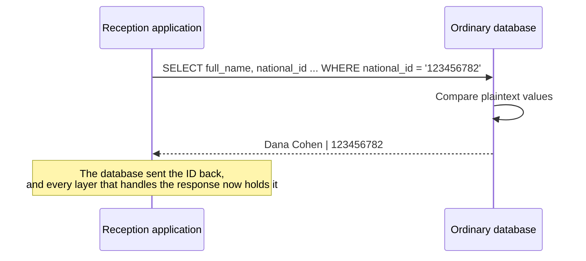

**With DEP**, the ID number is used and stays inside:

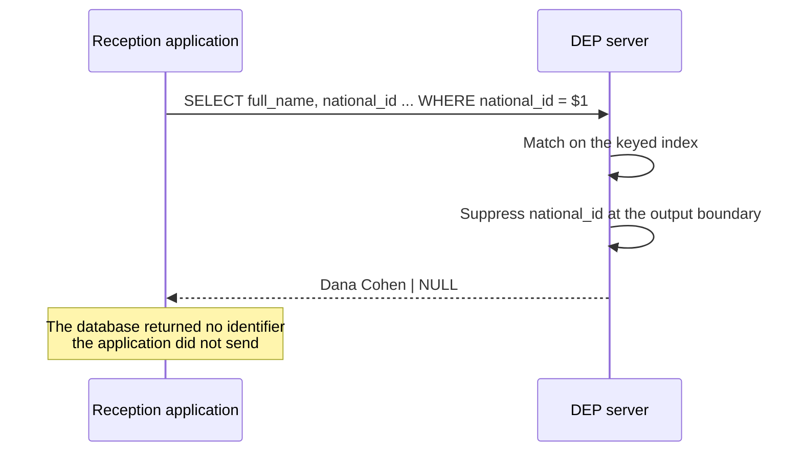

**Explanation:** the query is the same. The difference is that DEP used the ID number to find Dana, and then sent `NULL` in place of the ID number.

#### Situation 2: The AI agent tries to take everything

**Without DEP**, one query is enough:

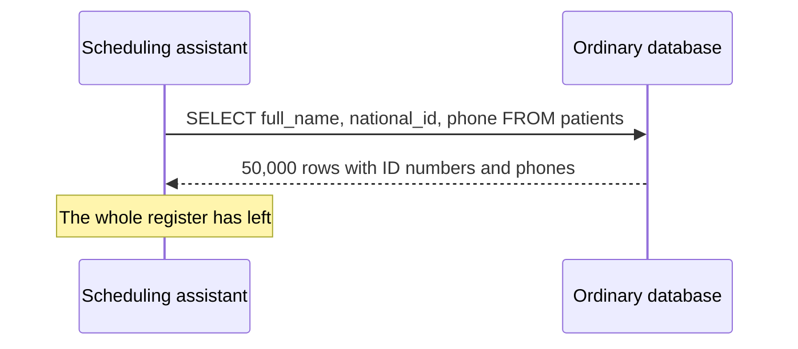

**With DEP**, nothing protected leaves, whether through the agent on the masked path or through a compromised application on the operational path:

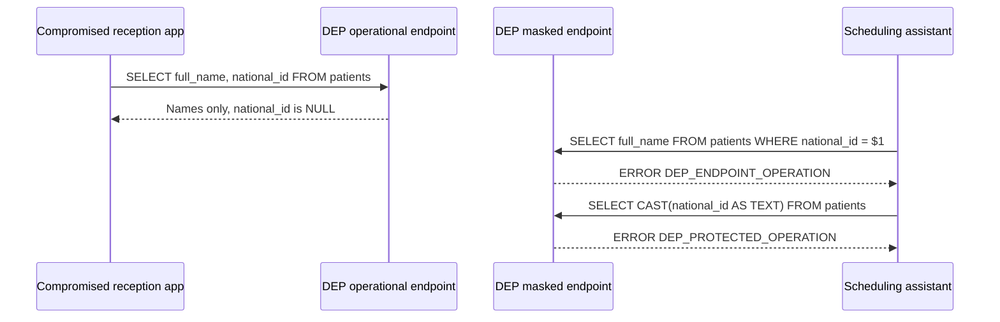

**Explanation:** names still reach the compromised application, which is why ordinary permissions still matter. The identifiers, the values that link a person across systems, do not.

#### Situation 3: Linking patients to diagnoses

**Without DEP**, the query from [1.3](#13-what-goes-wrong-in-an-ordinary-database) is just another join:

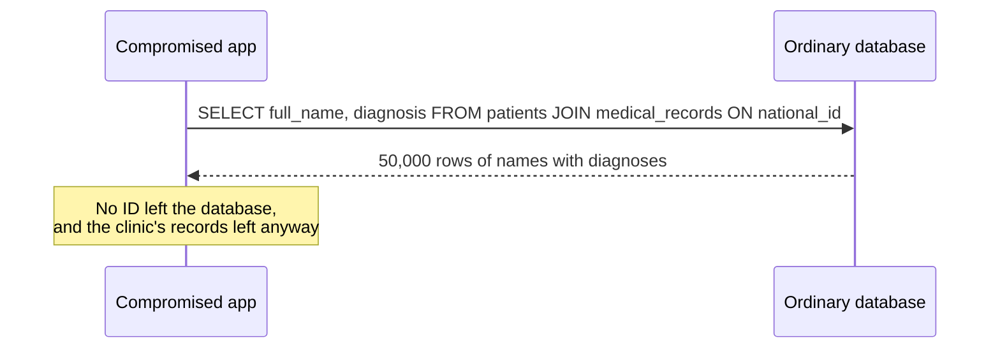

**With DEP**, the same join is allowed for one patient at a time, and only declared code may link everyone:

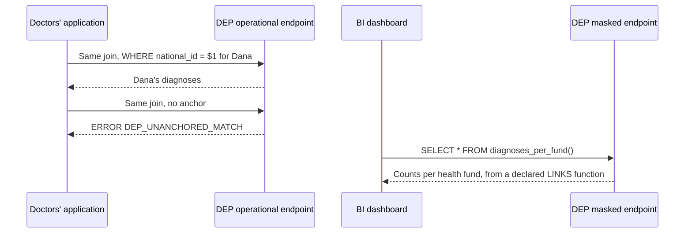

**Explanation:** the doctor's join names one patient, so it is allowed. The same join for everyone is rejected. The dashboard still gets its statistics, from a function the clinic declared and reviewed.

#### Situation 4: Where ID numbers can leave the database

**Without DEP**, every role with `SELECT` on the column is a potential exit, and finding them all means reading code:

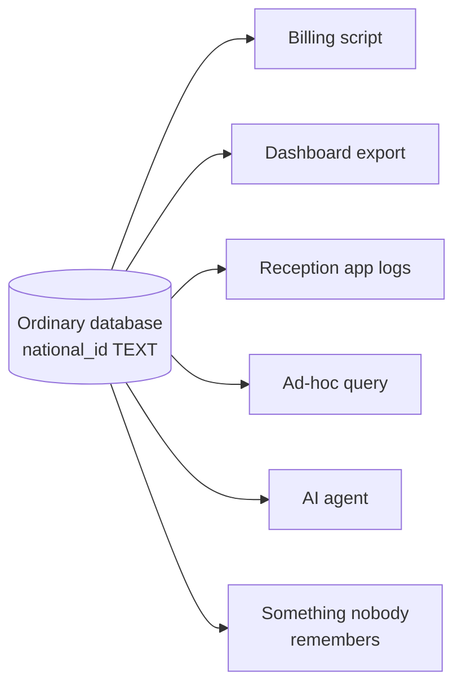

**With DEP**, the exits are declared functions, and the catalog lists them:

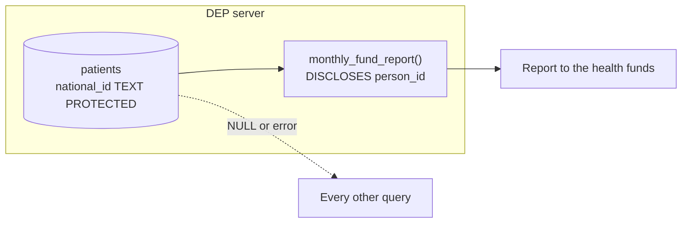

**Explanation:** the only way an ID number leaves is through `monthly_fund_report`, and anyone can find it in the catalog.

#### Summary of the four situations

| | Ordinary SQL | DEP |
| --- | --- | --- |
| Finding Dana by her ID number | The ID comes back with the answer | The ID is matched internally and never returned |
| Taking the whole register | One `SELECT` | ID numbers are `NULL`; matching on the masked path is rejected |
| Linking patients to diagnoses | One `JOIN` | One patient at a time; everyone only in declared `LINKS` functions |
| Where ID numbers can leave | Wherever someone has `SELECT` | Only through declared `DISCLOSES` functions, listed in the catalog |
| Who enforces the policy | Every client, separately | The server, for every client |

### 2.6 Why it is a language feature

**Why not just a permission?** Because a permission can be granted quietly, somewhere, by someone. DEP changes how developers write queries, in the way Rust changed how systems programmers write code. Rust is stricter than C, and the strictness is built into the language rather than left to discipline. Its exceptions are explicit: an `unsafe` block is allowed, but it is marked, local, and easy to find.

**How does DEP follow that pattern?** By default, protected values cannot be read, and datasets cannot be linked through them. When they must be, the exception is a language construct (a function declared `DISCLOSES` or `LINKS`), not a permission granted out of sight. The additional effort is intentional: it is what makes every exception reviewable.

### 2.7 Why it is a server

**Why can't the rules run in the application?** Every guarantee depends on a trust boundary: the client sends SQL, and the enforcement, the keys, and the data live in a separate process the client does not control. A privacy rule checked inside the client's own process would be a simulation, not a protection, because whoever runs the process can bypass it. DEP is therefore always a **server**, and clients reach it only through the network protocol. [12.1](#121-the-trust-boundary) explains the boundary in detail.

**Key points**

- The principle: using a value does not require reading it.
- Matching is allowed and recorded; linking, returning, and disclosing are declared or impossible.
- DEP does not hide what a client already knows; it stops wholesale extraction and unreviewed linkage.
- Exceptions are language constructs, enforced by a server the client cannot bypass.

---
## 3. Privacy as Code, privacy by design, and the GDPR

**In one sentence:** DEP takes three established ways of thinking about privacy (Privacy as Code, privacy by design, and the GDPR's data protection by design and by default) and turns each of them into something the database enforces on every query.

This chapter explains each framework in plain terms, shows what it asks for, and shows how DEP applies it, and where it does not. It uses DEP's constructs before they are defined in detail; each is linked to the chapter that explains it.

### 3.1 What is Privacy as Code?

**What is it?** *Privacy as Code* is the practice of writing privacy policy as an executable artifact: kept in a repository, reviewed like code, tested, and checked automatically.

**How is it practiced today?** Most tools in this space work *around* the database:

| Kind of tool | Example | What it does |
| --- | --- | --- |
| Policy evaluation in CI | Fides | Describes systems and datasets with a shared taxonomy of data categories, uses, and subjects, and rejects a change whose declared use violates a policy |
| Code scanning | Privado | Scans application code to find which personal data is collected and where it flows |
| Authorization as code | Open Policy Agent, Cedar | Evaluates access rules written as code, when an application or gateway asks |

**What is missing?** These tools check *code that someone wrote and submitted*. They do not see the query an AI agent composes at run time, or an ad-hoc query an analyst types. The database, the one component every query passes through, enforces none of the policy.

**Example: one policy, two ways.** The clinic's policy is: *patients' ID numbers may leave the database only for reporting to the health funds.*

**Without DEP**, the policy lives outside the database. A CI check can confirm that the billing code declares the right data use, and a scanner can flag code that reads `national_id`. But any role with `SELECT` on the column can still export it, and the new AI agent's query never passes through CI.

**With DEP**, the policy is part of the schema:

```sql
-- The only place ID numbers may leave
CREATE FUNCTION monthly_fund_report(report_month DATE)
RETURNS TABLE (national_id TEXT, visit_date DATE, visit_type TEXT, health_fund TEXT)
LANGUAGE sql
DISCLOSES person_id
AS $$ ... $$;

GRANT EXECUTE ON FUNCTION monthly_fund_report(DATE) TO billing_job;
```

And it can be checked by a query:

```sql
SELECT function_name, kind FROM dep.declared_functions
WHERE match_domain = 'person_id' AND kind LIKE '%DISCLOSES%';
```

**Output**

| function_name | kind |
| --- | --- |
| `monthly_fund_report` | DISCLOSES |
| `fund_claims_report` | DISCLOSES, LINKS |

**Explanation:** in DEP, `REVEAL` is legal only inside functions declared `DISCLOSES` ([8.2](#82-reveal)). So this list is not documentation that might be out of date: it is the complete set of places where ID numbers can leave, by construction. Any other query, including the agent's, gets `NULL` or an error.

**Comparison**

| | Privacy as Code around the database | DEP |
| --- | --- | --- |
| Where the policy is written | Policy files, annotations, CI configuration | The schema: `PROTECTED`, declared functions, grants |
| When it is checked | Before deployment, on code that was submitted | On every statement, at run time |
| What it can see | Code that passes through the pipeline | Every query, from every client |
| A new AI agent or ad-hoc query | Not covered | Covered from its first query |
| Evidence it produces | Scan and CI reports | The catalog, the audit log, and the drift report |

**How the two fit together.** DEP does not replace these tools; it gives them a point of enforcement. A Fides-style taxonomy can decide which columns should be `PROTECTED`, and a CI pipeline can check that every declared function matches an approved decision ([10.7](#107-step-7-keep-the-matrix-and-the-database-in-sync)). The development method in [chapter 10](#10-designing-with-dep) is built on exactly that idea.

### 3.2 What is privacy by design?

**What is it?** *Privacy by design* is a framework developed by Ann Cavoukian, then Information and Privacy Commissioner of Ontario, which holds that privacy should be built into systems from the start rather than added afterwards. It was recognized by the International Conference of Data Protection and Privacy Commissioners in a 2010 resolution adopted in Jerusalem, and its idea is now part of the GDPR as *data protection by design* ([3.3](#33-what-does-the-gdpr-require)).

**Its seven foundational principles, and how DEP applies them**

| Principle | What it asks | How DEP applies it | Coverage |
| --- | --- | --- | --- |
| **1. Proactive not reactive; preventative not remedial** | Prevent privacy-invasive events before they happen | A forbidden query is rejected before any row is read; a full export or a full linkage cannot run, rather than being detected afterwards; unsupported forms fail closed | Applies |
| **2. Privacy as the default** | Protect personal data without any action by the individual or the user | Protected values are suppressed by default; every new consumer starts on the masked path; declared functions are never executable by `PUBLIC`; internal keys are ordinary by default | Applies |
| **3. Privacy embedded into design** | Make privacy part of the architecture, not an add-on | Protection is part of the type system and the query semantics; the design method starts from a privacy matrix, before the first table | Applies |
| **4. Full functionality: positive-sum, not zero-sum** | Achieve privacy without giving up legitimate functionality | Reception, doctors, reminders, reports, and statistics all keep working; `SELECT *` keeps working, with `NULL` in place of protected values | Applies |
| **5. End-to-end security: lifecycle protection** | Secure data through its whole lifecycle | Encrypted storage, keyed matching, redaction from logs, and audit inside the database | Partly: DEP covers storage and use inside the database, not collection at the source, retention periods, or deletion schedules |
| **6. Visibility and transparency** | Keep practices open and verifiable | The catalog lists every disclosure and linkage; purposes are recorded; the audit log attributes every lookup; drift from the approved matrix is reported | Applies, to the organization and its reviewers |
| **7. Respect for user privacy** | Keep the individual's interests central: strong defaults, notice, user-friendly controls | Strong defaults, and a subject-access export can be a declared function | Limited: notice and consent are outside the database |

**Explanation:** DEP is strongest on the principles that a database can enforce by itself (1 to 4 and 6). It contributes to the lifecycle and the individual's rights, but those also depend on applications and on organizational processes.

### 3.3 What does the GDPR require?

**Which parts are relevant?** Three parts of the GDPR matter most for a database.

**Article 5: the principles.** Personal data must be processed lawfully, fairly, and transparently; collected for specified purposes (*purpose limitation*); limited to what is necessary (*data minimisation*); kept accurate; kept no longer than necessary (*storage limitation*); and processed securely (*integrity and confidentiality*). The controller must be able to demonstrate all of this (*accountability*, Article 5(2)).

**Article 25(1): data protection by design.** The controller must implement appropriate technical and organisational measures, such as pseudonymisation, designed to implement the data-protection principles effectively, both when deciding how processing will be done and during the processing itself, taking into account the state of the art, the cost, and the risks.

**Article 25(2): data protection by default.** By default, only the personal data necessary for each specific purpose may be processed. The obligation applies to four dimensions: the amount of data collected, the **extent of processing**, the period of storage, and **accessibility**. In particular, personal data must not be made accessible, by default, to an indefinite number of people.

**The EDPB's guidance.** The European Data Protection Board's *Guidelines 4/2019 on Article 25* (version 2.0, adopted 20 October 2020) explain how these duties are applied. Among other things, they expect measures to be effective rather than formal, the state of the art to be assessed continuously, access to personal data to be limited to those who need it and to the types of access they need, and technical limitations on the reuse of data.

**Example: the four dimensions of Article 25(2) in the clinic**

| Dimension | What it means | How DEP applies it |
| --- | --- | --- |
| Amount collected | Collect only what is necessary | Not addressed: DEP stores what is inserted |
| **Extent of processing** | Process only as much as each purpose needs | Matching is limited to one value at a time; linking whole datasets requires a declared `LINKS` function; the only operation on a protected value is equality |
| Period of storage | Keep data only as long as necessary | Not addressed: retention is set by the organization |
| **Accessibility** | Limit who can access the data | Protected values are never returned by ordinary queries; column privileges decide who may match on what; disclosure goes only to roles granted `EXECUTE` by name, and never to `PUBLIC` |

**Explanation:** a receptionist who may look up a patient no longer has access, by default, to all 50,000 ID numbers. The extent of what each role can do is limited to what its purpose needs, and the only exceptions are named, reviewed functions. That is Article 25(2) expressed as database behavior.

**Mapping of DEP to GDPR principles and duties**

| Principle or duty | Supporting DEP construct |
| --- | --- |
| Data minimisation, Art. 5(1)(c) | Ordinary queries never return protected values; analytics and agents use the masked path ([chapter 6](#6-two-access-paths)). |
| Purpose limitation, Art. 5(1)(b) | Each linkage and disclosure is a named, described function with explicit `EXECUTE` grants; each matrix cell records its reason ([chapter 8](#8-declared-functions), [10.3](#103-step-3-build-the-privacy-matrix)). |
| Data protection by design and by default, Art. 25 | Protection is the default for a `PROTECTED` column; every exception must be declared; internal keys are ordinary by default. |
| Security of processing, Art. 32 | Engine-enforced typing, per-domain keyed matching, encrypted storage of protected values, audited and rate-limited lookups ([chapter 16](#16-storage-and-matching)). |
| Accountability, Art. 5(2) | The catalog lists every disclosure and linkage; the audit log attributes every lookup to an identity ([chapter 9](#9-dep-and-privacy-as-code)). |
| Records of processing, Art. 30 | The catalog supplies the technical part of the record: where identifiers leave, and for which described purpose. |
| Access and erasure, Arts. 15 and 17 | A subject-access export as a `DISCLOSES` function anchored to the requester's identifier; erasure as an anchored, audited `DELETE`. |

**In Israel.** Amendment No. 13 to the Protection of Privacy Law, in force since August 2025, brought local requirements substantially closer to the GDPR and strengthened the enforcement powers of the Privacy Protection Authority. The same technical measures support it.

### 3.4 What does privacy engineering add?

**What is privacy engineering?** The discipline of turning privacy goals into system properties. NIST's *Introduction to Privacy Engineering and Risk Management in Federal Systems* (NISTIR 8062, 2017) defines three privacy engineering objectives:

| Objective | NIST's definition | How DEP applies it |
| --- | --- | --- |
| **Predictability** | Enabling reliable assumptions by individuals, owners, and operators about personal information and its processing by a system | The rules are fixed in the schema, and the catalog states exactly where values may leave or be linked |
| **Manageability** | Providing the capability for granular administration of personal information, including alteration, deletion, and selective disclosure | Anchored updates and deletes; disclosure only through declared functions that return only what their purpose requires |
| **Disassociability** | Enabling the processing of personal information or events without association to individuals or devices beyond the operational requirements of the system | The core of DEP: values are used for matching without being returned, and records are associated one value at a time unless linkage is declared |

**Explanation:** *disassociability* is the closest existing term for DEP's principle. The NIST Privacy Framework (version 1.0) makes it concrete in its *Disassociated Processing* category, whose first subcategory (CT.DP-P1) is that data are processed to limit observability and linkability. Anchored matching is a direct way to limit linkability: a query can associate records only for the value it names.

### 3.5 What DEP does not cover

**Where are the limits?** DEP is a technical measure inside the database. It does not address:

- the **lawful basis** for processing, or **consent** and its withdrawal;
- **notice** to individuals and transparency toward them;
- **what is collected** in the first place, and **how long** it is kept;
- **data protection impact assessments** and organizational governance;
- **international transfers**;
- data that has **already been disclosed** and left the database.

The mappings in this chapter describe technical contributions, not compliance. Any mapping to specific legal duties should be validated by privacy counsel.

**Key points**

- Privacy as Code checks policy around the database; DEP enforces it inside the database, on every query.
- DEP applies most privacy-by-design principles directly, and the lifecycle and user-centric principles only in part.
- For the GDPR, DEP's strongest contribution is to Article 25(2): it limits the **extent of processing** and the **accessibility** of protected values by default.
- In privacy-engineering terms, DEP is a mechanism for **disassociability**: using values without associating them beyond what each operation needs.

---
## 4. Core concepts

**In one sentence:** this chapter defines every DEP term once, in plain words, with an example from the clinic and a link to where it is explained in full.

### 4.1 Values

**Protected field** (`PROTECTED`)
- *What is it?* A column whose value is never returned by an ordinary query, and on which only the operations DEP defines are allowed. In the first version, the only such operation is full-value equality.
- *In the clinic.* `patients.national_id`, `patients.phone`, and `medical_records.patient_national_id`.
- *Note.* A protected field is not necessarily a personal identifier: phone numbers, addresses, card numbers, or any other sensitive value can be protected.
- *See* [7.1](#71-declaring-a-protected-column).

**Ordinary field**
- *What is it?* Any column that is not protected. It behaves exactly as in ordinary SQL, governed by ordinary permissions.
- *In the clinic.* `full_name`, `health_fund`, `diagnosis`, and the internal key `patient_id`.

**Match domain** (`MATCH DOMAIN`)
- *What is it?* A named group of protected fields that hold the same kind of value, and may therefore be compared with one another.
- *In the clinic.* `person_id` (national ID numbers) and `phone_number`.
- *See* [4.6](#46-what-a-match-domain-decides).

**Protected input**
- *What is it?* A value the client sends in a protected position: compared with a protected column, or inserted into one. It is either a **protected parameter** (sent separately, as `$1`) or a **protected literal** (written in the query, as `'123456782'`). The engine treats both the same way.
- *See* [7.9](#79-parameters-and-literals).

**Index entry**
- *What is it?* A keyed hash of a protected value, stored next to it and used for all matching. It lets the database compare values without looking at them. Ordinary SQL cannot reach it.
- *See* [16.3](#163-matching-with-a-keyed-index).

### 4.2 Operations

**Matching**
- *What is it?* Comparing protected values for equality, done by the engine on index entries, without making the values available to the rest of the query.

**Anchored matching**
- *What is it?* Matching limited to one value the client sent: one lookup, one update, or one join around that value. It is the only kind of matching an ordinary query may do.
- *Example.* Finding Dana by her ID number, or showing Dana's diagnoses.
- *See* [7.6](#76-joining-on-protected-columns).

**Anchor**
- *What is it?* The condition that limits a query to one value: an equality between a protected column and one protected input, at the top level of the query.
- *Example.* `WHERE p.national_id = $1`.

**Linking**
- *What is it?* Matching that connects whole datasets through a protected value, rather than one value at a time. Allowed only inside a linking function.
- *Example.* Counting diagnoses per health fund, which connects every patient to every diagnosis.

**Returning** and **suppression**
- *What is it?* Returning is sending a value to the client. When an ordinary query selects a protected value, it is **suppressed**: replaced with a real SQL `NULL` before the result is sent.
- *See* [7.4](#74-selecting-a-protected-column).

**Disclosing**
- *What is it?* Deliberately turning a protected value into an ordinary one, so it can leave the database. Possible only through `REVEAL` inside a disclosing function.

### 4.3 Connections

**Access path**
- *What is it?* A property of a connection, fixed when it logs in, that sets the most it may do with protected values. There are two paths.
- *See* [chapter 6](#6-two-access-paths).

**Operational path** (`OPERATIONAL`)
- *What is it?* The path for applications that find and update records. It allows reads, writes, anchored matching, and calls to declared functions the role may execute.
- *In the clinic.* Reception, the doctors' application, the reminder job, and billing.

**Masked read path** (`MASKED_READ`)
- *What is it?* A read-only path on which protected values cannot be used for matching at all. It may call linking functions that take no protected input, but never disclosing functions.
- *In the clinic.* The dashboard and the AI scheduling assistant.

**Endpoint**
- *What is it?* A server address that clients connect to, bound to one access path.
- *See* [6.2](#62-create-endpoint).

### 4.4 Declared code

**Declared function**
- *What is it?* A function whose signature says it does something an ordinary query may not: disclose protected values (`DISCLOSES`), link datasets through them (`LINKS`), or both.
- *See* [chapter 8](#8-declared-functions).

**Disclosing function** (`DISCLOSES d`)
- *What is it?* A declared function that may reveal values of match domain `d`. The only place where `REVEAL` is legal.
- *In the clinic.* `monthly_fund_report`, `tomorrow_reminders`.

**Linking function** (`LINKS d`)
- *What is it?* A declared function that may match values of domain `d` without an anchor.
- *In the clinic.* `diagnoses_per_fund`.

**`REVEAL`**
- *What is it?* The only operation that turns a protected value into an ordinary one.
- *See* [8.2](#82-reveal).

**Disclosed value**
- *What is it?* A value produced by `REVEAL`. It may be returned to the client, but not used to filter, join, group, store, or call a function.
- *See* [8.9](#89-disclosed-values-and-the-terminal-rule).

**Linking region**
- *What is it?* The part of a query plan that came from the body of a linking function. Unanchored matching is accepted only inside it.
- *See* [14.2](#142-tracking-disclosed-values-and-linking-regions).

### 4.5 Enforcement

**Protected foreign key**
- *What is it?* A foreign key from a protected column to a protected column of the same match domain. Its integrity is checked inside the engine, and each check counts as a protected lookup.
- *See* [7.10](#710-protected-foreign-keys).

**Output boundary**
- *What is it?* The last stage before anything is sent to a client. It suppresses protected values, lets disclosed values through, and cleans every message.
- *See* [12.3](#123-components).

**Audit log**
- *What is it?* A record, kept by the server, of every protected match on the operational path and every call to a declared function, with the identity that made it. It never contains protected or disclosed values.
- *See* [14.4](#144-recording-and-auditing).

**Rate limit**
- *What is it?* A limit, per identity, on protected lookups. It stops one-value-at-a-time matching from becoming guessing every value.

**Policy rejection** and **execution failure**
- *What is it?* A policy rejection is an error because a statement is not allowed. It depends only on the statement, the path, the role, and the schema, and happens before any row is read. An execution failure happens while an allowed statement runs, and may depend on the data.
- *See* [19.1](#191-principles-for-all-dep-errors).

**Fail closed**
- *What is it?* Any case the rules do not explicitly support is rejected, never silently allowed.

### 4.6 What a match domain decides

**What is it?** A match domain is more than a label. It decides four things:

| What it decides | Meaning | In the clinic |
| --- | --- | --- |
| **Meaning** | Two equal values in the same domain refer to the same entity. | "123456782" as a national ID and "123456782" as an internal record number are not the same thing, even though the digits match. |
| **Normalization** | How a value is cleaned up before comparison, so the same entity is never treated as two. | Whether leading zeros or spaces in an ID number matter. |
| **The matching key** | Each domain has its own secret key for its index entries. The same string in two domains produces unrelated entries, so values from different domains cannot be compared, even in storage. | `person_id` and `phone_number` have separate keys. |
| **The scope of declarations** | `DISCLOSES d` and `LINKS d` apply only to values of domain `d`, and the privilege to declare them is granted per domain. | A function declared `DISCLOSES phone_number` cannot reveal ID numbers. |

**What a shared domain is not.** A shared domain makes matching and linking *technically possible*. It is not consent, not legal approval to combine datasets, and not proof that a linked result is safe to disclose.

**Key points**

- Protected values are used through index entries and never returned by ordinary queries.
- Matching is one value at a time; linking and disclosing happen only in declared functions.
- The path sets the ceiling; column privileges decide who may match on what.

---

## 5. Design principles

**In one sentence:** ten rules that every other part of DEP follows. Each is stated, illustrated with the clinic, and followed by what it means in practice.

**1. Protection is declared in the schema.**
Marking a field as protected changes its behavior everywhere in the engine. There is no separate policy file that can drift out of sync with the table, and no application code that must agree to honor it.
- *Example.* Declaring `national_id TEXT PROTECTED` protects it for all six consumers, including the AI agent connected last week.
- *In practice:* reading the schema is enough to know what is protected.

**2. Defined capabilities instead of general access.**
The rules are an allow-list. Anchored equality matching on the operational path is permitted; everything else (substrings, casts, ordering, ranges, arbitrary functions) is rejected until it is explicitly designed and added.
- *Example.* `WHERE RIGHT(national_id, 4) = '6782'` is rejected, because "last four digits" was never designed as an operation.
- *In practice:* a new SQL feature never weakens protection by accident.

**3. Single values are operational work; bulk processing is declared.**
Finding, updating, or connecting the records of one protected value is everyday work, and DEP allows it to anyone who may use the column. Linking whole datasets, or releasing the values themselves, is an organizational decision, and DEP allows it only in declared code.
- *Example.* The doctor sees Dana's diagnoses; listing every patient's diagnoses requires a declared function.
- *In practice:* applications keep working; exports and linkages become reviewable objects.

**4. Permit and attribute.**
DEP does not decide whether a particular person may look up a particular record; ordinary permissions and the organization's own rules do that. DEP guarantees that every protected match is recorded, attributed to an identity, and rate-limited.
- *Example.* Reception may look anyone up, and every lookup is in the audit log under `reception_app`.
- *In practice:* a single action is allowed and visible; misuse can be detected and traced.

**5. Protection travels with the value.**
Aliases, subqueries, common table expressions, views, temporary tables, and planner transformations must not turn a protected value into an ordinary one.
- *Example.* Wrapping `national_id` in a common table expression and calling `length()` on it is still rejected.
- *In practice:* there is no way to launder a value through query structure.

**6. Exceptions are explicit and local.**
The only way to reveal a protected value is `REVEAL` inside a function declared `DISCLOSES`, and the only way to link whole datasets through protected values is a function declared `LINKS`.
- *Example.* `monthly_fund_report` is visible in the schema as the place ID numbers leave.
- *In practice:* every exception is visible in the code, not hidden in a grant.

**7. Reject rather than silently weaken.**
When a query asks for something forbidden, DEP returns an explicit error. It never "fixes" the query by removing a condition, because that would change its meaning and could return far more data than intended.
- *Example.* The assistant's lookup returns `DEP_ENDPOINT_OPERATION`, not zero rows.
- *In practice:* an error never looks like an empty result, and an empty result never hides an error.

**8. The path belongs to the connection, not to the query.**
Whether a client is operational or masked is decided by the server at login. No statement, session variable, role switch, or pooled connection can change it.
- *Example.* `SET dep.path = 'OPERATIONAL'` on the assistant's connection is rejected.
- *In practice:* a misbehaving client cannot promote itself.

**9. Familiar SQL wherever possible.**
DEP adds a few constructs to PostgreSQL-style syntax and reuses everything else: `CREATE FUNCTION`, `LANGUAGE sql`, `$$` bodies, `GRANT`, `COMMENT ON`. It adds no permission system of its own beyond two privileges for declaring functions.
- *Example.* The monthly report is an ordinary `CREATE FUNCTION` with one extra word, `DISCLOSES`.
- *In practice:* a PostgreSQL developer can read DEP code without learning a new language.

**10. A precise promise rather than a grand one.**
DEP prevents direct disclosure, unreviewed linkage, and arbitrary processing of protected fields. It does not promise anonymity, and it says so.
- *Example.* DEP states plainly that a successful lookup reveals that a patient exists.
- *In practice:* every claim in this document can be tested.

---
## 6. Two access paths

**In one sentence:** every connection is fixed, when it logs in, to one of two paths, and the path sets the most the connection can ever do with protected values.

### 6.1 What an access path is

**What is it?** An access path is a property of a connection that decides which operations on protected values are available to it. DEP has two paths: `OPERATIONAL` and `MASKED_READ`.

**Why is it needed?** Permissions decide what a *role* may do, and roles can be granted by mistake, inherited, and switched. The path adds a ceiling that does not depend on any of that: whatever privileges a masked connection holds, it cannot match on protected values.

**Example.** The same query, sent by two consumers:

```sql
SELECT full_name FROM patients WHERE national_id = $1;   -- $1 = '123456782'
```

**Output on the operational path (reception)**

| full_name |
| --- |
| Dana Cohen |

**Output on the masked path (the AI assistant)**

```text
ERROR:  DEP_ENDPOINT_OPERATION
DETAIL: Matching PROTECTED values is unavailable on a MASKED_READ connection.
```

**Explanation:** reception's connection was fixed to the operational path when it logged in, so the lookup runs. The assistant's connection was fixed to the masked path, so matching on `national_id` is not available to it at all, whatever privileges its role holds.

**Rules in detail**

1. The server decides the path when the connection authenticates, from the endpoint the client connected to and its identity.
2. The path cannot be changed for the rest of the session, by any statement, setting, or role switch ([6.7](#67-the-path-cannot-change)).
3. The path is an upper bound. Ordinary column privileges decide what a role may do beneath it ([6.6](#66-who-may-match-on-what)).
4. On both paths, an ordinary query never returns a protected value.

### 6.2 CREATE ENDPOINT

**What is it?** `CREATE ENDPOINT` defines a server address that clients connect to, and binds it to one access path.

**Syntax**

```sql
CREATE ENDPOINT endpoint_name MODE { OPERATIONAL | MASKED_READ };
```

**Parameters**

| Parameter | Meaning |
| --- | --- |
| `endpoint_name` | A name for the endpoint, unique in the server. |
| `MODE OPERATIONAL` | Connections through this endpoint receive the operational path. |
| `MODE MASKED_READ` | Connections through this endpoint receive the masked read path. |

**Example.** The clinic defines one endpoint per path:

```sql
CREATE ENDPOINT operational MODE OPERATIONAL;
CREATE ENDPOINT analytics   MODE MASKED_READ;
```

**Explanation:** reception, the doctors' application, the reminder job, and billing connect to `operational`. The dashboard and the scheduling assistant connect to `analytics`. Choosing an endpoint is the only way a client "chooses" a path, and only if its identity is allowed to connect there.

**Rules in detail**

1. `CREATE ENDPOINT` is a server-level administrative command, not something an application runs.
2. Which identities may connect through which endpoint is part of the server's authentication configuration, in the way PostgreSQL's `pg_hba.conf` decides who may connect and how. Its exact form is outside this proposal.

### 6.3 The operational path

**What is it?** The path for applications that must find, create, and update records.

| | |
| --- | --- |
| **Allows** | Reads and writes within ordinary permissions; inserting protected values; finding, updating, and connecting records by one protected value; calling declared functions the role may execute |
| **Does not allow** | Returning protected values from an ordinary query; unanchored matching outside a `LINKS` function; processing protected values (casts, substrings, ordering) |
| **Typical consumers** | Reception, the doctors' application, the reminder job, the billing job |

### 6.4 The masked read path

**What is it?** A read-only path on which protected values cannot be used for matching at all.

| | |
| --- | --- |
| **Allows** | Reading ordinary fields; joining on ordinary keys; aggregates; calling linking functions that take no protected input |
| **Does not allow** | Any matching on protected values, even for one value; any write; calling disclosing functions; calling linking functions that take a protected input |
| **Typical consumers** | Analysts, BI tools, and AI agents. The masked path is the default for any new consumer. |

**Example.** The assistant studies appointment patterns:

```sql
SELECT visit_type, extract(hour FROM starts_at) AS hour, COUNT(*)
FROM appointments
GROUP BY visit_type, hour
ORDER BY COUNT(*) DESC;
```

**Output**

| visit_type | hour | count |
| --- | --- | --- |
| Follow-up | 10 | 214 |
| First visit | 9 | 187 |

**Explanation:** the query uses only ordinary fields, so it runs exactly as in ordinary SQL. The masked path does not get in the way of the assistant's real work; it only removes access to identifiers.

### 6.5 Capabilities of each path

| Capability | `OPERATIONAL` | `MASKED_READ` |
| --- | --- | --- |
| Read ordinary fields | Allowed within ordinary permissions | Allowed within ordinary permissions |
| Join on ordinary fields | Allowed | Allowed |
| Insert or update data | Allowed within ordinary permissions | Rejected |
| Supply a value for a protected field on insert | Allowed | Rejected |
| Find or update a record by one protected value | Allowed, for columns the role may use; recorded | Rejected |
| Join on protected fields, anchored to one protected value | Allowed, for columns the role may use; recorded | Rejected |
| Join on protected fields across whole datasets | Rejected outside a `LINKS` function | Rejected |
| Return a protected field directly | Suppressed (`NULL`) | Suppressed (`NULL`) |
| Call a `LINKS` function that takes no protected input | Allowed with `EXECUTE` | Allowed with `EXECUTE` |
| Call a `LINKS` function that takes a protected input | Allowed with `EXECUTE` | Rejected |
| Call a `DISCLOSES` function | Allowed with `EXECUTE` | Rejected |
| Use `REVEAL` in an ordinary query | Rejected | Rejected |
| Extract parts of, cast, or pass a protected field to a general function | Rejected | Rejected |

### 6.6 Who may match on what

**What is it?** On the operational path, a role may match on a protected column if, and only if, it holds ordinary SQL privilege on that column.

**Why is it needed?** It lets DEP reuse the privileges SQL already has, instead of inventing a new permission system. DEP only changes what a privilege can reveal: because a protected value is never returned by an ordinary query, privilege on a protected column means only **"may use this column for matching."**

**Example 1: Reception may search by ID number**

```sql
GRANT SELECT (patient_id, national_id, full_name, health_fund) ON patients TO reception_app;

-- as reception_app
SELECT full_name FROM patients WHERE national_id = $1;
```

**Output**

| full_name |
| --- |
| Dana Cohen |

**Explanation:** reception holds privilege on `national_id`, so it may use it to find Dana. It still never receives the ID number itself.

**Example 2: Reception may not search by phone number**

```sql
-- as reception_app
SELECT full_name FROM patients WHERE phone = $1;
```

**Output**

```text
ERROR:  permission denied for column phone
```

**Explanation:** reception holds no privilege on `phone`, so it cannot perform a reverse lookup by phone number, which would let a receptionist identify an unknown caller. This is an ordinary SQL permission error, not a DEP error.

**Three layers.** Every decision about a protected column is made by exactly one of three layers:

| Layer | Decides | In the clinic |
| --- | --- | --- |
| The path | Whether matching is possible at all | The assistant, on the masked path, cannot match on anything |
| Column privileges | Who may match on which column | Reception may match on `national_id`, but not on `phone` |
| `PROTECTED` | What a match can ever reveal | No ordinary query returns either column |

**Key point:** every protected match on the operational path is written to the audit log with the identity that made it, and protected lookups are rate-limited per identity ([14.4](#144-recording-and-auditing)).

### 6.7 The path cannot change

**What is it?** A rule: once a connection has logged in, its path stays the same until it disconnects.

**Example.** The assistant, connected to `analytics`, tries to promote itself:

```sql
SET dep.path = 'OPERATIONAL';
```

**Output**

```text
ERROR:  DEP_PATH_IMMUTABLE
DETAIL: The access path of this connection is MASKED_READ and cannot be changed.
HINT:   The path is fixed at authentication. Connect through the operational endpoint instead.
```

**Explanation:** the path belongs to the connection as it logged in, not to anything the client can set afterwards. The same applies to `SET ROLE`, `SET SESSION AUTHORIZATION`, and pooled connections.

**Errors.** [`DEP_PATH_IMMUTABLE`](#dep_path_immutable--zd106).

### 6.8 Choosing a path for a consumer

**How is a path chosen?** From what the consumer must do with protected values:

1. A consumer that must match on a protected value connects on the **operational** path.
2. A consumer that must disclose values does so through a disclosing function, on the **operational** path.
3. A consumer whose only protected access is through linking functions that take no protected input connects on the **masked** path.
4. A consumer with no use for protected values connects on the **masked** path.
5. Any new consumer starts on the **masked** path, and moves only when someone decides, with a written reason, that it needs to match.

**In the clinic**

| Consumer | Path | Why |
| --- | --- | --- |
| `reception_app` | `OPERATIONAL` | Matches on `national_id` |
| `doctors_app` | `OPERATIONAL` | Matches on `national_id` and `medical_records.patient_national_id` |
| `reminder_job` | `OPERATIONAL` | Calls a disclosing function |
| `billing_job` | `OPERATIONAL` | Calls disclosing functions |
| `bi_dashboard` | `MASKED_READ` | Only calls a linking function without protected input |
| `scheduling_agent` | `MASKED_READ` | Has no use for protected values |

[Chapter 10](#10-designing-with-dep) derives these assignments from the clinic's privacy matrix.

**Key points**

- Two paths: operational for applications that find and update records; masked for analysts, dashboards, and agents.
- The path is fixed at login and cannot be changed by any statement.
- Column privileges decide who may match on which column, beneath the path.
- New consumers start on the masked path.

---
## 7. Writing DEP SQL

**In one sentence:** this chapter shows every DEP construct used in ordinary statements, one at a time, turning the clinic's database into a DEP database.

**Before you start.** Parameters written as `$1`, `$2` are values sent separately from the query text, through the PostgreSQL protocol. Writing a value directly in the query works the same way ([7.9](#79-parameters-and-literals)). All examples run on the operational path unless stated otherwise.

### 7.1 Declaring a protected column

**What is it?** `PROTECTED` is a column qualifier. It makes a column's value usable for matching, but never returnable by an ordinary query. `MATCH DOMAIN` names the kind of value the column holds.

**Why is it needed?** For a value the system must *use* (to find, deduplicate, or connect records) but that most consumers have no need to *see*.

**Syntax**

```sql
column_name base_type PROTECTED
    [ MATCH DOMAIN domain_name ]
    [ UNIQUE ] [ NOT NULL ]
    [ REFERENCES table_name ( column_name ) ]
```

The same clause is used in `CREATE TABLE` and in `ALTER TABLE ... ADD COLUMN`.

**Parameters**

| Parameter | Meaning |
| --- | --- |
| `base_type` | The ordinary SQL type of the value. The first version supports `TEXT`; types such as `DATE` or `BIGINT` could follow. |
| `PROTECTED` | Marks the column as protected. Required on every column that holds a protected value. |
| `MATCH DOMAIN domain_name` | The kind of value ([4.6](#46-what-a-match-domain-decides)). Required, unless the column references a protected column, in which case the domain is inherited ([7.10](#710-protected-foreign-keys)). |
| `UNIQUE` | Enforced on index entries, that is, after normalization. |
| `REFERENCES` | Declares a protected foreign key ([7.10](#710-protected-foreign-keys)). |

**Example 1: Protecting the ID number**

```sql
CREATE TABLE patients (
    patient_id  BIGINT PRIMARY KEY,
    national_id TEXT PROTECTED MATCH DOMAIN person_id UNIQUE,
    full_name   TEXT,
    health_fund TEXT
);
```

**Output**

```text
CREATE TABLE
```

**Explanation:** `national_id` is still `TEXT`, and still unique. What changed is what the engine may do with it: use it to find Dana, never send it back in an ordinary query. It belongs to the match domain `person_id`.

**Example 2: Adding a second protected column, in another domain**

```sql
ALTER TABLE patients
    ADD COLUMN phone TEXT PROTECTED MATCH DOMAIN phone_number;
```

**Output.** In any listing of the table, both columns appear as protected:

| patient_id | national_id | phone | full_name |
| --- | --- | --- | --- |
| 1 | *protected* | *protected* | Dana Cohen |

**Explanation:** phone numbers are a different kind of value from ID numbers, so they get their own domain. The two can never be compared with each other ([7.7](#77-comparing-protected-columns-match-domains)).

**Example 3: Connecting appointments through an ordinary key**

```sql
CREATE TABLE appointments (
    appointment_id BIGINT PRIMARY KEY,
    patient_id     BIGINT REFERENCES patients (patient_id),
    starts_at      TIMESTAMPTZ,
    visit_type     TEXT
);
```

**Explanation:** appointments are connected to patients through `patient_id`, an ordinary internal key, because which patient has which appointment is not, on its own, sensitive. [10.2](#102-step-2-classify-the-fields) explains how to make that decision.

**Rules in detail**

1. The column keeps its base type. What changes is what the engine may do with it.
2. The value is converted to its internal protected form (an index entry and a ciphertext) as soon as it is written ([16.1](#161-internal-columns)).
3. A direct projection of the column returns `NULL` ([7.4](#74-selecting-a-protected-column)).
4. The only operation defined on the column is full-value equality with a protected input, or with another protected column of the same domain.
5. In this proposal, a match domain comes into existence when the first column names it. Who defines its normalization rules, and how they are versioned, is an open question ([Roadmap and Release](02-roadmap-and-release.md#7-open-questions)).

**Key points**

- `PROTECTED` is a qualifier, not a new type.
- Every protected column belongs to exactly one match domain.
- Ordinary internal keys stay ordinary unless the link they carry is sensitive.

### 7.2 Inserting and updating protected values

**What is it?** Protected values are written with ordinary `INSERT` and `UPDATE` statements. The server converts them to their protected form immediately.

**Example 1: Registering a patient**

```sql
INSERT INTO patients (patient_id, national_id, full_name, health_fund)
VALUES ($1, $2, $3, $4);
```

**Output**

```text
INSERT 0 1
```

**Explanation:** the ID number in `$2` is normalized, turned into an index entry and a ciphertext, and stored. It never appears in the server's logs.

**Example 2: Updating a record found by its ID number**

Dana has changed her family name. Reception updates it, and uses the ID number only to locate the record:

```sql
UPDATE patients
SET full_name = $2
WHERE national_id = $1;
```

**Output**

```text
UPDATE 1
```

**Explanation:** `WHERE national_id = $1` is an anchored lookup ([7.3](#73-finding-a-record-by-a-protected-value)): it finds one patient by one value.

**Example 3: The same update from the masked path**

**Output**

```text
ERROR:  DEP_ENDPOINT_OPERATION
DETAIL: Writes are unavailable on a MASKED_READ connection.
```

**Explanation:** the masked path is read-only.

**Rules in detail**

1. Writing protected values is allowed only on the operational path.
2. A value written into a protected column is a protected input: normalized, converted, and redacted from any recorded statement text.
3. A protected column can be used in the `WHERE` clause of an `UPDATE` or `DELETE` only as an anchor.

### 7.3 Finding a record by a protected value

**What is it?** An **anchored lookup** finds a record by comparing a protected column with one value the client sends. It is the most common operation in DEP.

**Syntax**

```sql
WHERE protected_column = protected_input
```

**Parameters**

| Parameter | Meaning |
| --- | --- |
| `protected_column` | A protected column the role holds privilege on. |
| `protected_input` | One parameter (`$1`) or one literal (`'123456782'`). |

**Example 1: Finding Dana at reception**

```sql
SELECT full_name, health_fund
FROM patients
WHERE national_id = $1;          -- $1 = '123456782'
```

**Output**

| full_name | health_fund |
| --- | --- |
| Dana Cohen | Clalit |

**Explanation:** reception sent Dana's ID number as `$1`. The server turned it into an index entry, compared it with the stored entries, found Dana, and returned her name and health fund. The ID number was used, but not returned, because reception did not ask for it.

**Example 2: Showing Dana's appointments**

```sql
SELECT a.starts_at, a.visit_type
FROM patients AS p
JOIN appointments AS a USING (patient_id)
WHERE p.national_id = $1
  AND a.starts_at::date = current_date;
```

**Output**

| starts_at | visit_type |
| --- | --- |
| 2026-10-20 10:30 | Follow-up |

**Explanation:** the protected ID number is used only to find Dana. The join to her appointments goes through the ordinary key `patient_id`, which needs no special treatment.

**Example 3: The same lookup with a list of ID numbers**

```sql
SELECT full_name FROM patients WHERE national_id IN ($1, $2, $3);
```

**Output**

```text
ERROR:  DEP_UNANCHORED_MATCH
DETAIL: Matching on patients.national_id is not anchored to a single protected value.
```

**Explanation:** an anchored lookup asks about one value. A list asks about several at once, which is the first step toward bulk matching, so it is rejected ([7.6](#76-joining-on-protected-columns)).

**Rules in detail**

1. Allowed only on the operational path.
2. The role must hold privilege on the protected column ([6.6](#66-who-may-match-on-what)).
3. The comparison is done on index entries; the value is never compared or exposed as plaintext.
4. The anchor must be a top-level condition: part of the `WHERE` clause or of an inner join condition, not inside an `OR` or an outer join.
5. A matching comparison is a condition, not a value. It can filter rows, but it cannot be returned in the select list, assigned to a column, or passed to a function.
6. Every lookup is audited and counts against the identity's rate limit.

**Errors.** [`DEP_ENDPOINT_OPERATION`](#dep_endpoint_operation--zd102) on the masked path; [`DEP_UNANCHORED_MATCH`](#dep_unanchored_match--zd107) for lists and subqueries; [`DEP_MATCH_RATE_LIMITED`](#dep_match_rate_limited--zd301) when the limit is exceeded; an ordinary permission error without column privilege.

**Key points**

- One value per query.
- Only on the operational path, and only for columns the role may use.
- Every lookup is recorded and rate-limited.

### 7.4 Selecting a protected column

**What is it?** When an ordinary query selects a protected column, the value is replaced with a real SQL `NULL` before the result is sent. This is called **suppression**.

**Why is it needed?** Existing applications, ORMs, and reports that select every column should keep working, without receiving identifiers.

**Example 1: Asking for the ID number with the name**

```sql
SELECT full_name, national_id
FROM patients
WHERE national_id = $1;
```

**Output**

| full_name | national_id |
| --- | --- |
| Dana Cohen | `NULL` |

**Explanation:** the match still works: Dana was found. But a protected value never leaves the database in an ordinary query, so `national_id` comes back as `NULL`.

**Example 2: `SELECT *`**

```sql
SELECT * FROM patients WHERE national_id = $1;
```

**Output**

| patient_id | national_id | phone | full_name | health_fund |
| --- | --- | --- | --- | --- |
| 1 | `NULL` | `NULL` | Dana Cohen | Clalit |

**Explanation:** both protected columns are suppressed. An application that always selects every column keeps working; it simply never receives the identifiers.

**Rules in detail**

1. Suppression happens at the output boundary, on both paths, in every result format.
2. The value is a real SQL `NULL`: not the string `"NULL"`, not the stored ciphertext, and not a reusable token.
3. The column keeps its declared type in the result description.

**Notes**

- **Why not a token?** Returning stable "gibberish" in place of the ID would let clients track Dana across results.
- **Why not an error?** Because selecting is harmless once the value is suppressed. *Processing* a protected value, as opposed to selecting it, is an error ([7.8](#78-operations-that-are-not-allowed)).
- **Telling suppression from absence.** Whether a client can tell a suppressed value from a missing one is an open question ([Roadmap and Release](02-roadmap-and-release.md#7-open-questions)). Protected status is always visible in the schema.

### 7.5 Queries on the masked path

**What is it?** On the masked path, queries over ordinary fields run exactly as in ordinary SQL, and any matching on protected values is rejected.

**Example 1: Statistics the dashboard needs**

```sql
SELECT p.health_fund, COUNT(*)
FROM appointments AS a
JOIN patients AS p USING (patient_id)
GROUP BY p.health_fund;
```

**Output**

| health_fund | count |
| --- | --- |
| Clalit | 1,284 |
| Maccabi | 903 |

**Explanation:** the query joins through the ordinary key `patient_id` and touches no protected column, so it runs as usual.

**Example 2: The assistant tries to look Dana up**

```sql
SELECT full_name FROM patients WHERE national_id = $1;
```

**Output**

```text
ERROR:  DEP_ENDPOINT_OPERATION
DETAIL: Matching PROTECTED values is unavailable on a MASKED_READ connection.
HINT:   This operation requires an OPERATIONAL connection.
```

**Explanation:** the response is an error, not zero rows. An unsupported operation is a different outcome from an unsuccessful lookup, so the assistant cannot even learn whether Dana is a patient.

**Errors.** [`DEP_ENDPOINT_OPERATION`](#dep_endpoint_operation--zd102).

### 7.6 Joining on protected columns

**What is it?** A join through a protected column is **anchored** when at least one side is limited to one value the client sent. Without such a limit, the join is **unanchored**: it links whole datasets.

**Why is it needed?** This is the difference between showing one patient's diagnoses and listing every patient's diagnoses. Hiding identifiers cannot tell these apart; anchoring can.

**Syntax**

```sql
FROM table_a AS a
JOIN table_b AS b ON b.protected_column = a.protected_column
WHERE a.protected_column = protected_input
```

**Example 1: The doctor sees Dana's diagnoses (anchored)**

```sql
SELECT m.diagnosis, m.recorded_at
FROM patients AS p
JOIN medical_records AS m ON m.patient_national_id = p.national_id
WHERE p.national_id = $1;          -- Dana
```

**Output**

| diagnosis | recorded_at |
| --- | --- |
| Asthma | 2026-03-02 |
| Seasonal allergy | 2026-09-18 |

**Explanation:** the join connects `patients` and `medical_records` through the protected ID number, and `WHERE p.national_id = $1` limits it to Dana. One value, and it may match many rows: all of Dana's diagnoses.

**Example 2: The same join for every patient (unanchored)**

```sql
SELECT p.full_name, m.diagnosis
FROM patients AS p
JOIN medical_records AS m ON m.patient_national_id = p.national_id;
```

**Output**

```text
ERROR:  DEP_UNANCHORED_MATCH
DETAIL: Join on PROTECTED columns patients.national_id and medical_records.patient_national_id is not anchored to a single protected value.
HINT:   Anchor the join with a lookup such as WHERE patients.national_id = $1, or perform it inside a function declared LINKS person_id.
```

**Explanation:** without the anchor, the join would produce the name and diagnosis of every patient, even though it returns no ID number. Linking whole datasets is allowed only inside a declared linking function ([8.4](#84-create-function--links)).

**Example 3: A subquery instead of a join**

```sql
SELECT full_name FROM patients
WHERE national_id IN (SELECT patient_national_id FROM medical_records);
```

**Output**

```text
ERROR:  DEP_UNANCHORED_MATCH
```

**Explanation:** "every patient who has a medical record" is a question about a whole dataset of values. Writing it as a subquery instead of a join does not change what it asks.

**Forms that are not anchors**

| Form | Example | Why it is not an anchor |
| --- | --- | --- |
| A list of values | `WHERE national_id IN ($1, $2, $3)` | Asks about several values |
| Equalities combined with `OR` | `WHERE national_id = $1 OR national_id = $2` | Asks about several values |
| A comparison with a subquery | `WHERE national_id IN (SELECT patient_national_id FROM medical_records)` | Asks about a whole dataset of values |
| A correlated `EXISTS` on a protected column | `WHERE EXISTS (SELECT 1 FROM medical_records AS m WHERE m.patient_national_id = p.national_id)` | Asks about a whole dataset of values |
| A value computed inside the query | `WHERE p.national_id = m.patient_national_id`, with no anchor on either side | Not a value the client sent |

**Rules in detail**

1. In an ordinary query, every group of protected columns connected by join equalities must contain at least one anchored column. Otherwise the query is rejected.
2. The anchor is a value, not a person. A single value may match many rows; what is limited is the number of values the query asks about.
3. Unanchored joins are allowed only inside a function declared `LINKS` for the domain.
4. On the masked path, joins on protected columns are not available at all.
5. The precise algorithm is in [14.3](#143-deciding-whether-matching-is-anchored).

**Errors.** [`DEP_UNANCHORED_MATCH`](#dep_unanchored_match--zd107); [`DEP_ENDPOINT_OPERATION`](#dep_endpoint_operation--zd102) on the masked path.

**Key points**

- One patient's records: an ordinary anchored query.
- Every patient's records: a declared `LINKS` function.
- Lists, `OR`, and subqueries are not anchors.

### 7.7 Comparing protected columns: match domains

**What is it?** A rule: two protected columns can be compared only if they belong to the same match domain.

**Example 1: Comparing ID numbers with ID numbers**

```sql
SELECT m.diagnosis
FROM patients AS p
JOIN medical_records AS m ON m.patient_national_id = p.national_id
WHERE p.national_id = $1;
```

**Explanation:** both columns are in `person_id`, so the comparison is allowed (and anchored).

**Example 2: Comparing an ID number with a phone number**

```sql
SELECT full_name FROM patients WHERE national_id = phone;
```

**Output**

```text
ERROR:  DEP_MATCH_DOMAIN_MISMATCH
DETAIL: patients.national_id (person_id) cannot be compared with patients.phone (phone_number).
HINT:   Only PROTECTED fields in the same match domain can be compared.
```

**Explanation:** ID numbers and phone numbers are different kinds of value, even if some digits happen to coincide. Each domain has its own key, so their index entries are unrelated.

**Example 3: Comparing a protected column with an ordinary one**

```sql
SELECT p.full_name
FROM patients AS p
JOIN my_id_list AS l ON l.id = p.national_id;     -- l.id is ordinary TEXT
```

**Output**

```text
ERROR:  DEP_PROTECTED_OPERATION
```

**Explanation:** a protected column can be compared only with a protected input or with another protected column of the same domain. A client therefore cannot load a list of identifiers into a table of its own and join it against protected data.

**Errors.** [`DEP_MATCH_DOMAIN_MISMATCH`](#dep_match_domain_mismatch--zd103), [`DEP_PROTECTED_OPERATION`](#dep_protected_operation--zd101).

### 7.8 Operations that are not allowed

**What is it?** A rule: any operation on a protected value other than full-value equality is rejected, on both paths, anywhere in a query: in the select list, in `WHERE`, in join conditions, in subqueries, and in views.

**Example 1: Searching by the last four digits**

```sql
SELECT full_name
FROM patients
WHERE RIGHT(national_id, 4) = '6782';
```

**Output**

```text
ERROR:  DEP_PROTECTED_OPERATION
DETAIL: RIGHT() is not supported for PROTECTED values (patients.national_id).
HINT:   PROTECTED values support only full-value equality matching. To release a value, use a disclosing function.
```

**Explanation:** "the last four digits" would let anyone narrow down ID numbers piece by piece. It was never designed as an operation, so it is not allowed.

**Example 2: Casting the value back to text**

```sql
SELECT CAST(national_id AS TEXT) FROM patients;
```

**Output**

```text
ERROR:  DEP_PROTECTED_OPERATION
DETAIL: Conversion from PROTECTED to plain TEXT is forbidden (patients.national_id).
HINT:   To release a value, use a disclosing function.
```

**Explanation:** a cast would turn a protected value into an ordinary one. The only operation that does that is `REVEAL`, inside a disclosing function.

**Example 3: Sorting by the ID number**

```sql
SELECT full_name FROM patients ORDER BY national_id;
```

**Output**

```text
ERROR:  DEP_PROTECTED_OPERATION
```

**Explanation:** the order of rows would reveal information about the values themselves.

**The rejected operations**

| Category | Examples |
| --- | --- |
| Casts to ordinary types | `CAST(national_id AS TEXT)`, `national_id::text` |
| String functions | `RIGHT(national_id, 4)`, `LENGTH(national_id)`, `LIKE '1%'` |
| Ordering and ranges | `ORDER BY national_id`, `national_id > $1`, `BETWEEN` |
| Grouping | `GROUP BY national_id`, `DISTINCT national_id` |
| Aggregates | `COUNT(national_id)`, `MIN(national_id)` |
| Null tests | `national_id IS NULL` (pending an open question) |
| General functions | Passing the value to any user-defined or built-in function |
| Assignment to an ordinary column | `INSERT INTO t (ordinary_col) SELECT national_id FROM patients` |
| Comparison with an ordinary column | `l.id = p.national_id` where `l.id` is ordinary |

**Notes.** Whether a person has an identifier on record is itself information, so `IS NULL` and `COUNT(column)` on protected columns are rejected until the open question on `NULL`-ness is decided ([Roadmap and Release](02-roadmap-and-release.md#7-open-questions)). The deliberate exceptions to this rule are the declared functions of [chapter 8](#8-declared-functions).

**Errors.** [`DEP_PROTECTED_OPERATION`](#dep_protected_operation--zd101).

### 7.9 Parameters and literals

**What is it?** A **protected input** is a value the client sends in a protected position. It can arrive in two forms, and both are allowed:

- a **protected parameter**, sent separately from the query text, as `$1`;
- a **protected literal**, written in the query text, as `'123456782'`.

**Why is it needed?** DEP is SQL, and a query that searches for Dana has to send her ID number to the server.

**What counts as a protected position?** A value compared with a protected column, joined against one, or inserted into one.

**Example 1: The same lookup, both ways**

```sql
-- As a parameter: the value travels separately from the query text
SELECT full_name FROM patients WHERE national_id = $1;

-- As a literal: the value is written in the query text
SELECT full_name FROM patients WHERE national_id = '123456782';
```

**Output (both)**

| full_name |
| --- |
| Dana Cohen |

**Explanation:** both are anchored lookups, follow the same rules, and are recorded the same way.

**Example 2: Literals in an insert and an update**

```sql
INSERT INTO patients (patient_id, national_id, full_name, phone)
VALUES (3, '345678904', 'Noa Mizrahi', '+972-50-0000003');   -- both stored protected

UPDATE patients SET full_name = 'Dana Cohen-Levi'
WHERE national_id = '123456782';                              -- used for matching
```

**Explanation:** `'345678904'` and `'+972-50-0000003'` go into protected columns, so they are protected literals. `'Noa Mizrahi'` goes into an ordinary column, so it is ordinary.

**Example 3: What the server's log records**

```text
LOG:  statement: UPDATE patients SET full_name = 'Dana Cohen-Levi' WHERE national_id = <protected>
```

**Explanation:** the protected literal is redacted wherever the server records the statement. The ordinary literal is not.

**Rules in detail.** From the moment the statement is parsed, a protected input is:

1. normalized and converted to an index entry with the match domain's key, and used only for matching or storage;
2. unavailable to the rest of the query, which cannot read, transform, or return it;
3. redacted from the statement text wherever the server records or echoes it: logs, query statistics, audit records, and error messages.

**Notes**

- **Protection is positional.** DEP recognizes a value as protected because of *where it is used*, not because of what it looks like. A value written elsewhere (`SELECT '123456782'`, for instance) is ordinary text, and the server has no way to know it is an ID number.
- **Parameters are still recommended.** They keep the value out of the query text entirely, and they are the standard defense against SQL injection.
- **Client-side substitution.** Some drivers substitute values into the query text before sending it. To the server, that is a literal, and it is handled as one.

### 7.10 Protected foreign keys

**What is it?** A protected foreign key is a foreign key from a protected column to a protected column of the same match domain.

**Why is it needed?** A foreign key promises that every value in one column also appears in another. When the referenced column is protected, the protected value now lives in two places; these rules keep the second place as protected as the first.

**Syntax**

```sql
column_name base_type PROTECTED REFERENCES table_name ( protected_column )
```

**Example 1: Linking diagnoses through the protected ID number**

```sql
CREATE TABLE medical_records (
    record_id           BIGINT PRIMARY KEY,
    patient_national_id TEXT PROTECTED REFERENCES patients (national_id),  -- inherits person_id
    diagnosis           TEXT,
    recorded_at         DATE
);
```

**Output**

```text
CREATE TABLE
```

**Explanation:** the clinic links diagnoses to patients through the protected ID number, not through `patient_id`, because a list of patients next to their diagnoses is exactly the kind of link that must be guarded. The match domain `person_id` is inherited from `patients.national_id`.

**Example 2: Forgetting `PROTECTED`**

```sql
CREATE TABLE medical_records (
    record_id           BIGINT PRIMARY KEY,
    patient_national_id TEXT REFERENCES patients (national_id),
    diagnosis           TEXT
);
```

**Output**

```text
ERROR:  DEP_REFERENCE_MISMATCH
DETAIL: medical_records.patient_national_id references patients.national_id, which is PROTECTED.
HINT:   Declare the column TEXT PROTECTED REFERENCES patients (national_id).
```

**Explanation:** without `PROTECTED`, the second table would hold an ordinary copy of every ID number, and a plain `SELECT` on it would return them all.

**Example 3: Recording a diagnosis for a patient who does not exist**

```sql
INSERT INTO medical_records (record_id, patient_national_id, diagnosis)
VALUES (104, $1, 'Migraine');        -- $1 is not any patient's ID number
```

**Output**

```text
ERROR:  insert or update on table "medical_records" violates foreign key constraint "medical_records_patient_national_id_fkey"
```

**Explanation:** the check happened inside the engine, on index entries. The error names only the constraint, never the value. But the failure itself reveals that no patient has that ID number, so the check is counted as a protected lookup, audited and rate-limited.

**How a write is checked**

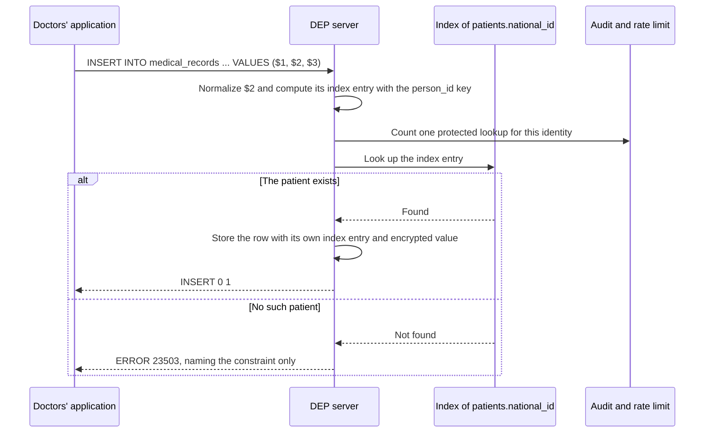

**Rules in detail**

1. **The referencing column must be declared `PROTECTED`, and inherits the match domain.** `PROTECTED` must be written, so that anyone reading the schema sees it wherever the value lives. If the domain is written, it must match. The same applies in the other direction (a protected column referencing an ordinary one) and across domains.
2. **The integrity check happens inside the engine**, by comparing index entries, without decrypting anything.
3. **The check counts as a protected lookup**, because its outcome carries information. A delete blocked by `RESTRICT` likewise reveals that a patient has records.
4. **Joins through the key follow the matching rules** ([7.6](#76-joining-on-protected-columns)).
5. **Privileges are not inherited.** The referencing column has its own privileges. Only the doctors receive privilege on both protected columns, which is how the clinic keeps reception away from diagnoses:

   ```sql
   GRANT SELECT (patient_id, national_id, full_name, health_fund) ON patients TO doctors_app;
   GRANT SELECT ON appointments, medical_records TO doctors_app;
   ```

6. **Creating the key requires `REFERENCES` privilege** on the referenced column, so adding a second home for a protected value is itself a decision someone must approve.

**What is inherited**

| Property | Taken from the referenced column? |
| --- | --- |
| `PROTECTED` | Required, and must be written |
| Match domain | Yes, inherited |
| Storage | The same as any protected column |
| Privilege to match on the column | No; each column has its own |

**Notes.** `ON UPDATE CASCADE` recomputes the index entries of the referencing rows, and `ON DELETE CASCADE` or `RESTRICT` locates them through the index. Deferred constraints, and foreign keys spanning several columns of which some are protected, are outside the first version.

**Errors.** [`DEP_REFERENCE_MISMATCH`](#dep_reference_mismatch--zd006); standard SQLSTATE `23503` for violations, naming only the constraint.

**Key points**

- A copy of a protected value must itself be protected.
- Checks run on index entries and count as lookups.
- Use a protected foreign key only when the link itself is sensitive.

### 7.11 Requiring qualified access

**What is it?** A table can require **qualified access**: every operational read or write on it must be anchored to one protected value or to its primary key.

**Why is it needed?** For tables where every legitimate access is targeted, it turns an accidental `UPDATE` without a `WHERE`, or a full scan, into an explicit error.

**Syntax.** The exact form is not yet fixed. One possibility is a table option:

```sql
ALTER TABLE patients SET (qualified_access = true);
```

**Example 1: An update that names one patient**

```sql
UPDATE patients SET full_name = $2 WHERE national_id = $1;
```

**Output**

```text
UPDATE 1
```

**Example 2: An update that names nobody**

```sql
UPDATE patients SET full_name = $1;
```

**Output**

```text
ERROR:  DEP_UNQUALIFIED_ACCESS
DETAIL: UPDATE on patients requires a qualifying lookup predicate.
HINT:   Locate the record by a single PROTECTED value or by its primary key.
```

**Explanation:** without qualified access, the second statement would have renamed all 50,000 patients.

**Notes.** Which tables should require qualified access, and whether it should be the default for tables with protected columns, is an open question ([Roadmap and Release](02-roadmap-and-release.md#7-open-questions)).

**Errors.** [`DEP_UNQUALIFIED_ACCESS`](#dep_unqualified_access--zd105).

---
## 8. Declared functions

**In one sentence:** a declared function is a SQL function whose signature states that it discloses protected values, links datasets through them, or both, and it is the only place where either can happen.

### 8.1 Why declared functions are needed

**What problem do they solve?** Most of the clinic's work is *pull* work: someone arrives with a value and asks for the matching record. Reception and the doctors work this way, with anchored matching, and never need the value back. Two kinds of legitimate work do not fit that pattern:

| Kind of work | In the clinic | Why ordinary queries cannot do it |
| --- | --- | --- |
| **Releasing the values themselves** | The monthly report to the health funds; appointment reminders by SMS; diagnosis claims | The database is the only party that knows the values at that moment, and ordinary queries never return them |
| **Linking whole datasets** | Diagnoses per health fund, for the dashboard | Ordinary queries may match only one value at a time |

**Why not a permission?** A general "read permission" or "link permission" would collapse back into the column privileges DEP was meant to improve on. DEP instead forbids both by default and makes each exception an explicit construct of the language, as Rust does with `unsafe`. There are two such constructs: `DISCLOSES` and `LINKS`.

### 8.2 REVEAL

**What is it?** `REVEAL` is the only operation that turns a protected value into an ordinary one.

**Syntax**

```sql
REVEAL ( protected_column )
```

**Parameters**

| Parameter | Meaning |
| --- | --- |
| `protected_column` | A protected column of match domain `d`. |

**Return value.** The value, with the base type of the column: `REVEAL` of a `TEXT PROTECTED` column returns `TEXT`. The result is a **disclosed value** ([8.9](#89-disclosed-values-and-the-terminal-rule)).

**Example 1: `REVEAL` inside a disclosing function**

```sql
CREATE FUNCTION monthly_fund_report(report_month DATE)
RETURNS TABLE (national_id TEXT, visit_date DATE, visit_type TEXT, health_fund TEXT)
LANGUAGE sql
DISCLOSES person_id
AS $$
    SELECT REVEAL(p.national_id), a.starts_at::date, a.visit_type, p.health_fund
    FROM appointments AS a
    JOIN patients AS p USING (patient_id)
    WHERE date_trunc('month', a.starts_at) = date_trunc('month', report_month);
$$;
```

**Output**

```text
CREATE FUNCTION
```

**Explanation:** `REVEAL(p.national_id)` is allowed, because the function declares `DISCLOSES person_id` and `national_id` belongs to `person_id`.

**Example 2: `REVEAL` in an ordinary query**

```sql
SELECT REVEAL(national_id) FROM patients;
```

**Output**

```text
ERROR:  DEP_REVEAL_OUTSIDE_DISCLOSURE
DETAIL: REVEAL() of patients.national_id (match domain person_id) appears outside a disclosing function.
HINT:   Move the disclosure into a function declared DISCLOSES person_id.
```

**Explanation:** outside a disclosing function, `REVEAL` does not exist as far as the client is concerned.

**Example 3: `REVEAL` of the wrong domain**

```sql
CREATE FUNCTION phones_and_ids()
RETURNS TABLE (phone TEXT, national_id TEXT)
LANGUAGE sql
DISCLOSES phone_number
AS $$
    SELECT REVEAL(phone), REVEAL(national_id) FROM patients;
$$;
```

**Output**

```text
ERROR:  DEP_REVEAL_OUTSIDE_DISCLOSURE
DETAIL: REVEAL() of patients.national_id (match domain person_id) appears outside a disclosing function.
```

**Explanation:** the function may reveal phone numbers, but not ID numbers. Each domain must be declared separately. The check runs when the function is created, not only when it runs.

**Errors.** [`DEP_REVEAL_OUTSIDE_DISCLOSURE`](#dep_reveal_outside_disclosure--zd001).

### 8.3 CREATE FUNCTION ... DISCLOSES

**What is it?** A **disclosing function** is a function declared `DISCLOSES d`. Inside its body, values of match domain `d` may be revealed.

**Why is it needed?** For any workflow that needs protected values to leave the database: a report, a file for an external system, a message to a person.

**Syntax**

```sql
CREATE FUNCTION function_name ( [ parameter_name type [, ...] ] )
RETURNS TABLE ( column_name type [, ...] )
LANGUAGE sql
DISCLOSES domain_name [, ...]
[ LINKS domain_name [, ...] ]
AS $$
    query
$$;
```

**Parameters**

| Clause | Meaning |
| --- | --- |
| `function_name`, parameters | As in any PostgreSQL function. |
| `RETURNS TABLE (...)` | The columns the caller receives. A disclosed column has the base type of the protected column it comes from. |
| `LANGUAGE sql` | Required, so the engine can analyze the body when the function is created. |
| `DISCLOSES domain_name` | The match domains whose values the body may `REVEAL`. |
| `LINKS domain_name` | Optional; also allows unanchored matching in that domain ([8.5](#85-declaring-both)). |
| `AS $$ ... $$` | The function body, in ordinary PostgreSQL syntax. |

**Example 1: Calling the monthly report**

The billing job calls the function from [8.2](#82-reveal) with ordinary SQL:

```sql
SELECT * FROM monthly_fund_report('2026-10-01');
```

**Output**

| national_id | visit_date | visit_type | health_fund |
| --- | --- | --- | --- |
| 123456782 | 2026-10-14 | Follow-up | Clalit |

**Explanation:** the billing job receives a real ID number, as ordinary `TEXT`, because that is what the signature promises. This is one of only two places in the clinic where ID numbers can leave the database.

**Example 2: Reminders, in the other domain**

```sql
CREATE FUNCTION tomorrow_reminders()
RETURNS TABLE (phone TEXT, starts_at TIMESTAMPTZ)
LANGUAGE sql
DISCLOSES phone_number
AS $$
    SELECT REVEAL(p.phone), a.starts_at
    FROM appointments AS a
    JOIN patients AS p USING (patient_id)
    WHERE a.starts_at::date = current_date + 1;
$$;

SELECT * FROM tomorrow_reminders();     -- as reminder_job
```

**Output**

| phone | starts_at |
| --- | --- |
| +972-50-0000001 | 2026-10-21 10:30 |

**Explanation:** the function returns the phone number and the time, and nothing else. A reminder SMS does not need to say what the visit is for, so the visit type never leaves with the phone number. A declared function should return only what its purpose requires.

**Example 3: Calling a disclosing function from the masked path**

```sql
SELECT * FROM monthly_fund_report('2026-10-01');     -- as bi_dashboard
```

**Output**

```text
ERROR:  DEP_ENDPOINT_OPERATION
DETAIL: Disclosing functions are unavailable on a MASKED_READ connection.
```

**Explanation:** disclosure happens only on the operational path, even for a role that somehow holds `EXECUTE`.

**Rules in detail.** The creator needs `DISCLOSE ON MATCH DOMAIN d` ([8.6](#86-grant-disclose-and-grant-link)); the function is never executable by `PUBLIC` ([8.7](#87-grant-execute-on-declared-functions)); it runs only on the operational path; and its disclosed output columns are terminal ([8.9](#89-disclosed-values-and-the-terminal-rule)). The full list is in [8.8](#88-the-rules-for-declared-functions).

**Errors.** [`DEP_DECLARATION_PRIVILEGE`](#dep_declaration_privilege--zd002), [`DEP_DECLARED_LANGUAGE`](#dep_declared_language--zd003), [`DEP_DECLARED_CALL`](#dep_declared_call--zd004), [`DEP_REVEAL_OUTSIDE_DISCLOSURE`](#dep_reveal_outside_disclosure--zd001), [`DEP_ENDPOINT_OPERATION`](#dep_endpoint_operation--zd102).

### 8.4 CREATE FUNCTION ... LINKS

**What is it?** A **linking function** is a function declared `LINKS d`. Inside its body, protected values of domain `d` may be matched without an anchor, linking whole datasets.

**Why is it needed?** For a workflow that must connect whole datasets through a protected value, typically to compute statistics, without releasing the values.

**Syntax**

```sql
CREATE FUNCTION function_name ( [ parameter_name type [, ...] ] )
RETURNS TABLE ( column_name type [, ...] )
LANGUAGE sql
LINKS domain_name [, ...]
AS $$
    query
$$;
```

**Example 1: Diagnoses per health fund**

```sql
CREATE FUNCTION diagnoses_per_fund()
RETURNS TABLE (health_fund TEXT, diagnosis TEXT, patients BIGINT)
LANGUAGE sql
LINKS person_id
AS $$
    SELECT p.health_fund, m.diagnosis, COUNT(*)
    FROM patients AS p
    JOIN medical_records AS m ON m.patient_national_id = p.national_id
    GROUP BY p.health_fund, m.diagnosis;
$$;

GRANT EXECUTE ON FUNCTION diagnoses_per_fund() TO bi_dashboard;
```

**Output**

```text
CREATE FUNCTION
GRANT
```

**Explanation:** the join inside the body has no anchor; it links every patient to every diagnosis. That is allowed only because the function declares `LINKS person_id`.

**Example 2: The dashboard calls it from the masked path**

```sql
SELECT * FROM diagnoses_per_fund();
```

**Output**

| health_fund | diagnosis | patients |
| --- | --- | --- |
| Clalit | Diabetes | 412 |
| Maccabi | Asthma | 187 |

**Explanation:** the function returns only counts, so it discloses nothing. The dashboard receives the result of a linkage the clinic approved, without gaining any ability to link anything itself. It sends no protected value, so it cannot use the function to probe for one, which is why a linking function without protected input may run on the masked path.

**Example 3: The dashboard tries the same join itself**

```sql
SELECT p.health_fund, m.diagnosis, COUNT(*)
FROM patients AS p
JOIN medical_records AS m ON m.patient_national_id = p.national_id
GROUP BY p.health_fund, m.diagnosis;
```

**Output**

```text
ERROR:  DEP_ENDPOINT_OPERATION
DETAIL: Matching PROTECTED values is unavailable on a MASKED_READ connection.
```

**Explanation:** the permission belongs to the reviewed function, not to the caller. The same SQL, written outside the function, is rejected.

**Rules in detail**

1. The creator needs `LINK ON MATCH DOMAIN d`.
2. `LINKS` alone does not permit `REVEAL`.
3. A linking function that takes **no protected input** may be called on both paths.
4. A linking function that takes a protected value as a parameter may be called only on the operational path, because calling it is itself a form of matching.

**Errors.** [`DEP_DECLARATION_PRIVILEGE`](#dep_declaration_privilege--zd002), [`DEP_ENDPOINT_OPERATION`](#dep_endpoint_operation--zd102).

### 8.5 Declaring both

**What is it?** A function may declare both `DISCLOSES d` and `LINKS d` when it must link datasets *and* release values.

**Example: The diagnosis claims**

```sql
CREATE FUNCTION fund_claims_report(report_month DATE)
RETURNS TABLE (national_id TEXT, diagnosis TEXT, recorded_at DATE)
LANGUAGE sql
DISCLOSES person_id
LINKS person_id
AS $$
    SELECT REVEAL(p.national_id), m.diagnosis, m.recorded_at
    FROM medical_records AS m
    JOIN patients AS p ON p.national_id = m.patient_national_id
    WHERE date_trunc('month', m.recorded_at) = date_trunc('month', report_month);
$$;

GRANT EXECUTE ON FUNCTION fund_claims_report(DATE) TO billing_job;
```

**Explanation:**

- The join links every diagnosis of the month to its patient, which requires `LINKS person_id`.
- The output includes the ID number, which requires `DISCLOSES person_id`.
- "Returns ID numbers" and "links patients to diagnoses" are two different privacy decisions, and a reviewer should see both in the signature. `DISCLOSES` alone does not permit linking, and `LINKS` alone does not permit `REVEAL`.

**The working idiom: match first, reveal last.** The join happens through internal matching on protected fields, and `REVEAL` appears only in the final projection, on the column the value is disclosed from.

### 8.6 GRANT DISCLOSE and GRANT LINK

**What is it?** `GRANT DISCLOSE` and `GRANT LINK` give a role the privilege to *create* disclosing and linking functions for one match domain.

**Why is it needed?** Declaring a function is adding "unsafe code" to the database. Only designated roles should be able to do it, domain by domain.

**Syntax**

```sql
GRANT  { DISCLOSE | LINK } ON MATCH DOMAIN domain_name TO   role_name [, ...];
REVOKE { DISCLOSE | LINK } ON MATCH DOMAIN domain_name FROM role_name [, ...];
```

**Parameters**

| Parameter | Meaning |
| --- | --- |
| `DISCLOSE` | Allows creating or altering functions declared `DISCLOSES domain_name`. |
| `LINK` | Allows creating or altering functions declared `LINKS domain_name`. |
| `domain_name` | The match domain the privilege applies to. |
| `role_name` | The role receiving the privilege. |

**Example 1: The clinic's privacy administrator**

```sql
GRANT DISCLOSE ON MATCH DOMAIN person_id    TO privacy_admin;
GRANT LINK     ON MATCH DOMAIN person_id    TO privacy_admin;
GRANT DISCLOSE ON MATCH DOMAIN phone_number TO privacy_admin;
```

**Explanation:** every declared function in the clinic is created by `privacy_admin`. Note what is missing: nobody may declare `LINKS phone_number`, so phone numbers can never be used to link datasets.

**Example 2: A developer tries to declare a linking function**

```sql
-- as app_developer
CREATE FUNCTION all_diagnoses() RETURNS TABLE (diagnosis TEXT)
LANGUAGE sql LINKS person_id AS $$ ... $$;
```

**Output**

```text
ERROR:  DEP_DECLARATION_PRIVILEGE
DETAIL: Role app_developer may not declare functions LINKS person_id.
HINT:   This function must be created by a role holding LINK ON MATCH DOMAIN person_id.
```

**Explanation:** the developer may write the function, but it must be reviewed and created by a role holding the privilege.

**Notes.** These are the only two privileges DEP adds. They decide who may *write* declared functions, not who may *call* them.

### 8.7 GRANT EXECUTE on declared functions

**What is it?** Who may *call* a declared function is decided by the ordinary `GRANT EXECUTE`, with one difference: declared functions are never executable by `PUBLIC`.

**Syntax**

```sql
GRANT EXECUTE ON FUNCTION function_name ( argument_types ) TO role_name [, ...];
```

**Example 1: Granting the reports to their jobs**

```sql
GRANT EXECUTE ON FUNCTION monthly_fund_report(DATE) TO billing_job;
GRANT EXECUTE ON FUNCTION tomorrow_reminders()      TO reminder_job;
```

**Explanation:** each consumer appears in the grants by name, so the list of who may receive disclosed values is explicit.

**Example 2: Opening a disclosing function to everyone**

```sql
GRANT EXECUTE ON FUNCTION monthly_fund_report(DATE) TO PUBLIC;
```

**Output**

```text
ERROR:  DEP_PUBLIC_EXECUTE
DETAIL: monthly_fund_report is declared DISCLOSES person_id and cannot be executable by PUBLIC.
HINT:   Grant EXECUTE to the specific roles that need it.
```

**Explanation:** in PostgreSQL, new functions are executable by `PUBLIC` by default. For declared functions that default would make every disclosure available to everyone, so DEP removes it.

**Rules in detail**

1. Declared functions are created with no `EXECUTE` privilege for anyone but their owner.
2. Granting `EXECUTE` on a declared function to `PUBLIC` is rejected.
3. A caller needs only `EXECUTE`, not privilege on the protected columns the function matches on internally ([8.8](#88-the-rules-for-declared-functions), rule 8).

**Errors.** [`DEP_PUBLIC_EXECUTE`](#dep_public_execute--zd005).

### 8.8 The rules for declared functions

| # | Rule | What it means |
| --- | --- | --- |
| 1 | **Location of `REVEAL`** | If `x` has type `T PROTECTED` in domain `d`, then `REVEAL(x)` has type `T` and is valid only in the body of a function declared `DISCLOSES d`. Checked at creation. |
| 2 | **Location of unanchored matching** | Unanchored matching on values of domain `d` is valid only in the body of a function declared `LINKS d`. |
| 3 | **Analyzable bodies** | Declared functions must be `LANGUAGE sql`. They may call user-defined functions only if those are declared for the same purpose and domain; otherwise a protected or revealed value could reach code that was never reviewed. |
| 4 | **Disclosed values are terminal** | Values produced by `REVEAL` may be returned to the client, but not used in a predicate, join condition, grouping, aggregate, insert, or function argument ([8.9](#89-disclosed-values-and-the-terminal-rule)). |
| 5 | **Paths** | Disclosing functions run only on the operational path. Linking functions run on the operational path, and on the masked path when they take no protected input. |
| 6 | **Declaring is privileged** | `DISCLOSES d` requires `DISCLOSE ON MATCH DOMAIN d`; `LINKS d` requires `LINK ON MATCH DOMAIN d` ([8.6](#86-grant-disclose-and-grant-link)). |
| 7 | **No public execution** | Declared functions are never executable by `PUBLIC` ([8.7](#87-grant-execute-on-declared-functions)). |
| 8 | **Matching runs under the declaration** | The matches inside a declared function were reviewed as part of the function, so a caller needs only `EXECUTE`, much like `SECURITY DEFINER` in PostgreSQL. That is why the dashboard, which has no privilege on any protected column, can call `diagnoses_per_fund`. |

### 8.9 Disclosed values and the terminal rule

**What is it?** A **disclosed value** is a value produced by `REVEAL`. The **terminal rule** says that a disclosed value may only be returned to the client: it is the end of the line inside the database.

**Why is it needed?** Without it, the report approved for the health funds could be turned into a tool for linking patients to diagnoses inside the database.

**Example 1: Returning a disclosed value (allowed)**

```sql
SELECT national_id, visit_date FROM monthly_fund_report('2026-10-01');
```

**Output**

| national_id | visit_date |
| --- | --- |
| 123456782 | 2026-10-14 |

**Explanation:** returning the value is exactly what the function is for.

**Example 2: Joining a disclosed value back to diagnoses (rejected)**

```sql
SELECT r.national_id, m.diagnosis
FROM monthly_fund_report('2026-10-01') AS r
JOIN medical_records AS m ON m.patient_national_id = r.national_id;
```

**Output**

```text
ERROR:  DEP_DISCLOSED_VALUE_USE
DETAIL: Column national_id of monthly_fund_report() is a disclosed value and cannot be used in a join condition.
HINT:   Disclosed values can only be returned. Perform the match on PROTECTED fields inside a declared function, before REVEAL.
```

**Explanation:** the signature says `TEXT`, and the developer sees an ordinary column. But the engine recorded that this column comes from `REVEAL`, so it may not be used as a join key. The report cannot become a linking tool.

**Example 3: Filtering a disclosed value (rejected)**

```sql
SELECT r.national_id
FROM monthly_fund_report('2026-10-01') AS r
WHERE r.national_id LIKE '1%';
```

**Output**

```text
ERROR:  DEP_DISCLOSED_VALUE_USE
```

**Explanation:** filtering is a use, not a return. If the billing job needs only some rows, the filter belongs inside the declared function.

**Rules in detail**

1. The engine records which output columns of a declared function come from `REVEAL`.
2. Those columns may be returned to the client, and nothing else: no predicate, join condition, grouping, aggregate, sort key, insert, or function argument.
3. A disclosed value keeps its base type. A revealed `DATE` remains a `DATE`; the terminal rule already prevents further processing, so converting everything to text would add no protection.

**What the rule does not prevent**

- **Use after release.** The rule governs what happens inside the database. Once a value is returned, DEP cannot control its use. The billing job can send the ID numbers back as parameters to later queries, but each is then an anchored lookup, audited and rate-limited.
- **Linkage through ordinary keys.** The rule stops the *marked value* from being used as a key. If `monthly_fund_report` also returned `patient_id`, its output could be joined freely to every table that holds `patient_id`:

```sql
-- Would be allowed, if the function returned patient_id: the join uses an ordinary key.
SELECT r.national_id, a.visit_type
FROM monthly_fund_report('2026-10-01') AS r
JOIN appointments AS a USING (patient_id);
```

Two design rules follow, and [chapter 10](#10-designing-with-dep) applies both: a declared function returns only what its purpose requires (none of the clinic's functions returns `patient_id`), and a key that links sensitive datasets should itself be protected.

**Errors.** [`DEP_DISCLOSED_VALUE_USE`](#dep_disclosed_value_use--zd104).

### 8.10 Documenting purpose: COMMENT ON FUNCTION

**What is it?** The purpose of a declared function is recorded with the standard `COMMENT ON FUNCTION`, which keeps it in the catalog without new syntax.

**Syntax**

```sql
COMMENT ON FUNCTION function_name ( argument_types ) IS 'text';
```

**Example**

```sql
COMMENT ON FUNCTION monthly_fund_report(DATE) IS 'Purpose: monthly visit report to health funds. Owner: billing.';
COMMENT ON FUNCTION tomorrow_reminders()      IS 'Purpose: SMS appointment reminders. Owner: operations.';
COMMENT ON FUNCTION diagnoses_per_fund()      IS 'Purpose: diagnosis statistics per health fund. Owner: management.';
COMMENT ON FUNCTION fund_claims_report(DATE)  IS 'Purpose: monthly diagnosis claims to health funds. Owner: billing.';
```

**Explanation:** the comment appears in the `description` column of the catalog ([8.11](#811-the-catalog-depdeclared_functions)), next to the declaration it explains.

**Notes.** Whether purpose should become a first-class, machine-checked part of a declaration is an open question ([Roadmap and Release](02-roadmap-and-release.md#7-open-questions)).

### 8.11 The catalog: dep.declared_functions

**What is it?** `dep.declared_functions` is a catalog view with one row per declared function and match domain.

**Columns**

| Column | Meaning |
| --- | --- |
| `function_name` | The function's name and signature. |
| `kind` | `DISCLOSES`, `LINKS`, or both. |
| `match_domain` | The domain the declaration applies to. |
| `owner` | The role that created the function. |
| `masked_path` | Whether the function may be called on the masked path. |
| `description` | The function's comment. |

**Example 1: Every place ID numbers may leave or be linked**

```sql
SELECT function_name, kind, owner, description
FROM dep.declared_functions
WHERE match_domain = 'person_id';
```

**Output**

| function_name | kind | owner | description |
| --- | --- | --- | --- |
| `monthly_fund_report` | DISCLOSES | privacy_admin | Monthly visit report to health funds |
| `diagnoses_per_fund` | LINKS | privacy_admin | Diagnosis statistics per health fund |
| `fund_claims_report` | DISCLOSES, LINKS | privacy_admin | Monthly diagnosis claims to health funds |

**Explanation:** because nothing else can reveal ID numbers or link datasets through them, this list is complete. It is not documentation that might be out of date.

**Example 2: What the masked path can reach**

```sql
SELECT function_name FROM dep.declared_functions WHERE masked_path;
```

**Output**

| function_name |
| --- |
| `diagnoses_per_fund` |

**Explanation:** the only declared function the dashboard and the assistant can ever call returns counts.

### 8.12 The mapping to Rust

| Rust | DEP |
| --- | --- |
| An unsafe operation (dereferencing a raw pointer) | `REVEAL`, or unanchored matching on a protected value |
| `unsafe fn` or an `unsafe` block | A function body declared `DISCLOSES d` or `LINKS d` |
| A safe wrapper that exposes an ordinary API | A declared function whose signature returns ordinary types |
| A `# Safety` comment documenting the contract | `COMMENT ON FUNCTION` describing the purpose |
| `cargo geiger`, which counts every `unsafe` in a project | A single query over `dep.declared_functions` |

### 8.13 Future extension: partial disclosure

**What is the idea?** Some recipients need less than the full value. A letter to Dana might show only the last four digits of her ID number, to confirm it reached the right person. A later version could make the *form* of disclosure part of the declaration, so that data minimization becomes a check at creation time:

```sql
DISCLOSES person_id AS SUFFIX(4)
```

**Explanation:** in such a body only `REVEAL_SUFFIX(x, 4)` would be legal; writing the full `REVEAL(x)` would be an error. This is intentionally outside the first version.

**Key points**

- `REVEAL` exists only inside `DISCLOSES` functions; unanchored matching only inside `LINKS` functions.
- Declaring needs a per-domain privilege; calling needs `EXECUTE`, never `PUBLIC`.
- Disclosed values can only be returned, never reused inside the database.
- The catalog lists every declared function, so it is the complete answer to "where can values leave?"

---
## 9. DEP and Privacy as Code

**In one sentence:** with DEP, the privacy policy is enforced by the engine that runs every query, and the evidence of that enforcement is produced in the same place.

[Chapter 3](#3-privacy-as-code-privacy-by-design-and-the-gdpr) compared DEP with Privacy as Code tools and with privacy frameworks. This chapter shows what Privacy as Code looks like in day-to-day work with DEP.

### 9.1 What changes in practice

**What is different?** Four things, each explained below with an example:

| | Without DEP | With DEP |
| --- | --- | --- |
| Where values may leave | Wherever a role has `SELECT` | Only in declared functions, listed in the catalog ([9.2](#92-a-complete-inventory-by-construction)) |
| Who looked up what | Unknown, unless every application logs it | Every protected match is recorded by the server ([9.3](#93-everyday-work-is-attributed)) |
| Review of privacy-relevant changes | Depends on reviewers noticing | Declared functions are syntax that CI can find ([9.4](#94-review-happens-in-code)) |
| Who decides | Whoever holds a permission | People decide; the engine enforces exactly what they approved ([9.5](#95-the-engine-enforces-people-decide)) |

### 9.2 A complete inventory by construction

**What is it?** Because `REVEAL` is legal only inside disclosing functions, and unanchored matching only inside linking functions, the set of places where protected values can leave the database, or link whole datasets, is exactly the set of declared functions.

**Example**

```sql
SELECT function_name, kind, match_domain, description
FROM dep.declared_functions
ORDER BY match_domain, function_name;
```

**Output**

| function_name | kind | match_domain | description |
| --- | --- | --- | --- |
| `diagnoses_per_fund` | LINKS | person_id | Diagnosis statistics per health fund |
| `fund_claims_report` | DISCLOSES, LINKS | person_id | Monthly diagnosis claims to health funds |
| `monthly_fund_report` | DISCLOSES | person_id | Monthly visit report to health funds |
| `tomorrow_reminders` | DISCLOSES | phone_number | SMS appointment reminders |

**Explanation:** these four rows are the clinic's complete answer to "where can identifiers leave, and where are datasets linked through them?" The answer is complete because of how the system is built, not because someone remembered to document every export.

### 9.3 Everyday work is attributed

**What is it?** Anchored matching is allowed without any declaration, but every protected match on the operational path is recorded in the audit log with the identity that made it, and without the value itself.

**Example.** An administrator reviewing yesterday's activity might see entries like these:

| time | identity | operation | protected columns | rows |
| --- | --- | --- | --- | --- |
| 2026-10-19 09:12 | `reception_app` | lookup | `patients.national_id` | 1 |
| 2026-10-19 09:31 | `doctors_app` | anchored join | `patients.national_id`, `medical_records.patient_national_id` | 2 |
| 2026-10-19 23:00 | `reminder_job` | call `tomorrow_reminders()` | `patients.phone` | 64 |

**Explanation:** the clinic can show who looked up what, and when, without the log itself containing a single ID number. An audit log that held every identifier ever searched for would become the most sensitive table in the system. The exact format of the log is left to an implementation.

### 9.4 Review happens in code

**What is it?** Declared functions live in migration files like any other schema change. Because `DISCLOSES` and `LINKS` are syntax, a CI pipeline can find every addition or change and require approval from the organization's privacy officer before it merges.

**Example.** A developer adds a new disclosing function in a migration. The pipeline reports:

```text
privacy check: 1 change requires approval
  + CREATE FUNCTION marketing_contacts() ... DISCLOSES phone_number
    no matching cell in privacy/matrix.md (phone x Marketing)
    approval required: privacy-officer
```

**Explanation:** the engine adds the guarantee that makes this review meaningful. Code that is not declared cannot reveal values or link datasets, so the review cannot be bypassed by writing the same logic somewhere else. The checks themselves are described in [10.7](#107-step-7-keep-the-matrix-and-the-database-in-sync).

### 9.5 The engine enforces, people decide

**What is the division of work?** DEP does not run approval workflows, judge lawful bases, or decide what is legitimate. Those decisions belong to the privacy officer, legal counsel, and management. DEP ensures that their decisions are implemented exactly as approved, and that the organization can demonstrate it.

**Key points**

- The catalog is a complete list of exits and linkages.
- The audit log attributes every lookup, without holding values.
- Privacy-relevant changes are syntax, so CI can require their review.
- People decide; DEP enforces and produces the evidence.

---

## 10. Designing with DEP

**In one sentence:** with DEP, privacy decisions are schema decisions, so they are made first, recorded as reviewed artifacts, and turned into grants, declared functions, and tests.

### 10.0 Why the order of design changes

**What changes?** In a conventional project the schema comes first, the application is built on it, and privacy is reviewed afterwards, usually by asking which columns should be hidden from whom. With DEP that order no longer works, because privacy decisions *are* schema decisions: whether a field is `PROTECTED`, which match domain it belongs to, which consumer connects on which path, which roles may use which protected column, and which declared functions exist at all.

**How does the method work?** It has eight steps. Each produces an **artifact** that lives in the repository next to the code, is reviewed like code, and is checked automatically. That is what makes it Privacy as Code rather than a checklist.

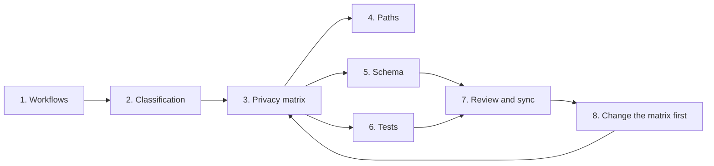

### 10.1 Step 1: Start from the workflows

**Question.** What must the system do, and who or what does it?

**Why first?** A value is sensitive only in relation to what is done with it, so workflows, not data, are the starting point.

**In the clinic**

| Workflow | Consumer | What it needs to do |
| --- | --- | --- |
| Check-in | `reception_app` | Find a patient by the ID number they present and show today's appointments |
| Consultation | `doctors_app` | Find the patient in the room by ID number and show their diagnoses |
| Reminders | `reminder_job` | Send an SMS to each patient with an appointment tomorrow |
| Visit report | `billing_job` | Report each visit to the patient's health fund, identified by ID number |
| Claims | `billing_job` | Submit each month's diagnoses to the health funds, identified by ID number |
| Statistics | `bi_dashboard` | Show how many patients of each health fund have each diagnosis |
| Scheduling | `scheduling_agent` | Suggest scheduling improvements from appointment patterns |

**Artifact:** `privacy/workflows.md`.

### 10.2 Step 2: Classify the fields

**Question.** Which fields are protected, in which match domain, and which keys link sensitive data?

**How?** Ask two questions about every field the workflows touch:

1. **Is the value sensitive, and is it mostly *used* rather than *read*?** Protect it when the system needs to use it (to find, deduplicate, or connect records) but most consumers have no need to see it. Fields that people must see to do their work, such as a name at reception or a diagnosis in the consultation room, stay ordinary in the first version, governed by ordinary permissions.
2. **Does the field link datasets whose linkage is sensitive?** DEP enforces anchoring and `LINKS` only on protected columns, so a key that connects two tables is a privacy decision in its own right.

**In the clinic**

| Field | Protected | Match domain | Reason |
| --- | --- | --- | --- |
| `patients.national_id` | Yes | `person_id` | Used to find patients and in the health-fund reports; nobody needs to browse it |
| `patients.phone` | Yes | `phone_number` | Needed only to send reminders |
| `medical_records.patient_national_id` | Yes | `person_id` | Links patients to diagnoses, and that linkage is sensitive |
| `patients.patient_id` | No | None | Internal key linking patients to appointments; that linkage is not sensitive |
| `patients.full_name` | No | None | Reception and doctors must see it |
| `medical_records.diagnosis` | No | None | Sensitive, but doctors must read it; governed by ordinary permissions |

**Explanation:** note what the design avoids: `medical_records` has no `patient_id`. Its only connection to `patients` is the protected ID number, so there is no ordinary path around the linkage rules.

#### Choosing how tables are connected

**What are the options?**

- An **ordinary key** is an open road: anyone with privilege on both tables can join them, on both paths, without anchoring or declaration.
- A **protected key** is a road with a barrier: joins through it are anchored on the operational path, declared in `LINKS` everywhere else, and impossible on the masked path.

The clinic's map:

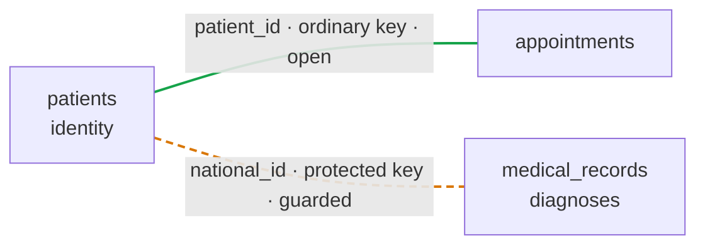

**Rule 1: the default is an ordinary internal key.** Most links are not sensitive. If `appointments` referenced patients through the protected ID number, the simplest dashboard figure, visits per health fund, would fail on the masked path, and every such report would need a reviewed `LINKS` function.

**Rule 2: a protected foreign key is for links that are themselves sensitive.** A list of names next to diagnoses is the clinic's most sensitive dataset even without a single ID number.

**Rule 3: a sensitive pair must not also be connected by an open road.**

**Example: an open road around the barrier.** A designer adds a `visits` table with a diagnosis code, connected to patients through `patient_id`:

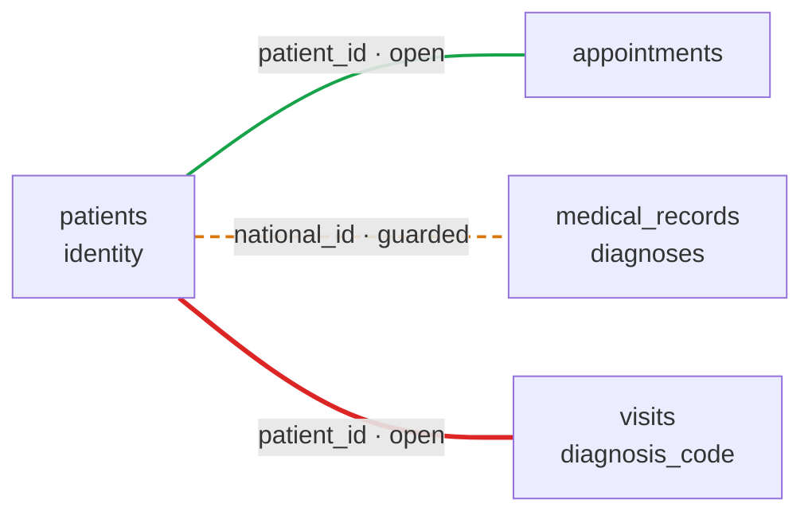

```sql
SELECT p.full_name, v.diagnosis_code
FROM patients AS p JOIN visits AS v USING (patient_id);
```

**Output**

```text
 full_name  | diagnosis_code
------------+----------------
 Dana Cohen | J45
 ...
```

**Explanation:** the query returns every patient's diagnoses, on both paths, without anchoring, without `LINKS`, and without touching a protected column. DEP cannot detect this by itself: to the engine, `patient_id` is an ordinary column like any other. Hence the rule:

> **Between a table that holds identities and a table that holds sensitive data, there must be no path made only of ordinary keys, of any length.**

**Three questions decide each connection**

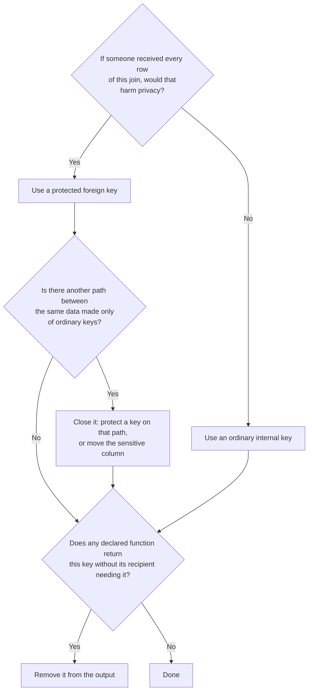

The first question is a business decision. The other two can be checked from the schema itself, which makes them a natural CI check ([10.7](#107-step-7-keep-the-matrix-and-the-database-in-sync)).

**Artifact:** `privacy/classification.md`.

### 10.3 Step 3: Build the privacy matrix

**What is it?** The **privacy matrix** has one row per protected field and one column per workflow. Every cell holds one of four decisions:

| Decision | Meaning |
| --- | --- |
| **MATCH** | The workflow uses the value to find, update, or connect the records of one value at a time, and never sees it. |
| **LINK** | The workflow connects whole datasets through the value. |
| **DISCLOSE** | The workflow needs the value itself to leave the database. |
| **NONE** | The workflow has no use for the value. |

**Rules.** The default is **NONE**. Every MATCH, LINK, and DISCLOSE carries a written reason. A cell may hold two decisions when a workflow both links and discloses.

**In the clinic**

| | Check-in | Consultation | Reminders | Visit report | Claims | Statistics | Scheduling |
| --- | --- | --- | --- | --- | --- | --- | --- |
| `patients.national_id` | MATCH | MATCH | NONE | DISCLOSE | DISCLOSE + LINK | LINK | NONE |
| `patients.phone` | NONE | NONE | DISCLOSE | NONE | NONE | NONE | NONE |
| `medical_records.patient_national_id` | NONE | MATCH | NONE | NONE | LINK | LINK | NONE |

**Explanation: reading by column** tells you what each consumer may do. Reception finds patients by ID number, but cannot look anyone up by phone and never reaches diagnoses. Doctors reach diagnoses one patient at a time: MATCH, not LINK. The reminder job releases phone numbers and touches no ID number. The dashboard links without matching anything itself, by calling a declared function. The scheduling assistant touches no protected value at all.

**Explanation: reading by row** tells you where each value goes. The ID number is used in two workflows, leaves the database in two, and links datasets in two. The phone number is never used for search and leaves only for reminders. The copy of the ID number in `medical_records` is used only by doctors, one patient at a time, and otherwise only in declared linkage; it never leaves.

The matrix covers only protected columns. Ordinary fields are governed by ordinary permissions.

**Artifact:** `privacy/matrix.md`, or an equivalent machine-readable file, with a reason next to every MATCH, LINK, and DISCLOSE.

### 10.4 Step 4: Assign consumers to paths

**Question.** Which consumer connects on which path?

**How?** Apply the rules of [6.8](#68-choosing-a-path-for-a-consumer) to the matrix:

| Consumer | Path | Declared functions it may call |
| --- | --- | --- |
| `reception_app` | `OPERATIONAL` | None |
| `doctors_app` | `OPERATIONAL` | None |
| `reminder_job` | `OPERATIONAL` | `tomorrow_reminders` |
| `billing_job` | `OPERATIONAL` | `monthly_fund_report`, `fund_claims_report` |
| `bi_dashboard` | `MASKED_READ` | `diagnoses_per_fund` |
| `scheduling_agent` | `MASKED_READ` | None |

**Artifact:** endpoint and role configuration.

### 10.5 Step 5: Translate the decisions into schema

**Question.** How does each decision become code?

| Matrix decision | Schema construct | In the clinic |
| --- | --- | --- |
| MATCH | Privilege on that protected column for the consumer's role, and the operational endpoint | `GRANT SELECT (patient_id, national_id, full_name, health_fund) ON patients TO reception_app` |
| LINK | A function declared `LINKS`, with `GRANT EXECUTE` | `diagnoses_per_fund` for `bi_dashboard` |
| DISCLOSE | A function declared `DISCLOSES`, with `GRANT EXECUTE` | `tomorrow_reminders` for `reminder_job` |
| NONE | No privilege on that column for that role | Reception has no privilege on `phone` |

**Explanation:** declared functions are created with no public `EXECUTE`, so every consumer appears in the grants by name. The complete schema, functions, and grants are in [Appendix A](#appendix-a-the-clinic). Three details in them come straight from the method:

- **The reminder function returns the phone number and the appointment time, but not the visit type.** A reminder SMS does not need to say what the visit is for.
- **No declared function returns `patient_id`.** Each returns only what its recipient needs, so its output cannot be joined back to other tables through an ordinary key.
- **Nobody has privilege on `patients.phone`.** The only route to phone numbers is `tomorrow_reminders`, and the NONE cells in the phone row are enforced by the absence of a grant.

**Artifact:** migration files.

### 10.6 Step 6: Write the tests before the implementation

**Question.** How do we prove each decision holds?

**How?** Every cell of the matrix becomes a test. Each test states a statement, a role, a path, and the expected result or error. The **NONE** cells produce negative tests, and they are the most important ones: they prove what must *not* happen.

**In the clinic**

```sql
-- national_id x Check-in = MATCH
-- role: reception_app    path: OPERATIONAL   expect: Dana's appointments; no national_id in output
SELECT p.full_name, a.starts_at
FROM patients AS p JOIN appointments AS a USING (patient_id)
WHERE p.national_id = '123456782';

-- phone x Check-in = NONE
-- role: reception_app    path: OPERATIONAL   expect: permission denied for column phone
SELECT full_name FROM patients WHERE phone = '+972-50-0000001';

-- medical_records x Consultation = MATCH (anchored)
-- role: doctors_app      path: OPERATIONAL   expect: Dana's diagnoses
SELECT m.diagnosis
FROM patients AS p JOIN medical_records AS m ON m.patient_national_id = p.national_id
WHERE p.national_id = '123456782';

-- medical_records x Consultation: linking everyone is not MATCH
-- role: doctors_app      path: OPERATIONAL   expect: DEP_UNANCHORED_MATCH
SELECT p.full_name, m.diagnosis
FROM patients AS p JOIN medical_records AS m ON m.patient_national_id = p.national_id;

-- national_id x Statistics = LINK
-- role: bi_dashboard     path: MASKED_READ   expect: rows of counts
SELECT * FROM diagnoses_per_fund();

-- national_id x Scheduling = NONE
-- role: scheduling_agent path: MASKED_READ   expect: DEP_ENDPOINT_OPERATION
SELECT a.starts_at
FROM patients AS p JOIN appointments AS a USING (patient_id)
WHERE p.national_id = '123456782';

-- phone x Visit report = NONE
-- role: billing_job      path: OPERATIONAL   expect: permission denied for function
SELECT * FROM tomorrow_reminders();

-- Disclosed values are terminal
-- role: billing_job      path: OPERATIONAL   expect: DEP_DISCLOSED_VALUE_USE
SELECT r.national_id, m.diagnosis
FROM monthly_fund_report('2026-10-01') AS r
JOIN medical_records AS m ON m.patient_national_id = r.national_id;
```

**Explanation:** these tests use the same format a DEP conformance suite would. If any of them stops behaving as expected, a privacy decision has been broken, and the build fails.

**Artifact:** the matrix-derived test suite.

### 10.7 Step 7: Keep the matrix and the database in sync

**Question.** Does what runs match what was decided?

**How?** The matrix and the schema live in the same repository and are reviewed together. A CI pipeline can enforce that:

1. every declared function in the migrations corresponds to a DISCLOSE or LINK cell, and every such cell has a function;
2. every privilege on a protected column corresponds to a MATCH cell for that role;
3. every new declared function, every `GRANT EXECUTE` on one, and every new privilege on a protected column is approved by the clinic's privacy officer;
4. every MATCH, LINK, and DISCLOSE cell carries a written reason;
5. the map of foreign keys contains no path made only of ordinary keys between a table that holds identities and a table that holds sensitive data;
6. the matrix-derived tests pass.

**After deployment.** The same comparison runs against the live database: `dep.declared_functions` and the privileges on protected columns are checked against the matrix.

**Example: a drift report**

```text
drift: 1 object in the database is not in the matrix
  GRANT EXECUTE ON FUNCTION monthly_fund_report(DATE) TO bi_dashboard
  matrix: national_id x Statistics = LINK (not DISCLOSE)
```

**Explanation:** someone granted the dashboard access to a disclosing function by hand. The grant would be useless on the masked path, but it contradicts what was decided, so it is reported.

**Artifact:** CI checks and a drift report.

### 10.8 Step 8: Change the matrix first

**What is the rule?** When a new need arrives, the first change is to the matrix, not to the code.

**Example.** The marketing team asks to send patients a promotional SMS. That is a new column in the matrix, and a new question in one cell: `phone x Marketing = DISCLOSE?`

**Explanation:** the question "may we?" is now asked explicitly, with the reason written down and reviewed, and perhaps answered no. Without the matrix, it would have been answered by whoever happened to have permission to run a query.

### 10.9 Summary of the method

| Step | Question it answers | Artifact |
| --- | --- | --- |
| 1. Workflows | What must the system do, and who does it? | `privacy/workflows.md` |
| 2. Classification | Which fields are protected, in which match domain, and which keys link sensitive data? | `privacy/classification.md` |
| 3. Privacy matrix | For each field and workflow: match, link, disclose, or nothing? | `privacy/matrix.md` |
| 4. Paths | Which consumer connects on which path? | Endpoint and role configuration |
| 5. Schema | How do the decisions become code? | Migrations: tables, declared functions, grants |
| 6. Tests | How do we prove each decision holds? | Matrix-derived test suite |
| 7. Review and sync | Does what runs match what was decided? | CI checks and drift report |
| 8. Change | How does the system evolve? | Matrix first, code second |

**Notes.** The method does not replace legal review or a data protection impact assessment. It gives them precise inputs (the matrix and its reasons) and verifiable outputs: the schema, the tests, and the catalog.

**Key points**

- Decide privacy first: workflows, then fields, then the matrix.
- Every matrix cell becomes a grant or a declared function, and a test.
- CI and the drift report keep the database equal to what was decided.

---

## 11. Use cases

**In one sentence:** the same three patterns (match one value, link through declared code, disclose through declared code) appear wherever an organization holds identifiers it uses more than it reads.

### 11.1 In the clinic

| Workflow | What DEP allows | What DEP prevents |
| --- | --- | --- |
| **Reception** | Finding a patient by the ID number she presents, and showing her appointments | Downloading the register; reaching diagnoses; reverse lookup by phone |
| **Consultation room** | Seeing the diagnoses of the patient in the room, through an anchored join | Listing the diagnoses of every patient |
| **Statistics** | Diagnoses per health fund, through the declared `diagnoses_per_fund` | Any linkage the dashboard writes itself |
| **Reports to the health funds** | The visit report and the claims, through declared disclosing functions | Any other route by which ID numbers leave |
| **The AI agent** | Exploring, aggregating, and joining appointments and patients through ordinary keys | Looking a patient up by ID number, or extracting identifiers, whatever SQL it generates |

**Explanation:** in every case, the legitimate work keeps running. What changes is that a compromised application, or an agent following the wrong instructions, cannot turn its access into a full export or a full linkage. Privacy is enforced by the server, not by the agent's prompt.

### 11.2 Beyond the clinic

| Setting | Matching | Linking | Disclosing |
| --- | --- | --- | --- |
| **Customer service** in a bank or a telecom company | Agents find a caller by the identifier they give | Complaint statistics per product | A regulatory report identified by customer number |
| **Human resources and payroll** | HR finds an employee by ID number | Salary statistics per department | The annual salary report to the tax authority |
| **Development and support access** | None | None | None: engineers query realistic data through the masked path without ever seeing identifiers |

---
# Part II: How DEP is supposed to work

## 12. Architecture

**In one sentence:** a DEP server is an ordinary query pipeline with DEP's checks added at each stage, running in a process the client cannot reach.

### 12.1 The trust boundary

**Definition.** The trust boundary is the line between the client's process, which DEP does not trust, and the server's process, which it does. Every guarantee in DEP depends on one architectural fact: **the client and the enforcement run in different processes, and the client controls only its own.**

**What the client holds.** A connection and the ability to send SQL. It never holds the data files, the matching keys, the server's memory, or the code that enforces the rules. Everything it learns arrives through the protocol, after the output boundary.

**Why DEP is a server and not a library.** If the same rules ran inside the client's process (a query engine embedded in an application or a notebook), whoever runs that process could read the data directly, load the keys, or simply change the code. The rules would still *describe* correct behavior, but they would not *enforce* it. Such an embedded build can be useful as a playground for learning the syntax ([Roadmap and Release](02-roadmap-and-release.md#4-distribution)), but it must be labeled clearly: **it offers no protection, because whoever runs it holds all the data.**

**Two consequences.**

1. **Keys never cross the boundary.** Matching keys and encryption keys are loaded by the server from a location the client cannot reach: a key-management service, or at minimum a server-side file or environment variable.
2. **The path is a property of the endpoint.** Each access path is bound to a listening endpoint and to authenticated identities at connection time. Nothing a client sends afterwards can change it.

### 12.2 Overview

The figure shows the whole server, using the clinic's six consumers. Numbers give the order in which a statement passes through it.

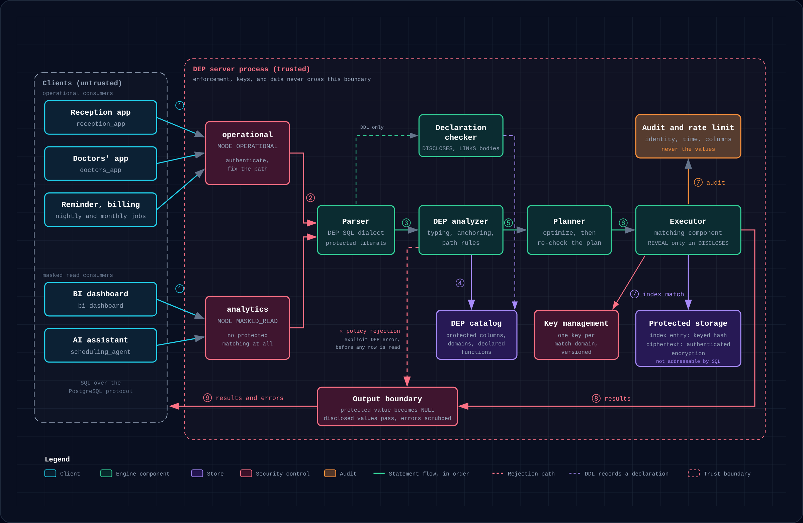

| Step | What happens |
| --- | --- |
| ① | The client sends SQL over the PostgreSQL protocol to the endpoint of its path. |
| ② | The endpoint authenticates the client and fixes the path for the session. |
| ③ | The parser reads the statement, including DEP syntax, and marks protected literals. DDL that declares functions also goes to the declaration checker, which records declarations in the DEP catalog. |
| ④ | The DEP analyzer resolves names and types through the catalog, and checks typing, anchoring, and path rules. A forbidden statement is rejected here with an explicit DEP error, before any row is read. |
| ⑤ | The planner optimizes the statement and re-checks the final plan. |
| ⑥ | The executor runs the plan. |
| ⑦ | Protected matching compares keyed index entries in protected storage, using the domain's key; every protected match is audited and counted against the rate limit. |
| ⑧ | Results pass to the output boundary. |
| ⑨ | The output boundary suppresses protected values, passes disclosed values, scrubs errors, and sends the response. |

### 12.3 Components

The same logical architecture applies whichever query engine sits underneath.

| Component | Definition | Role |
| --- | --- | --- |
| **Endpoints** | Listening server addresses, one per access path | Authenticate the client and fix the access path for the session. |
| **DEP catalog** | The server's record of DEP objects | Holds protected columns, match domains, protected foreign keys, declared functions, disclosed output columns, linking regions, `DISCLOSE` and `LINK` privileges, and purposes. |
| **Parser** | The SQL parser, with DEP's additions to the grammar | Understands `PROTECTED`, `MATCH DOMAIN`, `DISCLOSES`, `LINKS`, `GRANT DISCLOSE`, `GRANT LINK`, and `CREATE ENDPOINT`; identifies protected literals. |
| **DEP analyzer** | A checker over the resolved statement | Checks every statement by its resolved meaning (which table, column, type, and operator), not by its spelling, including whether protected matching is anchored. |
| **Declaration checker** | A checker for declared functions | Validates `DISCLOSES` and `LINKS` bodies at creation, and records disclosed columns and linking regions. |
| **Plan re-check** | A second check after optimization | Ensures no transformation reintroduces a forbidden use. |
| **Matching component** | The part of execution that handles protected comparisons | Performs lookups and joins on protected values through the internal matching index. |
| **Protected storage** | Internal columns that ordinary SQL cannot address | Holds each protected value's index entry and ciphertext. |
| **Key management** | The server-side source of keys | Supplies one versioned matching key per match domain, and encryption keys. |
| **Output boundary** | The last stage before the protocol | Suppresses protected values, passes disclosed values, and scrubs every outgoing message. |
| **Audit and rate limiting** | A server-side recorder and limiter | Records every protected match on the operational path and every call to a declared function, with the identity that made it; enforces per-identity limits; records withheld errors. Never records protected values. |

### 12.4 How the components fit together

**The path selects the execution rules; DEP enforces them inside the server.** The path does not rewrite queries for the client. Some queries run with suppressed output, some are rejected because the requested operation is forbidden, and some return disclosed values or linked results because a declared function says they may.

---

## 13. The life of a query

**In one sentence:** DEP keeps the ordinary pipeline of a query engine (authenticate, analyze, plan, execute, return) and adds enforcement at every stage.

### 13.1 The query

Reception sends this query when Dana arrives, with `123456782` supplied as `$1`:

```sql
SELECT full_name, national_id
FROM patients
WHERE national_id = $1;
```

### 13.2 In an ordinary engine

The query passes through four stages, and the protected column is treated like any other text:

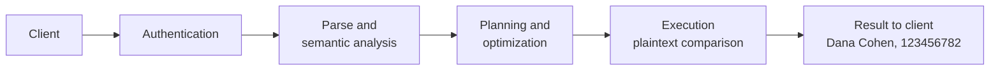

### 13.3 In DEP

The same pipeline, with DEP's additions highlighted:

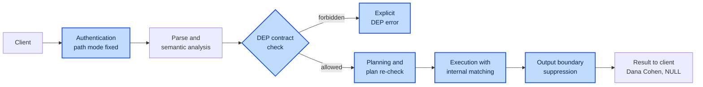

| Stage | Ordinary engine | DEP |
| --- | --- | --- |
| Authentication | Identifies the user | Also fixes the access path for the whole session |
| Analysis | Resolves names and types | Also checks every use of a protected or disclosed value against the rules, and rejects forbidden ones with an explicit error |
| Planning | Optimizes the query | Also re-checks the final plan, so no optimization reintroduces a forbidden use |
| Execution | Compares stored values directly | Compares keyed index entries; the value itself is never compared or exposed |
| Output | Sends whatever was selected | Suppresses protected values, passes only declared disclosed values, and scrubs every message |

### 13.4 Step by step

**Step 1: The connection already carries its path.** At authentication the server fixed the path, here `OPERATIONAL`, and the client cannot change it. The path accompanies the query through checking and execution. It is not a separate engine; it is the context in which the engine runs.

**Step 2: The engine resolves what the query means.** DEP works on the engine's resolved internal representation: which table `patients` refers to, which column `national_id` refers to, what its type is and whether it is protected, which operator implements `=`, and which fields are meant to reach the client. At this point DEP sees two different uses of the same column: in `WHERE national_id = $1` it is used for **matching**, and in `SELECT national_id` it is a request to **return** the value.

**Step 3: DEP checks the operations against the path.** On the operational path, the match is allowed: the role holds privilege on `national_id`, and the match is anchored to the single value `$1`. Returning the value is not allowed, so the projection will be suppressed. On the masked path, the matching itself is forbidden, and the query is rejected before any search runs. The engine never deletes the `WHERE` clause to "legalize" a query; that would change its meaning and could return the whole table.

**Step 4: The engine plans execution.** Conceptually, the plan is: find the matching record using the protected identifier; read the permitted `full_name` field; produce `NULL` for the protected output column; return the result. The predicate `national_id = $1` is rewritten into a comparison between the column's internal index entries and the keyed hash of the normalized parameter. This is fundamentally different from replacing `national_id` with `NULL` everywhere, which would destroy the search. Because the optimizer can transform queries, DEP re-checks the final plan rather than trusting only the check before planning.

**Step 5: The engine performs the internal match.** The matching component computes the index entry for the parameter with the match domain's key and locates the record ([16.3](#163-matching-with-a-keyed-index)). The same mechanism serves joins between protected fields of the same domain: a join on two `person_id` columns becomes an equi-join on their index entries.

**Step 6: The result crosses the output boundary.** Before anything is sent, DEP enforces the output rules, in text and binary result formats and on every output path:

| full_name | national_id |
| --- | --- |
| Dana Cohen | `NULL` |

Had the same value been produced by `REVEAL` inside a disclosing function, the output boundary would have let it through as a disclosed value, and Step 3 would have rejected any attempt to use it for anything but output.

---

## 14. How declared functions and anchoring are enforced

[Chapter 8](#8-declared-functions) defines the rules for `REVEAL`, `DISCLOSES`, `LINKS`, and anchored matching. Enforcing them takes five mechanisms.

### 14.1 Validation at creation

**When.** `CREATE FUNCTION ... DISCLOSES d` or `CREATE FUNCTION ... LINKS d` runs.

**What the server does, in order:**

1. checks that the creating role holds `DISCLOSE ON MATCH DOMAIN d` or `LINK ON MATCH DOMAIN d`, respectively;
2. checks that the function is `LANGUAGE sql`, and parses and analyzes its body;
3. checks that every `REVEAL` in the body applies to a domain the function declares `DISCLOSES`, and that every unanchored match applies to a domain it declares `LINKS`;
4. checks that every user-defined function the body calls is itself declared for the same purpose and domain;
5. determines which output columns come from `REVEAL`, and records them in the DEP catalog as **disclosed columns**;
6. determines whether the function takes any parameter used for protected matching, and records whether it may be called on the masked path;
7. creates the function with no `EXECUTE` privilege for `PUBLIC`;
8. records the function, its kinds, its domains, its owner, and its comment in `dep.declared_functions`.

**On failure.** Any failure rejects the whole statement. Later attempts to `GRANT EXECUTE` on a declared function to `PUBLIC` are rejected.

**Notes.** The checks run unconditionally. If the underlying engine has a setting that skips function-body validation (as PostgreSQL does with `check_function_bodies`, which is turned off while restoring a dump), DEP's checks run regardless, and are repeated at execution time.

### 14.2 Tracking disclosed values and linking regions

**The problem.** A declared function is usually executed by expanding its body into the calling query, much as a view is. After expansion, the planner no longer sees a function boundary. Two things must survive this: the terminal rule, and the permission for unanchored matching.

**Marked expressions.** DEP represents `REVEAL(x)` internally as a **marked expression**: ordinary for the purpose of output, but carrying a *disclosed* marker. The analyzer propagates the marker through aliases, subqueries, common table expressions, and projections, and rejects any plan in which a marked expression reaches a filter, a join key, an aggregate, a sort key, a function argument, or a write. The only legal destination of a marked expression is the output boundary.

**Linking regions.** In the same way, the expanded body of a linking function is marked as a **linking region**. Unanchored matching is accepted inside that region and rejected anywhere else in the same plan, so a caller cannot extend the function's permission to its own joins.

**Symmetry.** This is the same mechanism that keeps protected values protected, with the opposite permission: protected values may be *matched* but not *output*; disclosed values may be *output* but not *matched*.

### 14.3 Deciding whether matching is anchored

**Scope.** Outside a linking region, every use of a protected column for matching must be anchored. The analyzer decides this on each query block of the resolved query.

**Definitions.**

- A **protected input** is a parameter or a literal in a protected position ([7.9](#79-parameters-and-literals)).
- A **top-level conjunct** of a query block is a condition joined by `AND` at the top of its `WHERE` clause or of an inner join condition. It therefore holds in every row the block produces.
- The **match graph** of a query block has one vertex for each protected column, per table instance, that occurs in a matching comparison, and one edge for each equality between two protected columns.
- A vertex is **anchored** if the block contains, as a top-level conjunct, an equality between that column and a single protected input.

**The rule.** A query block is admissible if every connected component of its match graph contains an anchored vertex, or if the block lies inside a linking region for the component's domain.

**Anchored lookup**

```sql
WHERE p.national_id = $1                 -- anchored
WHERE p.national_id = '123456782'        -- anchored
```

**Anchored join.** One component, `{p.national_id, m.patient_national_id}`, anchored through `p`:

```sql
FROM patients AS p
JOIN medical_records AS m ON m.patient_national_id = p.national_id
WHERE p.national_id = $1
```

**Not anchored**

| Form | Why |
| --- | --- |
| A join between protected columns with no anchored lookup on either side | Links whole datasets |
| `IN` with more than one value, or several equalities combined with `OR` | Asks about many values at once |
| Comparison with the result of a subquery, `IN (SELECT ...)`, `EXISTS` correlated on a protected column | Asks about a whole dataset of values |
| Comparison with a value computed inside the query | Not a client-supplied value |
| An anchor inside an `OR` or an outer join condition | Does not hold in every row the block produces |

**Two open cases.** Left for the normative contract ([Roadmap and Release](02-roadmap-and-release.md#7-open-questions)), with a proposal for each:

- **Anchoring through a different protected column of the same table** (a join on `national_id` restricted by `WHERE p.phone = $1`) counts as anchored, because it is still a single protected value.
- **Anchoring through an ordinary key** (`WHERE p.patient_id = 42`) does not count, because it can be iterated over every key. At minimum, such queries count against the protected-lookup rate limit.

### 14.4 Recording and auditing

**What is recorded.** Every protected match on the operational path and every call to a declared function: which identity, when, which statement or function version, which protected columns were matched, and how many rows were returned.

**What is never recorded.** Protected values and disclosed values. An audit log holding every identifier that was ever looked up or released would itself become the most sensitive table in the system.

**Rate limiting.** The same component enforces the per-identity rate limit on protected lookups, and raises [`DEP_MATCH_RATE_LIMITED`](#dep_match_rate_limited--zd301) when it is exceeded.

### 14.5 Foreign keys

The rules for protected foreign keys ([7.10](#710-protected-foreign-keys)) are enforced in three places:

| When | What the server does |
| --- | --- |
| **At definition** | `CREATE TABLE` and `ALTER TABLE` check that a foreign key and the column it references have the same protection and match domain, fill in the inherited domain, and record the reference in the DEP catalog. A mismatch is rejected with `DEP_REFERENCE_MISMATCH`. |
| **At write time** | Referential checks compare index entries, never plaintext. Because both columns use the same domain key, an index entry computed for the referencing value can be looked up directly in the unique index of the referenced column. Cascading updates recompute index entries in the referencing rows; cascading deletes and `RESTRICT` locate them through the index. Each check passes through the audit and rate-limit component as one protected lookup. |
| **On failure** | Violation messages are reduced to the constraint's name before they reach the output boundary. The underlying engine's own message, which in most engines quotes the offending key, is never sent. |

---

## 15. Layers of enforcement

**In one sentence:** no single check is trusted to catch everything, so each stage of execution enforces the rules that apply to it.

| Layer | What DEP does there |
| --- | --- |
| **Connection** | Fixes the access path from the endpoint and the authenticated identity; rejects any later attempt to change it. |
| **Function creation** | Validates every `DISCLOSES` and `LINKS` body, records disclosed columns and linking regions, and withholds public execution ([14.1](#141-validation-at-creation)). |
| **Parsing and analysis** | Detects every use of a protected field or disclosed value and checks it against what the path allows, including whether protected matching is anchored ([14.3](#143-deciding-whether-matching-is-anchored)). Identifies protected literals and records their positions so the statement text can be redacted wherever it is kept. |
| **Type checking** | Rejects casts, functions, and operators not defined for protected values. Because the protected type defines no conversion to plain types, many attacks fail here by construction. |
| **Planning** | Re-validates the final plan, so that view inlining, function inlining, subquery flattening, or other transformations cannot reintroduce a forbidden use. |
| **Execution** | Performs permitted matches through the matching component. Protected comparison operations themselves verify the path, so indirect calls cannot bypass the earlier checks. |
| **Intermediate results** | Copying into a temporary table or passing through a common table expression does not turn a protected value into an ordinary one. Forms that cannot yet guarantee this are rejected as unsupported. |
| **Output boundary** | Suppresses protected values, passes disclosed values, and scrubs errors and notices, in every result format. |

### 15.1 Why rewriting the query is not enough

Editing the internal representation of a query is part of the implementation, but it is not sufficient on its own. If DEP only rewrote the outer query, a function, a view, or a subquery could route around it. Protection has to hold **during execution**, as the engine passes values between operations. That is why the protected type, the matching component, and the output boundary each enforce the rules independently, rather than relying on a single check at the start.

---
## 16. Storage and matching

**In one sentence:** each protected value is stored twice inside the engine, once as a keyed hash used for matching and once encrypted, and SQL sees neither.

### 16.1 Internal columns

**Definition.** A protected column is presented to SQL as one logical column, but stored as two internal columns that ordinary SQL cannot address.

| Internal column | Contents | Used for |
| --- | --- | --- |
| **Index entry** | Keyed hash of the normalized value, with a key version | Matching, joins, uniqueness, and foreign-key checks |
| **Ciphertext** | The value under authenticated encryption | `REVEAL`, key rotation, and re-indexing |

**Rules.**

1. Every protected column is stored the same way. There are no storage options for the user to choose in the first version.
2. `SELECT *`, the catalog's column listings, and every other introspection path show only the logical column.
3. The internal columns are reachable only by the matching component and by `REVEAL`.

### 16.2 Encrypted storage

Protected values are stored with an established authenticated-encryption scheme, with keys held outside ordinary tables. Plaintext inputs are excluded from logs and error messages.

**Role of encryption.** Encryption is a complementary storage layer. DEP's query rules do not depend on a client being unable to decrypt a string it received, because clients never receive the stored representation in the first place.

### 16.3 Matching with a keyed index

**Definition.** A **keyed equality index** (sometimes called a *blind index*) stores, alongside each protected value, a keyed hash of its normalized form. Lookups and joins compare these entries instead of the values.

**What its design must define.**

| Aspect | Meaning |
| --- | --- |
| **Normalization** | How leading zeros, whitespace, or check digits are treated, so that equal values always produce equal index entries. |
| **Domain separation** | Each match domain, and each tenant, uses its own key, so that index entries from different domains cannot be compared. |
| **Key versions** | Each entry records which key produced it, so keys can be rotated. |
| **Collision handling** | A matching index entry is confirmed against the ciphertext before it is treated as a match. |

**What it reveals.** Such an index reveals equality patterns to anyone who can inspect storage directly: equal values have equal entries. This is acceptable under the threat model in [chapter 18](#18-guarantees-and-limits), but it is not evidence of anonymity, and the technique itself is not new.

### 16.4 Foreign-key columns

A column that references a protected column stores its own index entry and ciphertext, like any protected column. Because both columns use the same domain key, their index entries are directly comparable, which is what makes internal referential checks and joins possible. The encrypted value now exists in two tables, which is one more reason to prefer ordinary internal keys unless the link itself is sensitive ([10.2](#102-step-2-classify-the-fields)).

### 16.5 Rotation is three different things

| Mechanism | What it changes |
| --- | --- |
| **Key rotation** | Which keys are in use |
| **Re-encryption** | The stored ciphertext |
| **Token rotation** | Identifiers visible to consumers (outside the first version) |

None of them can retract data that a client has already received.

### 16.6 A possible later extension: match-only storage

**Idea.** A protected column could, in principle, store only its index entry and discard the value itself. Matching, joins, uniqueness, and foreign-key checks would work unchanged; `REVEAL` would become impossible forever, and so would key rotation, re-normalization, migration, and correcting a mistyped value, unless the original values were re-supplied from elsewhere.

**Why it is not planned.** Its benefit is smaller than it appears. Against clients, DEP already prevents disclosure outside declared functions. Against theft of the database together with its keys, it protects little for low-entropy identifiers: there are only about 100 million valid Israeli ID numbers, and anyone holding both the index entries and the index key can hash every one of them. It protects well only high-entropy values that are verified and never read, which is password hashing, a technique that already exists.

---

## 17. Leakage channels

**In one sentence:** suppressing values in an ordinary `SELECT` is the easy part; a credible implementation must account for every other way a value can leave the server.

**Rule.** Each channel below must be either covered or rejected as unsupported.

| Channel | Risk | Treatment in the first version |
| --- | --- | --- |
| Text and binary result formats | A value encoded before suppression | Suppress before encoding, in both formats |
| `RETURNING` | `INSERT`, `UPDATE`, and `DELETE` returning rows | Suppress protected columns, or reject where unsupported |
| `COPY TO` and bulk export | Output that bypasses ordinary result handling | Reject for tables with protected columns |
| DEP's own errors | A message that quotes a value | Never include values ([19.1](#191-principles-for-all-dep-errors)) |
| The underlying engine's errors | An internal error that quotes a literal or a row | Scrub; replace with `DEP_ERROR_WITHHELD` when in doubt |
| Constraint violations | A unique-key or foreign-key error that reports the conflicting value | Report the constraint name only; the violation itself still reveals whether the value exists, a documented limitation |
| Foreign-key checks | Inserts used to test identifiers one by one, without any `SELECT` | Each check counts as a protected lookup: audited and rate-limited ([14.5](#145-foreign-keys)) |
| Server logs | Statement and parameter logging that records identifiers | Never log protected parameters; redact protected literals from statement text |
| Protected literals in statement text | An identifier written in the query, recorded or echoed with it | Redact at every place the text is kept: logs, query statistics, audit records, error messages ([7.9](#79-parameters-and-literals)) |
| `EXPLAIN` | Plans that show constants, parameters, or column statistics | Reject for statements involving protected values |
| Optimizer statistics | Minimum, maximum, and most-common values of a column | Never collect value statistics on internal protected columns; never expose them |
| User-defined functions, triggers, notices | User code that receives a value and emits it elsewhere | Protected values cannot be passed to user code at all, except declared functions |
| Views, temporary tables, `CREATE TABLE AS` | Derived objects that shed protection | Views inherit protection; materializing protected columns is rejected until designed |
| Disclosed values | Reuse of a revealed value after `REVEAL` | The terminal rule ([14.2](#142-tracking-disclosed-values-and-linking-regions)) |
| Unanchored matching | A join or lookup that links whole datasets without returning any identifier | Rejected outside `LINKS` functions ([14.3](#143-deciding-whether-matching-is-anchored)) |
| Linkage through ordinary keys | Datasets joined through an ordinary column, bypassing every linkage rule | Outside the engine's reach; a design responsibility ([18.6](#186-linkage-through-ordinary-keys)) |
| Timing | Execution time that depends on whether a match exists | Out of scope for the first version; documented as a known limitation |

Protection is incomplete if a value is hidden in the result but appears in a log.

---

## 18. Guarantees and limits

**In one sentence:** DEP makes four precise guarantees under stated assumptions, and is explicit about everything they do not cover.

### 18.1 Who is trusted

**Trusted.** The database server and its code, the operating system it runs on, the deployment administrator, the key-management service, and the roles granted `DISCLOSE` or `LINK` on a match domain.

**Not trusted.** Clients: applications, analysts, BI tools, and AI agents, even when they are authenticated. Clients cannot install native code, disable DEP, replace type functions, declare functions without the corresponding privilege, or obtain administrative credentials.

**Out of scope.** DEP does not protect against a compromised operating system or an administrator who can read the server's memory. If an administrator can modify the server itself, the rules of the query language cannot stop them. Encrypted backup and restore require a separate, controlled administrative design. DEP is therefore complementary to client-side encryption, which assumes the opposite trust model.

### 18.2 What DEP guarantees

**Assumptions.** The guarantees hold if:

1. the server is trusted, as described in [18.1](#181-who-is-trusted);
2. the rules are applied to the final plan of every statement, after views, common table expressions, and declared functions are expanded, and after optimization;
3. declared functions are created only by roles holding the declaration privilege, and invoked only by roles granted `EXECUTE`;
4. error text, logs, statistics, and plan output carry no protected values.

**Two kinds of information flow.** An *explicit* flow computes an output value from a protected value. An *implicit* flow lets a protected value decide which rows are produced, as a matching predicate does.

**The four guarantees**

| Guarantee | Statement |
| --- | --- |
| **No return** | In any statement, on either path, every output value computed from a protected value comes from `REVEAL` inside a declared disclosing function that the caller was explicitly allowed to execute. Every other protected value reaches the client as `NULL`. No statement can copy a protected value into an ordinary column, so a value cannot be laundered through storage. |
| **Anchored linkage** | On the operational path, an ordinary query combines records through a protected value only for the single value the client supplied. With a per-identity rate limit, this bounds how many people an operational client can link records for in a given period. |
| **Terminal disclosure** | A disclosed value never reaches a filter, join key, grouping, aggregate, function argument, or write. A client can use disclosed values against protected data again only by sending them back one at a time, as anchored lookups. A disclosure therefore cannot be turned into bulk linkage inside the database. |
| **Masked-path confinement** | On the masked path, the result of a query does not depend on protected values at all, except through the outputs of approved linking functions. Two databases that differ only in their protected values give the same answer to any query on that path. |

**Notes.** These are properties of the design. An implementation has them only to the extent that it applies the rules faithfully. The accompanying paper states them formally, with proof sketches. The masked-path guarantee depends on the current rule that `IS NULL` on a protected column is rejected; relaxing that rule would add one implicit flow: whether a value is present.

### 18.3 Matching reveals information

**The limit.** Every permitted match is a question the database answers. A successful lookup confirms that a record with that value exists; a join associates it with an appointment or a diagnosis; a returned name can identify the person behind it, however well the identifier is hidden.

**Enumeration.** Low-entropy identifiers make this concrete. An Israeli national ID has nine digits, the last of which is a check digit, so there are only about 100 million valid values. A client allowed 10,000 lookups per second could test every one of them in under three hours. Anchored matching without limits would be an enumeration oracle: one value at a time, but as many times as the client likes.

**DEP's answer: permit and attribute.** On the operational path, a role may match on any protected column it is permitted to use, and DEP does not judge each individual lookup. Instead:

- **every protected match is audited,** with the identity that made it, and without the value itself;
- **protected lookups are rate-limited per identity,** so that one value at a time cannot become every value in an afternoon;
- **tables can require qualified access,** so that every operational read or write on them must be anchored ([7.11](#711-requiring-qualified-access));
- **ordinary column privileges decide who may match on what** ([6.6](#66-who-may-match-on-what)).

### 18.4 Declared functions are trusted code

A declared function is, by design, an opening in the wall. DEP guarantees that the opening is declared, located, limited by the rules, and listed in the catalog. It does not guarantee that the declared purpose is legitimate, nor that the recipient will use the data properly. The quality of these decisions depends on the people who hold the `DISCLOSE` and `LINK` privileges and on the review process around them.

### 18.5 Released values are beyond DEP's reach

> **Disclosure tracking applies within database execution. Once a value is returned to a client, DEP cannot control its subsequent use.**

A client that received identifiers from a disclosing function can keep them, combine them with other data, or send them back as parameters in later queries, within whatever matching its permissions allow.

### 18.6 Linkage through ordinary keys

DEP enforces anchoring and `LINKS` only on protected columns. If two datasets are connected through an ordinary key, linkage through that key is governed by ordinary permissions alone, and every rule about linkage can be bypassed through it. The same is true of an ordinary key returned by a declared function. This is a design responsibility, not an engine guarantee: keys that link sensitive datasets must themselves be protected, there must be no path made only of ordinary keys between identities and sensitive data, and declared functions should not return keys their recipients do not need ([10.2](#102-step-2-classify-the-fields)).

### 18.7 Ordinary data is not anonymous data

The masked path can run aggregate queries over ordinary fields and call linking functions that return aggregates, but that does not make results anonymous. Small groups and combinations of released attributes can still identify people. DEP is one control among several, not a replacement for anonymization or data-minimization practices.

### 18.8 Known limitations of the first version

- Timing differences between matching and non-matching lookups are not addressed.
- Constraint violations on protected columns reveal whether a value exists, even though the error never contains the value: a duplicate in a `UNIQUE` column means it exists, and a failed foreign-key check means it does not. Both count as protected lookups.
- Only full-value equality is supported on protected values.
- SQL forms outside the published supported-forms list are rejected rather than supported.
- Protection of ordinary fields is left to ordinary permissions.

### 18.9 The precise promise

> **Ordinary queries never return protected plaintext, and never link whole datasets through protected values. Protected values leave the database only through explicitly declared disclosures, and datasets are linked through them only in explicitly declared linking functions. Permitted matching can still reveal record existence and associations with returned data, and DEP does not guarantee that nothing can be inferred from permitted information.**

---
# Reference

## 19. Error code reference

**In one sentence:** every forbidden operation in DEP produces an explicit, named error, and this chapter explains each one: what it means, an example, why it happens, and how to fix the statement.

The errors are grouped by **when** they are raised: definition-time errors appear when a migration runs, query-time errors when an application or agent sends SQL, and execution-time errors while an allowed statement runs.

### 19.1 Principles for all DEP errors

**No values in errors.** A DEP error never contains a protected value, a disclosed value, or a protected input. Messages name tables, columns, functions, match domains, and the rule that was violated, and nothing else. An error message is an output channel, held to the same standard as a query result.

**Policy rejections do not depend on the data.** DEP distinguishes two kinds of failure:

- A **policy rejection** happens because the statement is not allowed. It depends only on the statement, the path, the role, and the schema, never on which rows exist, and it happens **before any row is read**. Otherwise the pattern of rejections would itself become a way to probe the database. All definition-time and query-time errors are policy rejections.
- An **execution failure** happens while an allowed statement runs: a constraint violation, a rate limit, or an error inside the underlying engine. Such failures may depend on the data or on request history. They never contain values, but their occurrence can carry information: a duplicate-key violation on a protected column, for example, reveals that the value already exists ([18.8](#188-known-limitations-of-the-first-version)).

**An error is not an empty result.** A forbidden operation always produces an error. Zero rows means the operation was allowed and nothing matched.

**Every error says how to fix it.** Following PostgreSQL's conventions, each error carries a `DETAIL` line describing what was found and a `HINT` line describing the permitted alternative.

**Each error has its own SQLSTATE.** The SQL standard leaves classes beginning with a digit from 5 to 9 or a letter from I to Z to implementations. DEP proposes the class `ZD`, subject to confirming that it does not collide with classes PostgreSQL already uses. Ordinary SQL errors, such as a missing column privilege, keep their usual SQLSTATE.

### 19.2 Definition-time errors

Raised by `CREATE TABLE`, `ALTER TABLE`, `CREATE VIEW`, `CREATE FUNCTION`, `ALTER FUNCTION`, and `GRANT`, which in practice means when a migration runs.

#### `DEP_REVEAL_OUTSIDE_DISCLOSURE` · `ZD001`

**What does it mean?** `REVEAL` was used somewhere it is not allowed.

**Example**

```sql
CREATE VIEW patient_ids AS
SELECT REVEAL(national_id) FROM patients;
```

**Output**

```text
ERROR:  DEP_REVEAL_OUTSIDE_DISCLOSURE
DETAIL: REVEAL() of patients.national_id (match domain person_id) appears outside a disclosing function.
HINT:   Move the disclosure into a function declared DISCLOSES person_id.
```

**Why it happens.** `REVEAL` is legal only in the body of a function declared `DISCLOSES` for the value's match domain. A view, a function declared only `LINKS`, a function declared for another domain, and an ordinary query (where the error is raised at query time) are all outside.

**How to fix.** Write the disclosure as a declared function, created by a role holding `DISCLOSE ON MATCH DOMAIN person_id`, and grant it to the roles that need it:

```sql
CREATE FUNCTION patient_ids_for_fund_report()
RETURNS TABLE (national_id TEXT)
LANGUAGE sql DISCLOSES person_id
AS $$ SELECT REVEAL(national_id) FROM patients; $$;

GRANT EXECUTE ON FUNCTION patient_ids_for_fund_report() TO billing_job;
```

See [8.3](#83-create-function--discloses).

#### `DEP_DECLARATION_PRIVILEGE` · `ZD002`

**What does it mean?** The role creating a declared function is not allowed to declare it.

**Example**

```sql
-- as app_developer
CREATE FUNCTION all_diagnoses() RETURNS TABLE (diagnosis TEXT)
LANGUAGE sql LINKS person_id AS $$
    SELECT m.diagnosis FROM patients AS p
    JOIN medical_records AS m ON m.patient_national_id = p.national_id;
$$;
```

**Output**

```text
ERROR:  DEP_DECLARATION_PRIVILEGE
DETAIL: Role app_developer may not declare functions LINKS person_id.
HINT:   This function must be created by a role holding LINK ON MATCH DOMAIN person_id.
```

**Why it happens.** Declaring `DISCLOSES d` requires `DISCLOSE ON MATCH DOMAIN d`, and declaring `LINKS d` requires `LINK ON MATCH DOMAIN d`. Adding "unsafe code" to the database is a decision for designated roles.

**How to fix.** Submit the function for review, and have a role holding the privilege (in the clinic, `privacy_admin`) create it. See [8.6](#86-grant-disclose-and-grant-link).

#### `DEP_DECLARED_LANGUAGE` · `ZD003`

**What does it mean?** A declared function is written in a language other than SQL.

**Example**

```sql
CREATE FUNCTION export_ids() RETURNS SETOF TEXT
LANGUAGE plpython3u DISCLOSES person_id AS $$ ... $$;
```

**Output**

```text
ERROR:  DEP_DECLARED_LANGUAGE
DETAIL: Functions declared DISCLOSES or LINKS must be written in LANGUAGE sql.
HINT:   Rewrite the function as a LANGUAGE sql function.
```

**Why it happens.** The engine must analyze the body of a declared function when it is created, to check where `REVEAL` and unanchored matching appear. It can do that only for SQL.

**How to fix.** Rewrite the body as `LANGUAGE sql`.

#### `DEP_DECLARED_CALL` · `ZD004`

**What does it mean?** A declared function calls a user-defined function that is not declared for the same purpose.

**Example**

```sql
CREATE FUNCTION monthly_fund_report(report_month DATE) RETURNS TABLE (line TEXT)
LANGUAGE sql DISCLOSES person_id AS $$
    SELECT format_row(REVEAL(p.national_id), p.health_fund) FROM patients AS p;
$$;
```

**Output**

```text
ERROR:  DEP_DECLARED_CALL
DETAIL: Function monthly_fund_report calls format_row(), which is not declared DISCLOSES person_id.
HINT:   Inline the logic in the declared function, or declare the called function DISCLOSES person_id.
```

**Why it happens.** `format_row` was never reviewed as code that handles ID numbers. If declared functions could pass protected or revealed values to it, that review would be bypassed.

**How to fix.** Inline the logic in the declared function, or declare `format_row` for the same purpose and domain, so it is reviewed too.

#### `DEP_PUBLIC_EXECUTE` · `ZD005`

**What does it mean?** Someone tried to let every role call a declared function.

**Example**

```sql
GRANT EXECUTE ON FUNCTION monthly_fund_report(DATE) TO PUBLIC;
```

**Output**

```text
ERROR:  DEP_PUBLIC_EXECUTE
DETAIL: monthly_fund_report is declared DISCLOSES person_id and cannot be executable by PUBLIC.
HINT:   Grant EXECUTE to the specific roles that need it.
```

**Why it happens.** A disclosure open to `PUBLIC` would make the values available to every role, which defeats the declaration.

**How to fix.** Grant `EXECUTE` to each role that needs it, by name:

```sql
GRANT EXECUTE ON FUNCTION monthly_fund_report(DATE) TO billing_job;
```

See [8.7](#87-grant-execute-on-declared-functions).

#### `DEP_REFERENCE_MISMATCH` · `ZD006`

**What does it mean?** A foreign key and the column it references do not have the same protection or the same match domain.

**Example**

```sql
CREATE TABLE medical_records (
    record_id           BIGINT PRIMARY KEY,
    patient_national_id TEXT REFERENCES patients (national_id),
    diagnosis           TEXT
);
```

**Output**

```text
ERROR:  DEP_REFERENCE_MISMATCH
DETAIL: medical_records.patient_national_id references patients.national_id, which is PROTECTED.
HINT:   Declare the column TEXT PROTECTED REFERENCES patients (national_id).
```

**Why it happens.** Without `PROTECTED`, `medical_records` would hold an ordinary copy of every ID number. The same error is raised for a protected column referencing an ordinary one, and for protected columns in different domains.

**How to fix.**

```sql
patient_national_id TEXT PROTECTED REFERENCES patients (national_id),
```

See [7.10](#710-protected-foreign-keys).

### 19.3 Query-time errors

Policy rejections raised when a statement is analyzed, before any row is read.

#### `DEP_PROTECTED_OPERATION` · `ZD101`

**What does it mean?** An operation was applied to a protected value that is not defined for it.

**Example**

```sql
SELECT full_name FROM patients WHERE RIGHT(national_id, 4) = '6782';
```

**Output**

```text
ERROR:  DEP_PROTECTED_OPERATION
DETAIL: RIGHT() is not supported for PROTECTED values (patients.national_id).
HINT:   PROTECTED values support only full-value equality matching. To release a value, use a disclosing function.
```

**Why it happens.** The only operation on a protected value is full-value equality. String functions, casts, ordering, grouping, ranges, `LIKE`, aggregates, null tests, assignment to an ordinary column, comparison with an ordinary column, and passing the value to a general function are all rejected, on both paths.

**How to fix.** Match on the full value:

```sql
SELECT full_name FROM patients WHERE national_id = $1;
```

If the workflow genuinely needs part of the value, it needs a reviewed disclosing function. See [7.8](#78-operations-that-are-not-allowed).

#### `DEP_ENDPOINT_OPERATION` · `ZD102`

**What does it mean?** The operation is valid, but not on this connection's path.

**Example**

```sql
-- on the analytics endpoint
SELECT full_name FROM patients WHERE national_id = $1;
```

**Output**

```text
ERROR:  DEP_ENDPOINT_OPERATION
DETAIL: Matching PROTECTED values is unavailable on a MASKED_READ connection.
HINT:   This operation requires an OPERATIONAL connection.
```

**Why it happens.** On the masked path, matching or joining on protected fields, any write, calling a disclosing function, and calling a linking function that takes a protected input are all unavailable.

**How to fix.** On the masked path, use ordinary fields or approved linking functions:

```sql
SELECT * FROM diagnoses_per_fund();
```

If the consumer genuinely needs to match, record the decision in the privacy matrix, with a reason, and move it to the operational path. See [6.8](#68-choosing-a-path-for-a-consumer).

#### `DEP_MATCH_DOMAIN_MISMATCH` · `ZD103`

**What does it mean?** Two protected columns from different match domains were compared.

**Example**

```sql
SELECT full_name FROM patients WHERE national_id = phone;
```

**Output**

```text
ERROR:  DEP_MATCH_DOMAIN_MISMATCH
DETAIL: patients.national_id (person_id) cannot be compared with patients.phone (phone_number).
HINT:   Only PROTECTED fields in the same match domain can be compared.
```

**Why it happens.** Values in different domains are different kinds of value, matched with different keys, so comparing them has no meaning.

**How to fix.** Compare columns of the same domain, for example `medical_records.patient_national_id = patients.national_id`. See [7.7](#77-comparing-protected-columns-match-domains).

#### `DEP_DISCLOSED_VALUE_USE` · `ZD104`

**What does it mean?** A value produced by `REVEAL` was used for something other than being returned.

**Example**

```sql
SELECT r.national_id
FROM monthly_fund_report('2026-10-01') AS r
WHERE r.national_id LIKE '1%';
```

**Output**

```text
ERROR:  DEP_DISCLOSED_VALUE_USE
DETAIL: Column national_id of monthly_fund_report() is a disclosed value and cannot be used in a predicate.
HINT:   Disclosed values can only be returned. Perform the match on PROTECTED fields inside a declared function, before REVEAL.
```

**Why it happens.** Disclosed values are terminal: they may be returned, but not used in a predicate, join condition, grouping, insert, or function argument. Otherwise a disclosure could be turned into a linking tool.

**How to fix.** Select the disclosed columns without using them:

```sql
SELECT national_id, visit_date FROM monthly_fund_report('2026-10-01');
```

If only some rows are needed, put the condition inside the declared function, on protected or ordinary fields, before `REVEAL`. See [8.9](#89-disclosed-values-and-the-terminal-rule).

#### `DEP_UNQUALIFIED_ACCESS` · `ZD105`

**What does it mean?** A statement on a table that requires qualified access does not name a specific record.

**Example**

```sql
UPDATE patients SET full_name = $1;
```

**Output**

```text
ERROR:  DEP_UNQUALIFIED_ACCESS
DETAIL: UPDATE on patients requires a qualifying lookup predicate.
HINT:   Locate the record by a single PROTECTED value or by its primary key.
```

**Why it happens.** The table was declared to require that every operational read or write be anchored to one protected value or to its primary key.

**How to fix.**

```sql
UPDATE patients SET full_name = $2 WHERE national_id = $1;
```

See [7.11](#711-requiring-qualified-access).

#### `DEP_PATH_IMMUTABLE` · `ZD106`

**What does it mean?** A session tried to change its access path.

**Example**

```sql
SET dep.path = 'OPERATIONAL';
```

**Output**

```text
ERROR:  DEP_PATH_IMMUTABLE
DETAIL: The access path of this connection is MASKED_READ and cannot be changed.
HINT:   The path is fixed at authentication. Connect through the operational endpoint instead.
```

**Why it happens.** The path is fixed when the connection logs in, and no setting, role switch, or other command can change it.

**How to fix.** Connect through the endpoint of the required path, with an identity allowed to use it. See [6.7](#67-the-path-cannot-change).

#### `DEP_UNANCHORED_MATCH` · `ZD107`

**What does it mean?** An ordinary query matched on protected values without limiting the match to one value.

**Example**

```sql
SELECT p.full_name, m.diagnosis
FROM patients AS p
JOIN medical_records AS m ON m.patient_national_id = p.national_id;
```

**Output**

```text
ERROR:  DEP_UNANCHORED_MATCH
DETAIL: Join on PROTECTED columns patients.national_id and medical_records.patient_national_id is not anchored to a single protected value.
HINT:   Anchor the join with a lookup such as WHERE patients.national_id = $1, or perform it inside a function declared LINKS person_id.
```

**Why it happens.** Without an anchor, the query links whole datasets: here, every patient to every diagnosis. Lists of values, equalities combined with `OR`, and comparisons with subqueries are not anchors either.

**How to fix.** For one patient, anchor the query:

```sql
SELECT p.full_name, m.diagnosis
FROM patients AS p
JOIN medical_records AS m ON m.patient_national_id = p.national_id
WHERE p.national_id = $1;
```

If whole datasets genuinely must be linked, write a reviewed function declared `LINKS`. See [7.6](#76-joining-on-protected-columns) and [8.4](#84-create-function--links).

### 19.4 Coverage errors

#### `DEP_UNSUPPORTED_FORM` · `ZD201`

**What does it mean?** The statement uses an SQL construct that the current version does not yet cover for protected values.

**Example**

```sql
EXPLAIN SELECT full_name FROM patients WHERE national_id = $1;
```

**Output**

```text
ERROR:  DEP_UNSUPPORTED_FORM
DETAIL: EXPLAIN of statements involving PROTECTED values is not supported in this version.
HINT:   See the supported-forms list for this release.
```

**Why it happens.** DEP fails closed: a form whose protection has not been designed is rejected rather than run with uncertain protection. `EXPLAIN`, for example, can display constants and statistics.

**How to fix.** Use a supported form, as listed for the release.

### 19.5 Execution-time errors

Execution failures raised while an allowed statement runs. They may depend on the data or on request history, and never contain values.

#### `DEP_MATCH_RATE_LIMITED` · `ZD301`

**What does it mean?** The identity has made more protected lookups than its limit allows.

**Example.** A compromised reception application tries ID numbers one after another.

**Output**

```text
ERROR:  DEP_MATCH_RATE_LIMITED
DETAIL: Role reception_app exceeded its limit for PROTECTED lookups.
HINT:   Retry later. The limit is configured per identity by the database administrator.
```

**Why it happens.** About 100 million ID numbers are valid. Without a limit, one value at a time could still mean every value in an afternoon. The limit turns anchored matching into a bounded capability, and every occurrence is audited.

**How to fix.** Retry later. If the workload legitimately needs more lookups, the administrator adjusts the limit for that identity; if it needs bulk processing, it belongs in a declared function.

#### `DEP_ERROR_WITHHELD` · `ZD901`

**What does it mean?** The underlying engine raised an error whose message might contain data, so the message was withheld.

**Output**

```text
ERROR:  DEP_ERROR_WITHHELD
DETAIL: An engine error occurred while processing PROTECTED values. Its message was withheld.
HINT:   Ask the database administrator to look up reference 7f3a-21c9.
```

**Why it happens.** Engine errors often quote the value that caused them. Rather than risk sending a protected value inside an error, DEP sends a reference, and keeps the scrubbed original in the server's audit log under that reference.

**How to fix.** The administrator looks up the reference in the audit log.

#### Constraint violations on protected columns

**What does it mean?** A unique or foreign-key constraint on a protected column was violated.

**Output.** The standard SQLSTATE (`23505` for a unique violation, `23503` for a foreign-key violation), with a message that names only the constraint, never the conflicting value.

**Why it matters.** The occurrence itself carries information: a duplicate means a value exists, and a failed reference means it does not ([18.8](#188-known-limitations-of-the-first-version)). Foreign-key checks on protected columns therefore count against the protected-lookup rate limit.

### 19.6 Quick reference

| Code | SQLSTATE | Kind | Raised by | Meaning |
| --- | --- | --- | --- | --- |
| `DEP_REVEAL_OUTSIDE_DISCLOSURE` | `ZD001` | Policy | Declaration checker, DEP analyzer | `REVEAL` outside a matching disclosing function |
| `DEP_DECLARATION_PRIVILEGE` | `ZD002` | Policy | Declaration checker | Creator lacks `DISCLOSE` or `LINK` on the match domain |
| `DEP_DECLARED_LANGUAGE` | `ZD003` | Policy | Declaration checker | Declared function not written in `LANGUAGE sql` |
| `DEP_DECLARED_CALL` | `ZD004` | Policy | Declaration checker | Declared function calls an undeclared user-defined function |
| `DEP_PUBLIC_EXECUTE` | `ZD005` | Policy | Declaration checker | `EXECUTE` on a declared function granted to `PUBLIC` |
| `DEP_REFERENCE_MISMATCH` | `ZD006` | Policy | Table definition checks | Foreign key and referenced column differ in protection or domain |
| `DEP_PROTECTED_OPERATION` | `ZD101` | Policy | Type checking; plan re-check | Operation not defined for protected values |
| `DEP_ENDPOINT_OPERATION` | `ZD102` | Policy | DEP analyzer, with the session's path | Operation unavailable on the current path |
| `DEP_MATCH_DOMAIN_MISMATCH` | `ZD103` | Policy | DEP analyzer | Comparison across match domains |
| `DEP_DISCLOSED_VALUE_USE` | `ZD104` | Policy | Marker propagation; plan re-check | Disclosed value used for anything but output |
| `DEP_UNQUALIFIED_ACCESS` | `ZD105` | Policy | DEP analyzer | Missing qualifying lookup on a table that requires one |
| `DEP_PATH_IMMUTABLE` | `ZD106` | Policy | Endpoints and session handling | Attempt to change the connection's path |
| `DEP_UNANCHORED_MATCH` | `ZD107` | Policy | DEP analyzer; plan re-check | Protected matching not anchored to a single value, outside `LINKS` |
| `DEP_UNSUPPORTED_FORM` | `ZD201` | Policy | DEP analyzer; plan re-check | SQL construct not yet covered |
| `DEP_MATCH_RATE_LIMITED` | `ZD301` | Execution | Audit and rate-limit component | Protected-lookup rate limit exceeded |
| `DEP_ERROR_WITHHELD` | `ZD901` | Execution | Output boundary | Engine error message withheld because it might contain data |

Every policy rejection happens **before any row is read**, which is what keeps it independent of the data.

---

# Appendix

## Appendix A: The clinic

The complete version of the example used throughout this document.

### A.1 Consumers and paths

| Consumer | Role | Path | Workflows |
| --- | --- | --- | --- |
| Reception application | `reception_app` | `OPERATIONAL` | Check-in |
| Doctors' application | `doctors_app` | `OPERATIONAL` | Consultation |
| Nightly reminder job | `reminder_job` | `OPERATIONAL` | Reminders |
| Billing job | `billing_job` | `OPERATIONAL` | Visit report, claims |
| BI dashboard | `bi_dashboard` | `MASKED_READ` | Statistics |
| Scheduling assistant (AI agent) | `scheduling_agent` | `MASKED_READ` | Scheduling |
| Privacy administrator | `privacy_admin` | None | Creates declared functions |

```sql
CREATE ENDPOINT operational MODE OPERATIONAL;
CREATE ENDPOINT analytics   MODE MASKED_READ;
```

### A.2 Tables

```sql
CREATE TABLE patients (
    patient_id  BIGINT PRIMARY KEY,
    national_id TEXT PROTECTED MATCH DOMAIN person_id UNIQUE,
    phone       TEXT PROTECTED MATCH DOMAIN phone_number,
    full_name   TEXT,
    health_fund TEXT
);

CREATE TABLE appointments (
    appointment_id BIGINT PRIMARY KEY,
    patient_id     BIGINT REFERENCES patients (patient_id),               -- link not sensitive: ordinary key
    starts_at      TIMESTAMPTZ,
    visit_type     TEXT
);

CREATE TABLE medical_records (
    record_id           BIGINT PRIMARY KEY,
    patient_national_id TEXT PROTECTED REFERENCES patients (national_id),  -- link sensitive: protected key
    diagnosis           TEXT,
    recorded_at         DATE
);
```


### A.3 Sample data

`patients`

| patient_id | national_id | phone | full_name | health_fund |
| --- | --- | --- | --- | --- |
| 1 | 123456782 | +972-50-0000001 | Dana Cohen | Clalit |
| 2 | 234567893 | +972-50-0000002 | Yossi Levi | Maccabi |
| 3 | 345678904 | +972-50-0000003 | Noa Mizrahi | Clalit |

`medical_records`

| record_id | patient_national_id | diagnosis | recorded_at |
| --- | --- | --- | --- |
| 101 | 123456782 | Asthma | 2026-03-02 |
| 102 | 123456782 | Seasonal allergy | 2026-09-18 |
| 103 | 234567893 | Diabetes | 2026-05-11 |

All identifiers, phone numbers, and records are fictional. Protected values are shown here as they are written; no ordinary query returns them.

### A.4 Declared functions

```sql
GRANT DISCLOSE ON MATCH DOMAIN person_id    TO privacy_admin;
GRANT LINK     ON MATCH DOMAIN person_id    TO privacy_admin;
GRANT DISCLOSE ON MATCH DOMAIN phone_number TO privacy_admin;

-- Reminders: phone x Reminders = DISCLOSE
CREATE FUNCTION tomorrow_reminders()
RETURNS TABLE (phone TEXT, starts_at TIMESTAMPTZ)
LANGUAGE sql
DISCLOSES phone_number
AS $$
    SELECT REVEAL(p.phone), a.starts_at
    FROM appointments AS a
    JOIN patients AS p USING (patient_id)
    WHERE a.starts_at::date = current_date + 1;
$$;

-- Visit report: national_id x Visit report = DISCLOSE
CREATE FUNCTION monthly_fund_report(report_month DATE)
RETURNS TABLE (national_id TEXT, visit_date DATE, visit_type TEXT, health_fund TEXT)
LANGUAGE sql
DISCLOSES person_id
AS $$
    SELECT REVEAL(p.national_id), a.starts_at::date, a.visit_type, p.health_fund
    FROM appointments AS a
    JOIN patients AS p USING (patient_id)
    WHERE date_trunc('month', a.starts_at) = date_trunc('month', report_month);
$$;

-- Statistics: national_id and medical_records x Statistics = LINK
CREATE FUNCTION diagnoses_per_fund()
RETURNS TABLE (health_fund TEXT, diagnosis TEXT, patients BIGINT)
LANGUAGE sql
LINKS person_id
AS $$
    SELECT p.health_fund, m.diagnosis, COUNT(*)
    FROM patients AS p
    JOIN medical_records AS m ON m.patient_national_id = p.national_id
    GROUP BY p.health_fund, m.diagnosis;
$$;

-- Claims: national_id x Claims = DISCLOSE + LINK
CREATE FUNCTION fund_claims_report(report_month DATE)
RETURNS TABLE (national_id TEXT, diagnosis TEXT, recorded_at DATE)
LANGUAGE sql
DISCLOSES person_id
LINKS person_id
AS $$
    SELECT REVEAL(p.national_id), m.diagnosis, m.recorded_at
    FROM medical_records AS m
    JOIN patients AS p ON p.national_id = m.patient_national_id
    WHERE date_trunc('month', m.recorded_at) = date_trunc('month', report_month);
$$;

COMMENT ON FUNCTION tomorrow_reminders()      IS 'Purpose: SMS appointment reminders. Owner: operations.';
COMMENT ON FUNCTION monthly_fund_report(DATE) IS 'Purpose: monthly visit report to health funds. Owner: billing.';
COMMENT ON FUNCTION diagnoses_per_fund()      IS 'Purpose: diagnosis statistics per health fund. Owner: management.';
COMMENT ON FUNCTION fund_claims_report(DATE)  IS 'Purpose: monthly diagnosis claims to health funds. Owner: billing.';
```

| Function | Declares | Returns | Called by | Path |
| --- | --- | --- | --- | --- |
| `tomorrow_reminders()` | `DISCLOSES phone_number` | Phone and appointment time, not the visit type | `reminder_job` | Operational |
| `monthly_fund_report(month)` | `DISCLOSES person_id` | ID number, date, type, and health fund of each visit | `billing_job` | Operational |
| `diagnoses_per_fund()` | `LINKS person_id` | Counts only | `bi_dashboard` | Masked |
| `fund_claims_report(month)` | `DISCLOSES person_id`, `LINKS person_id` | ID number and diagnosis | `billing_job` | Operational |

### A.5 Privileges

```sql
-- MATCH cells: privilege on exactly the protected columns each role may use
GRANT SELECT (patient_id, national_id, full_name, health_fund) ON patients TO reception_app, doctors_app;
GRANT SELECT ON appointments TO reception_app, doctors_app;
GRANT SELECT ON medical_records TO doctors_app;

-- DISCLOSE and LINK cells: execution of declared functions
GRANT EXECUTE ON FUNCTION tomorrow_reminders()      TO reminder_job;
GRANT EXECUTE ON FUNCTION monthly_fund_report(DATE) TO billing_job;
GRANT EXECUTE ON FUNCTION fund_claims_report(DATE)  TO billing_job;
GRANT EXECUTE ON FUNCTION diagnoses_per_fund()      TO bi_dashboard;

-- Masked consumers read ordinary fields only
GRANT SELECT (patient_id, health_fund) ON patients TO bi_dashboard, scheduling_agent;
GRANT SELECT ON appointments TO bi_dashboard, scheduling_agent;
```

### A.6 The privacy matrix

| | Check-in | Consultation | Reminders | Visit report | Claims | Statistics | Scheduling |
| --- | --- | --- | --- | --- | --- | --- | --- |
| `patients.national_id` | MATCH | MATCH | NONE | DISCLOSE | DISCLOSE + LINK | LINK | NONE |
| `patients.phone` | NONE | NONE | DISCLOSE | NONE | NONE | NONE | NONE |
| `medical_records.patient_national_id` | NONE | MATCH | NONE | NONE | LINK | LINK | NONE |

---

## How to cite

This document is licensed under the [Creative Commons Attribution 4.0 International License](https://creativecommons.org/licenses/by/4.0/). You may share and adapt it for any purpose, including commercially, with appropriate credit.

> Reuven Mandelovich. *DEP: Database-Enforced Privacy. A Design Proposal.* Version 1.0, October 2026. https://doi.org/<DOI>

```bibtex
@techreport{mandelovich2026dep,
  author      = {Reuven Mandelovich},
  title       = {{DEP}: Database-Enforced Privacy. A Design Proposal},
  year        = {2026},
  month       = oct,
  institution = {Self-published},
  version     = {1.0},
  doi         = {<DOI>},
  url         = {https://github.com/<GITHUB-USER>/project-hoopeo}
}
```

If you implement DEP's ideas in your own system, a mention in your documentation, "based on DEP by Reuven Mandelovich", is appreciated.

---

## References

These sources describe existing capabilities, frameworks, and regulation that inform the design. They do not validate DEP, establish its novelty, or demonstrate its security. Sources on related products and research are listed in [Roadmap and Release](02-roadmap-and-release.md#references).

1. PostgreSQL documentation. *Privileges*: column-level privileges. https://www.postgresql.org/docs/current/ddl-priv.html
2. PostgreSQL documentation. *CREATE FUNCTION*. https://www.postgresql.org/docs/current/sql-createfunction.html
3. PostgreSQL documentation. *Frontend/Backend Protocol*. https://www.postgresql.org/docs/current/protocol.html
4. PostgreSQL documentation. *The pg_hba.conf File*. https://www.postgresql.org/docs/current/auth-pg-hba-conf.html
5. PostgreSQL documentation. *Client Connection Defaults* (`check_function_bodies`). https://www.postgresql.org/docs/current/runtime-config-client.html
6. PostgreSQL documentation. *COMMENT*. https://www.postgresql.org/docs/current/sql-comment.html
7. Paragon Initiative. *CipherSweet: blind indexes*. https://ciphersweet.paragonie.com/internals/blind-index
8. Google Cloud. *Re-encrypting data*: key rotation versus re-encryption. https://docs.cloud.google.com/kms/docs/re-encrypt-data
9. Regulation (EU) 2016/679 (General Data Protection Regulation). https://eur-lex.europa.eu/eli/reg/2016/679/oj
10. Israel. Protection of Privacy Law, 5741-1981, as amended by Amendment No. 13 (in force August 2025).
11. European Data Protection Board. *Guidelines 4/2019 on Article 25: Data Protection by Design and by Default*, version 2.0, adopted 20 October 2020. https://edpb.europa.eu/our-work-tools/our-documents/guidelines/guidelines-42019-article-25-data-protection-design-and_en
12. A. Cavoukian. *Privacy by Design: The 7 Foundational Principles*. Information and Privacy Commissioner of Ontario. https://www.ietf.org/slides/slides-privacyws-privacy-by-design-the-seven-foundational-principles-00.pdf
13. International Conference of Data Protection and Privacy Commissioners. *Resolution on Privacy by Design*, 32nd International Conference, Jerusalem, October 2010.
14. S. Brooks, M. Garcia, N. Lefkovitz, S. Lightman, E. Nadeau. *An Introduction to Privacy Engineering and Risk Management in Federal Systems*, NISTIR 8062, NIST, January 2017. https://doi.org/10.6028/NIST.IR.8062
15. NIST. *NIST Privacy Framework: A Tool for Improving Privacy through Enterprise Risk Management*, version 1.0, January 2020. https://doi.org/10.6028/NIST.CSWP.01162020
16. Ethyca. *Creating privacy policies as code with Fides*. https://content.ethyca.com/?p=96024
17. Privado. *Open source*. https://privado.ai/open-source
18. Open Policy Agent. https://www.openpolicyagent.org/
19. Cedar policy language. https://www.cedarpolicy.com/
