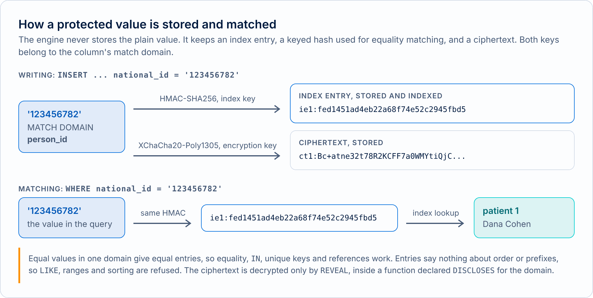

# Concepts

New to DEP? Start with [DEP SQL in five minutes](overview.md). DEP stands for Database-Enforced Privacy. Its principle is that the ability to *use* a value for an operation does not require the ability to *read* it. This guide defines the terms the rest of the documentation uses, with a short example of each from the demo clinic (`examples/clinic.sql`). The full argument is in the [design proposal](../design/01-dep-concept.md); the language is in the [DEP SQL guide](dep-sql.md).

DEP Engine is an experimental concept. It shows that the model can be built and where its trust boundary lies, and it is not a production database.

## Protected columns

A column declared `PROTECTED` can be used by the database to find a record, update it and connect it to related records, but an ordinary query never returns its value. The type of the column does not change: `national_id` is still `TEXT`.

<picture><source media="(prefers-color-scheme: dark)" srcset="../images/diagrams/statement-path-dark.png"></picture>

```text
admin@operational=> SELECT patient_id, full_name, national_id, phone FROM patients WHERE patient_id = 2;
DEP:  Output column national_id is PROTECTED column patients.national_id (MATCH DOMAIN person_id) and is returned as NULL.
DEP:  Output column phone is PROTECTED column patients.phone (MATCH DOMAIN phone_number) and is returned as NULL.
 patient_id | full_name  | national_id | phone
------------+------------+-------------+-------
 2          | Yossi Levi | NULL        | NULL
(1 row)
```

Both protected columns come back as NULL, although the role is the administrator. The column privilege on a protected column is the privilege to *match* on it. Reception was granted `national_id` but not `phone`, so a query that uses `phone` is refused by an ordinary privilege check:

```text
reception_app@operational=> SELECT full_name FROM patients WHERE phone = '+972-50-0000002';
ERROR:  permission denied for column phone of table patients
HINT:  In DEP, the privilege on a PROTECTED column is the privilege to match on it. GRANT SELECT (phone) ON patients TO reception_app would allow it.
SQLSTATE:  42501
```

A protected column supports one operation: comparison with a whole value for equality. Casts, substrings, `LIKE`, ordering, ranges, and passing the value to a function are all refused, on any path and at any depth of a query. The [DEP SQL guide](dep-sql.md) lists them with their errors.

## Match domains

A match domain is a named group of protected columns that hold the same kind of value. In the clinic, `person_id` covers `patients.national_id` and `medical_records.patient_national_id`, and `phone_number` covers `patients.phone`.

A domain decides four things:

- **Meaning.** Two equal values in one domain refer to the same entity.
- **Comparison.** Only columns of the same domain can be compared with each other.
- **The key.** Each domain has its own secret key for its index entries, so the same string in two domains gives unrelated entries.
- **Declarations.** `DISCLOSES person_id` and `LINKS person_id` apply to that domain only, and the privilege to declare them is granted per domain.

```text
admin@operational=> CREATE TABLE devices (device_id BIGINT PRIMARY KEY, serial TEXT PROTECTED MATCH DOMAIN device_serial, patient_id BIGINT);
CREATE TABLE

admin@operational=> INSERT INTO devices VALUES (1, '123456782', 1);
DEP:  PROTECTED column devices.serial (MATCH DOMAIN device_serial) is stored as a blind index and ciphertext.
INSERT 0 1

admin@operational=> SELECT p.full_name FROM patients AS p JOIN devices AS d ON d.serial = p.national_id WHERE p.national_id = '123456782';
ERROR:  devices.serial (match domain device_serial) cannot be compared with patients.national_id (match domain person_id).
HINT:  Values from different match domains are different kinds of value.
SQLSTATE:  ZD103 (DEP_MATCH_DOMAIN_MISMATCH)
```

The serial looks like an ID number but belongs to another domain, so the join is refused.

## Blind indexes and ciphertexts

A protected value is stored twice, and never as plaintext. An **index entry** is a keyed hash (HMAC-SHA256 under the domain's key) used for all matching. A **ciphertext** (XChaCha20-Poly1305) holds the value so that a disclosing function can release it later. `SHOW STORAGE` shows what the server holds. It needs a superuser, and it never shows a value:

<picture><source media="(prefers-color-scheme: dark)" srcset="../images/diagrams/blind-index-dark.png"></picture>

```text
admin@operational=> CREATE TABLE secrets (id BIGINT PRIMARY KEY, token TEXT PROTECTED MATCH DOMAIN token_domain);
CREATE TABLE

admin@operational=> INSERT INTO secrets VALUES (1, 'my-secret-token');
DEP:  PROTECTED column secrets.token (MATCH DOMAIN token_domain) is stored as a blind index and ciphertext.
INSERT 0 1

admin@operational=> SHOW STORAGE secrets;
 id |                token                 |                                    token__ct
----+--------------------------------------+----------------------------------------------------------------------------------
 1  | ie1:67e93c0084a985ded80c8e10febc3200 | ct1:9aMcuMfZkDE5K/M/JCtaoT0/eIqoLTvr5oPrDJNBiGDUhImgTfcI0zF5QREmXaDk2HH3U3j79Q==
(1 row)
```

The stored form of `token` is an `ie1:` index entry and a `ct1:` ciphertext, side by side. A lookup computes the entry of the value it was given and reads the matching rows, and no plaintext is ever compared.

## Endpoints and access paths

A connection has an **access path**, fixed when it logs in, which sets the most it may do with protected values. An **endpoint** is the database name a client connects to, bound to one path.

<picture><source media="(prefers-color-scheme: dark)" srcset="../images/diagrams/access-paths-dark.png"></picture>

| Path | For | May |
|---|---|---|
| `OPERATIONAL` | Applications that find and update records | Read, write, match one value at a time, call the declared functions its role may execute |
| `MASKED_READ` | Dashboards, analytics, AI agents | Read ordinary columns; call linking functions that take no protected input; never match, write, or disclose |

```text
bi_dashboard@analytics=> SELECT health_fund, count(*) AS patients FROM patients GROUP BY health_fund ORDER BY health_fund;
 health_fund | patients
-------------+----------
 Clalit      | 2
 Leumit      | 1
 Maccabi     | 2
 Meuhedet    | 1
(4 rows)

bi_dashboard@analytics=> SELECT health_fund FROM patients WHERE national_id = '123456782';
ERROR:  Matching PROTECTED values is unavailable on a MASKED_READ connection.
HINT:  This operation requires an OPERATIONAL connection.
SQLSTATE:  ZD102 (DEP_ENDPOINT_OPERATION)

bi_dashboard@analytics=> SET dep.path = 'OPERATIONAL';
ERROR:  The access path of this connection is MASKED_READ and cannot be changed.
HINT:  The path is fixed at authentication. Connect through another endpoint instead.
SQLSTATE:  ZD106 (DEP_PATH_IMMUTABLE)
```

The path cannot be changed after login. Which roles may use which endpoint is itself a grant: `GRANT CONNECT ON ENDPOINT analytics TO bi_dashboard`.

## Matching, anchoring and linking

DEP separates four decisions that most databases fold into one `SELECT` privilege.

| Decision | Meaning | In DEP |
|---|---|---|
| Matching | Using a protected value to find records | Allowed on the operational path, for a role granted the column |
| Linking | Connecting whole datasets through a protected value | Only inside a function declared `LINKS` |
| Returning | Sending the value to a client | Never by an ordinary query |
| Disclosing | Releasing the value on purpose | Only inside a function declared `DISCLOSES`, through `REVEAL` |

Matching must be **anchored**: tied to a value the client sent, by an equality at the top level of the query. A lookup is anchored by its own filter, and a join between two protected columns is anchored when the query also filters one of them to a value.

<picture><source media="(prefers-color-scheme: dark)" srcset="../images/diagrams/anchoring-dark.png"></picture>

```text
doctors_app@operational=> SELECT p.full_name, m.diagnosis FROM patients AS p JOIN medical_records AS m ON m.patient_national_id = p.national_id WHERE p.national_id = '123456782';
DEP:  PROTECTED column patients.national_id is matched by equality through the blind index of MATCH DOMAIN person_id.
DEP:  Join of PROTECTED columns medical_records.patient_national_id and patients.national_id (MATCH DOMAIN person_id) is anchored to a single protected value.
 full_name  |    diagnosis
------------+------------------
 Dana Cohen | Asthma
 Dana Cohen | Seasonal allergy
(2 rows)

doctors_app@operational=> SELECT p.full_name, m.diagnosis FROM patients AS p JOIN medical_records AS m ON m.patient_national_id = p.national_id;
ERROR:  Join on PROTECTED columns patients.national_id and medical_records.patient_national_id is not anchored to a single protected value.
HINT:  Anchor the join with a lookup such as WHERE patients.national_id = $1, or perform it inside a function declared LINKS person_id.
SQLSTATE:  ZD107 (DEP_UNANCHORED_MATCH)
```

The second statement would connect every patient to every diagnosis, so it is refused with `ZD107`. An anchor under `OR`, a subquery that joins by another route, and `GROUP BY` or `DISTINCT` on a protected column are all unanchored matches. The doctors can read one patient's records and cannot export the table.

## Declared functions

When an organization does need to link datasets or release a value, it says so in the schema. A **declared function** has a signature that states what it may do:

<picture><source media="(prefers-color-scheme: dark)" srcset="../images/diagrams/declared-functions-dark.png"></picture>

- `DISCLOSES d` allows `REVEAL` on values of domain `d`, the only place `REVEAL` is legal;
- `LINKS d` allows unanchored matching of domain `d` inside its body;
- both can be declared together.

```text
admin@operational=> \df
          function           |  discloses   |   links   |     owner     | masked_path | executable_by
-----------------------------+--------------+-----------+---------------+-------------+---------------
 appointment_reminders(DATE) | phone_number |           | privacy_admin | no          | reminder_job
 monthly_fund_report(DATE)   | person_id    |           | privacy_admin | no          | billing_job
 diagnoses_per_fund()        |              | person_id | privacy_admin | yes         | bi_dashboard
 fund_claims_report(DATE)    | person_id    | person_id | privacy_admin | no          | billing_job
(4 rows)
```

Each function names its owner, has a recorded purpose (`COMMENT ON FUNCTION`), and is executable only by the roles granted `EXECUTE` on it, never by `PUBLIC`. It runs with its owner's privileges, checked at every call. The privilege to declare is `GRANT DISCLOSE ON MATCH DOMAIN d` and `GRANT LINK ON MATCH DOMAIN d`.

Billing's monthly report is the one place ID numbers leave:

```text
billing_job@operational=> SELECT * FROM monthly_fund_report(DATE '2026-10-01');
DEP:  monthly_fund_report() is declared DISCLOSES person_id: the columns it declares are returned in plaintext.
DEP:  Output column national_id is disclosed: Column national_id of monthly_fund_report() (DISCLOSES person_id).
 national_id | visit_date | visit_type  | health_fund
-------------+------------+-------------+-------------
 234567893   | 2026-10-21 | First visit | Maccabi
 234567893   | 2026-10-09 | Lab results | Maccabi
 567890126   | 2026-10-18 | First visit | Leumit
 123456782   | 2026-10-21 | Follow-up   | Clalit
 123456782   | 2026-10-22 | Lab results | Clalit
 345678904   | 2026-10-22 | Vaccination | Clalit
 345678904   | 2026-10-01 | Follow-up   | Clalit
 678901237   | 2026-10-13 | Follow-up   | Maccabi
 678901237   | 2026-10-28 | Vaccination | Maccabi
 456789015   | 2026-10-22 | Follow-up   | Meuhedet
(10 rows)
```

## Disclosed values and the terminal rule

A value produced by `REVEAL` is a **disclosed value**. It can be returned to the client and nothing more: it cannot be used to filter, join, group, order, store, or pass to another function. This is the **terminal rule**, and it stops a disclosure from becoming a new key.

```text
billing_job@operational=> SELECT * FROM monthly_fund_report(DATE '2026-10-01') AS r WHERE r.national_id = '123456782';
ERROR:  Column national_id of monthly_fund_report() is a disclosed value and cannot be used in a filter.
HINT:  Disclosed values can only be returned. Perform the match on PROTECTED fields inside a declared function, before REVEAL.
SQLSTATE:  ZD104 (DEP_DISCLOSED_VALUE_USE)
```

## DEP notes

Every rule that applies to a statement produces a **DEP note**: a sentence saying what the engine did. Plain SQL gets none, so a clean statement stays quiet and a note is a signal. Over the PostgreSQL protocol the notes are `NOTICE` messages, DEP CLI prints them as `DEP:` lines, the HTTP API returns them in a `notes` array, and `SHOW DEP NOTES` repeats the notes of the last statement. The [notes reference](../reference/notes.md) lists them all.

## Audit

The server records every protected match, every call of a declared function, every refused statement, every rate-limited statement and every key rotation, with the role that made it. It never records a protected value or the text of a statement. `SHOW AUDIT` shows it to superusers:

```text
reception_app@operational=> SELECT full_name FROM patients WHERE national_id = '123456782';
DEP:  PROTECTED column patients.national_id is matched by equality through the blind index of MATCH DOMAIN person_id.
 full_name
------------
 Dana Cohen
(1 row)

reception_app@operational=> SELECT full_name FROM patients WHERE national_id LIKE '1%';
ERROR:  LIKE is not supported for PROTECTED values (patients.national_id).
HINT:  PROTECTED values support only full-value equality matching. To release a value, use a disclosing function.
SQLSTATE:  ZD101 (DEP_PROTECTED_OPERATION)

reception_app@operational=> \c operational admin
You are now connected as "admin" through endpoint "operational" (OPERATIONAL).

admin@operational=> SHOW AUDIT 5;
 seq |            at            | session_user  |     role      |  endpoint   |    path     |  kind  |        object        |  domain   | count |         detail
-----+--------------------------+---------------+---------------+-------------+-------------+--------+----------------------+-----------+-------+-------------------------
 2   | 2026-10-23T12:27:04.713Z | reception_app | reception_app | operational | OPERATIONAL | denied | SELECT               | NULL      | NULL  | DEP_PROTECTED_OPERATION
 1   | 2026-10-23T12:27:04.713Z | reception_app | reception_app | operational | OPERATIONAL | match  | patients.national_id | person_id | 1     | NULL
(2 rows)
```

## What DEP does not do

A permitted match still reveals that a record exists, and associates it with the data that is returned. Names and other ordinary fields can identify people. Aggregates are not automatically anonymous. The server and its administrator are trusted, and a released value is beyond DEP's reach. The [Privacy as Code](../../site/content/privacy-as-code.md) page and chapter 18 of the design proposal state the guarantees and the limits.
