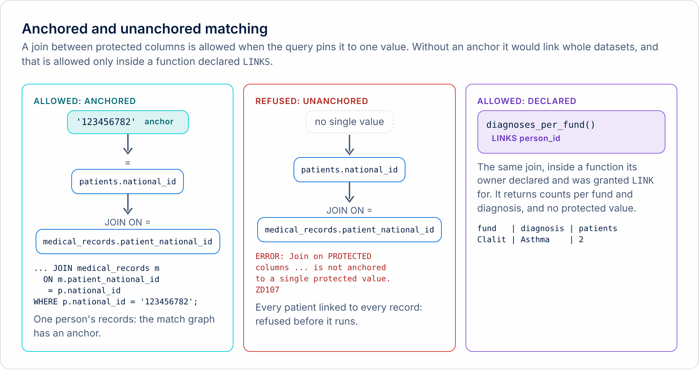
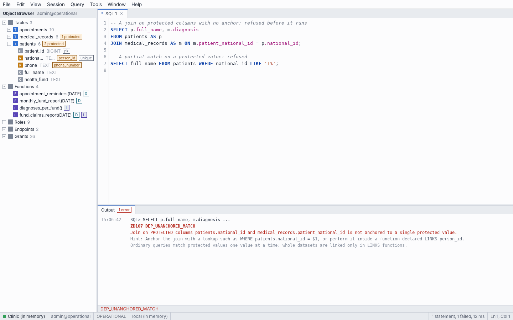
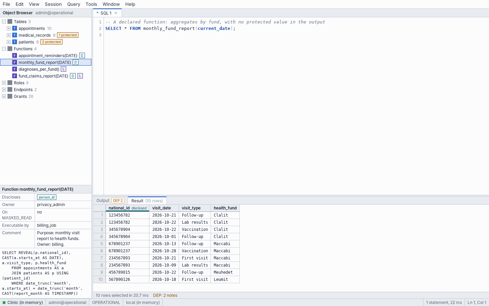
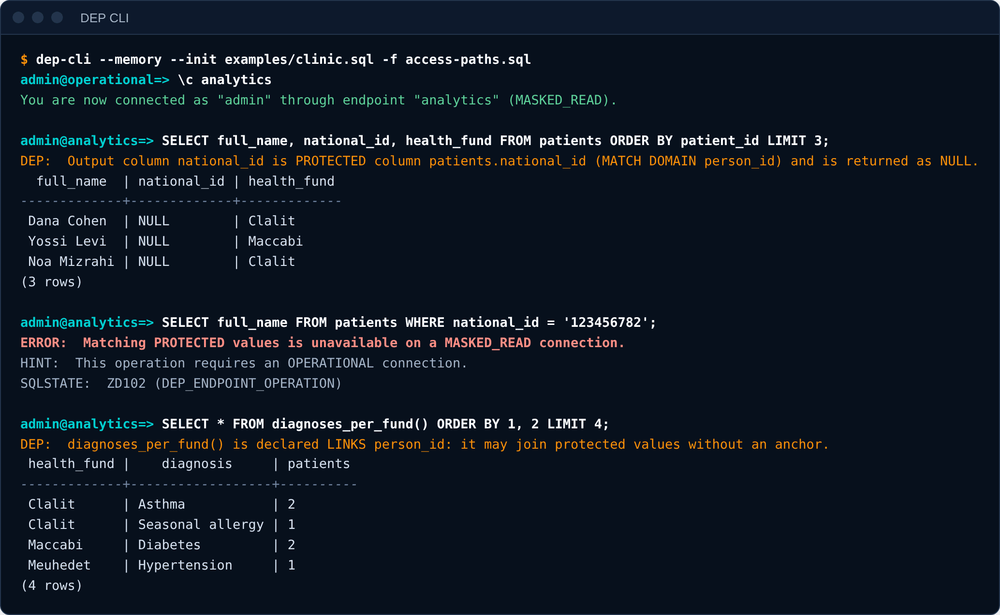

# DEP SQL

New to DEP SQL? [DEP SQL in five minutes](overview.md) explains what the language is, with one example. DEP SQL is SQL with a small number of additions. It runs on Apache DataFusion, so most of ordinary SQL works as it does there: `SELECT` with joins, subqueries, CTEs, aggregates and window functions, and `INSERT`, `UPDATE` and `DELETE`. This guide covers what DEP adds and restricts, with the syntax, the rule, an example, and the error each rule raises. Every example below was run against DEP Engine 0.5.2 on the demo clinic (`examples/clinic.sql`), and the output is real. Rows come back in no guaranteed order unless the statement has `ORDER BY`.

A statement that breaks a rule fails with a **DEP error**: a message, a hint, and a `ZDnnn` SQLSTATE with a code such as `DEP_UNANCHORED_MATCH`. The [error reference](../reference/errors.md) lists them all. A rule that applies produces a **DEP note**; see the [notes reference](../reference/notes.md).

Examples show the role and the endpoint in the prompt, as DEP CLI prints them: `reception_app@operational=>`.

## Contents

- [Protected columns](#protected-columns)
- [Inserting and updating protected values](#inserting-and-updating-protected-values)
- [Matching](#matching)
- [Joins and anchors](#joins-and-anchors)
- [What is refused](#what-is-refused)
- [Declared functions](#declared-functions)
- [Roles, grants and endpoints](#roles-grants-and-endpoints)
- [Match limits](#match-limits)
- [Not supported](#not-supported)

## Protected columns

```sql
CREATE [TEMPORARY] TABLE name (
    column type [PROTECTED MATCH DOMAIN domain] [constraints],
    column type PROTECTED REFERENCES other (column),
    ...
);
```

`PROTECTED MATCH DOMAIN d` declares a protected column and names its match domain. A domain is created by its first use. A column that references a protected column is itself protected and takes the same domain: write `PROTECTED REFERENCES t (c)`, without repeating the domain. Constraints (`PRIMARY KEY`, `UNIQUE`, `NOT NULL`, `REFERENCES`) work on protected columns too; the engine checks them through the blind index, and the error never shows the value.

```text
admin@operational=> CREATE TABLE patients (
    patient_id  BIGINT PRIMARY KEY,
    national_id TEXT PROTECTED MATCH DOMAIN person_id UNIQUE,
    full_name   TEXT
);
CREATE TABLE

admin@operational=> CREATE TABLE records (
    record_id           BIGINT PRIMARY KEY,
    patient_national_id TEXT PROTECTED REFERENCES patients (national_id),
    diagnosis           TEXT
);
CREATE TABLE

admin@operational=> SHOW COLUMNS FROM records;
       column        |  type  | match_domain | primary_key |       references       | not_null | unique
---------------------+--------+--------------+-------------+------------------------+----------+--------
 record_id           | BIGINT | NULL         | yes         | NULL                   | yes      | yes
 patient_national_id | TEXT   | person_id    |             | patients (national_id) |          |
 diagnosis           | TEXT   | NULL         |             | NULL                   |          |
(3 rows)
```

The reference and the column it references must agree, and the engine checks it:

```text
admin@operational=> CREATE TABLE bad1 (id BIGINT PRIMARY KEY, nid TEXT PROTECTED);
ERROR:  PROTECTED column nid needs a match domain
HINT:  Write TEXT PROTECTED MATCH DOMAIN name, or PROTECTED REFERENCES a protected column.
SQLSTATE:  42601

admin@operational=> CREATE TABLE bad2 (id BIGINT PRIMARY KEY, nid TEXT PROTECTED MATCH DOMAIN phone_number REFERENCES patients (national_id));
ERROR:  Column bad2.nid (match domain phone_number) references patients.national_id (match domain person_id).
HINT:  A reference and the column it references must have the same match domain.
SQLSTATE:  ZD103 (DEP_MATCH_DOMAIN_MISMATCH)

admin@operational=> CREATE TABLE bad3 (id BIGINT PRIMARY KEY, nid TEXT REFERENCES patients (national_id));
ERROR:  Column bad3.nid references PROTECTED column patients.national_id (match domain person_id) but is not PROTECTED.
HINT:  Declare it TEXT PROTECTED REFERENCES patients (national_id), so the reference is kept as an index entry.
SQLSTATE:  ZD006 (DEP_REFERENCE_MISMATCH)
```

| Mistake | Error |
|---|---|
| `PROTECTED` with no domain and no reference | `42601` syntax error |
| A reference in a different domain from its target | `ZD103` `DEP_MATCH_DOMAIN_MISMATCH` |
| A protected column that references an ordinary one, or the reverse | `ZD006` `DEP_REFERENCE_MISMATCH` |

Only a superuser creates tables. A protected value is never stored in an ordinary column; the next section shows the error.

## Inserting and updating protected values

Writing a protected column is ordinary SQL. The value is turned into an index entry and a ciphertext as it is stored, and the statement returns a note saying so.

```text
reception_app@operational=> INSERT INTO patients (patient_id, national_id, phone, full_name, health_fund)
VALUES (7, '789012348', '+972-50-0000007', 'Lior Katz', 'Clalit');
DEP:  PROTECTED column patients.national_id (MATCH DOMAIN person_id) is stored as a blind index and ciphertext.
DEP:  PROTECTED column patients.phone (MATCH DOMAIN phone_number) is stored as a blind index and ciphertext.
INSERT 0 1

reception_app@operational=> UPDATE patients SET full_name = 'Lior Katz-Peretz' WHERE national_id = '789012348';
DEP:  PROTECTED column patients.national_id is matched by equality through the blind index of MATCH DOMAIN person_id.
UPDATE 1

reception_app@operational=> SELECT full_name FROM patients WHERE national_id = '789012348';
DEP:  PROTECTED column patients.national_id is matched by equality through the blind index of MATCH DOMAIN person_id.
    full_name
------------------
 Lior Katz-Peretz
(1 row)
```

Reception was granted `INSERT` and `UPDATE` on `patients`, and `SELECT` on the `national_id` column. Writing a protected column needs no read right, because the engine never hands the value back. A role that is granted nothing on the table cannot write it.

A protected value can be copied only into another protected column of the same domain. Copying it into an ordinary column is refused:

```text
admin@operational=> CREATE TABLE copy1 (id BIGINT PRIMARY KEY, nid TEXT);
CREATE TABLE

admin@operational=> INSERT INTO copy1 SELECT patient_id, national_id FROM patients;
ERROR:  Storing PROTECTED value patients.national_id in the ordinary column copy1.nid is forbidden.
HINT:  To release a value, use a disclosing function.
SQLSTATE:  ZD101 (DEP_PROTECTED_OPERATION)
```

`UPDATE` and `DELETE` find rows by an ordinary condition or by a protected match, and a match is a lookup like any other (see below). A protected key that other rows reference cannot be changed or deleted: the statement fails with the usual `23503`.

## Matching

A protected column can be compared with a value for equality. The value is a literal (`'123456782'`) or a parameter (`$1`); the engine treats both the same way and, for a parameter, never puts the value in an error message.

| Form | Works | Note |
|---|---|---|
| `col = value` | yes | A lookup through the blind index |
| `col IN (v1, v2, ...)` | yes | A list of lookups |
| `col = v1 OR col = v2` | yes | Each side is a lookup |
| `CASE WHEN col = v THEN ... END` | yes | The comparison is a lookup |
| `col NOT IN (...)`, `NOT (col = v)` | yes | The same lookups, negated |
| `col IS NULL`, `col IS NOT NULL` | yes | No value is compared |
| `col = other_protected_col` | in a join | The two columns must be in the same domain |
| `col <> v`, `<`, `>`, `BETWEEN` | no | `ZD101` |

```text
reception_app@operational=> SELECT full_name FROM patients WHERE national_id IN ('123456782', '234567893');
DEP:  PROTECTED column patients.national_id is matched against a list of values through the blind index of MATCH DOMAIN person_id.
 full_name
------------
 Dana Cohen
 Yossi Levi
(2 rows)

reception_app@operational=> SELECT full_name FROM patients WHERE national_id = '123456782' OR national_id = '345678904';
DEP:  PROTECTED column patients.national_id is matched by equality through the blind index of MATCH DOMAIN person_id.
  full_name
-------------
 Dana Cohen
 Noa Mizrahi
(2 rows)
```

Each lookup on the operational path is counted for the role's [match limit](#match-limits) and written to the audit log, without the value. A lookup needs the privilege `SELECT (column)` on the protected column. On the masked read path it is refused altogether:

```text
bi_dashboard@analytics=> SELECT health_fund FROM patients WHERE national_id = '123456782';
ERROR:  Matching PROTECTED values is unavailable on a MASKED_READ connection.
HINT:  This operation requires an OPERATIONAL connection.
SQLSTATE:  ZD102 (DEP_ENDPOINT_OPERATION)
```

A comparison with a value of the wrong kind does not match and does not fail: `national_id = 123` compares an integer with text and finds no row. Compare with a string.

## Joins and anchors

Two protected columns in the same domain can be joined, if the join is **anchored**: the query also contains an equality between one of the columns and a single value, at the top level of the `WHERE` clause.

<picture><source media="(prefers-color-scheme: dark)" srcset="../images/diagrams/anchoring-dark.png"></picture>

```text
doctors_app@operational=> SELECT p.full_name, m.diagnosis
FROM patients AS p JOIN medical_records AS m ON m.patient_national_id = p.national_id
WHERE p.national_id = '123456782';
DEP:  PROTECTED column patients.national_id is matched by equality through the blind index of MATCH DOMAIN person_id.
DEP:  Join of PROTECTED columns medical_records.patient_national_id and patients.national_id (MATCH DOMAIN person_id) is anchored to a single protected value.
 full_name  |    diagnosis
------------+------------------
 Dana Cohen | Asthma
 Dana Cohen | Seasonal allergy
(2 rows)
```

Without the anchor, the join would connect every patient to every record, and it is refused with `ZD107` `DEP_UNANCHORED_MATCH`. These are also unanchored matches, and refused in the same way:

```text
doctors_app@operational=> SELECT m.diagnosis FROM patients AS p JOIN medical_records AS m ON m.patient_national_id = p.national_id
WHERE p.national_id = '123456782' OR p.full_name = 'Yossi Levi';
ERROR:  Join on PROTECTED columns patients.national_id and medical_records.patient_national_id is not anchored to a single protected value.
HINT:  Anchor the join with a lookup such as WHERE patients.national_id = $1, or perform it inside a function declared LINKS person_id.
SQLSTATE:  ZD107 (DEP_UNANCHORED_MATCH)

doctors_app@operational=> SELECT full_name FROM patients WHERE national_id IN (SELECT patient_national_id FROM medical_records);
ERROR:  Match of PROTECTED column patients.national_id against a subquery is not anchored to a single protected value.
HINT:  Anchor the join with a lookup such as WHERE patients.national_id = $1, or perform it inside a function declared LINKS person_id.
SQLSTATE:  ZD107 (DEP_UNANCHORED_MATCH)

doctors_app@operational=> SELECT patient_national_id, count(*) FROM medical_records GROUP BY patient_national_id;
ERROR:  GROUP BY on PROTECTED column medical_records.patient_national_id links every row that shares a value.
HINT:  Group by ordinary columns, or perform the grouping inside a function declared LINKS person_id.
SQLSTATE:  ZD107 (DEP_UNANCHORED_MATCH)

doctors_app@operational=> SELECT DISTINCT patient_national_id FROM medical_records;
ERROR:  DISTINCT on PROTECTED column medical_records.patient_national_id links every row that shares a value.
HINT:  Perform it inside a function declared LINKS person_id.
SQLSTATE:  ZD107 (DEP_UNANCHORED_MATCH)

doctors_app@operational=> SELECT p.full_name FROM patients p, medical_records m WHERE p.national_id = m.patient_national_id;
ERROR:  Join on PROTECTED columns medical_records.patient_national_id and patients.national_id is not anchored to a single protected value.
HINT:  Anchor the join with a lookup such as WHERE medical_records.patient_national_id = $1, or perform it inside a function declared LINKS person_id.
SQLSTATE:  ZD107 (DEP_UNANCHORED_MATCH)
```

An anchor under `OR` is not an anchor, a subquery is a join written differently, and grouping or `DISTINCT` on a protected column links every row that shares a value. Joins on ordinary keys, such as `appointments.patient_id`, are ordinary SQL.

The only way to run an unanchored match is inside a function declared `LINKS` for the domain; see [Declared functions](#declared-functions).

## What is refused

Everything other than full-value equality is refused on a protected value, on every path, in any position of a query, with `ZD101` `DEP_PROTECTED_OPERATION`:



```text
admin@operational=> SELECT full_name FROM patients WHERE national_id LIKE '1234%';
ERROR:  LIKE is not supported for PROTECTED values (patients.national_id).
HINT:  PROTECTED values support only full-value equality matching. To release a value, use a disclosing function.
SQLSTATE:  ZD101 (DEP_PROTECTED_OPERATION)

admin@operational=> SELECT full_name FROM patients WHERE national_id <> '123456782';
ERROR:  Operator != is not supported for PROTECTED values (patients.national_id).
HINT:  PROTECTED values support only full-value equality matching. To release a value, use a disclosing function.
SQLSTATE:  ZD101 (DEP_PROTECTED_OPERATION)

admin@operational=> SELECT full_name FROM patients ORDER BY national_id;
ERROR:  ORDER BY is not supported for PROTECTED values (patients.national_id).
HINT:  PROTECTED values support only full-value equality matching. To release a value, use a disclosing function.
SQLSTATE:  ZD101 (DEP_PROTECTED_OPERATION)

admin@operational=> SELECT CAST(national_id AS TEXT) FROM patients;
ERROR:  Conversion from PROTECTED to plain TEXT is forbidden (patients.national_id).
HINT:  To release a value, use a disclosing function.
SQLSTATE:  ZD101 (DEP_PROTECTED_OPERATION)

admin@operational=> SELECT length(national_id) FROM patients;
ERROR:  Function character_length() is not supported for PROTECTED values (patients.national_id).
HINT:  PROTECTED values support only full-value equality matching. To release a value, use a disclosing function.
SQLSTATE:  ZD101 (DEP_PROTECTED_OPERATION)

admin@operational=> SELECT coalesce(national_id, 'none') FROM patients;
ERROR:  Function coalesce() is not supported for PROTECTED values (patients.national_id).
HINT:  PROTECTED values support only full-value equality matching. To release a value, use a disclosing function.
SQLSTATE:  ZD101 (DEP_PROTECTED_OPERATION)

admin@operational=> SELECT min(national_id) FROM patients;
ERROR:  Aggregate min() is not supported for PROTECTED values (patients.national_id).
HINT:  PROTECTED values support only full-value equality matching. To release a value, use a disclosing function.
SQLSTATE:  ZD101 (DEP_PROTECTED_OPERATION)

admin@operational=> SELECT full_name FROM patients WHERE national_id = full_name;
ERROR:  Comparison with a non-PROTECTED column is not supported for PROTECTED values (patients.national_id).
HINT:  PROTECTED values support only full-value equality matching. To release a value, use a disclosing function.
SQLSTATE:  ZD101 (DEP_PROTECTED_OPERATION)
```

| Operation | Why |
|---|---|
| `LIKE`, `ILIKE`, `~`, `SIMILAR TO` | Reveals the structure of the value |
| `<>`, `<`, `>`, `BETWEEN`, `ORDER BY` | Reveals order |
| `CAST`, `::`, `COALESCE`, any function or aggregate (`min`, `max`, `length`, ...) | Produces or releases a derived value |
| Comparing with an ordinary column | The ordinary column is plaintext |

`count(column)` and `count(*)` work: they count rows and read no value.

DEP fails closed. A form the engine cannot analyze is rejected with `ZD108` `DEP_UNSUPPORTED_FORM` rather than run with uncertain protection.

A protected column read by `SELECT` comes back as `NULL`:

```text
admin@operational=> SELECT patient_id, national_id, phone FROM patients WHERE patient_id = 1;
DEP:  Output column national_id is PROTECTED column patients.national_id (MATCH DOMAIN person_id) and is returned as NULL.
DEP:  Output column phone is PROTECTED column patients.phone (MATCH DOMAIN phone_number) and is returned as NULL.
 patient_id | national_id | phone
------------+-------------+-------
 1          | NULL        | NULL
(1 row)
```

## Declared functions

A declared function is the only way to link datasets or release a protected value. It is `LANGUAGE sql`, returns a table, and states what it does in its signature:

```sql
CREATE [OR REPLACE] FUNCTION name(param type, ...)
RETURNS TABLE (column type, ...)
LANGUAGE sql
[DISCLOSES domain [, domain ...]]
[LINKS domain [, domain ...]]
AS $$ SELECT ... $$;
```

- **`DISCLOSES d`** lets the body call `REVEAL(column)` on a protected column of domain `d`. `REVEAL` is legal nowhere else. The values it returns are *disclosed values*.
- **`LINKS d`** lets the body match columns of domain `d` without an anchor: joins, `GROUP BY` and `DISTINCT`.
- A function with neither is an ordinary function. Its body is still analyzed, and an anchored lookup works in it as anywhere else.
- A function can declare both. It cannot be `LANGUAGE plpgsql`, because the engine must be able to analyze the body.

Parameters are referred to by name in the body. The body of every declared function is checked when it is created, so an error in it appears at that moment.

```text
privacy_admin@operational=> CREATE FUNCTION patient_contact(id TEXT)
RETURNS TABLE (full_name TEXT, phone TEXT)
LANGUAGE sql
DISCLOSES phone_number
AS $$
    SELECT p.full_name, REVEAL(p.phone)
    FROM patients AS p
    WHERE p.national_id = id
$$;
CREATE FUNCTION

privacy_admin@operational=> COMMENT ON FUNCTION patient_contact(TEXT) IS 'Purpose: contact one patient. Owner: operations.';
COMMENT

privacy_admin@operational=> GRANT EXECUTE ON FUNCTION patient_contact(TEXT) TO reception_app;
GRANT

privacy_admin@operational=> \c operational reception_app
You are now connected as "reception_app" through endpoint "operational" (OPERATIONAL).

reception_app@operational=> SELECT * FROM patient_contact('123456782');
DEP:  patient_contact() is declared DISCLOSES phone_number: the columns it declares are returned in plaintext.
DEP:  Output column phone is disclosed: Column phone of patient_contact() (DISCLOSES phone_number).
 full_name  |      phone
------------+-----------------
 Dana Cohen | +972-50-0000001
(1 row)
```

### The rules

```text
privacy_admin@operational=> SELECT full_name, REVEAL(national_id) FROM patients;
ERROR:  REVEAL() of patients.national_id (match domain person_id) appears outside a disclosing function.
HINT:  Move the disclosure into a function declared DISCLOSES person_id.
SQLSTATE:  ZD001 (DEP_REVEAL_OUTSIDE_DISCLOSURE)

privacy_admin@operational=> CREATE FUNCTION wrong_domain(id TEXT) RETURNS TABLE (x TEXT) LANGUAGE sql DISCLOSES phone_number
AS $$ SELECT REVEAL(p.national_id) FROM patients AS p WHERE p.national_id = id $$;
ERROR:  REVEAL() of patients.national_id (match domain person_id) appears outside a disclosing function.
HINT:  Move the disclosure into a function declared DISCLOSES person_id.
SQLSTATE:  ZD001 (DEP_REVEAL_OUTSIDE_DISCLOSURE)

privacy_admin@operational=> CREATE FUNCTION in_plpgsql(id TEXT) RETURNS TABLE (x TEXT) LANGUAGE plpgsql DISCLOSES person_id AS $$ SELECT 1 $$;
ERROR:  Function in_plpgsql is written in LANGUAGE plpgsql.
HINT:  Declared functions must be LANGUAGE sql, so the engine can analyze their bodies.
SQLSTATE:  ZD003 (DEP_DECLARED_LANGUAGE)

privacy_admin@operational=> CREATE FUNCTION wrap(d DATE) RETURNS TABLE (national_id TEXT) LANGUAGE sql LINKS person_id
AS $$ SELECT r.national_id FROM monthly_fund_report(d) AS r $$;
ERROR:  Function wrap calls monthly_fund_report(), which is not declared for the same purpose and match domain.
HINT:  Inline the logic, or declare both functions for the same purpose.
SQLSTATE:  ZD004 (DEP_DECLARED_CALL)

privacy_admin@operational=> GRANT EXECUTE ON FUNCTION appointment_reminders(DATE) TO PUBLIC;
ERROR:  Function appointment_reminders is declared DISCLOSES or LINKS, and cannot be executable by PUBLIC.
HINT:  Grant EXECUTE to the specific roles that need it.
SQLSTATE:  ZD005 (DEP_PUBLIC_EXECUTE)

privacy_admin@operational=> \c operational app_developer
You are now connected as "app_developer" through endpoint "operational" (OPERATIONAL).

app_developer@operational=> CREATE FUNCTION all_ids() RETURNS TABLE (national_id TEXT) LANGUAGE sql DISCLOSES person_id AS $$ SELECT REVEAL(national_id) FROM patients $$;
ERROR:  Role app_developer may not declare functions that DISCLOSES match domain person_id.
HINT:  A superuser can allow it: GRANT DISCLOSE ON MATCH DOMAIN person_id TO app_developer.
SQLSTATE:  ZD002 (DEP_DECLARATION_PRIVILEGE)
```

| Rule | Error |
|---|---|
| `REVEAL` outside a function that declares its domain | `ZD001` `DEP_REVEAL_OUTSIDE_DISCLOSURE` |
| Declaring `DISCLOSES` or `LINKS d` without `GRANT DISCLOSE` or `GRANT LINK ON MATCH DOMAIN d` | `ZD002` `DEP_DECLARATION_PRIVILEGE` |
| A language other than `sql` | `ZD003` `DEP_DECLARED_LANGUAGE` |
| A declared function that calls another one not declared for the same domains | `ZD004` `DEP_DECLARED_CALL` |
| `EXECUTE` on a declared function granted to `PUBLIC`, or `DISCLOSE` or `LINK` granted to `PUBLIC` | `ZD005` `DEP_PUBLIC_EXECUTE`, `ZD002` |

A declared function runs with the privileges of its **owner**, checked at every call. If the owner loses `SELECT` on a table the body reads, the function stops working for everyone, which makes the owner's privileges part of the review. The caller needs `EXECUTE` on the function, and nothing on the tables.

### Calling a declared function

A disclosing function can be called on the operational path only. A linking function with no protected parameter can also be called on the masked read path, which is how dashboards get statistics without matching anything. A function is called in the `FROM` clause:



```text
bi_dashboard@analytics=> SELECT * FROM diagnoses_per_fund() ORDER BY health_fund, diagnosis;
DEP:  diagnoses_per_fund() is declared LINKS person_id: it may join protected values without an anchor.
 health_fund |    diagnosis     | patients
-------------+------------------+----------
 Clalit      | Asthma           | 2
 Clalit      | Seasonal allergy | 1
 Maccabi     | Diabetes         | 2
 Meuhedet    | Hypertension     | 1
(4 rows)
```

```text
bi_dashboard@analytics=> SELECT * FROM monthly_fund_report(DATE '2026-10-01');
ERROR:  Disclosing functions are unavailable on a MASKED_READ connection.
HINT:  This operation requires an OPERATIONAL connection.
SQLSTATE:  ZD102 (DEP_ENDPOINT_OPERATION)
```

### Disclosed values: the terminal rule

A disclosed value can be returned and nothing else. It cannot be used to filter, join, group, order, store, or pass to another function. Using one is `ZD104` `DEP_DISCLOSED_VALUE_USE`.

```text
billing_job@operational=> SELECT r.national_id, m.diagnosis
FROM monthly_fund_report(DATE '2026-10-01') AS r
JOIN medical_records AS m ON m.patient_national_id = r.national_id;
ERROR:  Column national_id of monthly_fund_report() is a disclosed value and cannot be used in a join condition.
HINT:  Disclosed values can only be returned. Perform the match on PROTECTED fields inside a declared function, before REVEAL.
SQLSTATE:  ZD104 (DEP_DISCLOSED_VALUE_USE)

billing_job@operational=> SELECT * FROM monthly_fund_report(DATE '2026-10-01') AS r WHERE r.national_id = '123456782';
ERROR:  Column national_id of monthly_fund_report() is a disclosed value and cannot be used in a filter.
HINT:  Disclosed values can only be returned. Perform the match on PROTECTED fields inside a declared function, before REVEAL.
SQLSTATE:  ZD104 (DEP_DISCLOSED_VALUE_USE)

billing_job@operational=> CREATE TABLE exported (id TEXT);
ERROR:  permission denied to create tables
HINT:  Only a superuser can do this.
SQLSTATE:  42501
```

Other columns of a disclosing function are ordinary, and can be used freely.

## Roles, grants and endpoints

```sql
CREATE ROLE name [LOGIN | NOLOGIN] [SUPERUSER | NOSUPERUSER] [PASSWORD 'secret' | PASSWORD NULL];
ALTER ROLE name [same options] [MATCH LIMIT n PER unit | NONE | DEFAULT];
CREATE ENDPOINT name MODE OPERATIONAL | MASKED_READ;

GRANT privilege [, ...] ON object TO role [, ...];
REVOKE privilege [, ...] ON object FROM role [, ...];
```



| Privilege | On | Meaning |
|---|---|---|
| `SELECT [(columns)]`, `INSERT`, `UPDATE [(columns)]`, `DELETE`, `ALL` | A table | Ordinary privileges. On a protected column, `SELECT` is the privilege to *match* on it. |
| `EXECUTE` | `FUNCTION name(types)` | Call a declared function. Never to `PUBLIC` for a declared function. |
| `DISCLOSE`, `LINK` | `MATCH DOMAIN d` | Declare functions with `DISCLOSES d` or `LINKS d`. Never to `PUBLIC`. |
| `CONNECT` | `ENDPOINT e` | Log in through an endpoint, and so on its access path |

A role can connect only through endpoints it was granted, and an endpoint is bound to one path, so the grant decides the path. Only superusers create roles, endpoints and tables. The `GRANT SELECT (columns)` form is what makes the privacy matrix. Here `support` may match on `email` and `marketing` may not, because it connects through the masked read path:

```text
admin@operational=> CREATE TABLE accounts (id BIGINT PRIMARY KEY, email TEXT PROTECTED MATCH DOMAIN email, name TEXT);
CREATE TABLE

admin@operational=> CREATE ROLE support LOGIN PASSWORD 'x';
CREATE ROLE

admin@operational=> CREATE ROLE marketing LOGIN PASSWORD 'x';
CREATE ROLE

admin@operational=> GRANT CONNECT ON ENDPOINT operational TO support;
GRANT

admin@operational=> GRANT CONNECT ON ENDPOINT analytics TO marketing;
GRANT

admin@operational=> GRANT SELECT (id, email, name) ON accounts TO support;
GRANT

admin@operational=> GRANT SELECT (id, name) ON accounts TO marketing;
GRANT

admin@operational=> SHOW PRIVACY MATRIX;
 match_domain |     column     |   role    |                       paths                        | may_match | discloses_via | links_via
--------------+----------------+-----------+----------------------------------------------------+-----------+---------------+-----------
 email        | accounts.email | admin     | analytics (MASKED_READ), operational (OPERATIONAL) | yes       |               |
 email        | accounts.email | marketing | analytics (MASKED_READ)                            | no        |               |
 email        | accounts.email | support   | operational (OPERATIONAL)                          | yes       |               |
(3 rows)
```

`SHOW PRIVACY MATRIX` lists, for every protected column and every role, whether the role may match on it, through which paths, and which declared functions it may use to disclose or link it. It is computed from the grants, so it cannot drift.

### SET ROLE

A superuser can act as another role without reconnecting. It is the way to test what a role sees.

```text
admin@operational=> SET ROLE reception_app;
SET

reception_app@operational=> SHOW ROLE;
     role
---------------
 reception_app
(1 row)

reception_app@operational=> SELECT phone FROM patients;
ERROR:  permission denied for column phone of table patients
HINT:  In DEP, the privilege on a PROTECTED column is the privilege to match on it. GRANT SELECT (phone) ON patients TO reception_app would allow it.
SQLSTATE:  42501

reception_app@operational=> RESET ROLE;
SET

admin@operational=> SHOW ROLE;
 role
-------
 admin
(1 row)
```

`SET ROLE` changes the privileges that apply. It does not change the access path of the connection, which is fixed at login.

## Match limits

A lookup on a protected column is a question, "is this value in the table?", and a program that can ask it without limit can guess every value. A **match limit** caps how many protected matches a role can make in a period. It is set per role, with a server default for roles that are not superusers (`--match-limit`).

```sql
ALTER ROLE reception_app MATCH LIMIT 600 PER HOUR;   -- units: SECOND, MINUTE, HOUR, DAY
ALTER ROLE reception_app MATCH LIMIT NONE;           -- no limit for this role
ALTER ROLE reception_app MATCH LIMIT DEFAULT;        -- the server default
```

```text
admin@operational=> ALTER ROLE reception_app MATCH LIMIT 2 PER MINUTE;
ALTER ROLE

admin@operational=> \c operational reception_app
You are now connected as "reception_app" through endpoint "operational" (OPERATIONAL).

reception_app@operational=> SELECT full_name FROM patients WHERE national_id IN ('123456782', '234567893');
DEP:  PROTECTED column patients.national_id is matched against a list of values through the blind index of MATCH DOMAIN person_id.
 full_name
------------
 Dana Cohen
 Yossi Levi
(2 rows)

reception_app@operational=> SELECT full_name FROM patients WHERE national_id = '345678904';
ERROR:  Role reception_app has made 2 protected matches of the 2 PER MINUTE it is allowed; this statement would make 1 more.
HINT:  Wait for the period to pass, or ask a superuser to change the limit (ALTER ROLE ... MATCH LIMIT n PER MINUTE).
SQLSTATE:  ZD109 (DEP_MATCH_RATE_LIMITED)
```

A statement over the limit fails with `ZD109` `DEP_MATCH_RATE_LIMITED` before it reads anything, and the refusal is audited. Every value in an `IN` list counts.

## Not supported

DEP Engine rejects, with `ZD108` or a PostgreSQL error, what it cannot analyze safely:

- `DEFAULT` values and `CHECK` constraints in `CREATE TABLE`;
- `ALTER TABLE` (only `ALTER ROLE` and `ALTER SYSTEM ROTATE MASTER KEY` exist);
- `ON DELETE CASCADE` and other referential actions (`NO ACTION` only);
- declared functions in any language but `sql`, or returning anything but `TABLE`;
- `COPY` and `MERGE`.

```text
admin@operational=> CREATE TABLE t1 (id BIGINT PRIMARY KEY, n INT DEFAULT 5);
ERROR:  DEFAULT values are not supported.
HINT:  DEP rejects forms it cannot analyze rather than run them with uncertain protection.
SQLSTATE:  ZD108 (DEP_UNSUPPORTED_FORM)

admin@operational=> CREATE TABLE t2 (id BIGINT PRIMARY KEY, n INT CHECK (n > 0));
ERROR:  CHECK constraints are not supported.
HINT:  DEP rejects forms it cannot analyze rather than run them with uncertain protection.
SQLSTATE:  ZD108 (DEP_UNSUPPORTED_FORM)

admin@operational=> ALTER TABLE t1 ADD COLUMN x INT;
ERROR:  Only ALTER ROLE and ALTER SYSTEM ROTATE MASTER KEY are supported.
HINT:  DEP rejects forms it cannot analyze rather than run them with uncertain protection.
SQLSTATE:  ZD108 (DEP_UNSUPPORTED_FORM)
```

Transactions, savepoints, constraints, indexes and `EXPLAIN` are in the [next guide](transactions-and-constraints.md).
