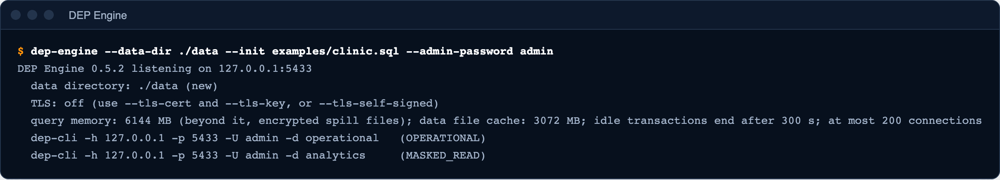
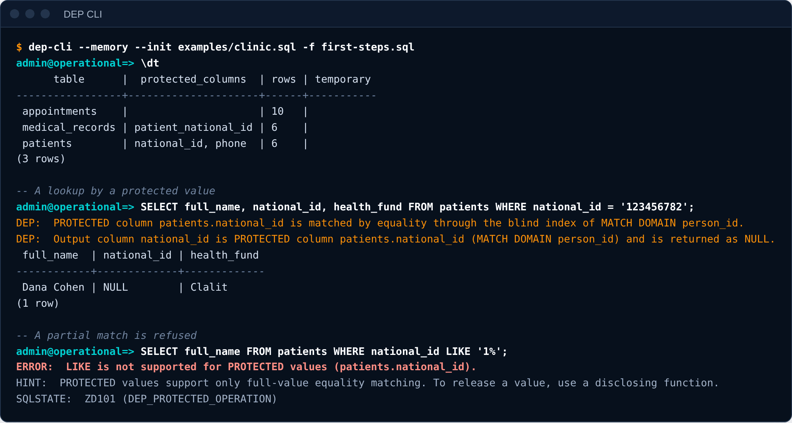
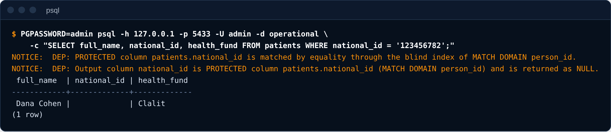

# Getting started

This guide installs DEP Engine, loads the demo clinic, connects to it in three ways, and runs a first lookup. It takes about ten minutes.

<p class="muted"><span class="badge">Experimental</span> Project Hoopeo is an experimental, conceptual project. See the <a href="../../site/content/legal/terms.md">terms of use</a>.</p>

New to DEP? Read [DEP SQL in five minutes](overview.md) first: it explains what the language is, and shows what each user of the clinic sees. This guide is the second step: install it, run it, connect to it, and try a first lookup. The [concepts guide](concepts.md) explains the model in full.

## 1. Install

Pick a product on the [Install page](../../site/content/install.md): **Hoopeo Studio** for a developer application with a database of its own, **DEP CLI** for the command line, or **DEP Engine** for a server that other tools connect to. Each has a download button for your system and numbered steps, and the page opens on the tab of the system you are using. The playground needs nothing installed: it runs the same rules in your browser (see the [playground guide](../../playground/README.md)).

The demo clinic is `examples/clinic.sql`: [download it](../../examples/clinic.sql), or find it in the installed examples folder. The rest of this guide uses it.

## 2. Start a server with the clinic

`--init` runs a script as `admin` when the database is new. Without `--data-dir` the data stays in memory and is lost when the server stops, which is what you want for a first try.

```sh
dep-engine --init examples/clinic.sql --admin-password admin --http-listen 127.0.0.1:8433
```

The server prints how to connect. The memory figures depend on the machine:



Leave it running. The clinic has three tables (`patients`, `appointments`, `medical_records`), eight roles whose password is `demo`, and two endpoints. An endpoint is the "database name" a client connects to, and it fixes the access path: `operational` (OPERATIONAL, for applications that find and update records) and `analytics` (MASKED_READ, for dashboards and agents that only read).

## 3. Connect

The user name is the **role**, and the database name is the **endpoint**. There are three ways in.

### DEP CLI

```sh
dep-cli -h 127.0.0.1 -p 5433 -U reception_app -d operational
```

The password comes from `DEP_PASSWORD`, `PGPASSWORD` or a prompt. For a first try without a server, DEP CLI can hold the clinic itself, in memory:

```sh
dep-cli --memory --init examples/clinic.sql -U reception_app
```

Type `\dt` to list the tables, and any statement to run it. DEP notes are printed before each result:



### psql, or any PostgreSQL driver

DEP Engine speaks the PostgreSQL wire protocol, so `psql` works as it is. The DEP notes of each statement arrive as ordinary `NOTICE` messages.

```sh
export PGPASSWORD=demo
psql "host=127.0.0.1 port=5433 user=reception_app dbname=operational sslmode=disable" \
     -c "SELECT full_name, national_id FROM patients WHERE national_id = '123456782'"
```



`sslmode=disable` is for this local try. See the [administration guide](administration.md) for TLS.

### The HTTP API

```sh
curl -s -u reception_app:demo "http://127.0.0.1:8433/v1/query?endpoint=operational" \
     -H 'Content-Type: application/json' \
     -d '{"sql": "SELECT full_name, national_id FROM patients WHERE national_id = $1", "params": ["123456782"]}'
```

```text
{"endpoint":"operational","open_transaction_rolled_back":false,"path":"OPERATIONAL","results":[{"columns":["full_name","national_id"],"elapsed_ms":3.13,"notes":["PROTECTED column patients.national_id is matched by equality through the blind index of MATCH DOMAIN person_id.","Output column national_id is PROTECTED column patients.national_id (MATCH DOMAIN person_id) and is returned as NULL."],"row_count":1,"rows":[["Dana Cohen",null]],"statement":"SELECT full_name, national_id FROM patients WHERE national_id = $1"}],"role":"reception_app"}
```

The [HTTP API reference](../reference/http-api.md) describes the request and the response.

## 4. A first lookup

Reception finds a patient by the ID number she presents. The query below filters on a protected column, and also selects it.

```text
reception_app@operational=> SELECT full_name, national_id FROM patients WHERE national_id = '123456782';
DEP:  PROTECTED column patients.national_id is matched by equality through the blind index of MATCH DOMAIN person_id.
DEP:  Output column national_id is PROTECTED column patients.national_id (MATCH DOMAIN person_id) and is returned as NULL.
 full_name  | national_id
------------+-------------
 Dana Cohen | NULL
(1 row)
```

In Hoopeo Studio the same statement is a lookup in a SQL window (**File > New SQL Window**, then **Query > Execute**), and the Output pane shows the result and its DEP notes:

<picture><source media="(prefers-color-scheme: dark)" srcset="../images/studio/studio-lookup-dark.png"></picture>

Three things happened, and the DEP notes name them:

1. The ID number was **matched by equality** through a blind index. The server never compared plaintext values.
2. `national_id` was **returned as NULL**. A protected value is never returned by an ordinary query, however it is selected.
3. Nothing about the statement was special. It is plain SQL, and no client had to cooperate.

Now ask for something a protected value does not allow:

```text
reception_app@operational=> SELECT full_name FROM patients WHERE national_id LIKE '1234%';
ERROR:  LIKE is not supported for PROTECTED values (patients.national_id).
HINT:  PROTECTED values support only full-value equality matching. To release a value, use a disclosing function.
SQLSTATE:  ZD101 (DEP_PROTECTED_OPERATION)
```

The error carries a `ZD101` SQLSTATE and a hint. A DEP rule never fails silently and never returns a degraded answer.

## 5. The tour

The repository includes a guided tour with six scripts: reception, doctors, a dashboard, billing, the privacy administrator and the administrator. Each statement is shown with its result and its DEP notes, so you can read the rules in action. From the repository folder:

```sh
dep-cli --memory --init examples/clinic.sql -f examples/tour/all.sql
```

## Where next

- [DEP SQL in five minutes](overview.md): the language, with what each user of the clinic sees.
- [Concepts](concepts.md): protected columns, match domains, anchoring, declared functions.
- [DEP SQL](dep-sql.md): every addition DEP makes to SQL, with the errors each rule raises.
- [Applications](applications.md): connecting from Python and JavaScript.
- [Administration](administration.md): running a server for others to use.
