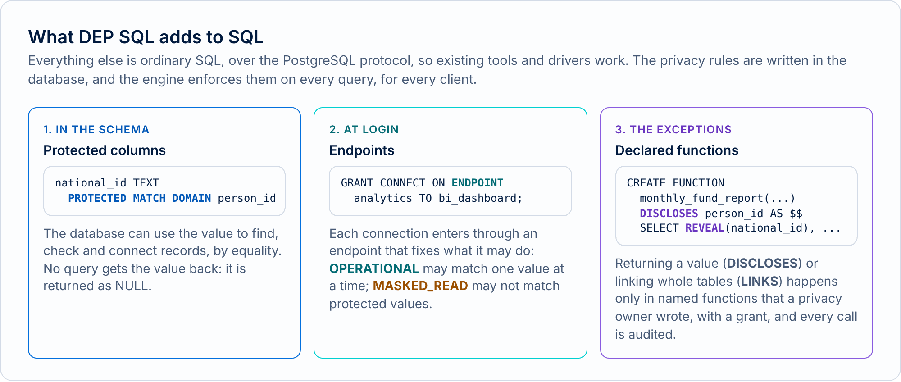

# DEP SQL in five minutes

DEP SQL is SQL in which the privacy rules are part of the database. You mark a column `PROTECTED`, and from then on the database lets applications use that value to find, check and connect records, but it never hands the value back. The few real exceptions are functions with a name, an owner and an audit trail. This page explains the idea with one example, a small clinic, and shows what each kind of user sees.

<p class="muted"><span class="badge">Experimental</span> Project Hoopeo is an experimental, conceptual project. See the <a href="../../site/content/legal/terms.md">terms of use</a>.</p>

## The names

| Name | What it is |
|---|---|
| **DEP**, Database-Enforced Privacy | The idea: privacy rules that the database engine enforces on every query, for every client |
| **DEP SQL** | The language: SQL, plus a few words to declare those rules |
| **DEP Engine** | The database server that runs DEP SQL |
| **DEP CLI**, **Hoopeo Studio** | The command-line shell and the developer application. Both include DEP Engine, so they need no server |
| **DEP.js** | The same rules in the browser, in the [playground](../../playground/). A simulator, for learning |
| **Project Hoopeo** | The project that builds all of the above |

## The problem

A clinic's reception needs to find a patient by the ID number she presents. In a regular database, the permission to search by ID number is the permission to read the column, so the same application can also run `SELECT national_id FROM patients` and get every ID number in the table. The same is true of the analytics dashboard, the reminder job, a developer's laptop, and any AI agent with a connection. The privacy policy says who may see what; the database cannot tell the difference between finding one person and copying everyone.

Today that gap is closed, if at all, in the code of each application. DEP closes it in the database, once, for every client.

## The idea

The ability to **use** a value does not have to include the ability to **read** it. Reception does not need to read ID numbers; it needs the database to find the row that matches the number in front of it. DEP SQL gives the database enough information to do exactly that, and nothing more.

<picture><source media="(prefers-color-scheme: dark)" srcset="../images/diagrams/dep-sql-adds-dark.png"></picture>

## What DEP SQL adds

Three things. Everything else is ordinary SQL, and DEP Engine speaks the PostgreSQL protocol, so `psql` and the usual drivers connect to it.

**1. Protected columns, in the schema.**

```sql
CREATE TABLE patients (
    patient_id  BIGINT PRIMARY KEY,
    national_id TEXT PROTECTED MATCH DOMAIN person_id UNIQUE,
    phone       TEXT PROTECTED MATCH DOMAIN phone_number,
    full_name   TEXT,
    health_fund TEXT
);
```

A protected value can be compared with a whole value for equality (`=`, `IN`), so it can find a row, enforce a unique key and connect two tables. It cannot be read back: every query returns it as NULL. Anything that would leak part of it, such as `LIKE`, sorting or a range, is refused. The **match domain** (`person_id`) says which values may be compared with each other: all the columns that hold ID numbers share it, and a phone number can never be compared with an ID number.

The database never stores the plain value. It stores a **blind index entry**, a keyed fingerprint that is equal for equal values, and an encrypted copy. The [concepts guide](concepts.md#blind-indexes-and-ciphertexts) shows both.

**2. Endpoints, at login.**

```sql
GRANT CONNECT ON ENDPOINT operational TO reception_app, doctors_app, billing_job;
GRANT CONNECT ON ENDPOINT analytics   TO bi_dashboard;
```

Every connection enters through an endpoint, and the endpoint fixes its **access path** for the whole session. On the **operational** path an application may match protected values, one person at a time. On the **masked read** path (`analytics`), for dashboards and reports, it may read ordinary columns and may not match protected values at all.

**3. Declared functions, for the exceptions.**

```sql
GRANT DISCLOSE ON MATCH DOMAIN person_id TO privacy_admin;

CREATE FUNCTION monthly_fund_report(report_month DATE)
RETURNS TABLE (national_id TEXT, visit_date DATE, visit_type TEXT, health_fund TEXT)
LANGUAGE sql
DISCLOSES person_id
AS $$
    SELECT REVEAL(p.national_id), CAST(a.starts_at AS DATE), a.visit_type, p.health_fund
    FROM appointments AS a JOIN patients AS p USING (patient_id)
    WHERE date_trunc('month', a.starts_at) = date_trunc('month', CAST(report_month AS TIMESTAMP))
$$;
```

Sometimes a value must leave the database (the health funds need the ID numbers on the monthly report), or whole tables must be connected (statistics per fund need every patient joined to every diagnosis). Those two things happen only inside functions declared for them: `DISCLOSES` may return plain values with `REVEAL`, and `LINKS` may join without naming one person. Only a role granted `DISCLOSE` or `LINK` on the match domain can write such a function, other roles can only call it, and every call goes to the audit log. A disclosed value can be returned and nothing else: it cannot be used to search or join again.

## What each user sees

The [demo clinic](../../examples/clinic.sql) gives each application its own role. Here is what four of them get, with the real output of DEP Engine.

<picture><source media="(prefers-color-scheme: dark)" srcset="../images/diagrams/roles-dark.png"></picture>

**Reception** finds Dana by the ID number she presents. The row comes back; the ID number does not. Each result carries **DEP notes** that say what the database did.

```text
reception_app@operational=> SELECT patient_id, full_name, national_id, health_fund FROM patients WHERE national_id = '123456782';
DEP:  PROTECTED column patients.national_id is matched by equality through the blind index of MATCH DOMAIN person_id.
DEP:  Output column national_id is PROTECTED column patients.national_id (MATCH DOMAIN person_id) and is returned as NULL.
 patient_id | full_name  | national_id | health_fund
------------+------------+-------------+-------------
 1          | Dana Cohen | NULL        | Clalit
(1 row)

reception_app@operational=> SELECT full_name FROM patients WHERE national_id LIKE '12%';
ERROR:  LIKE is not supported for PROTECTED values (patients.national_id).
HINT:  PROTECTED values support only full-value equality matching. To release a value, use a disclosing function.
SQLSTATE:  ZD101 (DEP_PROTECTED_OPERATION)
```

**Doctors** read the records of the patient in front of them. A join on protected columns is allowed when it is **anchored** to one value; joining everyone to everything is refused before a row is read.

```text
doctors_app@operational=> SELECT m.diagnosis, m.recorded_at FROM patients AS p JOIN medical_records AS m ON m.patient_national_id = p.national_id WHERE p.national_id = '123456782' ORDER BY m.recorded_at;
DEP:  PROTECTED column patients.national_id is matched by equality through the blind index of MATCH DOMAIN person_id.
DEP:  Join of PROTECTED columns medical_records.patient_national_id and patients.national_id (MATCH DOMAIN person_id) is anchored to a single protected value.
    diagnosis     | recorded_at
------------------+-------------
 Asthma           | 2026-04-04
 Seasonal allergy | 2026-10-21
(2 rows)

doctors_app@operational=> SELECT p.full_name, m.diagnosis FROM patients AS p JOIN medical_records AS m ON m.patient_national_id = p.national_id;
ERROR:  Join on PROTECTED columns patients.national_id and medical_records.patient_national_id is not anchored to a single protected value.
HINT:  Anchor the join with a lookup such as WHERE patients.national_id = $1, or perform it inside a function declared LINKS person_id.
SQLSTATE:  ZD107 (DEP_UNANCHORED_MATCH)
```

**The BI dashboard** connects through `analytics`. It counts what it needs, and gets the statistics through a function declared `LINKS`; it cannot look anyone up.

```text
bi_dashboard@analytics=> SELECT patient_id FROM patients WHERE national_id = '123456782';
ERROR:  Matching PROTECTED values is unavailable on a MASKED_READ connection.
HINT:  This operation requires an OPERATIONAL connection.
SQLSTATE:  ZD102 (DEP_ENDPOINT_OPERATION)

bi_dashboard@analytics=> SELECT * FROM diagnoses_per_fund() ORDER BY 1, 2;
DEP:  diagnoses_per_fund() is declared LINKS person_id: it may join protected values without an anchor.
 health_fund |    diagnosis     | patients
-------------+------------------+----------
 Clalit      | Asthma           | 2
 Clalit      | Seasonal allergy | 1
 Maccabi     | Diabetes         | 2
 Meuhedet    | Hypertension     | 1
(4 rows)
```

**Billing** sends the monthly report with the ID numbers, through the function above, and can do nothing else with them.

```text
billing_job@operational=> SELECT * FROM monthly_fund_report(DATE '2026-10-01') ORDER BY visit_date LIMIT 3;
DEP:  monthly_fund_report() is declared DISCLOSES person_id: the columns it declares are returned in plaintext.
DEP:  Output column national_id is disclosed: Column national_id of monthly_fund_report() (DISCLOSES person_id).
 national_id | visit_date | visit_type  | health_fund
-------------+------------+-------------+-------------
 345678904   | 2026-10-01 | Follow-up   | Clalit
 234567893   | 2026-10-09 | Lab results | Maccabi
 678901237   | 2026-10-13 | Follow-up   | Maccabi
(3 rows)
```

## Words you will meet

Each term links to its full entry in the [glossary](../reference/glossary.md), with an example and where you will meet it.

| Term | In plain words |
|---|---|
| [Protected column](../reference/glossary.md#protected-column) | A column whose values the database uses but never returns |
| [Match domain](../reference/glossary.md#match-domain) | A family of values that may be compared with each other, with its own keys |
| [Blind index](../reference/glossary.md#blind-index) | What the database stores instead of the value: a keyed fingerprint, equal for equal values |
| [Endpoint, access path](../reference/glossary.md#endpoint) | The door a connection comes in by, and what it may do: `OPERATIONAL` or `MASKED_READ` |
| [Matching](../reference/glossary.md#matching) | Finding rows by a protected value, by equality only |
| [Anchor](../reference/glossary.md#anchor) | The one value that a join on protected columns is tied to |
| [Linking](../reference/glossary.md#linking) | Joining protected values without an anchor: only in a `LINKS` function |
| [Disclosure](../reference/glossary.md#disclosure) | Returning a plain value: only in a `DISCLOSES` function, with `REVEAL` |
| [Terminal rule](../reference/glossary.md#terminal-rule) | A disclosed value can be returned, and used for nothing else |
| [DEP note](../reference/glossary.md#dep-note) | A line with a result that says how protected columns were handled |
| [DEP error](../reference/glossary.md#dep-error) | A refusal, with a `ZD` code and a hint that says what would be allowed |
| [Audit log](../reference/glossary.md#audit-log) | The record of every protected match, disclosure and refusal, without values |

## Where next

- **Try it:** the [playground](../../playground/) runs every statement three times, side by side: in a regular database, on the masked read path and on the operational path.
- **Install:** Hoopeo Studio is the easiest start. See [Install](../../site/content/install.md).
- **Learn the rules:** [Concepts](concepts.md), then [DEP SQL](dep-sql.md).
- **The reasoning:** [DEP and privacy as code](../../site/content/privacy-as-code.md), and the [design proposal](../design/01-dep-concept.md).
