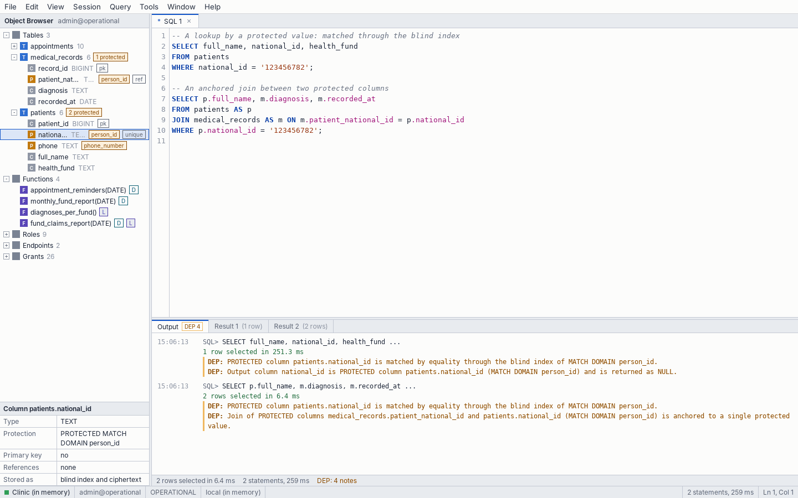

# DEP notes reference

A **DEP note** is a sentence that says which DEP rule applied to a statement. Plain SQL produces none, so a note is a signal that DEP did something. Notes never contain a protected value.

<picture><source media="(prefers-color-scheme: dark)" srcset="../images/studio/studio-lookup-dark.png"></picture>

How a client receives them:

| Client | How |
|---|---|
| DEP CLI, Hoopeo Studio | Printed as `DEP:  ...` lines before the result (DEP CLI: `\notes off` hides them) |
| PostgreSQL drivers, `psql` | `NOTICE` messages whose text starts with `DEP: ` |
| HTTP API | The `notes` array of each result |
| Any client | `SHOW DEP NOTES` returns the notes of the last statement |

In the texts below, `{x}` stands for a name filled in by the engine: `{col}` is `table.column`, `{domain}` a match domain, `{fn}` a function.

## Reads

| Note | When |
|---|---|
| `PROTECTED column {col} is matched by equality through the blind index of MATCH DOMAIN {domain}.` | A [protected column](glossary.md#protected-column) is compared with a value ([matching](glossary.md#matching)): `=`, `OR`, `CASE`, `NOT (col = v)`; also in `UPDATE` and `DELETE` |
| `PROTECTED column {col} is matched against a list of values through the blind index of MATCH DOMAIN {domain}.` | `IN` or `NOT IN` with a list |
| `Join of PROTECTED columns {col} and {col} (MATCH DOMAIN {domain}) is anchored to a single protected value.` | A join between two protected columns that the query [anchors](glossary.md#anchor) to one value |
| `Output column {name} is PROTECTED column {col} (MATCH DOMAIN {domain}) and is returned as NULL.` | A protected column is selected |
| `Output column {name} is disclosed: {description} (DISCLOSES {domain}).` | A column produced by [`REVEAL`](glossary.md#reveal) in a [disclosing function](glossary.md#disclosure) is returned |
| `{fn}() is declared DISCLOSES {domains}: the columns it declares are returned in plaintext.` | A function declared `DISCLOSES` is called |
| `{fn}() is declared LINKS {domains}: it may join protected values without an anchor.` | A function declared for [linking](glossary.md#linking) (`LINKS`) is called |

## Writes and schema

| Note | When |
|---|---|
| `PROTECTED column {table}.{column} (MATCH DOMAIN {domain}) is stored as a blind index and ciphertext.` | `INSERT` writes a protected column |
| `Index {name} keys PROTECTED column(s) {columns} by their blind index entries: it answers equality only, and holds no plaintext.` | `CREATE INDEX` on a protected column |
| `Index {name} already exists; nothing was done.` | `CREATE INDEX IF NOT EXISTS` finds the name taken |
| `{table} is a TEMPORARY table: it is kept in memory only, and is gone when the server stops.` | `CREATE TEMPORARY TABLE` |
| `{index}: {n} duplicate key(s); uniqueness is still not enforced.` | `REINDEX` of a unique key that still has duplicates |
| `{index}: no duplicate keys; uniqueness is enforced again.` | `REINDEX` after the duplicates were removed |
| `The master key was replaced: {n} protected values were indexed and encrypted again with the new key, and the indexes were rebuilt. The old key no longer opens this data.` | `ALTER SYSTEM ROTATE MASTER KEY` |

## Transactions

| Note | When |
|---|---|
| `There is already a transaction in progress.` | `BEGIN` inside a transaction |
| `There is no transaction in progress.` | `COMMIT` or `ROLLBACK` outside one |
| `The transaction had failed, so it was rolled back.` | `COMMIT` of an aborted transaction |

## Examples

```text
reception_app@operational=> SELECT full_name, national_id FROM patients WHERE national_id IN ('123456782', '234567893');
DEP:  PROTECTED column patients.national_id is matched against a list of values through the blind index of MATCH DOMAIN person_id.
DEP:  Output column national_id is PROTECTED column patients.national_id (MATCH DOMAIN person_id) and is returned as NULL.
 full_name  | national_id
------------+-------------
 Dana Cohen | NULL
 Yossi Levi | NULL
(2 rows)

reception_app@operational=> SHOW DEP NOTES;
DEP:  PROTECTED column patients.national_id is matched against a list of values through the blind index of MATCH DOMAIN person_id.
DEP:  Output column national_id is PROTECTED column patients.national_id (MATCH DOMAIN person_id) and is returned as NULL.
                                                             note
------------------------------------------------------------------------------------------------------------------------------
 PROTECTED column patients.national_id is matched against a list of values through the blind index of MATCH DOMAIN person_id.
 Output column national_id is PROTECTED column patients.national_id (MATCH DOMAIN person_id) and is returned as NULL.
(2 rows)
```

```text
doctors_app@operational=> SELECT p.full_name, m.diagnosis FROM patients AS p JOIN medical_records AS m ON m.patient_national_id = p.national_id WHERE p.national_id = '123456782';
DEP:  PROTECTED column patients.national_id is matched by equality through the blind index of MATCH DOMAIN person_id.
DEP:  Join of PROTECTED columns medical_records.patient_national_id and patients.national_id (MATCH DOMAIN person_id) is anchored to a single protected value.
 full_name  |    diagnosis
------------+------------------
 Dana Cohen | Asthma
 Dana Cohen | Seasonal allergy
(2 rows)
```

```text
admin@operational=> CREATE TEMPORARY TABLE scratch (id BIGINT PRIMARY KEY, token TEXT PROTECTED MATCH DOMAIN scratch_token);
DEP:  scratch is a TEMPORARY table: it is kept in memory only, and is gone when the server stops.
CREATE TABLE

admin@operational=> CREATE INDEX IF NOT EXISTS scratch_token_idx ON scratch (token);
DEP:  Index scratch_token_idx already exists; nothing was done.
CREATE INDEX

admin@operational=> BEGIN;
BEGIN

admin@operational=*> BEGIN;
DEP:  There is already a transaction in progress.
BEGIN

admin@operational=*> COMMIT;
COMMIT

admin@operational=> COMMIT;
DEP:  There is no transaction in progress.
COMMIT
```

```text
admin@operational=> BEGIN;
BEGIN

admin@operational=*> INSERT INTO patients (patient_id, national_id) VALUES (1, '999999990');
ERROR:  duplicate key value violates unique constraint "patients_pkey": Key (patient_id)=(1) already exists.
SQLSTATE:  23505

admin@operational=!> COMMIT;
DEP:  The transaction had failed, so it was rolled back.
ROLLBACK
```
