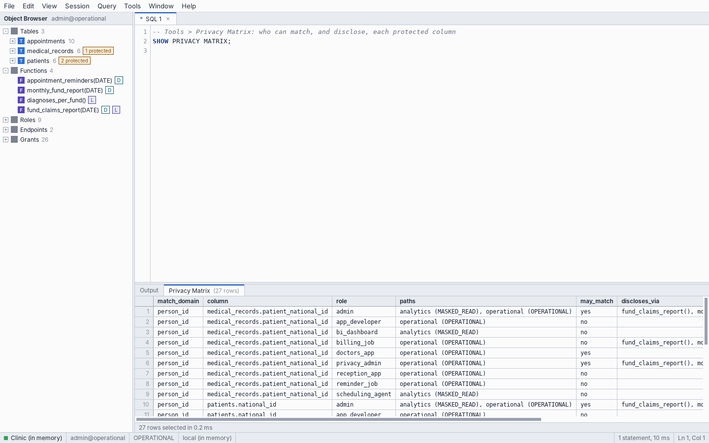

# SHOW commands

`SHOW` statements describe the catalog, the privileges and the state of the connection. They are ordinary statements: they work in DEP CLI, in `psql` and from any driver, and they return rows. DEP CLI's meta-commands run them (`\dt` runs `SHOW TABLES`).

| Statement | Needs | Returns |
|---|---|---|
| `SHOW TABLES` | | One row per table |
| `SHOW COLUMNS FROM t` | | One row per column |
| `SHOW INDEXES [FROM t]` | | One row per index |
| `SHOW FUNCTIONS` | | One row per declared function |
| `SHOW ROLES` | | One row per role |
| `SHOW GRANTS` | | One row per grant |
| `SHOW ENDPOINTS` | | One row per endpoint |
| `SHOW PRIVACY MATRIX` | | One row per protected column and role |
| `SHOW STORAGE t [n]` | superuser | The first `n` rows of `t` as stored |
| `SHOW AUDIT [n]` | superuser | The latest `n` audit records |
| `SHOW DEP NOTES` | | The DEP notes of the last statement |
| `SHOW dep.path` | | The access path of the connection |
| `SHOW ROLE`, `SHOW CURRENT_USER` | | The current role |
| `SHOW SESSION AUTHORIZATION` | | The role the connection logged in as |
| `SHOW TRANSACTION ISOLATION LEVEL` | | `repeatable read` |

Each statement below was run against the demo clinic as `admin`.

## SHOW TABLES

Columns: `table`, `protected_columns`, `rows`, `temporary`.

```text
admin@operational=> SHOW TABLES;
      table      |  protected_columns  | rows | temporary
-----------------+---------------------+------+-----------
 appointments    |                     | 10   |
 medical_records | patient_national_id | 6    |
 patients        | national_id, phone  | 6    |
(3 rows)
```

## SHOW COLUMNS FROM t

Columns: `column`, `type`, `match_domain` (NULL for an ordinary column), `primary_key`, `references`, `not_null`, `unique`.

```text
admin@operational=> SHOW COLUMNS FROM medical_records;
       column        |  type  | match_domain | primary_key |       references       | not_null | unique
---------------------+--------+--------------+-------------+------------------------+----------+--------
 record_id           | BIGINT | NULL         | yes         | NULL                   | yes      | yes
 patient_national_id | TEXT   | person_id    |             | patients (national_id) |          |
 diagnosis           | TEXT   | NULL         |             | NULL                   |          |
 recorded_at         | DATE   | NULL         |             | NULL                   |          |
(4 rows)
```

## SHOW INDEXES [FROM t]

Columns: `table`, `index`, `columns`, `kind` (`primary key`, `unique` or empty), `enforced`, `made_by` (`engine` or `CREATE INDEX`), `keys` (`values`, or `blind index entries` for a protected column).

```text
admin@operational=> SHOW INDEXES FROM patients;
  table   |          index           |   columns   |    kind     | enforced | made_by |        keys
----------+--------------------------+-------------+-------------+----------+---------+---------------------
 patients | patients_pkey            | patient_id  | primary key | yes      | engine  | values
 patients | patients_national_id_key | national_id | unique      | yes      | engine  | blind index entries
 patients | patients_phone_idx       | phone       |             |          | engine  | blind index entries
(3 rows)
```

## SHOW FUNCTIONS

Columns: `function` (with its argument types), `discloses`, `links`, `owner`, `masked_path` (`yes` when it can be called on the masked read path), `comment`, `executable_by`, `body`. DEP CLI's `\df` shows the first six without `comment`.

```text
admin@operational=> SHOW FUNCTIONS;
          function           |  discloses   |   links   |     owner     | masked_path |                              comment                               | executable_by |                                                          body
-----------------------------+--------------+-----------+---------------+-------------+--------------------------------------------------------------------+---------------+------------------------------------------------------------------------------------------------------------------------
 appointment_reminders(DATE) | phone_number |           | privacy_admin | no          | Purpose: SMS appointment reminders. Owner: operations.             | reminder_job  | SELECT REVEAL(p.phone), a.starts_at     FROM appointments AS a     JOIN patients AS p USING (patient_id)     WHERE CAST(a.starts_at AS DATE) = day
 monthly_fund_report(DATE)   | person_id    |           | privacy_admin | no          | Purpose: monthly visit report to health funds. Owner: billing.     | billing_job   | SELECT REVEAL(p.national_id), CAST(a.starts_at AS DATE), a.visit_type, p.health_fund     FROM appointments AS a     JOIN patients AS p USING (patient_id)     WHERE date_trunc('month', a.starts_at) = date_trunc('month', CAST(report_month AS TIMESTAMP))
 diagnoses_per_fund()        |              | person_id | privacy_admin | yes         | Purpose: diagnosis statistics per health fund. Owner: management.  | bi_dashboard  | SELECT p.health_fund, m.diagnosis, COUNT(*)     FROM patients AS p     JOIN medical_records AS m ON m.patient_national_id = p.national_id     GROUP BY p.health_fund, m.diagnosis
 fund_claims_report(DATE)    | person_id    | person_id | privacy_admin | no          | Purpose: monthly diagnosis claims to health funds. Owner: billing. | billing_job   | SELECT REVEAL(p.national_id), m.diagnosis, m.recorded_at     FROM medical_records AS m     JOIN patients AS p ON p.national_id = m.patient_national_id     WHERE date_trunc('month', CAST(m.recorded_at AS TIMESTAMP)) = date_trunc('month', CAST(report_month AS TIMESTAMP))
(4 rows)
```

## SHOW ROLES

Columns: `role`, `superuser`, `login`, `endpoints` (those it may connect through), `match_limit`.

```text
admin@operational=> SHOW ROLES;
       role       | superuser | login |       endpoints        | match_limit
------------------+-----------+-------+------------------------+-------------
 admin            | yes       | yes   | analytics, operational |
 app_developer    |           | yes   | operational            |
 bi_dashboard     |           | yes   | analytics              |
 billing_job      |           | yes   | operational            |
 doctors_app      |           | yes   | operational            |
 privacy_admin    |           | yes   | operational            |
 reception_app    |           | yes   | operational            |
 reminder_job     |           | yes   | operational            |
 scheduling_agent |           | yes   | analytics              |
(9 rows)
```

## SHOW GRANTS

Columns: `grantee`, `privilege`. The privilege reads like the statement that granted it: `SELECT (national_id, full_name) ON patients`, `EXECUTE ON FUNCTION monthly_fund_report`, `DISCLOSE ON MATCH DOMAIN person_id`, `CONNECT ON ENDPOINT operational`.

```text
admin@operational=> SHOW GRANTS;
     grantee      |                                      privilege
------------------+--------------------------------------------------------------------------------------
 bi_dashboard     | SELECT ON appointments
 bi_dashboard     | SELECT (health_fund, patient_id) ON patients
 doctors_app      | SELECT ON appointments
 doctors_app      | SELECT, INSERT ON medical_records
 doctors_app      | SELECT (full_name, health_fund, national_id, patient_id) ON patients
 privacy_admin    | SELECT ON appointments
 privacy_admin    | SELECT ON medical_records
 privacy_admin    | SELECT ON patients
 reception_app    | SELECT ON appointments
 reception_app    | SELECT (full_name, health_fund, national_id, patient_id), INSERT, UPDATE ON patients
 scheduling_agent | SELECT ON appointments
 scheduling_agent | SELECT (health_fund, patient_id) ON patients
 privacy_admin    | DISCLOSE, LINK ON MATCH DOMAIN person_id
 privacy_admin    | DISCLOSE ON MATCH DOMAIN phone_number
 reminder_job     | EXECUTE ON FUNCTION appointment_reminders
 bi_dashboard     | EXECUTE ON FUNCTION diagnoses_per_fund
 billing_job      | EXECUTE ON FUNCTION fund_claims_report
 billing_job      | EXECUTE ON FUNCTION monthly_fund_report
 bi_dashboard     | CONNECT ON ENDPOINT analytics
 scheduling_agent | CONNECT ON ENDPOINT analytics
 app_developer    | CONNECT ON ENDPOINT operational
 billing_job      | CONNECT ON ENDPOINT operational
 doctors_app      | CONNECT ON ENDPOINT operational
 privacy_admin    | CONNECT ON ENDPOINT operational
 reception_app    | CONNECT ON ENDPOINT operational
 reminder_job     | CONNECT ON ENDPOINT operational
(26 rows)
```

## SHOW ENDPOINTS

Columns: `endpoint`, `path`.

```text
admin@operational=> SHOW ENDPOINTS;
  endpoint   |    path
-------------+-------------
 analytics   | MASKED_READ
 operational | OPERATIONAL
(2 rows)
```

## SHOW PRIVACY MATRIX

One row for each protected column and each role. Columns: `match_domain`, `column`, `role`, `paths` (the endpoints it may use, with their paths), `may_match` (whether it may match on the column), `discloses_via` and `links_via` (the declared functions it may execute for that domain). It is computed from the grants and the declared functions, so it always agrees with what the engine enforces. The full matrix of the clinic has 27 rows; this is one table with one protected column:

<picture><source media="(prefers-color-scheme: dark)" srcset="../images/studio/studio-matrix-dark.png"></picture>

```text
admin@operational=> CREATE TABLE accounts (id BIGINT PRIMARY KEY, email TEXT PROTECTED MATCH DOMAIN email, name TEXT);
CREATE TABLE

admin@operational=> CREATE ROLE support LOGIN PASSWORD 'x';
CREATE ROLE

admin@operational=> CREATE ROLE marketing LOGIN PASSWORD 'x';
CREATE ROLE

admin@operational=> GRANT CONNECT ON ENDPOINT operational TO support;
GRANT

admin@operational=> GRANT CONNECT ON ENDPOINT analytics TO marketing;
GRANT

admin@operational=> GRANT SELECT (id, email, name) ON accounts TO support;
GRANT

admin@operational=> GRANT SELECT (id, name) ON accounts TO marketing;
GRANT

admin@operational=> SHOW PRIVACY MATRIX;
 match_domain |     column     |   role    |                       paths                        | may_match | discloses_via | links_via
--------------+----------------+-----------+----------------------------------------------------+-----------+---------------+-----------
 email        | accounts.email | admin     | analytics (MASKED_READ), operational (OPERATIONAL) | yes       |               |
 email        | accounts.email | marketing | analytics (MASKED_READ)                            | no        |               |
 email        | accounts.email | support   | operational (OPERATIONAL)                          | yes       |               |
(3 rows)
```

## SHOW STORAGE t [n]

The rows of `t` as the server stores them (a superuser only). A protected column appears as two columns: the blind index entry (`ie1:...`) and the ciphertext (`col__ct`, `ct1:...`). No plaintext is shown.

```text
admin@operational=> CREATE TABLE secrets (id BIGINT PRIMARY KEY, token TEXT PROTECTED MATCH DOMAIN token_domain);
CREATE TABLE

admin@operational=> INSERT INTO secrets VALUES (1, 'my-secret-token'), (2, 'another-token');
DEP:  PROTECTED column secrets.token (MATCH DOMAIN token_domain) is stored as a blind index and ciphertext.
INSERT 0 2

admin@operational=> SHOW STORAGE secrets 1;
 id |                token                 |                                    token__ct
----+--------------------------------------+----------------------------------------------------------------------------------
 1  | ie1:a3f8833a9b1d6c1c8abc7d53381d77cf | ct1:DlCrLM2SQ4X64ppl+shah5u5t4W3WRJ7QaZf6I8i4Va9WkQ6HnJltaulcCC67snctn2/F8MXSw==
(1 row)
```

## SHOW AUDIT [n]

Columns: `seq`, `at` (UTC), `session_user`, `role`, `endpoint`, `path`, `kind`, `object`, `domain`, `count`, `detail`. Newest first. See the [administration guide](../guides/administration.md#the-audit-log) for the kinds.

```text
reception_app@operational=> SELECT full_name FROM patients WHERE national_id = '123456782';
DEP:  PROTECTED column patients.national_id is matched by equality through the blind index of MATCH DOMAIN person_id.
 full_name
------------
 Dana Cohen
(1 row)

reception_app@operational=> SELECT full_name FROM patients WHERE national_id LIKE '1%';
ERROR:  LIKE is not supported for PROTECTED values (patients.national_id).
HINT:  PROTECTED values support only full-value equality matching. To release a value, use a disclosing function.
SQLSTATE:  ZD101 (DEP_PROTECTED_OPERATION)

reception_app@operational=> \c operational admin
You are now connected as "admin" through endpoint "operational" (OPERATIONAL).

admin@operational=> SHOW AUDIT 2;
 seq |            at            | session_user  |     role      |  endpoint   |    path     |  kind  |        object        |  domain   | count |         detail
-----+--------------------------+---------------+---------------+-------------+-------------+--------+----------------------+-----------+-------+-------------------------
 2   | 2026-10-23T12:27:14.476Z | reception_app | reception_app | operational | OPERATIONAL | denied | SELECT               | NULL      | NULL  | DEP_PROTECTED_OPERATION
 1   | 2026-10-23T12:27:14.476Z | reception_app | reception_app | operational | OPERATIONAL | match  | patients.national_id | person_id | 1     | NULL
(2 rows)
```

## Other settings

```text
admin@operational=> SHOW dep.path;
  dep.path
-------------
 OPERATIONAL
(1 row)

admin@operational=> SHOW ROLE;
 role
-------
 admin
(1 row)

admin@operational=> SET ROLE reception_app;
SET

reception_app@operational=> SHOW ROLE;
     role
---------------
 reception_app
(1 row)

reception_app@operational=> SHOW SESSION AUTHORIZATION;
 session authorization
-----------------------
 admin
(1 row)

reception_app@operational=> RESET ROLE;
SET

admin@operational=> SHOW TRANSACTION ISOLATION LEVEL;
 transaction_isolation
-----------------------
 repeatable read
(1 row)
```

`SET dep.path` is always refused (`ZD106`): the access path is fixed at login. Any other `SET` that is not a `dep.` setting is accepted and ignored, so that drivers can send their usual settings. `SET ROLE` is the exception, and works as described in the [DEP SQL guide](../guides/dep-sql.md#set-role).
