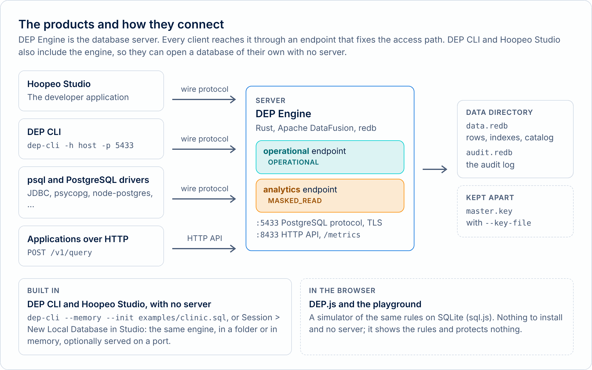

# About

Project Hoopeo is an experimental concept: an implementation of **Database-Enforced Privacy (DEP)**, a database in which privacy rules are part of the schema and of the query plan, so that the engine enforces them on every query, for every client. It consists of a specification, a database server (DEP Engine), a command-line shell (DEP CLI), a developer application (Hoopeo Studio), and a browser simulator (DEP.js, the playground). It demonstrates the model and its trust boundary.

<p class="muted"><span class="badge">Experimental</span> Project Hoopeo is an experimental, conceptual project. See the <a href="legal/terms.md">terms of use</a>.</p>

The name is the project's own: Hoopeo is a play on the hoopoe, the bird of the logo, and the one that is spelled "Hoopeo" in the products' names. See [Names and logos](../../BRAND.md).

## The idea

The principle is that **the ability to use a value for an operation does not require the ability to read it**. A column declared `PROTECTED` can be used by the database to find a record, update it, and connect it to related records, but an ordinary query never returns its value. Linking whole datasets, and releasing a value, are possible only inside functions that are declared for it, reviewable in the schema, and listed in the catalog. [DEP on Privacy as Code](privacy-as-code.md) explains the model and its limits, and the [concepts guide](../../docs/guides/concepts.md) defines its terms.

<picture><source media="(prefers-color-scheme: dark)" srcset="../../docs/images/diagrams/products-dark.png"></picture>

## The documents

- **The design proposal** defines DEP: the problem, the idea, the language, declared functions, the architecture, and the guarantees and limits. [Read the design proposal](../../docs/design/01-dep-concept.md).
- **The roadmap and release plan** records one way DEP could be built and released, and compares it with existing approaches. [Read the roadmap](../../docs/design/02-roadmap-and-release.md).

Both are licensed under CC BY 4.0: anyone may implement Database-Enforced Privacy, in any product, with attribution.

## History

The history is in the [changelog](../../CHANGELOG.md). In short:

- **0.3**: the name Project Hoopeo, with DEP Engine, DEP CLI and Hoopeo Studio. DEP notes, the privacy matrix and TLS. Installers for macOS, Linux and Docker.
- **0.4**: storage in redb, the transaction manager, the audit log, match limits and key rotation, the PostgreSQL extended protocol, and the HTTP API.
- **0.5**: storage on disk with indexes and constraints, savepoints and transactional schema changes, bounded query memory with encrypted spilling, and DEP.js following the engine rule for rule, checked by a compatibility test. 0.5.1 fixed two bugs. 0.5.2 changed the licensing and the way the products are distributed: DEP Engine, DEP CLI and Hoopeo Studio became binaries under an evaluation license, and the specification, the playground and the examples stayed open.

## The author

Project Hoopeo is made by **Reuven Mandelovich**: [lp.reuven.click](https://lp.reuven.click).

## Licenses and a commercial license

The layers have different licenses: CC BY 4.0 for the specification and documentation, Apache 2.0 for DEP.js and the examples, and the Project Hoopeo Evaluation License for the binaries of DEP Engine, DEP CLI and Hoopeo Studio. See [Licensing](../../LICENSING.md). Production use and commercial use need a commercial license. To ask for one, contact the author through [lp.reuven.click](https://lp.reuven.click).

## Contributing and security

Contributions are welcome to the open layers: the documents, DEP.js and the examples. See [Contributing](../../CONTRIBUTING.md). A way around DEP's rules, in the design or in an implementation, should be reported privately: see [Security](../../SECURITY.md).

## How to cite

If you use, discuss or build on DEP, please cite the design proposal:

> R. Mandelovich. *DEP: Database-Enforced Privacy. A Design Proposal.* Version 1.0, October 2026.

To cite the software:

> R. Mandelovich. *Project Hoopeo: Database-Enforced Privacy (DEP).* Version 0.5.2, 2026. Source and releases: <https://github.com/mandelreouven2002/project-hoopeo.github.io>

```bibtex
@techreport{mandelovich2026dep,
  author      = {Mandelovich, Reuven},
  title       = {{DEP}: Database-Enforced Privacy. A Design Proposal},
  year        = {2026},
  month       = oct,
  note        = {Version 1.0},
  url         = {https://github.com/mandelreouven2002/project-hoopeo.github.io}
}
```

The repository also has a [`CITATION.cff`](../../CITATION.cff), which GitHub reads to offer a citation. A DOI will be added after the first Zenodo release.
