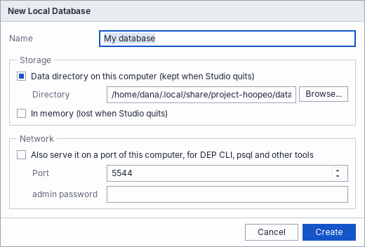
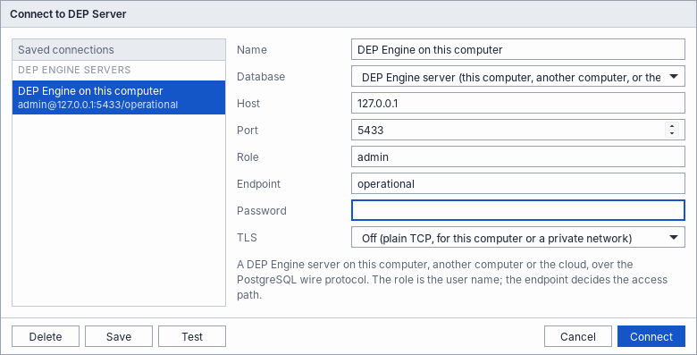

# Install

Choose a product, then your system. Every button downloads the latest release, so there is nothing to look up: download, open, install.

<p class="muted"><span class="badge">Experimental</span> Project Hoopeo is an experimental, conceptual project. See the <a href="legal/terms.md">terms of use</a>.</p>

<div class="grid two product-picker">
<a class="card" href="#hoopeo-studio"><h3>Hoopeo Studio</h3><p>The developer application, with a database of its own. The easiest place to start.</p></a>
<a class="card teal" href="#dep-cli"><h3>DEP CLI</h3><p>The command-line shell, also with a database of its own.</p></a>
<a class="card blue" href="#dep-engine"><h3>DEP Engine</h3><p>The database server, for applications, psql and other clients.</p></a>
<a class="card" href="#depjs"><h3>DEP.js</h3><p>The playground, in the browser. Nothing to install.</p></a>
</div>

<picture><source media="(prefers-color-scheme: dark)" srcset="../../docs/images/diagrams/products-dark.png"></picture>

## Hoopeo Studio

SQL windows, an object browser, result grids, plans, the privacy matrix and the DEP notes of every statement. DEP Engine is built in, so Studio needs no server; it can also connect to one.

<div class="tabs" markdown="1">
<div class="tablist" role="tablist" aria-label="System for Hoopeo Studio" markdown="1">
<a role="tab" href="#studio-macos" data-os="mac" aria-selected="true">macOS</a>
<a role="tab" href="#studio-linux" data-os="linux" aria-selected="false">Linux</a>
<a role="tab" href="#studio-windows" data-os="windows" aria-selected="false">Windows</a>
</div>

<section class="tabpanel" id="studio-macos" markdown="1">

<p class="btn-row"><a class="btn" href="https://github.com/mandelreouven2002/project-hoopeo.github.io/releases/latest/download/Hoopeo-Studio-macos-universal.pkg">Download Hoopeo Studio for macOS</a></p>

macOS 11 or later, Apple silicon and Intel.

1. **Open the downloaded package.** If macOS says it cannot verify the developer, Control-click the package and choose **Open**, then **Open** again. (Or open **System Settings > Privacy & Security** and choose **Open Anyway**.)
2. **Install.** Choose **Continue**, then **Install**, and enter your password.
3. **Start Hoopeo Studio** from Applications or Launchpad.

</section>

<section class="tabpanel" id="studio-linux" markdown="1">

<p class="btn-row"><a class="btn" href="https://github.com/mandelreouven2002/project-hoopeo.github.io/releases/latest/download/hoopeo-studio_amd64.deb">Download for Linux (x86-64)</a> <a class="btn secondary" href="https://github.com/mandelreouven2002/project-hoopeo.github.io/releases/latest/download/hoopeo-studio_arm64.deb">ARM (arm64)</a></p>

Ubuntu 22.04, Debian 12 or newer.

1. **Open the downloaded file** and choose **Install** (on Ubuntu, the App Center opens it). In a terminal instead:

   ```sh
   sudo apt install ./hoopeo-studio_amd64.deb
   ```

2. **Start Hoopeo Studio** from the applications menu, or run `hoopeo-studio`.

</section>

<section class="tabpanel" id="studio-windows" markdown="1">

There is no Windows build of Hoopeo Studio yet. Try DEP in the [playground](../../playground/), which runs in any browser, or use [DEP CLI](#dep-cli) in WSL.

</section>
</div>

### First steps in Studio

1. **Create a database.** Choose **Session > New Local Database**, give it a name, and choose **Create**. It is kept in a folder on your computer, or in memory if you prefer.

   

2. **Load the demo clinic.** <a href="../../examples/clinic.sql" download>Download clinic.sql</a>, open it with **File > Open**, and run it with **Query > Execute** (F8).
3. **Run a lookup.** Open a new SQL window (**File > New SQL Window**), and run:

   ```sql
   SELECT full_name, national_id, health_fund
   FROM patients
   WHERE national_id = '123456782';
   ```

   The Output pane shows the result and its DEP notes: the ID number was matched through the blind index, and returned as NULL.

   

To work with a DEP Engine server instead, choose **Session > Connect to DEP Server**, and enter its host, port, role, endpoint and password.



**Remove:** on macOS, move Hoopeo Studio from Applications to the Trash. On Linux, `sudo apt remove hoopeo-studio`.

## DEP CLI

`dep-cli`, the command-line shell. It connects to a DEP Engine server, or opens a database of its own in a folder or in memory.

<div class="tabs" markdown="1">
<div class="tablist" role="tablist" aria-label="System for DEP CLI" markdown="1">
<a role="tab" href="#cli-macos" data-os="mac" aria-selected="true">macOS</a>
<a role="tab" href="#cli-linux" data-os="linux" aria-selected="false">Linux</a>
<a role="tab" href="#cli-windows" data-os="windows" aria-selected="false">Windows</a>
</div>

<section class="tabpanel" id="cli-macos" markdown="1">

<p class="btn-row"><a class="btn" href="https://github.com/mandelreouven2002/project-hoopeo.github.io/releases/latest/download/DEP-CLI-macos-universal.pkg">Download DEP CLI for macOS</a></p>

1. **Open the downloaded package** (Control-click and **Open** if macOS asks), choose **Continue** and **Install**.
2. **Open Terminal**, or the **DEP CLI** app the package adds to Applications, which opens Terminal for you.

The examples are installed in `/usr/local/share/project-hoopeo/examples`.

</section>

<section class="tabpanel" id="cli-linux" markdown="1">

<p class="btn-row"><a class="btn" href="https://github.com/mandelreouven2002/project-hoopeo.github.io/releases/latest/download/dep-cli_amd64.deb">Download for Linux (x86-64)</a> <a class="btn secondary" href="https://github.com/mandelreouven2002/project-hoopeo.github.io/releases/latest/download/dep-cli_arm64.deb">ARM (arm64)</a></p>

1. **Open the downloaded file** and choose **Install**, or in a terminal: `sudo apt install ./dep-cli_amd64.deb`.
2. The examples are installed in `/usr/share/dep-cli/examples`.

**Or in one line,** in a terminal (it picks the right file for your system and checks it):

```sh
curl -fsSL https://mandelreouven2002.github.io/project-hoopeo.github.io/install.sh | sh -s -- cli
```

For a distribution without apt, the same command installs `dep-cli` in `/usr/local/bin` from the archive.

</section>

<section class="tabpanel" id="cli-windows" markdown="1">

There is no Windows build yet. In WSL 2 with Ubuntu, follow the Linux steps.

</section>
</div>

### First steps with DEP CLI

```sh
dep-cli --memory --init /usr/local/share/project-hoopeo/examples/clinic.sql   # macOS
dep-cli --memory --init /usr/share/dep-cli/examples/clinic.sql                # Linux
```

This opens the demo clinic in memory, as `admin` on the operational endpoint. Type `\?` for the commands, `\dt` for the tables, and any DEP SQL statement:


`--data-dir ./data` keeps the database in a folder instead. To connect to a server: `dep-cli -h 127.0.0.1 -p 5433 -U admin -d operational`. The [DEP CLI reference](../../docs/reference/cli.md) has every option and command.

**Remove:** on macOS, `/usr/local/share/project-hoopeo/uninstall.sh`. On Linux, `sudo apt remove dep-cli`.

## DEP Engine

The database server: the PostgreSQL wire protocol on port 5433 and, when you turn it on, the HTTP API.

<div class="tabs" markdown="1">
<div class="tablist" role="tablist" aria-label="System for DEP Engine" markdown="1">
<a role="tab" href="#engine-macos" data-os="mac" aria-selected="true">macOS</a>
<a role="tab" href="#engine-linux" data-os="linux" aria-selected="false">Linux</a>
<a role="tab" href="#engine-docker" data-os="windows" aria-selected="false">Docker</a>
</div>

<section class="tabpanel" id="engine-macos" markdown="1">

<p class="btn-row"><a class="btn" href="https://github.com/mandelreouven2002/project-hoopeo.github.io/releases/latest/download/Project-Hoopeo-macos-universal.pkg">Download Project Hoopeo for macOS</a> <a class="btn secondary" href="https://github.com/mandelreouven2002/project-hoopeo.github.io/releases/latest/download/DEP-Engine-macos-universal.pkg">DEP Engine only</a></p>

The first package installs everything: DEP Engine, DEP CLI and Hoopeo Studio.

1. **Open the downloaded package** (Control-click and **Open** if macOS asks), and choose **Continue**.
2. **Keep "Run DEP Engine in the background"** selected under **Customize**. The server then starts when you log in, on `127.0.0.1:5433`, with its data in `~/Library/Application Support/Project Hoopeo/data`.
3. **Install,** and enter your password.

The admin password is in `~/Library/Application Support/Project Hoopeo/admin-password`. Connect:

```sh
DEP_PASSWORD=$(cat ~/Library/Application\ Support/Project\ Hoopeo/admin-password) dep-cli -h 127.0.0.1 -p 5433 -U admin -d operational
```

**Remove:** `/usr/local/share/project-hoopeo/uninstall.sh`. Your databases stay in `~/Library/Application Support/Project Hoopeo` until you delete them.

</section>

<section class="tabpanel" id="engine-linux" markdown="1">

<p class="btn-row"><a class="btn" href="https://github.com/mandelreouven2002/project-hoopeo.github.io/releases/latest/download/dep-engine_amd64.deb">Download for Linux (x86-64)</a> <a class="btn secondary" href="https://github.com/mandelreouven2002/project-hoopeo.github.io/releases/latest/download/dep-engine_arm64.deb">ARM (arm64)</a></p>

1. **Install** the downloaded file: open it and choose **Install**, or `sudo apt install ./dep-engine_amd64.deb`. Install [DEP CLI](#dep-cli) too, to connect.
2. **That is all.** The package starts DEP Engine as a service on `127.0.0.1:5433`, and generates the admin password in `/etc/dep-engine/admin-password`.
3. **Connect, and load the demo clinic** into the new database:

   ```sh
   export DEP_PASSWORD=$(sudo cat /etc/dep-engine/admin-password)
   dep-cli -h 127.0.0.1 -p 5433 -U admin -d operational -f /usr/share/dep-engine/examples/clinic.sql
   dep-cli -h 127.0.0.1 -p 5433 -U admin -d operational
   ```

**Or in one line** (any systemd distribution; it uses the package where apt exists):

```sh
curl -fsSL https://mandelreouven2002.github.io/project-hoopeo.github.io/install.sh | sh -s -- engine cli
```

**The service:** the configuration is `/etc/dep-engine/dep-engine.env` (then `sudo systemctl restart dep-engine`), the data `/var/lib/dep-engine/data`, the log `journalctl -u dep-engine`. **Remove:** `sudo apt remove dep-engine` keeps the database; `sudo apt purge dep-engine` also removes the configuration.

</section>

<section class="tabpanel" id="engine-docker" markdown="1">

On any system with Docker, including Windows with Docker Desktop. The image always has the latest release:

```sh
docker run -d --name dep-engine -p 127.0.0.1:5433:5433 -v dep-data:/var/lib/dep-engine \
  -e DEP_ADMIN_PASSWORD=change-me \
  -e DEP_INIT=/usr/share/project-hoopeo/examples/clinic.sql \
  ghcr.io/mandelreouven2002/dep-engine
```

The database is created with the demo clinic and kept in the `dep-data` volume. TLS is on, with a self-signed certificate, so connect with `--sslmode require`:

```sh
DEP_PASSWORD=change-me dep-cli -h 127.0.0.1 -p 5433 -U admin -d operational --sslmode require
```

To update: `docker pull ghcr.io/mandelreouven2002/dep-engine`, then remove the container and run the same command again; the volume keeps the data.

</section>
</div>

### First steps with the server


Any PostgreSQL client connects to it. DEP notes arrive as notices:


The [getting started guide](../../docs/guides/getting-started.md) continues from here, and the [administration guide](../../docs/guides/administration.md) covers TLS, backups, limits and upgrades.

## DEP.js

<p class="btn-row"><a class="btn" href="../../playground/">Open the playground</a> <a class="btn secondary" href="https://github.com/mandelreouven2002/project-hoopeo.github.io/releases/latest/download/dep-sql-playground.html">Download it as one file</a></p>

DEP.js needs no installation: the playground runs DEP's rules in your browser, on SQLite. The downloaded file opens from disk and works offline. To use `depsql.js` as a library, in Node or in a page, see the [playground guide](playground-guide.md#using-depsqljs-as-a-library). DEP.js is open source, under the Apache License 2.0.

## More

- **Every file of a release,** older versions, and the `SHA256SUMS` file are on the [releases page](https://github.com/mandelreouven2002/project-hoopeo.github.io/releases). The one-line installer checks the file it downloads against `SHA256SUMS` for you. To check a download yourself: `sha256sum -c --ignore-missing SHA256SUMS` on Linux, `shasum -a 256 -c --ignore-missing SHA256SUMS` on macOS.
- **Archives** for Linux distributions without apt: `dep-engine-linux-x86_64.tar.gz` (with `install.sh`, which sets up the service) and `dep-cli-linux-x86_64.tar.gz`, also for `aarch64`.
- **A server that others connect to** needs TLS, the key kept apart from the data, backups and limits. The [administration guide](../../docs/guides/administration.md) has a checklist.
