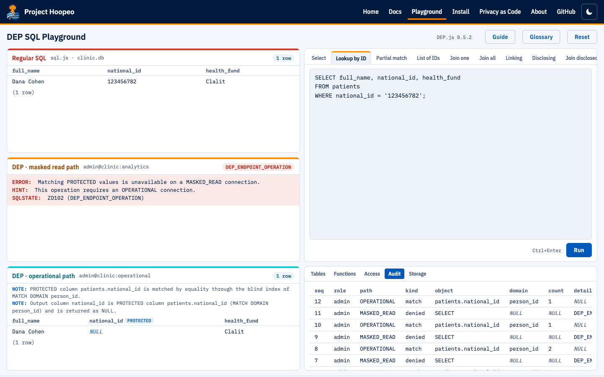
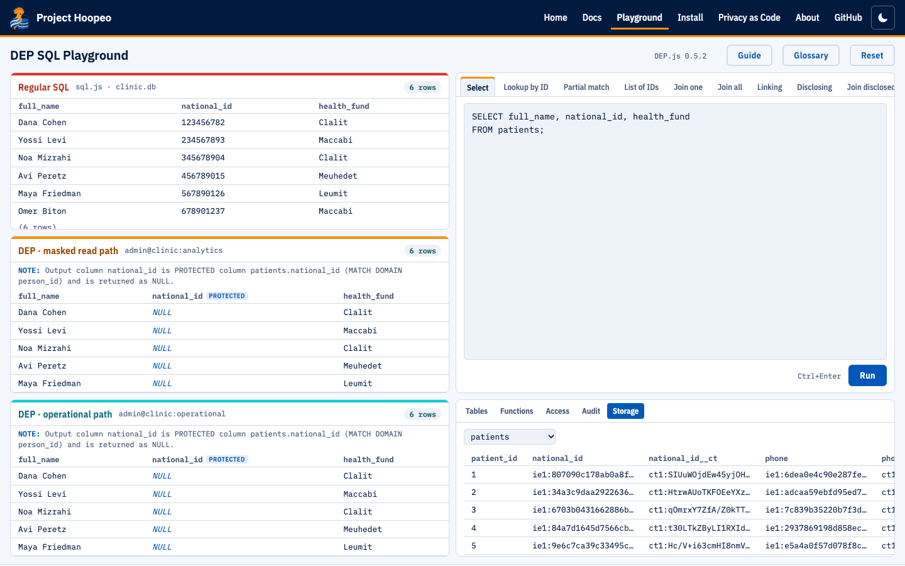
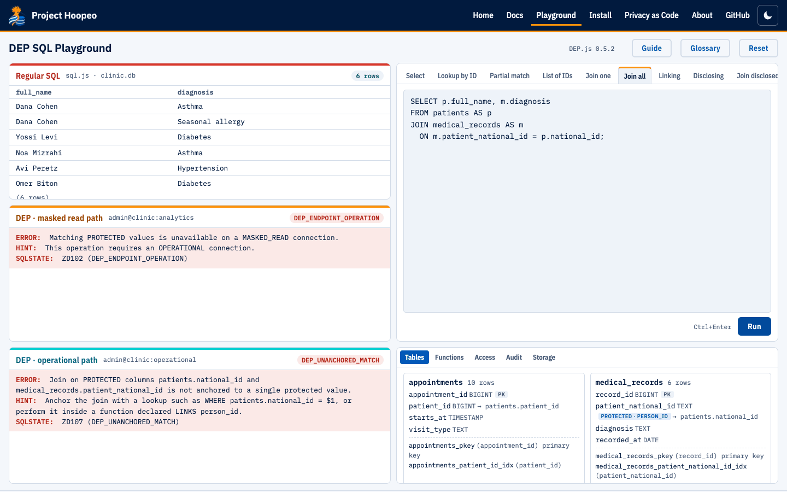
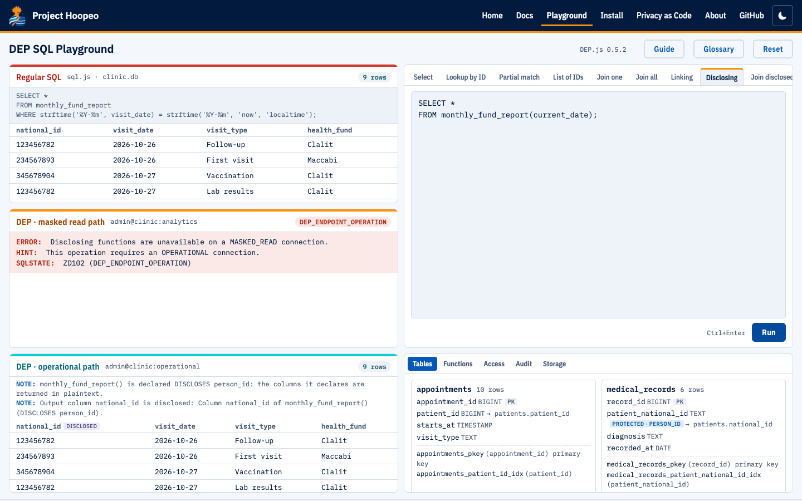
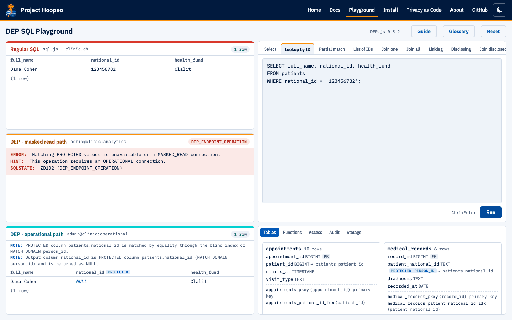

# Using the playground

Begin with the five-step guided tour. “Browse all examples” opens the complete example collection. Expand DEP notes to see why an operation was allowed or refused. [Known native differences](../../docs/book/06-server.md#known-difference-sorting-disclosed-values) are documented in chapter 6.

The DEP SQL Playground runs Database-Enforced Privacy (DEP) in your browser. New to DEP? Read [Understand DEP](../../docs/guides/overview.md) first. You write DEP SQL against a small clinic, and you see the same statement run three times, side by side: in a regular database, on DEP's masked read path, and on DEP's operational path. Nothing is installed and nothing is sent anywhere: the page runs entirely in your browser.

[Open the playground](../../playground/). The page is also available as a [single HTML file](../../playground/dep-sql-playground.html) that works offline.

> **A simulator.** The playground has no trust boundary, because everything runs in your browser, and its cryptography is a stand-in. It illustrates the rules and protects nothing. For real enforcement use DEP Engine, DEP CLI or Hoopeo Studio, which are distributed as binaries (see [Install](install.md)).

## The page

The hosted page has four areas: the guided tour, the editable SQL, three result panes, and the database views.

1. **Guided tour:** Find one → Read IDs → Join one → Join everyone → Disclose. Each step explains the task and expected difference.
2. **SQL editor:** edit the syntax-colored query, then press Run or Ctrl/⌘+Enter. Colors aid reading; the query text remains ordinary SQL.
3. **Results:** compare the same operation in the regular database and both DEP paths. Expand the DEP notes to understand a result or refusal.
4. **Schema and governance:** inspect Tables, Functions, Access, Audit and Storage below the results.

[Chapter 1: Understand DEP](../../docs/guides/read-examples.md) explains why reading all IDs returns NULL, while an unanchored protected join is refused.

**The three result panes.** Every statement you run appears in all three, with its DEP notes.

- **Regular SQL** is an ordinary SQLite database with the same clinic, where ID numbers and phone numbers are plain text. It shows what a regular database does with your statement. SQLite has no `CREATE FUNCTION`, so in this copy the declared functions are views, and the examples that call them run the equivalent query on the views and show it above the result. A few examples, such as the audit log and the privacy matrix, have no regular equivalent, and say so.
- **DEP masked read path** is a connection as `admin` through the `analytics` endpoint (`MASKED_READ`). Protected values come back as NULL, and matching them is refused.
- **DEP operational path** is a connection as `admin` through the `operational` endpoint (`OPERATIONAL`). Protected values can be matched one value at a time, and come back as NULL.

A pane shows when its connection is inside a transaction, or in a failed one.

**The editor and complete example collection.** Click **Browse all examples**, then choose from the dropdown. The five tour steps remain available. The editor can hold several statements; output and error text are not SQL commands.

| Example | What it shows |
|---|---|
| Select | A plain `SELECT` of the patients: the ID numbers are plain on the regular path and NULL on both DEP paths |
| Read IDs | A direct read of all identifiers: six values in regular SQL, six NULLs in DEP |
| Lookup by ID | A lookup by a protected value: matched through the blind index, returned as NULL |
| Partial match | `LIKE` on a protected column: refused with `ZD101` |
| List of IDs | `IN` with a list: a set of lookups |
| Join one, Join all | A join on protected columns, anchored to one value and not anchored |
| Linking | A function declared `LINKS`: statistics without matching |
| Disclosing | A function declared `DISCLOSES`: the one place ID numbers leave |
| Join disclosed | The terminal rule: a disclosed value cannot be joined |
| Update | A write on the operational path |
| Transaction | `BEGIN`, a savepoint, `ROLLBACK TO`, `ROLLBACK` |
| Constraints | Duplicate keys: an ordinary key is shown, a protected value is not |
| Indexes | `CREATE INDEX`, `EXPLAIN` and `SHOW INDEXES` |
| Roles | `SET ROLE`: reception may match `national_id` but not `phone` |
| Match limit | A role limited to two protected matches a minute |
| Audit | `SHOW AUDIT`: every protected match, without values |
| Who can match | `SHOW PRIVACY MATRIX` |
| Your code | Your own statements. They are kept in this browser's local storage, and nowhere else |

**Below the results: the schema**, as the operational connection sees it. **Tables** shows each table with its row count, keys and indexes. **Functions** lists the declared functions. **Access** shows roles, endpoints and grants. **Audit** is the audit log. **Storage** shows a table as the DEP server keeps it: index entries and ciphertexts, never the values.





The two DEP panes are two connections to one DEP server, so a transaction open in one is isolated from the other. **Reset** rebuilds both databases from the setup script and clears the panes. Your own code tab is kept.

## Notes and errors

Each DEP result carries its **DEP notes**, in the pane below the statement: one sentence for each rule that applied, such as "PROTECTED column patients.national_id is matched by equality through the blind index". Plain SQL gets none. A refused statement shows the specified DEP error: a message, a hint, and a SQLSTATE with a DEP code such as `ZD107` (`DEP_UNANCHORED_MATCH`). The [error reference](../../docs/reference/errors.md) lists them all.

Try this: run **Lookup by ID**, then **Join all**, then **Join disclosed**. The first is matched and returned as NULL, the second is refused because nothing anchors it to a single value, and the third is refused because a disclosed value can be returned and nothing else. [Concepts](../../docs/guides/concepts.md) explains why.





## What DEP.js is

DEP.js is the software behind the playground. It is a simulator of DEP Engine: a compiler and a server for DEP SQL, written in JavaScript, that runs the compiled statements on [sql.js](https://github.com/sql-js/sql.js) (SQLite compiled to WebAssembly). It targets DEP SQL rules, errors, DEP notes and audit records, with the implementation differences listed below. The source is open, under the Apache License 2.0.

The repository includes `compat.js`, a suite comparing statements on a running DEP Engine and DEP.js. Its earlier 280-statement parity result predates the disclosed-sort correction. The current simulator rejects disclosed sort keys in accordance with the specification; a project review reports that native 0.5.1 accepts them. Native 0.5.2 has not been retested here for this issue. Name, alias and ordinal cases are included in the compatibility suite. See the [known difference and examples](../../docs/guides/compatibility.md#known-difference-sorting-disclosed-values).

### Where DEP.js differs from DEP Engine

- `EXPLAIN` shows the SQLite statement DEP.js runs, then the engine's `Read:` lines. The engine shows DataFusion's plan there.
- A second writer fails at once with `55P03`, where the engine waits up to `--lock-timeout`.
- Readers in a transaction see the latest commit rather than a snapshot taken at `BEGIN`.
- Results come from SQLite: dates and times are text, and a few functions behave like SQLite's (division by zero gives NULL, for example).
- `current_date` and `now()` are in the browser's time zone. The engine uses UTC.
- `\connect role [endpoint]` opens a new connection inside a script. It is a simulator command, like `\c` in DEP CLI.
- The cryptography is a stand-in. There is no trust boundary in a browser.

## Using `depsql.js` as a library

`depsql.js` runs in a page or in Node. It needs sql.js. Download it from the [latest release](https://github.com/mandelreouven2002/project-hoopeo.github.io/releases/latest/download/depsql.js), or take `playground/depsql.js` from the repository.

```js
const SQL = await initSqlJs();                                  // sql.js
const server = new DepSQL.Server(SQL, { setup: clinicSql });    // a DEP server; clinicSql is a DEP SQL script
const conn = server.connect('reception_app', 'operational');    // role and endpoint
const [r] = conn.exec('SELECT full_name FROM patients WHERE national_id = $1', ['123456782']);
// r: { ok, kind: 'rows' | 'command', columns, rows, tag, notes, error: { message, code, sqlstate, hint }, session }
conn.exec('BEGIN; ...; COMMIT');
conn.close();                                                   // rolls back an open transaction
```

`new DepSQL.Server(SQL, { setup, matchLimit: '1000/minute' })` sets a default match limit for roles that are not superusers, as `--match-limit` does. `server.describe(conn)`, `server.storage(table, conn)` and `server.auditLog` return the catalog, the stored form of a table and the audit records. `DepSQL.parse(sql)` returns the syntax tree. In Node, `require('./depsql.js')` returns the same object.

The code and its tests are in the [`playground/` folder](https://github.com/mandelreouven2002/project-hoopeo.github.io/tree/main/playground) of the repository. `npm test` runs the playground's own tests, `npm run build` writes the page and the single file, and `npm run compat` runs the compatibility test against a DEP Engine server you run yourself.


<figure markdown="1">

<picture><source media="(prefers-color-scheme: dark)" srcset="../../docs/images/playground/playground-lookup-dark.png"></picture>

<figcaption>Compare a direct SQL result with NULL suppression on a DEP connection.</figcaption>
</figure>
