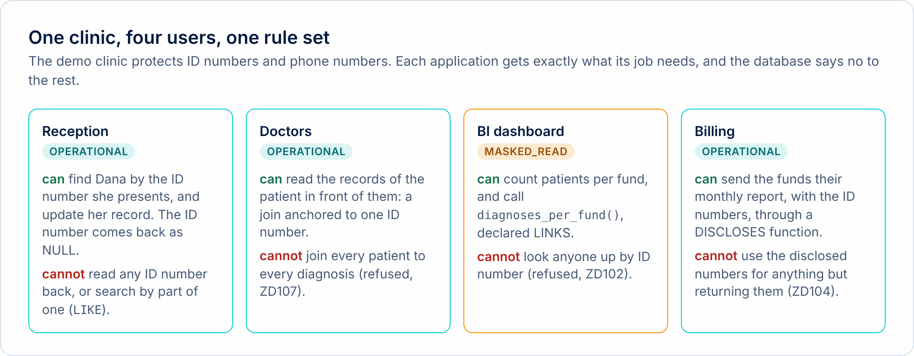

# Privacy as Code

A privacy decision is easier to apply when a system can read it, test it and enforce it. Privacy as Code means expressing those decisions in artifacts that teams can version and review, alongside the software that handles the data.

You do not need SQL knowledge for this introduction. [Chapter 7: Privacy as Code & GDPR](../../docs/book/07-privacy.md) develops the ideas, technical controls and limits in detail.

## A simple example: finding a patient

A receptionist needs to find the patient who presents an ID number. A dashboard needs statistics. A billing job sometimes needs to send an ID to an authorized recipient. These are three different tasks, and they need different permissions.

| Task | What the application needs | What DEP can make explicit |
|---|---|---|
| Reception | Find the matching record | Use the supplied ID for a lookup; return ordinary fields and NULL for the protected ID |
| Analytics | Read approved statistics | An analytics connection and, when needed, an approved linking function |
| Billing | Release an identifier for a defined job | A named disclosure function, granted to the billing role |

Hiding a number on a screen handles that screen. Database permissions, restricted views and stored procedures can also constrain access. DEP adds a language model that distinguishes using a protected value, linking records through it and releasing it.

<picture><source media="(prefers-color-scheme: dark)" srcset="../../docs/images/diagrams/roles-dark.png"></picture>

## From a decision to an enforced rule

1. **Describe the task.** Record who needs which operation and why.
2. **Express the decision.** Put protection, roles and approved exceptions in the schema and grants.
3. **Review and test.** Check that required work succeeds and unwanted uses fail.
4. **Enforce and inspect.** The server applies the implemented rules; its audit and metadata support review.

This is a way of engineering privacy decisions. A comment saying “billing” does not establish a lawful purpose, and a test passing does not prove that the decision itself was appropriate.

## How DEP applies the idea

DEP stands for Database-Enforced Privacy. Applications can use a protected identifier to find a record without receiving the stored identifier in ordinary query output. Broader protected linkage and plaintext disclosure need declared functions with explicit permissions.

<picture><source media="(prefers-color-scheme: dark)" srcset="../../docs/images/diagrams/statement-path-dark.png"></picture>

The database provides a point of enforcement shared by its connected clients. Other Privacy as Code tools may check application code, configurations or policy decisions; DEP can work alongside those controls.

## Where GDPR fits

Technical controls can support data minimisation, protection by design, security and accountability. GDPR also concerns the purpose and lawful basis of processing, people's rights and the organization's wider practices. DEP does not establish GDPR compliance, and protected identifiers do not make the rest of a record anonymous.

[Chapter 7](../../docs/book/07-privacy.md) explains the relationship and what remains outside the database. [Current capabilities and differences](../../docs/book/06-server.md#compatibility) describe the available implementation.

## Continue at your own pace

- **Understand the complete model:** [start the DEP guide](../../docs/book/01-understand.md).
- **Read the privacy discussion:** [chapter 7: Privacy as Code & GDPR](../../docs/book/07-privacy.md).
- **See one operation change:** [try the playground](../../playground/).
