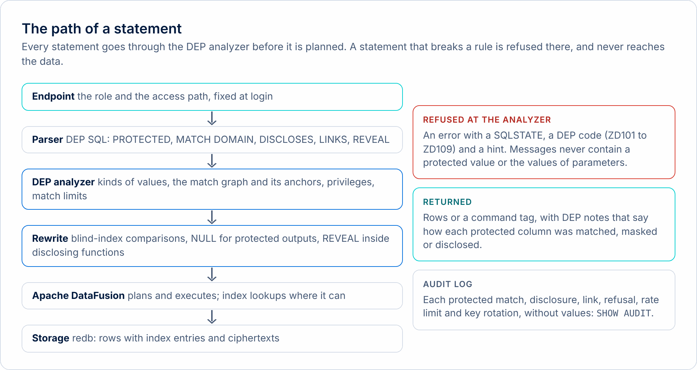
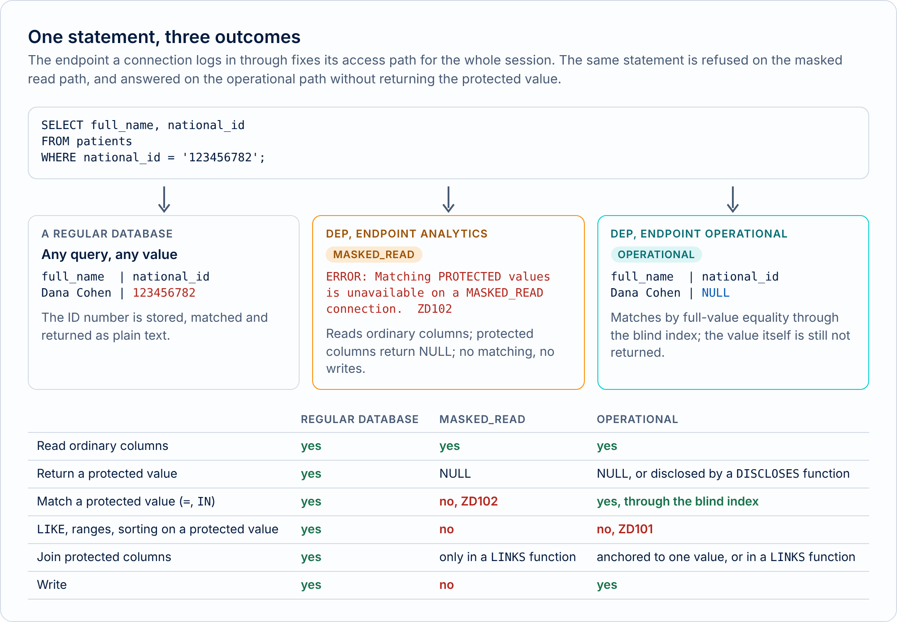
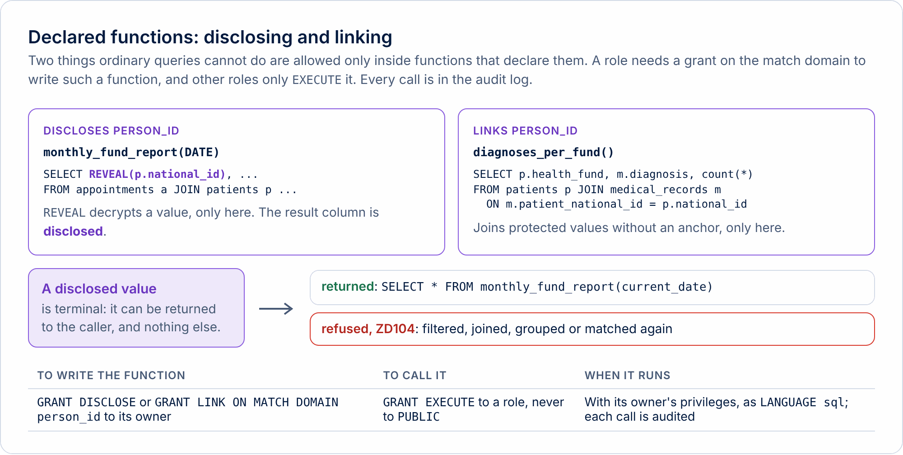

# DEP on Privacy as Code

Privacy as Code is the practice of writing privacy policy as an executable artifact: kept in a repository, reviewed like code, tested, and checked automatically. Database-Enforced Privacy (DEP) takes the idea one step further and asks where the policy is enforced. This page explains the problem DEP addresses, how its model works, what it maps to in privacy by design, and, plainly, what it does not protect against. DEP is an experimental concept. Nothing here is a claim of compliance with any regulation.

## 1. The problem

Most privacy rules in a software system are written in application code. A receptionist's screen shows a masked ID number. A reporting job filters out the fields a regulator does not need. A service layer checks the caller's role before it queries the table. Each rule is correct where it is written, and none of them is a rule of the database.

The database sees every query from every client, and in most systems it enforces none of the policy. The permission to use a value in a query and the permission to read it are the same permission: `SELECT` on a column lets a client filter by it, join on it, and return it. So a rule enforced in one service does not bind the next service. A new analyst, a new BI tool or a new AI agent connects to the same tables and starts from no rules at all. Privacy that lives in application code is enforced unevenly, and it is bypassed by every client that does not go through that code.

The tools usually called Privacy as Code work around this. A policy-evaluation step in continuous integration rejects a change whose declared data use breaks a policy. A code scanner finds where personal data flows. A policy engine answers authorization questions when an application asks. These make policy reviewable and testable, and they check code that someone wrote and submitted. They do not see the query an agent composes at run time, or an ad-hoc query an analyst types, because those never pass through the pipeline.

## 2. Privacy as code in the engine

DEP moves the enforcement to the one component every query passes through. The policy is part of the schema and of the query plan, so every client is bound by it, from its first statement.

<picture><source media="(prefers-color-scheme: dark)" srcset="../../docs/images/diagrams/statement-path-dark.png"></picture>

A column is declared protected, with a match domain that says what kind of value it holds:

```sql
CREATE TABLE patients (
    patient_id  BIGINT PRIMARY KEY,
    national_id TEXT PROTECTED MATCH DOMAIN person_id UNIQUE,
    full_name   TEXT
);
```

From then on the engine will use that column to find and connect records, and an ordinary query will never get its value back. The only exceptions are declared, named, reviewable, and listed in the catalog. They are objects in the schema, so they can be reviewed in a pull request, tested in a pipeline and queried from the database, which is where Privacy as Code and the engine meet. A privacy review no longer has to ask which services might read an ID number: the engine can list the places where an ID number can leave, and no other place exists.

This works alongside the tools above, and does not replace them. A data taxonomy can decide which columns should be protected. A pipeline can check that every declared function matches an approved decision. The engine gives those decisions a point of enforcement.

## 3. The model

DEP separates four decisions that most databases fold into a single privilege.

<picture><source media="(prefers-color-scheme: dark)" srcset="../../docs/images/diagrams/access-paths-dark.png"></picture>

<picture><source media="(prefers-color-scheme: dark)" srcset="../../docs/images/diagrams/declared-functions-dark.png"></picture>

| Decision | What it means | In DEP |
|---|---|---|
| Matching | Using a protected value to find records | Allowed one value at a time on the operational path, to a role granted the column |
| Linking | Connecting whole datasets through a protected value | Only inside a function declared `LINKS` |
| Returning | Sending a protected value to a client | Never done by an ordinary query: the value comes back as NULL |
| Disclosing | Releasing a protected value on purpose | Only inside a function declared `DISCLOSES`, the one place `REVEAL` is legal |

**Protected columns and match domains.** A protected value is stored as a blind index (a keyed hash, used for matching) and as a ciphertext (used for a later disclosure). A match domain names a kind of value. Values from different domains cannot be compared, even in storage, because each domain has its own key.

**Access paths fixed by the endpoint.** A connection logs in through an endpoint, and the endpoint decides what it may do with protected values. On the operational path an application finds and updates records. On the masked read path, a dashboard or an AI agent reads ordinary fields and cannot match, write or disclose at all. The path cannot change after login.

**Equality only.** The one operation on a protected value is full-value equality. Pattern matching, ordering, casts, substrings and functions are refused wherever they appear in a query, so a protected value cannot be probed through them.

**Anchoring as data minimization.** An application may match a value it was given: look a patient up, update her record, read her diagnoses. It may not connect every patient to every diagnosis. The first is an anchored match, tied to one value the client supplied. The second is linking, and it is refused unless a function was declared for it.

```text
doctors_app@operational=> SELECT p.full_name, m.diagnosis FROM patients AS p JOIN medical_records AS m ON m.patient_national_id = p.national_id;
ERROR:  Join on PROTECTED columns patients.national_id and medical_records.patient_national_id is not anchored to a single protected value.
HINT:  Anchor the join with a lookup such as WHERE patients.national_id = $1, or perform it inside a function declared LINKS person_id.
SQLSTATE:  ZD107 (DEP_UNANCHORED_MATCH)
```

**Declared functions as purpose limitation.** A function that releases a value, or links datasets, says so in its signature (`DISCLOSES person_id`, `LINKS person_id`), carries a recorded purpose, and can be executed only by the roles granted it, never by `PUBLIC`. The privilege to declare one is granted per match domain. The function runs with its owner's privileges, so the owner's rights are part of the review.

**The privacy matrix.** Who may match, disclose or link what is not a separate document that can drift. `SHOW PRIVACY MATRIX` computes it from the grants and the declared functions, one row for every protected column and role.

**Disclosed values and the terminal rule.** A value released by `REVEAL` can be returned and nothing else. It cannot filter, join, group or be stored, so a disclosure cannot become a new key for linking inside the database.

**The audit log as accountability.** Every protected match, every call of a declared function, every refused statement and every rate-limited statement is recorded, with the role that made it. A match limit per role keeps one-value-at-a-time lookups from becoming every value in an afternoon. The log never holds a value or the text of a statement.

## 4. How it maps to privacy by design

Privacy by design asks that privacy be built into a system from the start. Four of its commonly cited principles correspond to something a database can enforce.

- **Data minimization.** Ordinary queries never return protected values, and a role holds only the columns, endpoint and functions it needs. Matching is tied to one value at a time.
- **Purpose limitation.** Each release or linkage of data is a named function with a recorded purpose and an explicit list of the roles that may execute it.
- **Privacy as the default.** A protected column is suppressed unless a declared function says otherwise. A role can connect only through the endpoints it was granted, so a consumer has the masked read path unless someone grants it the operational one, and a declared function is never executable by `PUBLIC`.
- **Accountability.** The catalog lists every disclosure and linkage, and the audit log attributes every protected match to a role.

DEP is a technical measure inside the database. It says nothing about the lawful basis for processing, consent, notice, what is collected, how long it is kept, impact assessments or transfers. The mappings above describe technical contributions, not compliance with the GDPR or any other regulation, and any mapping to a legal duty should be checked by privacy counsel. The full discussion is in [chapter 3 of the design proposal](../../docs/design/01-dep-concept.md#3-privacy-as-code-privacy-by-design-and-the-gdpr).

## 5. What DEP does not protect against

DEP is an experimental concept that demonstrates the model and the trust boundary. It is not a production database. These limits come from the design proposal and the roadmap, and they apply to the implementation too.

- **Permitted matching still reveals information.** A successful lookup confirms that a record with that value exists, and a join associates it with the data that is returned. A returned name can identify a person, however well the ID number is hidden.
- **Low-entropy identifiers can be enumerated.** A client that may look up values without limit can test every one. A match limit and the audit log bound and attribute this. They do not remove it.
- **Declared functions are trusted code.** DEP guarantees that every opening is declared and listed. It does not guarantee that the declared purpose is legitimate, or that the recipient will use the data properly.
- **Released values are beyond DEP's reach.** Once a value reaches a client, DEP cannot control its use.
- **Ordinary fields and ordinary keys are not protected.** Names, dates and ordinary keys can identify people, and datasets joined through an ordinary key are governed by ordinary permissions alone.
- **Aggregates are not automatically anonymous.** Small groups and combinations of attributes can identify people.
- **The server and its administrator are trusted.** DEP does not defend against a compromised operating system or an administrator who can read the server's memory.
- **Side channels are not addressed.** Differences in timing between lookups that match and lookups that do not are out of scope, and a constraint violation on a protected column reveals whether a value exists.
- **It is a demonstration.** DEP Engine shows that the model can be built. It is experimental software, part of a conceptual project; see the [terms of use](legal/terms.md).

The [design proposal](../../docs/design/01-dep-concept.md#18-guarantees-and-limits) states the guarantees precisely, under stated assumptions, and lists the known limitations of this version. The [roadmap](../../docs/design/02-roadmap-and-release.md) compares DEP with existing approaches, and says which ideas DEP borrows from them.

## 6. Try it

- Run the rules in your browser with the [playground](../../playground/), and read the [playground guide](playground-guide.md).
- [Install](install.md) DEP Engine, DEP CLI or Hoopeo Studio, and work through the [getting started guide](../../docs/guides/getting-started.md).
- Read the [concepts guide](../../docs/guides/concepts.md) for the vocabulary, and the [DEP SQL guide](../../docs/guides/dep-sql.md) for the rules and their errors.
